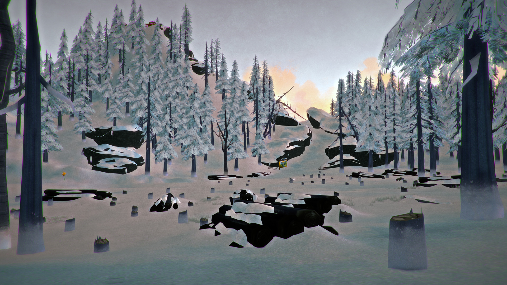
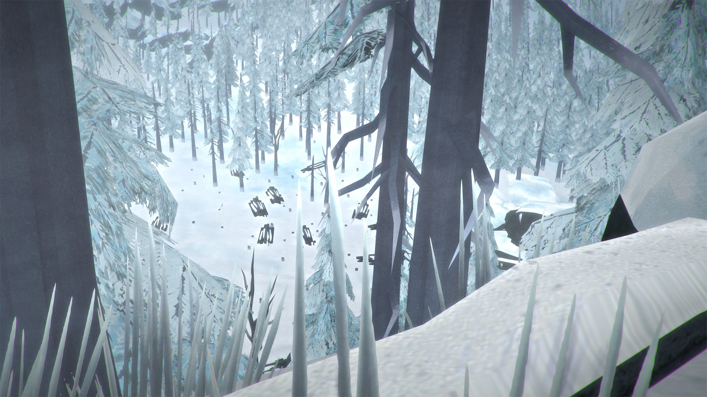

# Clearcut

**Categories:** Locations, Locations in Mystery Lake, Outdoor locations · **Source:** [Fandom](https://thelongdark.fandom.com/wiki/Clearcut)

**Clearcut**

[Clearcut 01](../assets/Clearcut_01.jpg)

**Location**

[Clearcut Location](../assets/Clearcut_Location.png)

**Region:** [Mystery Lake](./Mystery%20Lake%20%28region%29.md)

**Description:** A clear cut logging area.

**General**

**Type:** Outdoors

<!-- #Overview -->
​

<!-- #overview -->
## Overview

Caution is advised when approaching Clearcut as [wolves](./Wolf.md) and [bears](./Bear.md) frequently roam the area. A measly amount of loot can be scavenged from several [frozen corpses](./Frozen%20Corpse.md) scattered around the area.

A large sign leads to an narrow, winding road that leads to the [Destroyed Lookout](./Destroyed%20Lookout.md). A road east has a sign with a truck hauling wood leads to the [Logging Camp](./Logging%20Camp.md). A small path north leads to an area called the [Lookout](./Lookout%20%28Mystery%20Lake%20location%29.md), not to be be confused with the [Forestry Lookout](./Forestry%20Lookout.md) or Destroyed Lookout.

<!-- #Gallery -->
​

<!-- #gallery -->
## Gallery

_A view of Clearcut from the nearby [Destroyed Lookout](./Destroyed%20Lookout.md)._

[ru:Лесосека](https://ru.wikipedia.org/wiki/%D0%9B%D0%B5%D1%81%D0%BE%D1%81%D0%B5%D0%BA%D0%B0)
