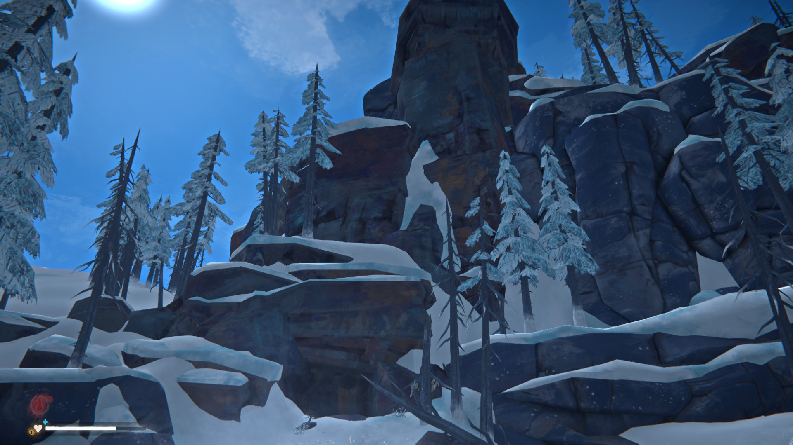

# Climber's Cave

**Climber's Cave**

| Property | Details |
| --- | --- |
|  |  / *20201212011633\_1.jpg* |
| **Location** |  |
|  |  / *Climber's\_Cave\_Location.png* |
| Region | [Ash Canyon](./Ash%20Canyon.md)\|- |
| Type | Cave\|- |
