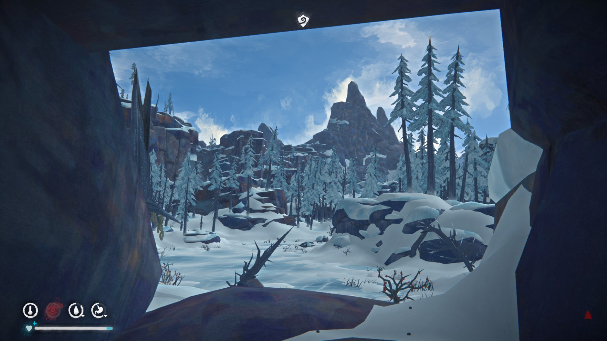
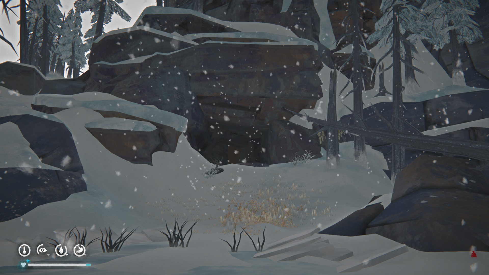
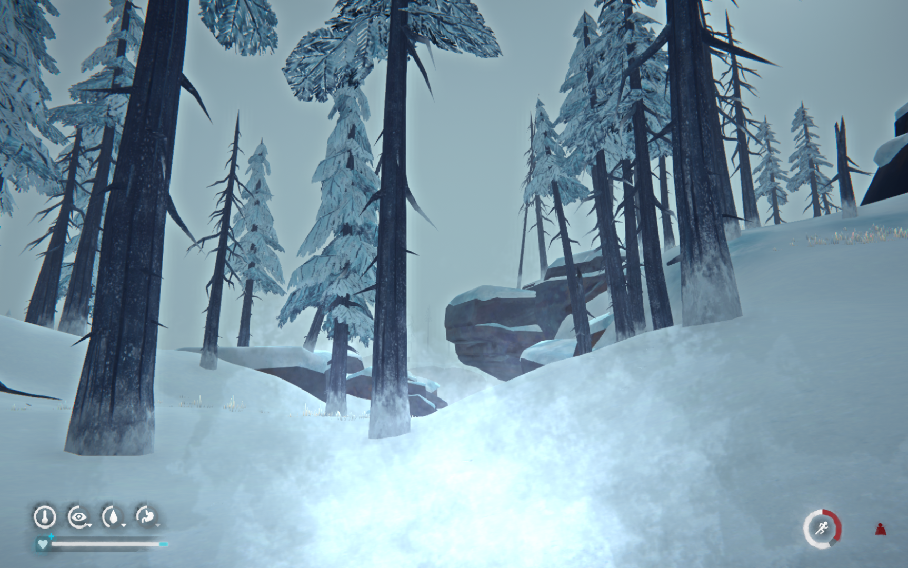

# Climber's Cave

**Categories:** Caves, Locations, Locations in Ash Canyon, Sheltered locations · **Source:** [Fandom](https://thelongdark.fandom.com/wiki/Climber's_Cave)

**Contents**

- [Overview](#overview)
- [Use as a base](#use-as-a-base)
- [Loot](#loot)
- [Nearby unnamed locations](#nearby-unnamed-locations)
- [Rope and bridge above the Shattered Cove](#rope-and-bridge-above-the-shattered-cove)
- [Hidden cache and Minor Loot](#hidden-cache-and-minor-loot)
- [Gallery](#gallery)

**Climber's Cave**

[20201212011633 1](../assets/20201212011633_1.jpg)

**Location**

[Climber's Cave Location](../assets/Climber%27s_Cave_Location.png)

**Region:** [Ash Canyon](./Ash%20Canyon.md)

**Type:** Cave

## Overview

Providing a decent warmth bonus, this cave is perfect to overnight in while wandering in the highlands. The lake in front of the cave is often frequented by [rabbits](./Rabbit.md) and a possible [Moose](./Moose.md) spawn, making this place a good spot to rest in the central area in the region.

### Use as a base

Although Climber's Cave is safe from hostile fauna and will not cause [cabin fever](./Cabin%20Fever.md), its usefulness as a long-term base is severely limited by the lack of any food source other than rabbits and [cattails](./Cat%20Tail.md) in the nearby area. Additionally, the cave can become very cold during early-morning blizzards, which may necessitate a fire to stay warm. Overall, Climber's Cave is more suited for short-term stays than long-term living.

## Loot

Climbers cave usually contains a high grade piece of clothing, for example [Snow Pants](./Snow%20Pants.md), and some food in form of cooked [Venison](./Venison%20%28Cooked%29.md) and a cup of [Herbal Tea](./Herbal%20Tea.md). It also contains randomized loot from a backpack, firewood and charcoal inside the burnt out campfire.

## Nearby unnamed locations

### Rope and bridge above the [Shattered Cove](./Shattered%20Cove.md)

Going towards the right edge of the mountain, atop witch the cave is located (east, direction of Bitter Marsh), the survivor can find a medium size climbing rope going down, underneath which there is a small cave (left when looking at the bottom of the rope), inside which is possibly 10 [Revolver Ammunition](./Revolver%20Ammunition.md) and on a short ledge behind a pair of [Cargo Pants](./Cargo%20Pants.md) and a hunting knife hidden in a nook of the cliff, not far from the rope bridge over Shattered Cove.

This location is however best reached by dropping a one way slope from the same side of the mountain, but slightly above the [Climber's Cave](./Climber%27s%20Cave.md), the route is visible on the wiki map of [Ash Canyon](./Ash%20Canyon.md), as this will save you one trip of the rope, as well as allowing you to reach a shallow cave at the far bottom of the map, possibly containing another 10 rounds of [Revolver Ammunition](./Revolver%20Ammunition.md). The beginning of this route is beneath a large overhang rock pass, visible on the right when standing above the [Climber's Cave](./Climber%27s%20Cave.md). There is a [Cooking Pot](./Cooking%20Pot.md) and a pair of [Ski Boots](./Ski%20Boots.md) buried in the snow under the overhang.

### Hidden cache and Minor Loot

When climbing up the hill forming the back side of the [Climber's Cave](./Climber%27s%20Cave.md), the survivor will eventually arrive at a fallen tree forming a bridge before crossing a "hidden" cache can be found in the nook of the cliff,

Continuing across the fallen tree bridge (going East in the direction of Pillar Footrest), climb the slope to your right, then turn left and walk towards the outcropping in that direction, you will find a small nook with several items, usually including a small amount of ammo and food.

(In the past, a broken rifle could be discovered in the place of the minor loot, it was not harvestable, but around it partially buried in the snow were ~8 [Revolver Shell Casings](./Revolver%20Shell%20Casing.md) a [Can of Gunpowder](./Can%20of%20Gunpowder.md), [Stump Remover](./Stump%20Remover.md) and an [Improvised Knife](./Improvised%20Knife.md).)

From there the cave transition to Timberwolf Mountain, the West access, is not far.

## Gallery

_Overhang rock pass, begining of a scavenge route tovards the bridge above [Shattered Cove](./Shattered%20Cove.md)_
