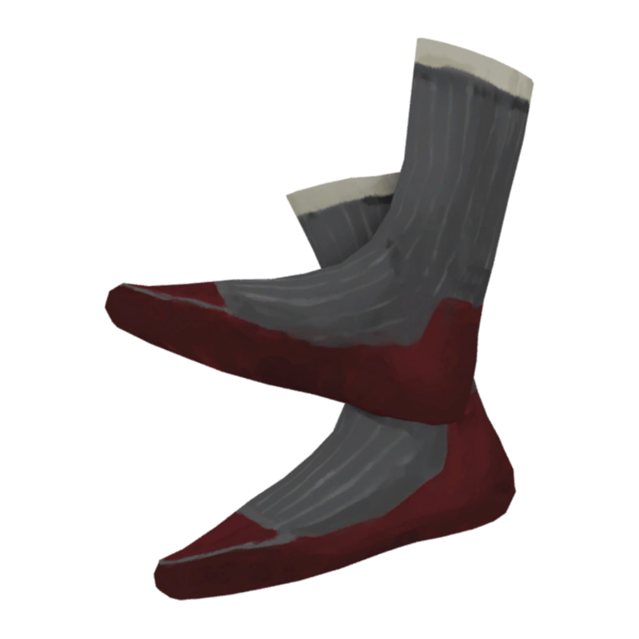
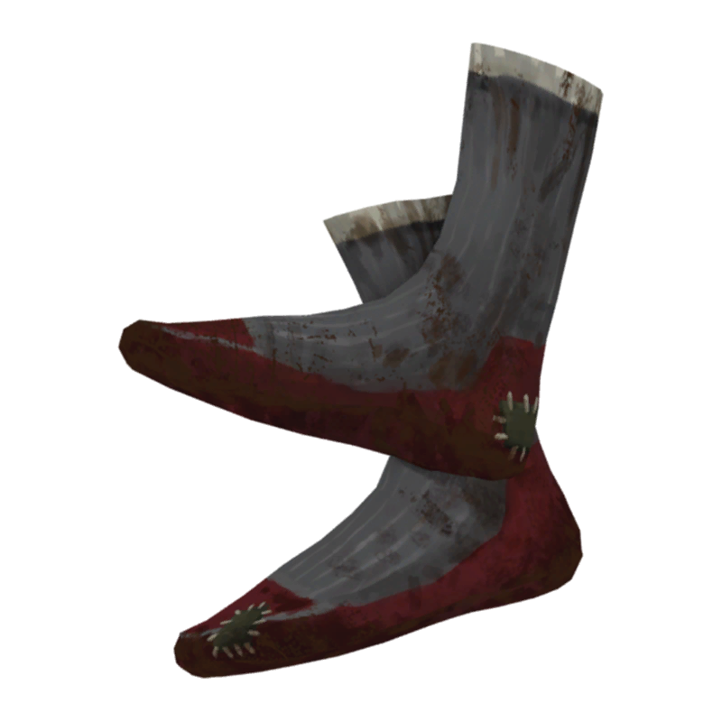

# Climbing Socks

**Categories:** Clothing, Pages with update history · **Source:** [Fandom](https://thelongdark.fandom.com/wiki/Climbing_Socks)

**Climbing Socks**

| Property | Details |
| --- | --- |
|  | [Climbing Socks icon](../assets/Climbing_Socks_icon.png) |
| **General** |  |
| Item Type | Clothing\|- |
| Renewable | Yes |
| Clothing Slot | Inner feet |
| **Statistics** |  |
| Weight | [Weight icon](../assets/Weight_icon.png)0.25 kg(0.55 lbs) |
| Warmth bonus | [Temp icon](../assets/Temp_icon.png)1.0 °C(1.8 °F) |
| Windproof bonus | [Windproofness icon](../assets/Windproofness_icon.png)0.5 °C(0.9 °F) |
| Waterproof bonus | [Waterproofness icon](../assets/Waterproofness_icon.png)25% |
| Protection | [Protection icon](../assets/Protection_icon.png)0% |
| Mobility | [Mobility icon](../assets/Mobility_icon.png)0% |
| Harvest | 1 × [Cloth](./Cloth.md) / 20 minutes |
| Repair | 1 × [Cloth](./Cloth.md) / 45 minutes / 55% condition |

> “**Reinforced, expedition quality wool socks.**”
>
> — In-game description

**Climbing Socks** are a type of Clothing in _The Long Dark_.

## Overview

Climbing Socks are the warmest socks, and also have the slowest decay rate of all socks (requiring them to be repaired less often).

## Update history

- UPDATE **19 December 2016 ([Update](./The%20Long%20Dark%20%E2%80%94%20Early%20Access%20Changelog.md#0.386)):**
  - Added to game
