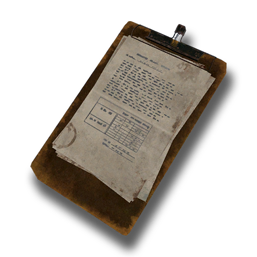

# Clipboard With Medical Documents

**Categories:** Collectibles, Pages with update history · **Source:** [Fandom](https://thelongdark.fandom.com/wiki/Clipboard_With_Medical_Documents)

**Clipboard With Medical Documents**

_Clipboard\_With\_Medical\_Documents\_icon.png_

**Release:** [31 March 2026](./The%20Long%20Dark%20%E2%80%94%20Changelog.md#2.52)

**Wintermute:** [Episode 5: The Light At The End Of All Things](./Episode%205%20-%20The%20Light%20At%20The%20End%20Of%20All%20Things.md)

**Properties**

**Item type:** [Collectibles](./Collectibles.md)

**Stackable:** No

**Examine:** A bunch of brain scans and notes

**Values**

**Weight:** 0.00 kg (0 lbs)

**Actions**

**Backpack:** Examine

**On ground:** Take It, Read Text, Leave It

**Clipboard With Medical Documents** is a [Collectibles](./Collectibles.md) found in [Episode 5](./Episode%205%20-%20The%20Light%20At%20The%20End%20Of%20All%20Things.md) of the [Wintermute](./Wintermute.md) story. It is found inside Dr Larsen's Clinic during the main mission [Perseverance](./Perseverance.md). It is found inside the top left [File Cabinet](./File%20Cabinet.md) drawer, across from the door to the Morgue.

## Transcript

_The following text is transcribed from **Clipboard With Medical Documents**_

**Brain scans received for patients Jacob D., Claudia R., Freya W., Ben T.

The results are consistent with early signs of dementia. Which can be expected in elderly patients. What I don't understand is how you find the exact same symptoms in children. It cannot be dementia. not this sudden, and with several cases in town appearing just months apart. A virus having similar effects? Contaminated water perhaps?

Whatever this is, it seems to be affecting weaker, fragile people. For now, at least.

My diagnostic tools remain inadequate for this strange malady.**

## Update history

\* UPDATE **31 March 2026 ([Update](./The%20Long%20Dark%20%E2%80%94%20Changelog.md#2.52)):**

- 
  - Added to game.
