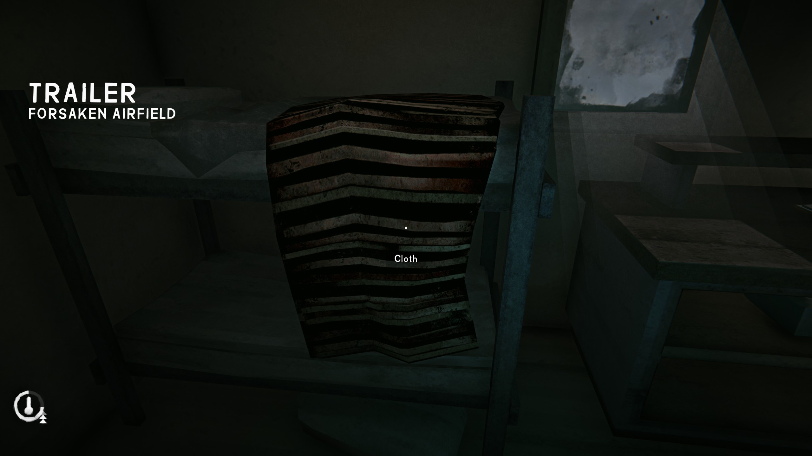
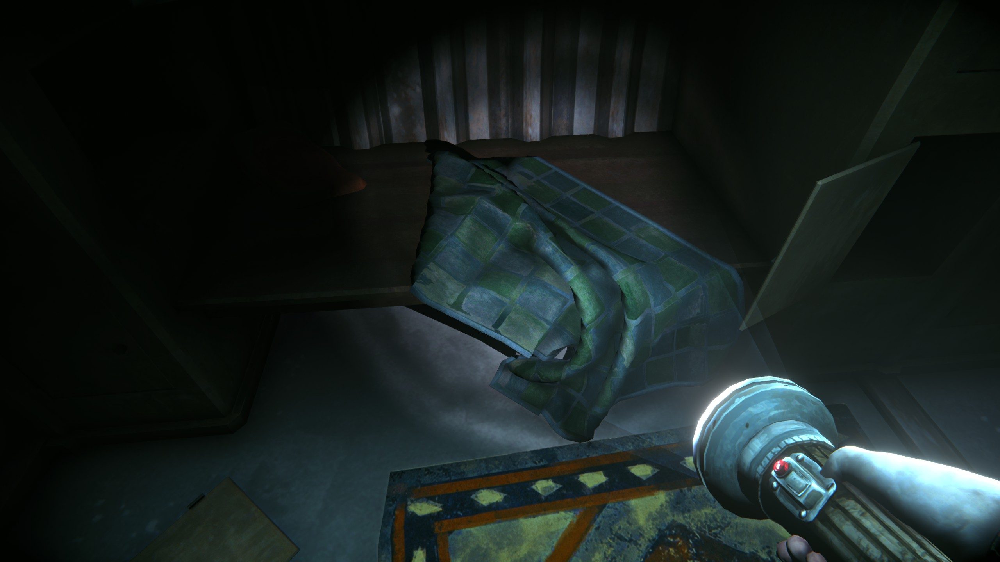
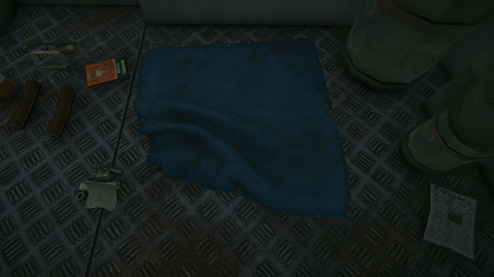

# Cloth \(Object\)

**Categories:** Interactable Objects, Story items · **Source:** [Fandom](https://thelongdark.fandom.com/wiki/Cloth_%28Object%29)

**Contents**

- [Blanket](#blanket)
- [Scarf](#scarf)
- [Bedsheet](#bedsheet)
- [Tarp](#tarp)
- [Small Tarp](#small-tarp)
- [Large Tarp](#large-tarp)

**Cloth (Object)**

\[\[File: /  / _Blanket_ /  / _Scarf_ /  / _Bedsheet_ /  / _Tarp_

250px\]\]

_Blanket_

_Scarf_

_Bedsheet_

_Tarp_

**General**

**Item Type:** Item

Cloth

Time

Calories

Condition of Tool

3

15 minutes

-0% by Hand

3

9 minutes

-2% Hunting Knife

**3:** -3% Improvised Knife

Cloth

Time

Calories

Condition of Tool

1

6 minutes

18

-0% by Hand

1

4 minutes

11

-2% Hunting Knife

1

4 minutes

14

-3% Improvised Knife

Cloth

Time

Calories

Condition of Tool

5

30 minutes

90

-0% by Hand

5

18 minutes

54

-2% Hunting Knife

5

22 minutes

68

-3% Improvised Knife

Cloth

Time

Calories

Condition of Tool

4

24 minutes

72

-0% by Hand

4

14 minutes

43

-2% Hunting Knife

4

18 minutes

54

-3% Improvised Knife

Cloth

Time

Calories

Condition of Tool

5

30 minutes

90

-0% by Hand

5

18 minutes

54

-2% Hunting Knife

5

22 minutes

68

-3% Improvised Knife
