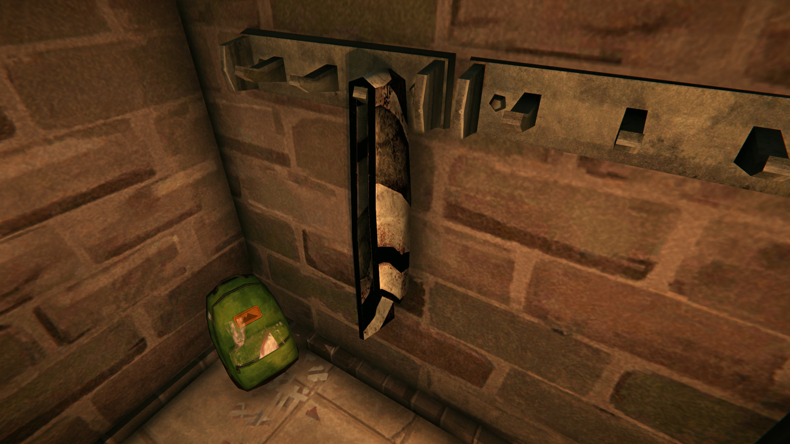

# Cloth \(Object\)

**Categories:** Interactable Objects, Story items · **Source:** [Fandom](https://thelongdark.fandom.com/wiki/Cloth_%28Object%29)

**Contents**

- [Blanket](#blanket)
- [Scarf](#scarf)
- [Bedsheet](#bedsheet)
- [Tarp](#tarp)
- [Small Tarp](#small-tarp)
- [Large Tarp](#large-tarp)

**Cloth (Object)**

\[\[File: /  / _Blanket_ /  / _Scarf_ /  / _Bedsheet_ /  / _Tarp_

250px\]\]

**General**

**Item Type:** Item

**Wintermute:** Yes **Cloth (Object)** are harvestable interactable objects mainly found inside homes and beds. They come in varying sizes but can be harvested by hand or with a [Hunting Knife](./Hunting%20Knife.md) to obtain [Cloth](./Cloth.md).

## Blanket

Found near many beds and couches inside homes and cabins.

| Cloth | Time | Calories | Condition of Tool |
| --- | --- | --- | --- |
| 3 | 15 minutes |  | -0% by Hand |
| 3 | 9 minutes |  | -2% Hunting Knife |
| 3 |  |  | -3% Improvised Knife |

## Scarf

Found hanging on coat racks inside homes.

| Cloth | Time | Calories | Condition of Tool |
| --- | --- | --- | --- |
| 1 | 6 minutes | 18 | -0% by Hand |
| 1 | 4 minutes | 11 | -2% Hunting Knife |
| 1 | 4 minutes | 14 | -3% Improvised Knife |

## Bedsheet

Found in bunkers and the Far Territory regions.

| Cloth | Time | Calories | Condition of Tool |
| --- | --- | --- | --- |
| 5 | 30 minutes | 90 | -0% by Hand |
| 5 | 18 minutes | 54 | -2% Hunting Knife |
| 5 | 22 minutes | 68 | -3% Improvised Knife |

## Tarp

Found in [Signal Void](./Signal%20Void.md) Bunkers, [Prepper Caches](./Prepper%20Cache.md) and the Far Territory regions ([Forsaken Airfield](./Forsaken%20Airfield.md), [Zone of Contamination](./Zone%20of%20Contamination.md)).

### Small Tarp

| Cloth | Time | Calories | Condition of Tool |
| --- | --- | --- | --- |
| 4 | 24 minutes | 72 | -0% by Hand |
| 4 | 14 minutes | 43 | -2% Hunting Knife |
| 4 | 18 minutes | 54 | -3% Improvised Knife |

### Large Tarp

| Cloth | Time | Calories | Condition of Tool |
| --- | --- | --- | --- |
| 5 | 30 minutes | 90 | -0% by Hand |
| 5 | 18 minutes | 54 | -2% Hunting Knife |
| 5 | 22 minutes | 68 | -3% Improvised Knife |
