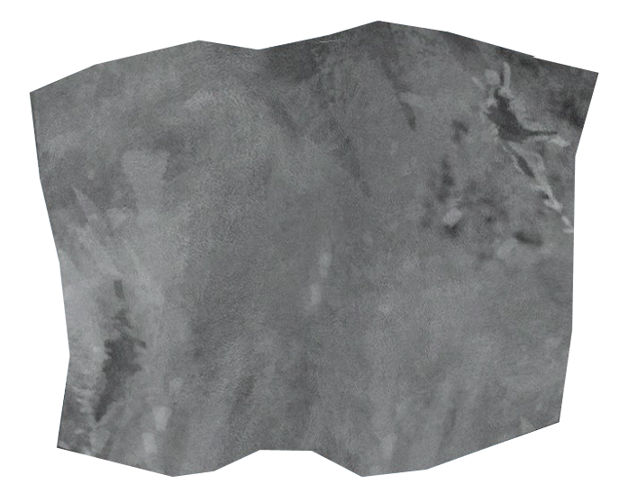

# Cloth

**Categories:** Materials · **Source:** [Fandom](https://thelongdark.fandom.com/wiki/Cloth)

**Cloth**

[Cloth icon](../assets/Cloth_icon.png)

**General**

**Item Type:** Material

**Renewable:** Yes ([Beachcombing](./Beachcombing.md))

**Statistics**

**Weight:** [Weight icon](../assets/Weight_icon.png)0.10 kg(0.22 lbs)

> “**Cloth used for crafting and repair, as well as for creating bandages.**”
>
> — In-game description

**Cloth** is a material in _[The Long Dark](./The%20Long%20Dark.md)_.

## General Information

It can be used to repair [Clothing](./Clothing.md) in conjunction with a [Sewing Kit](./Sewing%20Kit.md) and can also be harvested for [Bandages](./Bandage.md). Cloth is also needed for crafting a [Torch](./Torch.md), [Bear Skin Bedroll](./Bear%20Skin%20Bedroll.md), [Improvised Knife](./Improvised%20Knife.md), and [Improvised Hatchet](./Improvised%20Hatchet.md). Cloth can be acquired by finding it on the ground, harvesting Clothing or environmental objects ([Cloth (Object)](./Cloth%20%28Object%29.md), [Old Bedrolls](./Old%20Bedroll.md), [Pillows](./Pillow.md), [Curtains](./Curtain.md), [Towels](./Towel.md)) or as a by-product of breaking down certain furniture, like comfy chairs or couches.

## Products

| Item | Skills | Materials |
| --- | --- | --- |
| [Bandage](./Bandage.md) | None | - 1 × [Cloth](./Cloth.md) |
| [Bear Skin Bedroll](./Bear%20Skin%20Bedroll.md) | None | - 2 × [Cured Black Bear Hide](./Cured%20Black%20Bear%20Hide.md) - 5 × [Cloth](./Cloth.md) - 6 × [Cured Gut](./Cured%20Gut.md) |
| [Fishing Tip-Up](./Fishing%20Tip-Up.md) | None | - 2 × [Stick](./Stick.md) - 1 × [Cloth](./Cloth.md) - 1 × [Scrap Metal](./Scrap%20Metal.md) - 1 × [Fishing Tackle](./Fishing%20Tackle.md) |
| [Improvised Down Bedroll](./Improvised%20Down%20Bedroll.md) | None | - 1 × [Bedroll](./Bedroll.md) - 3 × [Cloth](./Cloth.md) - 10 × [Ptarmigan Down](./Ptarmigan%20Down.md) |
| [Improvised Hand Wraps](./Improvised%20Hand%20Wraps.md) | None | - 4 × [Cloth](./Cloth.md) |
| [Improvised Hatchet](./Improvised%20Hatchet.md) | None | - 5 × [Scrap Metal](./Scrap%20Metal.md) - 1 × [Cloth](./Cloth.md) |
| [Improvised Head Wrap](./Improvised%20Head%20Wrap.md) | None | - 2 × [Cloth](./Cloth.md) |
| [Improvised Insulation](./Improvised%20Insulation.md) | None | - 4 × [Cloth](./Cloth.md) - 5 × [Ptarmigan Down](./Ptarmigan%20Down.md) |
| [Improvised Knife](./Improvised%20Knife.md) | None | - 3 × [Scrap Metal](./Scrap%20Metal.md) - 1 × [Cloth](./Cloth.md) |
| [Noisemaker](./Noisemaker.md) | None | - 1 × [Recycled Can](./Recycled%20Can.md) - 1 × [Cloth](./Cloth.md) - 0.10 kg × [Can of Gunpowder](./Can%20of%20Gunpowder.md) |
| [Quilted Bed](./Quilted%20Bed.md) | None | - 12 × [Fir Firewood](./Fir%20Firewood.md) - 10 × [Cloth](./Cloth.md) - 6 × [Cured Gut](./Cured%20Gut.md) - 16 × [Ptarmigan Down](./Ptarmigan%20Down.md) |
| [Rustic Bed](./Rustic%20Bed.md) | None | - 10 × [Cedar Firewood](./Cedar%20Firewood.md) - 12 × [Cloth](./Cloth.md) - 2 × [Cured Gut](./Cured%20Gut.md) |
| [Snow Shelter](./Snow%20Shelter.md) | None | - 15 × [Stick](./Stick.md) - 5 × [Cloth](./Cloth.md) |
| [Torch](./Torch.md) | None | - 3 × [Stick](./Stick.md) - 1 × [Cloth](./Cloth.md) - 0.10 L × [Lantern Fuel](./Lantern%20Fuel.md) |

## Gallery

