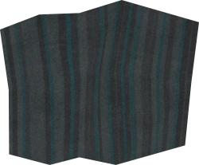

# Cloth

**Cloth**

| Property | Details |
| --- | --- |
|  |  / *cloth\_icon.png* |
| **General** |  |
| Item Type | Material\|- |
| Renewable | Yes ([Beachcombing](./Beachcombing.md)) |
| **Statistics** |  |
| Weight | 0.10 kg(0.22 lbs) |

> “**Cloth used for crafting and repair, as well as for creating bandages.**”
>
> — In-game description

**Cloth** is a material in *[The Long Dark](./The%20Long%20Dark.md)*.

## General Information

It can be used to repair [Clothing](./Clothing.md) in conjunction with a [Sewing Kit](./Sewing%20Kit.md) and can also be harvested for [Bandages](./Bandage.md). Cloth is also needed for crafting a [Torch](./Torch.md), [Bear Skin Bedroll](./Bear%20Skin%20Bedroll.md), [Improvised Knife](./Improvised%20Knife.md), and [Improvised Hatchet](./Improvised%20Hatchet.md). Cloth can be acquired by finding it on the ground, harvesting Clothing or environmental objects ([Cloth (Object)](./Cloth%20%28Object%29.md), [Old Bedrolls](./Old%20Bedroll.md), [Pillows](./Pillow.md), [Curtains](./Curtain.md), [Towels](./Towel.md)) or as a by-product of breaking down certain furniture, like comfy chairs or couches.

## Products

## Gallery

| Column 1 | Column 2 |
| --- | --- |
|  / *3D model* |  / *Old model* |

**Lua execution error in Module:Navbox function navbox** [es:Retal](es:Retal) [ru:Ткань](ru:%D0%A2%D0%BA%D0%B0%D0%BD%D1%8C)
