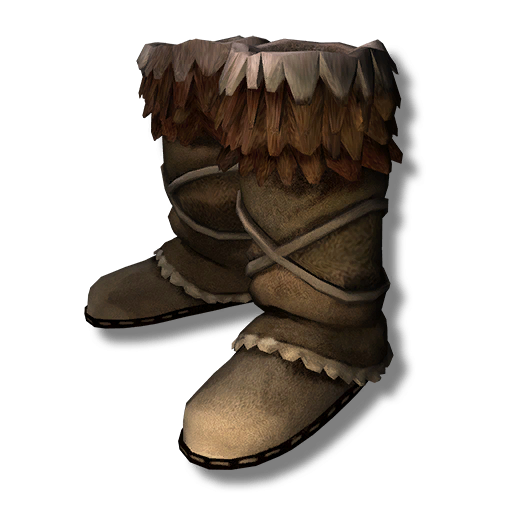
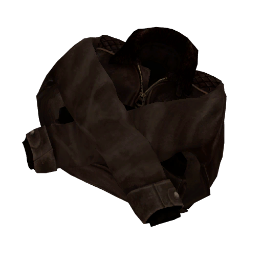
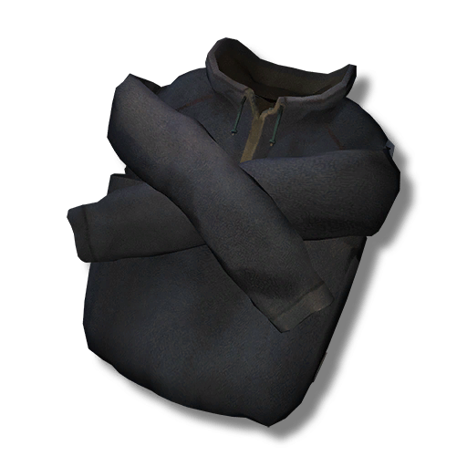
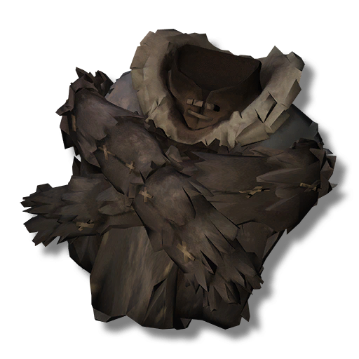

# Clothing

**Contents**

- [Obtaining clothing](#Obtaining_clothing)
- [Clothing attributes](#Clothing_attributes)
- [Warmth](#Warmth)
- [Windproof](#Windproof)
- [Waterproof](#Waterproof)
- [Protection](#Protection)
- [Mobility](#Mobility)
- [Condition](#Condition)
- [Weight](#Weight)
- [Layering](#Layering)
- [Clothing by slot](#Clothing_by_slot)
- [Head](#Head)
- [Torso](#Torso)
- [Outer](#Outer)
- [Inner](#Inner)
- [Hands](#Hands)
- [Legs](#Legs)
- [Outer](#Outer_2)
- [Inner](#Inner_2)
- [Feet](#Feet)
- [Inner](#Inner_3)
- [Outer](#Outer_3)
- [Accessories](#Accessories)
- [Cut Clothing](#Cut_Clothing)

<figure>
[Missing image: clothing_hud2.jpg]
<figcaption>XTHUMB The clothing hud old</figcaption>
</figure>

  
"*Out in the wilderness, clothing is like armour against the elements. Wear layers to stay warm. And remember, wind is your enemy! Clothing offers different protection from cold and windchill. Your clothes can get wet from blowing snow or if you fall into water, which makes them ineffective and increases your risk of hypothermia or even frostbite. Keep your clothes as dry as you can! Finally, clothing can protect you from physical injuries as from falling or tangling with wildlife. Balance all these factors against the weight and mobility cost of your combined clothing.*"

— <a href="./What%20I%20Know.md" class="wikilink" title="What I Know">What I Know</a> description

**Clothing** is the term for items that can be equipped to provide bonuses to the player throughout their playthrough. Clothing does not have any requirements to wear. A player's total clothing bonus can be seen on the status screen.

## Obtaining clothing

In all difficulty levels, the player will start out with a few items of low-grade clothing. In the early game, one of the highest priorities is finding good quality clothing. It's possible to find clothing nearly everywhere, but some of the most common locations where clothing may be found include houses (bedrooms in particular), cabins, lockers, car trunks, suitcases, and <a href="./Frozen%20Corpse.md" class="wikilink" title="Frozen Corpses">Frozen Corpses</a>. If the player is struggling to find clothing, specific locations to search include <a href="./Coastal%20Townsite.md" class="wikilink" title="Coastal Townsite">Coastal Townsite</a> in <a href="./Coastal%20Highway.md" class="wikilink" title="Coastal Highway">Coastal Highway</a>, the <a href="./Crash%20Site%20%28Pleasant%20Valley%29.md" class="wikilink" title="plane crash">plane crash</a> in <a href="./Pleasant%20Valley.md" class="wikilink" title="Pleasant Valley">Pleasant Valley</a>, the town of <a href="./Milton.md" class="wikilink" title="Milton">Milton</a>, or the <a href="./Cargo%20Container.md" class="wikilink" title="Cargo Containers">Cargo Containers</a> found at the <a href="./Summit.md" class="wikilink" title="Summit">Summit</a> (bring a <a href="./Hacksaw.md" class="wikilink" title="Hacksaw">Hacksaw</a> for here).

## Clothing attributes

### Warmth

 The **Warmth** bonus provided by clothing protects against the chilling ambient temperatures experienced by the player character. Each equipped clothing item contributes a specified number of degrees to the warmth bonus. The bonus is a constant effect that increases the "Feels Like" temperature. However, as clothing deteriorates, so too does the level of warmth it provides.

The highest possible warmth bonus that can currently be achieved is 44°C (79.2°F) (or 37.5°C on Interloper).

<table style="width:100%;">
<colgroup>
<col style="width: 16%" />
<col style="width: 16%" />
<col style="width: 16%" />
<col style="width: 16%" />
<col style="width: 16%" />
<col style="width: 16%" />
</colgroup>
<tbody>
<tr>
<td>
Head
</td>
<td><figure>

<figcaption>Clothing.png</figcaption>
</figure></td>
<td><figure>

<figcaption>Temp_icon.png</figcaption>
</figure></td>
<td>
Accessory
</td>
<td><figure>

<figcaption>Clothing.png</figcaption>
</figure></td>
<td><figure>

<figcaption>Temp_icon.png</figcaption>
</figure></td>
</tr>
<tr>
<td><figure>

<figcaption>Cougar_Hide_Wrap_icon.png</figcaption>
</figure></td>
<td>
<a href="./Cougar%20Hide%20Wrap.md" class="wikilink" title="Cougar Hide Wrap">Cougar Hide Wrap</a>
</td>
<td>
4.0 °C 
(7.2 °F)
</td>
<td><figure>

<figcaption>Improvised_Insulation_icon.png</figcaption>
</figure></td>
<td>
<a href="./Improvised%20Insulation.md" class="wikilink" title="Improvised Insulation">Improvised Insulation</a>
</td>
<td>
2.0 °C 
(3.6 °F)
</td>
</tr>
<tr>
<td>
// /
</td>
<td>
<a href="./Aviator%20Cap.md" class="wikilink" title="Aviator Cap">Aviator Cap</a>/<a href="./Balaclava.md" class="wikilink" title="Balaclava">Balaclava</a>/ <a href="./Technical%20Balaclava.md" class="wikilink" title="Technical Balaclava">Technical Balaclava</a>/<a href="./Wool%20Toque.md" class="wikilink" title="Wool Toque">Wool Toque</a>
</td>
<td>
2.0 °C 
(3.6 °F)
</td>
<td><figure>

<figcaption>Improvised_Insulation_icon.png</figcaption>
</figure></td>
<td>
<a href="./Improvised%20Insulation.md" class="wikilink" title="Improvised Insulation">Improvised Insulation</a>
</td>
<td>
2.0 °C 
(3.6 °F)
</td>
</tr>
<tr>
<td>
Torso (Outer)
</td>
<td><figure>

<figcaption>Clothing.png</figcaption>
</figure></td>
<td><figure>

<figcaption>Temp_icon.png</figcaption>
</figure></td>
<td>
Legs (Outer)
</td>
<td><figure>

<figcaption>Clothing.png</figcaption>
</figure></td>
<td><figure>

<figcaption>Temp_icon.png</figcaption>
</figure></td>
</tr>
<tr>
<td><figure>

<figcaption>Bearskin_Coat_icon.png</figcaption>
</figure></td>
<td>
<a href="./Bearskin%20Coat.md" class="wikilink" title="Bearskin Coat">Bearskin Coat</a>
</td>
<td>
6.0 °C 
(10.8 °F)
</td>
<td><figure>

<figcaption>Wolfskin_Pants_icon.png</figcaption>
</figure></td>
<td>
<a href="./Wolfskin%20Pants.md" class="wikilink" title="Wolfskin Pants">Wolfskin Pants</a>
</td>
<td>
3.0 °C 
(5.4 °F)
</td>
</tr>
<tr>
<td><figure>

<figcaption>Bearskin_Coat_icon.png</figcaption>
</figure></td>
<td>
<a href="./Bearskin%20Coat.md" class="wikilink" title="Bearskin Coat">Bearskin Coat</a>
</td>
<td>
6.0 °C 
(10.8 °F)
</td>
<td><figure>

<figcaption>Wolfskin_Pants_icon.png</figcaption>
</figure></td>
<td>
<a href="./Wolfskin%20Pants.md" class="wikilink" title="Wolfskin Pants">Wolfskin Pants</a>
</td>
<td>
3.0 °C 
(5.4 °F)
</td>
</tr>
<tr>
<td>
Torso (Inner)
</td>
<td><figure>

<figcaption>Clothing.png</figcaption>
</figure></td>
<td><figure>

<figcaption>Temp_icon.png</figcaption>
</figure></td>
<td>
Legs (Inner)
</td>
<td><figure>

<figcaption>Clothing.png</figcaption>
</figure></td>
<td><figure>

<figcaption>Temp_icon.png</figcaption>
</figure></td>
</tr>
<tr>
<td><figure>

<figcaption>Cowichan_Sweater_icon.png</figcaption>
</figure></td>
<td>
<a href="./Cowichan%20Sweater.md" class="wikilink" title="Cowichan Sweater">Cowichan Sweater</a>
</td>
<td>
2.5 °C 
(4.5 °F)
</td>
<td><figure>

<figcaption>Wool_Longjohns_icon.png</figcaption>
</figure></td>
<td>
<a href="./Wool%20Longjohns.md" class="wikilink" title="Wool Longjohns">Wool Longjohns</a>
</td>
<td>
2.0 °C 
(3.6 °F)
</td>
</tr>
<tr>
<td><figure>

<figcaption>Cowichan_Sweater_icon.png</figcaption>
</figure></td>
<td>
<a href="./Cowichan%20Sweater.md" class="wikilink" title="Cowichan Sweater">Cowichan Sweater</a>
</td>
<td>
2.5 °C 
(4.5 °F)
</td>
<td><figure>

<figcaption>Wool_Longjohns_icon.png</figcaption>
</figure></td>
<td>
<a href="./Wool%20Longjohns.md" class="wikilink" title="Wool Longjohns">Wool Longjohns</a>
</td>
<td>
2.0 °C 
(3.6 °F)
</td>
</tr>
<tr>
<td>
Gloves
</td>
<td><figure>

<figcaption>Clothing.png</figcaption>
</figure></td>
<td><figure>

<figcaption>Temp_icon.png</figcaption>
</figure></td>
<td>
Socks
</td>
<td><figure>

<figcaption>Clothing.png</figcaption>
</figure></td>
<td><figure>

<figcaption>Temp_icon.png</figcaption>
</figure></td>
</tr>
<tr>
<td>
/
</td>
<td>
<a href="./Gauntlets.md" class="wikilink" title="Gauntlets">Gauntlets</a>/<a href="./Rabbitskin%20Mitts.md" class="wikilink" title="Rabbitskin Mitts">Rabbitskin Mitts</a>
</td>
<td>
2.0 °C 
(3.6 °F)
</td>
<td><figure>

<figcaption>Climbing_Socks_icon.png</figcaption>
</figure></td>
<td>
<a href="./Climbing%20Socks.md" class="wikilink" title="Climbing Socks">Climbing Socks</a>
</td>
<td>
1.0 °C 
(1.8 °F)
</td>
</tr>
<tr>
<td></td>
<td></td>
<td></td>
<td><figure>

<figcaption>Climbing_Socks_icon.png</figcaption>
</figure></td>
<td>
<a href="./Climbing%20Socks.md" class="wikilink" title="Climbing Socks">Climbing Socks</a>
</td>
<td>
1.0 °C 
(1.8 °F)
</td>
</tr>
<tr>
<td></td>
<td></td>
<td></td>
<td>
Shoes
</td>
<td><figure>

<figcaption>Clothing.png</figcaption>
</figure></td>
<td><figure>

<figcaption>Temp_icon.png</figcaption>
</figure></td>
</tr>
<tr>
<td></td>
<td></td>
<td></td>
<td>
/
</td>
<td>
<a href="./Insulated%20Boots.md" class="wikilink" title="Insulated Boots">Insulated Boots</a>/<a href="./Ski%20Boots.md" class="wikilink" title="Ski Boots">Ski Boots</a>
</td>
<td>
3.0 °C 
(5.4 °F)
</td>
</tr>
</tbody>
</table>

### Windproof

 The **Windproof** bonus provided by clothing protects against the additional heat loss experienced by the player due to windchill. Even when your gear's warmth rating is higher than the environmental temperature, when its windproof rating is lower than the windchill, you will lose heat. The windproof effect only increases the "Feels Like" temperature by the absolute number of degrees of windchill affecting the player.

Only the outermost layer of clothing contributes to the player's windproof bonus, which severely limits how much you can stack it. There are only 7 clothing slots that count towards the Windproof rating. These are: Head (1st slot), Outer Torso (1st slot), Outer Legs (2nd slot), Hands, Outer Feet (boots), and Accessories (both slots). This means inner hats, 2nd jacket, sweaters & shirts, 2nd pants, inner pants, and socks do not add to the windproof rating when fully geared, even if they have a Windproof score. Their windproof score only applies when no outer layer is worn over them. The accessories are an exception to this rule, however. Both accessory slots contribute to the player's windproof bonus.

The highest possible Windproof rating is 21°C (37.8°F)

<table style="width:100%;">
<colgroup>
<col style="width: 16%" />
<col style="width: 16%" />
<col style="width: 16%" />
<col style="width: 16%" />
<col style="width: 16%" />
<col style="width: 16%" />
</colgroup>
<tbody>
<tr>
<td>
Head
</td>
<td><figure>

<figcaption>Clothing.png</figcaption>
</figure></td>
<td><figure>

<figcaption>Windproofness_icon.png</figcaption>
</figure></td>
<td>
Accessory
</td>
<td><figure>

<figcaption>Clothing.png</figcaption>
</figure></td>
<td><figure>

<figcaption>Windproofness_icon.png</figcaption>
</figure></td>
</tr>
<tr>
<td><figure>

<figcaption>Cougar_Hide_Wrap_icon.png</figcaption>
</figure></td>
<td>
<a href="./Cougar%20Hide%20Wrap.md" class="wikilink" title="Cougar Hide Wrap">Cougar Hide Wrap</a>
</td>
<td>
4.0 °C 
(7.2 °F)
</td>
<td><figure>

<figcaption>Improvised_Insulation_icon.png</figcaption>
</figure></td>
<td>
<a href="./Improvised%20Insulation.md" class="wikilink" title="Improvised Insulation">Improvised Insulation</a>
</td>
<td>
1.0 °C 
(1.8 °F)
</td>
</tr>
<tr>
<td>
None
</td>
<td></td>
<td></td>
<td><figure>

<figcaption>Improvised_Insulation_icon.png</figcaption>
</figure></td>
<td>
<a href="./Improvised%20Insulation.md" class="wikilink" title="Improvised Insulation">Improvised Insulation</a>
</td>
<td>
1.0 °C 
(1.8 °F)
</td>
</tr>
<tr>
<td>
Torso (Outer)
</td>
<td><figure>

<figcaption>Clothing.png</figcaption>
</figure></td>
<td><figure>

<figcaption>Windproofness_icon.png</figcaption>
</figure></td>
<td>
Legs (Outer)
</td>
<td><figure>

<figcaption>Clothing.png</figcaption>
</figure></td>
<td><figure>

<figcaption>Windproofness_icon.png</figcaption>
</figure></td>
</tr>
<tr>
<td><figure>

<figcaption>Expedition_Parka_icon.png</figcaption>
</figure></td>
<td>
<a href="./Expedition%20Parka.md" class="wikilink" title="Expedition Parka">Expedition Parka</a>
</td>
<td>
6.0 °C 
(10.8 °F)
</td>
<td>
/
</td>
<td>
<a href="./Deerskin%20Pants.md" class="wikilink" title="Deerskin Pants">Deerskin Pants</a>/<a href="./Snow%20Pants.md" class="wikilink" title="Snow Pants">Snow Pants</a>
</td>
<td>
2.0 °C 
(3.6 °F)
</td>
</tr>
<tr>
<td>
None
</td>
<td></td>
<td></td>
<td>
None
</td>
<td></td>
<td></td>
</tr>
<tr>
<td>
Gloves
</td>
<td><figure>

<figcaption>Clothing.png</figcaption>
</figure></td>
<td><figure>

<figcaption>Windproofness_icon.png</figcaption>
</figure></td>
<td>
Shoes
</td>
<td><figure>

<figcaption>Clothing.png</figcaption>
</figure></td>
<td><figure>

<figcaption>Windproofness_icon.png</figcaption>
</figure></td>
</tr>
<tr>
<td><figure>

<figcaption>Tactical_Gloves_icon.png</figcaption>
</figure></td>
<td>
<a href="./Tactical%20Gloves.md" class="wikilink" title="Tactical Gloves">Tactical Gloves</a>
</td>
<td>
3.0 °C 
(5.4 °F)
</td>
<td><figure>

<figcaption>Ski_Boots_icon.png</figcaption>
</figure></td>
<td>
<a href="./Ski%20Boots.md" class="wikilink" title="Ski Boots">Ski Boots</a>
</td>
<td>
4.0 °C 
(7.2 °F)
</td>
</tr>
</tbody>
</table>

### Waterproof

 The **Waterproof** bonus provided by clothing measures how resistant clothing becomes wet during outdoor activities and how fast they dry off.

- Clothes become wet by simply being left outside or inside <a href="./Vehicle.md" class="wikilink" title="Vehicles">Vehicles</a>, if it's snowing, if a Blizzard is present, or being near certain wet locations.
  - Clothing will become completely wet if the player falls through <a href="./Weak%20Ice.md" class="wikilink" title="Weak Ice">Weak Ice</a>, or when passing through a <a href="./Environmental%20Hazard.md#Waterfalls" class="wikilink" title="waterfall">waterfall</a>.
    - One can also remove all clothing when going through a waterfall to avoid them getting wet, then simply put them back on.
  - Walking through <a href="./Environmental%20Hazard.md#Cold_Water_Puddles%2FStreams" class="wikilink" title="shallow water puddles">shallow water puddles</a> will only soak your feet; remove boots and socks before walking through water to prevent them from becoming wet.
    - Certain waterfalls with splashing water, such as the ones in <a href="./Hushed%20River%20Valley.md" class="wikilink" title="Hushed River Valley">Hushed River Valley</a>, also make the player's clothing wet by standing near them for long periods of time.
- Clothing will gradually dry when worn or dropped in a dry interior location. They rapidly dry when beside a <a href="./Fire.md" class="wikilink" title="Fire">Fire</a>.
  - Clothes cannot become wet if they are placed indoors or in the player's Backpack, even when passing through waterfalls/falling through Weak Ice.
- Wetness counters windproof protection. As clothes become wet, each% of wetness removes 1% of windproof. 100% wet equals 0% Windproof.
- Static warmth is reduced by 5% for each 33% wetness (Maximum -15% for 100% wet).
- Each 1% of Wetness makes clothing heavier than its initial weight (ex. a 1.00kg hat at 50% wetness will weigh 2.00kg).
- Clothing that becomes 100% Wet will weigh twice as much and begin gradually freezing over to 100% Frozen.
  - Fully Wet clothing and 0% Frozen equal -15%°C and 0% Windproof as well as weighing twice as much as normal.
- Each 1% of Frozen makes clothing warmth decrease by 0.1 Wearing 100% frozen clothing also increases the likelihood of <a href="./Hypothermia.md" class="wikilink" title="Hypothermia">Hypothermia</a> and will ultimately lead to <a href="./Frostbite.md" class="wikilink" title="Frostbite">Frostbite</a> (even if the player's other clothing is warm enough to counter the frozen clothing).
  - Freezing counters the warmth protection. Each% of freezing diminishes warmth protection, and clothing becomes much heavier.
  - A clothing at 50% Frozen = -15% + (-37%) more warmth. A 100% Froze clothing = 0% warmth & 0% Windproof.
- The time needed to reduce Frozen or Wet status depends on weight and Waterproof rating of the clothing as well as if a fire is active and nearby. When unfrozen, clothing becomes 100% wet again.

The highest possible waterproofness value that can currently be achieved is 700%

<table style="width:100%;">
<colgroup>
<col style="width: 16%" />
<col style="width: 16%" />
<col style="width: 16%" />
<col style="width: 16%" />
<col style="width: 16%" />
<col style="width: 16%" />
</colgroup>
<tbody>
<tr>
<td>
Head
</td>
<td><figure>

<figcaption>Clothing.png</figcaption>
</figure></td>
<td><figure>

<figcaption>Waterproofness_icon.png</figcaption>
</figure></td>
<td>
Accessory
</td>
<td><figure>

<figcaption>Clothing.png</figcaption>
</figure></td>
<td><figure>

<figcaption>Waterproofness_icon.png</figcaption>
</figure></td>
</tr>
<tr>
<td><figure>

<figcaption>Cougar_Hide_Wrap_icon.png</figcaption>
</figure></td>
<td>
<a href="./Cougar%20Hide%20Wrap.md" class="wikilink" title="Cougar Hide Wrap">Cougar Hide Wrap</a>
</td>
<td>
30%
</td>
<td>
/
</td>
<td>
<a href="./Crampons.md" class="wikilink" title="Crampons">Crampons</a>/<a href="./Improvised%20Crampons.md" class="wikilink" title="Improvised Crampons">Improvised Crampons</a>
</td>
<td>
100%
</td>
</tr>
<tr>
<td><figure>

<figcaption>Technical_Balaclava_icon.png</figcaption>
</figure></td>
<td>
<a href="./Technical%20Balaclava.md" class="wikilink" title="Technical Balaclava">Technical Balaclava</a>
</td>
<td>
50%
</td>
<td><figure>

<figcaption>Wool_Ear_Wrap_icon.png</figcaption>
</figure></td>
<td>
<a href="./Wool%20Ear%20Wrap.md" class="wikilink" title="Wool Ear Wrap">Wool Ear Wrap</a>
</td>
<td>
20%
</td>
</tr>
<tr>
<td>
Torso (Outer)
</td>
<td><figure>

<figcaption>Clothing.png</figcaption>
</figure></td>
<td><figure>

<figcaption>Waterproofness_icon.png</figcaption>
</figure></td>
<td>
Legs (Outer)
</td>
<td><figure>

<figcaption>Clothing.png</figcaption>
</figure></td>
<td><figure>

<figcaption>Waterproofness_icon.png</figcaption>
</figure></td>
</tr>
<tr>
<td><figure>

<figcaption>Moose-Hide_Cloak_icon.png</figcaption>
</figure></td>
<td>
<a href="./Moose-Hide%20Cloak.md" class="wikilink" title="Moose-Hide Cloak">Moose-Hide Cloak</a>
</td>
<td>
90%
</td>
<td><figure>

<figcaption>Deerskin_Pants_icon.png</figcaption>
</figure></td>
<td>
<a href="./Deerskin%20Pants.md" class="wikilink" title="Deerskin Pants">Deerskin Pants</a>
</td>
<td>
60%
</td>
</tr>
<tr>
<td><figure>

<figcaption>Moose-Hide_Cloak_icon.png</figcaption>
</figure></td>
<td>
<a href="./Moose-Hide%20Cloak.md" class="wikilink" title="Moose-Hide Cloak">Moose-Hide Cloak</a>
</td>
<td>
90%
</td>
<td><figure>

<figcaption>Deerskin_Pants_icon.png</figcaption>
</figure></td>
<td>
<a href="./Deerskin%20Pants.md" class="wikilink" title="Deerskin Pants">Deerskin Pants</a>
</td>
<td>
60%
</td>
</tr>
<tr>
<td>
Torso (Inner)
</td>
<td><figure>

<figcaption>Clothing.png</figcaption>
</figure></td>
<td><figure>

<figcaption>Waterproofness_icon.png</figcaption>
</figure></td>
<td>
Legs (Inner)
</td>
<td><figure>

<figcaption>Clothing.png</figcaption>
</figure></td>
<td><figure>

<figcaption>Waterproofness_icon.png</figcaption>
</figure></td>
</tr>
<tr>
<td><figure>

<figcaption>Cowichan_Sweater_icon.png</figcaption>
</figure></td>
<td>
<a href="./Cowichan%20Sweater.md" class="wikilink" title="Cowichan Sweater">Cowichan Sweater</a>
</td>
<td>
50%
</td>
<td><figure>

<figcaption>Wool_Longjohns_icon.png</figcaption>
</figure></td>
<td>
<a href="./Wool%20Longjohns.md" class="wikilink" title="Wool Longjohns">Wool Longjohns</a>
</td>
<td>
35%
</td>
</tr>
<tr>
<td><figure>

<figcaption>Cowichan_Sweater_icon.png</figcaption>
</figure></td>
<td>
<a href="./Cowichan%20Sweater.md" class="wikilink" title="Cowichan Sweater">Cowichan Sweater</a>
</td>
<td>
50%
</td>
<td><figure>

<figcaption>Wool_Longjohns_icon.png</figcaption>
</figure></td>
<td>
<a href="./Wool%20Longjohns.md" class="wikilink" title="Wool Longjohns">Wool Longjohns</a>
</td>
<td>
35%
</td>
</tr>
<tr>
<td>
Gloves
</td>
<td><figure>

<figcaption>Clothing.png</figcaption>
</figure></td>
<td><figure>

<figcaption>Waterproofness_icon.png</figcaption>
</figure></td>
<td>
Socks
</td>
<td><figure>

<figcaption>Clothing.png</figcaption>
</figure></td>
<td><figure>

<figcaption>Waterproofness_icon.png</figcaption>
</figure></td>
</tr>
<tr>
<td><figure>

<figcaption>Tactical_Gloves_icon.png</figcaption>
</figure></td>
<td>
<a href="./Tactical%20Gloves.md" class="wikilink" title="Tactical Gloves">Tactical Gloves</a>
</td>
<td>
50%
</td>
<td><figure>

<figcaption>Climbing_Socks_icon.png</figcaption>
</figure></td>
<td>
<a href="./Climbing%20Socks.md" class="wikilink" title="Climbing Socks">Climbing Socks</a>
</td>
<td>
25%
</td>
</tr>
<tr>
<td></td>
<td></td>
<td></td>
<td><figure>

<figcaption>Climbing_Socks_icon.png</figcaption>
</figure></td>
<td>
<a href="./Climbing%20Socks.md" class="wikilink" title="Climbing Socks">Climbing Socks</a>
</td>
<td>
25%
</td>
</tr>
<tr>
<td></td>
<td></td>
<td></td>
<td>
Shoes
</td>
<td><figure>

<figcaption>Clothing.png</figcaption>
</figure></td>
<td><figure>

<figcaption>Waterproofness_icon.png</figcaption>
</figure></td>
</tr>
<tr>
<td></td>
<td></td>
<td></td>
<td><figure>

<figcaption>Chemical_Boots_icon.png</figcaption>
</figure></td>
<td>
<a href="./Chemical%20Boots.md" class="wikilink" title="Chemical Boots">Chemical Boots</a>
</td>
<td>
60%
</td>
</tr>
</tbody>
</table>

### Protection

 The **Protection** bonus provided by clothing provides a reduction in physical damage that the player may experience through falls, burns, or attacks from wildlife.

Only the outermost layer of clothing contributes to the player's protection bonus (the only exception to this is if the Ballistic Vest is worn on the inner Accesory slot). Layered clothing does not help mitigate the effects of damage beyond the outermost layer. Inner clothes eg. underwear, socks, 2nd coat, 2nd pants, or shirts, do not contribute to protection bonus. The accessories are an exception to this rule, however. Both accessory slots contribute to the player's protection bonus.

Protections works as follows: For every 1 protection you have, you receive 1% less damage from wildlife attacks. If you have 100% or greater, you become ***invulnerable*** to wildlife attacks (at the cost of clothing being damaged). Protection also reduces the damage done by the afflictions <a href="./Minor%20Bruising.md" class="wikilink" title="Minor Bruising">Minor Bruising</a>, <a href="./Major%20Bruising.md" class="wikilink" title="Major Bruising">Major Bruising</a>, and <a href="./Laceration.md" class="wikilink" title="Laceration">Laceration</a>. Protection does not however, reduce the risk of receiving negative afflictions from fights. No matter what protection you have, you can still always get <a href="./Blood%20Loss.md" class="wikilink" title="Blood Loss">Blood Loss</a>, <a href="./Infection%20Risk.md" class="wikilink" title="Infection Risk">Infection Risk</a>, <a href="./Sprained%20Wrist.md" class="wikilink" title="Sprained Wrist">Sprained Wrist</a>, ect.

The highest possible protection value that can currently be achieved is 106%

<table style="width:100%;">
<colgroup>
<col style="width: 16%" />
<col style="width: 16%" />
<col style="width: 16%" />
<col style="width: 16%" />
<col style="width: 16%" />
<col style="width: 16%" />
</colgroup>
<tbody>
<tr>
<td>
Head
</td>
<td><figure>

<figcaption>Clothing.png</figcaption>
</figure></td>
<td><figure>

<figcaption>Protection_icon.png</figcaption>
</figure></td>
<td>
Accessory
</td>
<td><figure>

<figcaption>Clothing.png</figcaption>
</figure></td>
<td><figure>

<figcaption>Protection_icon.png</figcaption>
</figure></td>
</tr>
<tr>
<td><figure>

<figcaption>Cougar_Hide_Wrap_icon.png</figcaption>
</figure></td>
<td>
<a href="./Cougar%20Hide%20Wrap.md" class="wikilink" title="Cougar Hide Wrap">Cougar Hide Wrap</a>
</td>
<td>
6%
</td>
<td><figure>

<figcaption>Ballistic_Vest_icon.png</figcaption>
</figure></td>
<td>
<a href="./Ballistic%20Vest.md" class="wikilink" title="Ballistic Vest">Ballistic Vest</a>
</td>
<td>
50%
</td>
</tr>
<tr>
<td></td>
<td></td>
<td></td>
<td>
/
</td>
<td>
<a href="./Crampons.md" class="wikilink" title="Crampons">Crampons</a>/<a href="./Improvised%20Crampons.md" class="wikilink" title="Improvised Crampons">Improvised Crampons</a>
</td>
<td>
3%
</td>
</tr>
<tr>
<td>
Torso (Outer)
</td>
<td><figure>

<figcaption>Clothing.png</figcaption>
</figure></td>
<td><figure>

<figcaption>Protection_icon.png</figcaption>
</figure></td>
<td>
Legs (Outer)
</td>
<td><figure>

<figcaption>Clothing.png</figcaption>
</figure></td>
<td><figure>

<figcaption>Protection_icon.png</figcaption>
</figure></td>
</tr>
<tr>
<td><figure>

<figcaption>Moose-Hide_Cloak_icon.png</figcaption>
</figure></td>
<td>
<a href="./Moose-Hide%20Cloak.md" class="wikilink" title="Moose-Hide Cloak">Moose-Hide Cloak</a>
</td>
<td>
20%
</td>
<td>
/
</td>
<td>
<a href="./Deerskin%20Pants.md" class="wikilink" title="Deerskin Pants">Deerskin Pants</a>/<a href="./Wolfskin%20Pants.md" class="wikilink" title="Wolfskin Pants">Wolfskin Pants</a>
</td>
<td>
10%
</td>
</tr>
<tr>
<td>
Gloves
</td>
<td><figure>

<figcaption>Clothing.png</figcaption>
</figure></td>
<td><figure>

<figcaption>Protection_icon.png</figcaption>
</figure></td>
<td>
Shoes
</td>
<td><figure>

<figcaption>Clothing.png</figcaption>
</figure></td>
<td><figure>

<figcaption>Protection_icon.png</figcaption>
</figure></td>
</tr>
<tr>
<td><figure>

<figcaption>Tactical_Gloves_icon.png</figcaption>
</figure></td>
<td>
<a href="./Tactical%20Gloves.md" class="wikilink" title="Tactical Gloves">Tactical Gloves</a>
</td>
<td>
7%
</td>
<td>
/
</td>
<td>
<a href="./Ski%20Boots.md" class="wikilink" title="Ski Boots">Ski Boots</a>/<a href="./Combat%20Boots.md" class="wikilink" title="Combat Boots">Combat Boots</a>
</td>
<td>
10%
</td>
</tr>
</tbody>
</table>

### Mobility

 The **Mobility** penalty provided by clothing constricts the survivor's ability to move, reducing the maximum length of time that a player can <a href="./Stamina.md" class="wikilink" title="Sprint">Sprint</a> while worn. The penalty is cumulative when wearing multiple pieces of clothing that cause a mobility penalty (e.g., a coat that reduces mobility by -5% and a pair of gloves that reduce mobility by -4% would yield a total penalty of -9%).

The highest possible mobility penalty that can currently be achieved is -100% (technically -126%, but capped at -100%)

<table style="width:100%;">
<colgroup>
<col style="width: 16%" />
<col style="width: 16%" />
<col style="width: 16%" />
<col style="width: 16%" />
<col style="width: 16%" />
<col style="width: 16%" />
</colgroup>
<tbody>
<tr>
<td>
Head
</td>
<td><figure>

<figcaption>Clothing.png</figcaption>
</figure></td>
<td><figure>

<figcaption>Mobility_icon.png</figcaption>
</figure></td>
<td>
Accessory
</td>
<td><figure>

<figcaption>Clothing.png</figcaption>
</figure></td>
<td><figure>

<figcaption>Mobility_icon.png</figcaption>
</figure></td>
</tr>
<tr>
<td>
None
</td>
<td></td>
<td></td>
<td><figure>

<figcaption>Ballistic_Vest_icon.png</figcaption>
</figure></td>
<td>
<a href="./Ballistic%20Vest.md" class="wikilink" title="Ballistic Vest">Ballistic Vest</a>
</td>
<td>
-40%
</td>
</tr>
<tr>
<td>
None
</td>
<td></td>
<td></td>
<td>
/
</td>
<td>
<a href="./Crampons.md" class="wikilink" title="Crampons">Crampons</a>/<a href="./Improvised%20Crampons.md" class="wikilink" title="Improvised Crampons">Improvised Crampons</a>
</td>
<td>
-5%
</td>
</tr>
<tr>
<td>
Torso (Outer)
</td>
<td><figure>

<figcaption>Clothing.png</figcaption>
</figure></td>
<td><figure>

<figcaption>Mobility_icon.png</figcaption>
</figure></td>
<td>
Legs (Outer)
</td>
<td><figure>

<figcaption>Clothing.png</figcaption>
</figure></td>
<td><figure>

<figcaption>Mobility_icon.png</figcaption>
</figure></td>
</tr>
<tr>
<td><figure>

<figcaption>Bearskin_Coat_icon.png</figcaption>
</figure></td>
<td>
<a href="./Bearskin%20Coat.md" class="wikilink" title="Bearskin Coat">Bearskin Coat</a>
</td>
<td>
-20%
</td>
<td>
//
</td>
<td>
<a href="./Deerskin%20Pants.md" class="wikilink" title="Deerskin Pants">Deerskin Pants</a>/<a href="./Wolfskin%20Pants.md" class="wikilink" title="Wolfskin Pants">Wolfskin Pants</a> /<a href="./Snow%20Pants.md" class="wikilink" title="Snow Pants">Snow Pants</a>
</td>
<td>
-5%
</td>
</tr>
<tr>
<td><figure>

<figcaption>Bearskin_Coat_icon.png</figcaption>
</figure></td>
<td>
<a href="./Bearskin%20Coat.md" class="wikilink" title="Bearskin Coat">Bearskin Coat</a>
</td>
<td>
-20%
</td>
<td>
//
</td>
<td>
<a href="./Deerskin%20Pants.md" class="wikilink" title="Deerskin Pants">Deerskin Pants</a>/<a href="./Wolfskin%20Pants.md" class="wikilink" title="Wolfskin Pants">Wolfskin Pants</a> /<a href="./Snow%20Pants.md" class="wikilink" title="Snow Pants">Snow Pants</a>
</td>
<td>
-5%
</td>
</tr>
<tr>
<td>
Gloves
</td>
<td><figure>

<figcaption>Clothing.png</figcaption>
</figure></td>
<td><figure>

<figcaption>Mobility_icon.png</figcaption>
</figure></td>
<td>
Shoes
</td>
<td><figure>

<figcaption>Clothing.png</figcaption>
</figure></td>
<td><figure>

<figcaption>Mobility_icon.png</figcaption>
</figure></td>
</tr>
<tr>
<td><figure>

<figcaption>Rabbitskin_Mitts_icon.png</figcaption>
</figure></td>
<td>
<a href="./Rabbitskin%20Mitts.md" class="wikilink" title="Rabbitskin Mitts">Rabbitskin Mitts</a>
</td>
<td>
-5%
</td>
<td><figure>

<figcaption>Ski_Boots_icon.png</figcaption>
</figure></td>
<td>
<a href="./Ski%20Boots.md" class="wikilink" title="Ski Boots">Ski Boots</a>
</td>
<td>
-20%
</td>
</tr>
</tbody>
</table>

### Condition

 The **Condition** of clothing affects how well it does the job it's designed to do. As clothing deteriorates, it will contribute less to the players warmth and windchill protection. A piece of clothing at 50% condition rated for +2.0 degrees of warmth will only contribute +1.0 degrees. If clothing reaches 0% condition, it will become Ruined and can't be repaired, though it can still be harvested for raw materials.

### Weight

 The **Weight** of clothing is how much it weighs when carried, worn, or placed in a container. When worn, clothing only contributes 75% of its weight towards the player's carrying limit. Wet clothing also increases clothing weight by 0.01kg per 1%.

The heaviest clothing weight that can currently be worn is 29.65kg (this number jumps to 58.55kg when 100% Wet, though Improvised Crampons cannot get wet due to being 100% Waterproof)

<table style="width:100%;">
<colgroup>
<col style="width: 16%" />
<col style="width: 16%" />
<col style="width: 16%" />
<col style="width: 16%" />
<col style="width: 16%" />
<col style="width: 16%" />
</colgroup>
<tbody>
<tr>
<td>
Head
</td>
<td><figure>

<figcaption>Clothing.png</figcaption>
</figure></td>
<td><figure>

<figcaption>Weight_icon.png</figcaption>
</figure></td>
<td>
Accessory
</td>
<td><figure>

<figcaption>Clothing.png</figcaption>
</figure></td>
<td><figure>

<figcaption>Weight_icon.png</figcaption>
</figure></td>
</tr>
<tr>
<td><figure>

<figcaption>Cougar_Hide_Wrap_icon.png</figcaption>
</figure></td>
<td>
<a href="./Cougar%20Hide%20Wrap.md" class="wikilink" title="Cougar Hide Wrap">Cougar Hide Wrap</a>
</td>
<td>
1.00 kg 
(2.2 lb)
</td>
<td><figure>

<figcaption>Ballistic_Vest_icon.png</figcaption>
</figure></td>
<td>
<a href="./Ballistic%20Vest.md" class="wikilink" title="Ballistic Vest">Ballistic Vest</a>
</td>
<td>
6.00 kg 
(13.2 lb)
</td>
</tr>
<tr>
<td><figure>

<figcaption>Hardhat_icon.png</figcaption>
</figure></td>
<td>
<a href="./Hardhat.md" class="wikilink" title="Hardhat">Hardhat</a>
</td>
<td>
0.40 kg 
(0.88 lb)
</td>
<td><figure>

<figcaption>Improvised_Crampons_icon.png</figcaption>
</figure></td>
<td>
<a href="./Improvised%20Crampons.md" class="wikilink" title="Improvised Crampons">Improvised Crampons</a>
</td>
<td>
0.75 kg 
(1.65 lb)
</td>
</tr>
<tr>
<td>
Torso (Outer)
</td>
<td><figure>

<figcaption>Clothing.png</figcaption>
</figure></td>
<td><figure>

<figcaption>Weight_icon.png</figcaption>
</figure></td>
<td>
Legs (Outer)
</td>
<td><figure>

<figcaption>Clothing.png</figcaption>
</figure></td>
<td><figure>

<figcaption>Weight_icon.png</figcaption>
</figure></td>
</tr>
<tr>
<td><figure>

<figcaption>Bearskin_Coat_icon.png</figcaption>
</figure></td>
<td>
<a href="./Bearskin%20Coat.md" class="wikilink" title="Bearskin Coat">Bearskin Coat</a>
</td>
<td>
5.00 kg 
(11 lb)
</td>
<td><figure>

<figcaption>Wolfskin_Pants_icon.png</figcaption>
</figure></td>
<td>
<a href="./Wolfskin%20Pants.md" class="wikilink" title="Wolfskin Pants">Wolfskin Pants</a>
</td>
<td>
2.50 kg 
(5.5 lb)
</td>
</tr>
<tr>
<td><figure>

<figcaption>Bearskin_Coat_icon.png</figcaption>
</figure></td>
<td>
<a href="./Bearskin%20Coat.md" class="wikilink" title="Bearskin Coat">Bearskin Coat</a>
</td>
<td>
5.00 kg 
(11 lb)
</td>
<td><figure>

<figcaption>Wolfskin_Pants_icon.png</figcaption>
</figure></td>
<td>
<a href="./Wolfskin%20Pants.md" class="wikilink" title="Wolfskin Pants">Wolfskin Pants</a>
</td>
<td>
2.50 kg 
(5.5 lb)
</td>
</tr>
<tr>
<td>
Torso (Inner)
</td>
<td><figure>

<figcaption>Clothing.png</figcaption>
</figure></td>
<td><figure>

<figcaption>Weight_icon.png</figcaption>
</figure></td>
<td>
Legs (Inner)
</td>
<td><figure>

<figcaption>Clothing.png</figcaption>
</figure></td>
<td><figure>

<figcaption>Weight_icon.png</figcaption>
</figure></td>
</tr>
<tr>
<td><figure>

<figcaption>Cowichan_Sweater_icon.png</figcaption>
</figure></td>
<td>
<a href="./Cowichan%20Sweater.md" class="wikilink" title="Cowichan Sweater">Cowichan Sweater</a>
</td>
<td>
1.00 kg 
(2.2 lb)
</td>
<td><figure>

<figcaption>Wool_Longjohns_icon.png</figcaption>
</figure></td>
<td>
<a href="./Wool%20Longjohns.md" class="wikilink" title="Wool Longjohns">Wool Longjohns</a>
</td>
<td>
0.50 kg 
(1.1 lb)
</td>
</tr>
<tr>
<td><figure>

<figcaption>Cowichan_Sweater_icon.png</figcaption>
</figure></td>
<td>
<a href="./Cowichan%20Sweater.md" class="wikilink" title="Cowichan Sweater">Cowichan Sweater</a>
</td>
<td>
1.00 kg 
(2.2 lb)
</td>
<td><figure>

<figcaption>Wool_Longjohns_icon.png</figcaption>
</figure></td>
<td>
<a href="./Wool%20Longjohns.md" class="wikilink" title="Wool Longjohns">Wool Longjohns</a>
</td>
<td>
0.50 kg 
(1.1 lb)
</td>
</tr>
<tr>
<td>
Gloves
</td>
<td><figure>

<figcaption>Clothing.png</figcaption>
</figure></td>
<td><figure>

<figcaption>Weight_icon.png</figcaption>
</figure></td>
<td>
Socks
</td>
<td><figure>

<figcaption>Clothing.png</figcaption>
</figure></td>
<td><figure>

<figcaption>Weight_icon.png</figcaption>
</figure></td>
</tr>
<tr>
<td>
/
</td>
<td>
<a href="./Gauntlets.md" class="wikilink" title="Gauntlets">Gauntlets</a>/<a href="./Rabbitskin%20Mitts.md" class="wikilink" title="Rabbitskin Mitts">Rabbitskin Mitts</a>
</td>
<td>
1.00 kg 
(2.2 lb)
</td>
<td>
///

/
</td>
<td>
<a href="./Climbing%20Socks.md" class="wikilink" title="Climbing Socks">Climbing Socks</a>/ <a href="./Patterned%20Wool%20Socks%20%28Dots%29.md" class="wikilink" title="Patterned Wool Socks (Dots)">Patterned Wool Socks (Dots)</a>/

<a href="./Patterned%20Wool%20Socks%20%28Moose%29.md" class="wikilink" title="Patterned Wool Socks (Moose)">Patterned Wool Socks (Moose)</a>/<a href="./Patterned%20Wool%20Socks%20%28Plaid%29.md" class="wikilink" title="Patterned Wool Socks (Plaid)">Patterned Wool Socks (Plaid)</a>

/<a href="./Wool%20Socks.md" class="wikilink" title="Wool Socks">Wool Socks</a>
</td>
<td>
0.25 kg 
(0.55 lb)
</td>
</tr>
<tr>
<td></td>
<td></td>
<td></td>
<td>
/// /
</td>
<td>
<a href="./Climbing%20Socks.md" class="wikilink" title="Climbing Socks">Climbing Socks</a>/ <a href="./Patterned%20Wool%20Socks%20%28Dots%29.md" class="wikilink" title="Patterned Wool Socks (Dots)">Patterned Wool Socks (Dots)</a>/

<a href="./Patterned%20Wool%20Socks%20%28Moose%29.md" class="wikilink" title="Patterned Wool Socks (Moose)">Patterned Wool Socks (Moose)</a>/<a href="./Patterned%20Wool%20Socks%20%28Plaid%29.md" class="wikilink" title="Patterned Wool Socks (Plaid)">Patterned Wool Socks (Plaid)</a>

/<a href="./Wool%20Socks.md" class="wikilink" title="Wool Socks">Wool Socks</a>
</td>
<td>
0.25 kg 
(0.55 lb)
</td>
</tr>
<tr>
<td></td>
<td></td>
<td></td>
<td>
Shoes
</td>
<td><figure>

<figcaption>Clothing.png</figcaption>
</figure></td>
<td><figure>

<figcaption>Weight_icon.png</figcaption>
</figure></td>
</tr>
<tr>
<td></td>
<td></td>
<td></td>
<td>
/
</td>
<td>
<a href="./Combat%20Boots.md" class="wikilink" title="Combat Boots">Combat Boots</a>/<a href="./Deerskin%20Boots.md" class="wikilink" title="Deerskin Boots">Deerskin Boots</a>
</td>
<td>
2.00 kg 
(4.4 lb)
</td>
</tr>
</tbody>
</table>

## Layering

\[Missing image: Outer_and_inner_layers.jpg\] Outer and inner layers Effects in which the game elements affect the clothing are represented by the order of numbers (the lowest numbers are affected first and the highest numbers are affected last).

## Clothing by slot

**Note**: Clothing items denoted with *italics* are only available in <a href="./Wintermute.md" class="wikilink" title="Wintermute">Wintermute</a>.

Harvest info can be found in <a href="./Harvesting.md#Harvestable_Clothing" class="wikilink" title="Harvesting">Harvesting</a>.

### Head

<table>
<colgroup>
<col style="width: 11%" />
<col style="width: 11%" />
<col style="width: 11%" />
<col style="width: 11%" />
<col style="width: 11%" />
<col style="width: 11%" />
<col style="width: 11%" />
<col style="width: 11%" />
<col style="width: 11%" />
</colgroup>
<thead>
<tr>
<th class="unsortable" style="border-style: solid none solid solid"><figure>

<figcaption>Clothing.png</figcaption>
</figure></th>
<th style="border-style: solid solid solid none; width: 128px">
Item
</th>
<th data-sort-type="number"><figure>

<figcaption>Temp_icon.png</figcaption>
</figure></th>
<th data-sort-type="number"><figure>

<figcaption>Windproofness_icon.png</figcaption>
</figure></th>
<th data-sort-type="number"><figure>

<figcaption>Waterproofness_icon.png</figcaption>
</figure></th>
<th data-sort-type="number"><figure>

<figcaption>Protection_icon.png</figcaption>
</figure></th>
<th data-sort-type="number"><figure>

<figcaption>Mobility_icon.png</figcaption>
</figure></th>
<th data-sort-type="number"><figure>

<figcaption>Weight_icon.png</figcaption>
</figure></th>
<th data-sort-type="number">
Weight Ratio
</th>
</tr>
</thead>
<tbody>
<tr>
<td><figure>

<figcaption>Aviator_Cap_icon.png</figcaption>
</figure></td>
<td>
<a href="./Aviator%20Cap.md" class="wikilink" title="Aviator Cap">Aviator Cap</a>
</td>
<td>
2.0 °C 
(3.6 °F)
</td>
<td>
2.0 °C 
(3.6 °F)
</td>
<td>
30%
</td>
<td>
4%
</td>
<td>
0%
</td>
<td>
0.30 kg 
(0.66 lb)
</td>
<td>
6.67 °C/kg 
(5.44 °F/lb)
</td>
</tr>
<tr>
<td><figure>

<figcaption>Astrid's_Toque_icon.png</figcaption>
</figure></td>
<td>
<em><a href="./Astrid%27s%20Toque.md" class="wikilink" title="Astrid&#39;s Toque">Astrid's Toque</a></em>
</td>
<td>
1.5 °C 
(2.7 °F)
</td>
<td>
0.75 °C 
(1.4 °F)
</td>
<td>
30%
</td>
<td>
2%
</td>
<td>
0%
</td>
<td>
0.15 kg 
(0.33 lb)
</td>
<td>
10 °C/kg 
(8.16 °F/lb)
</td>
</tr>
<tr>
<td><figure>

<figcaption>Balaclava_icon.png</figcaption>
</figure></td>
<td>
<a href="./Balaclava.md" class="wikilink" title="Balaclava">Balaclava</a> <a href="#fn1" class="footnote-ref" id="fnref1" role="doc-noteref">1</a>
</td>
<td>
2.0 °C 
(3.6 °F)
</td>
<td>
1.5 °C 
(2.7 °F)
</td>
<td>
30%
</td>
<td>
3%
</td>
<td>
0%
</td>
<td>
0.25 kg 
(0.55 lb)
</td>
<td>
8 °C/kg 
(6.53 °F/lb)
</td>
</tr>
<tr>
<td><figure>

<figcaption>Baseball_Cap_icon.png</figcaption>
</figure></td>
<td>
<a href="./Baseball%20Cap.md" class="wikilink" title="Baseball Cap">Baseball Cap</a>
</td>
<td>
0.5 °C 
(0.9 °F)
</td>
<td>
0.0 °C 
(0 °F)
</td>
<td>
0%
</td>
<td>
0%
</td>
<td>
0%
</td>
<td>
0.10 kg 
(0.22 lb)
</td>
<td>
5 °C/kg 
(4.08 °F/lb)
</td>
</tr>
<tr>
<td><figure>

<figcaption>Cotton_Scarf_icon.png</figcaption>
</figure></td>
<td>
<a href="./Cotton%20Scarf.md" class="wikilink" title="Cotton Scarf">Cotton Scarf</a>
</td>
<td>
0.5 °C 
(0.9 °F)
</td>
<td>
0.0 °C 
(0 °F)
</td>
<td>
5%
</td>
<td>
0%
</td>
<td>
0%
</td>
<td>
0.10 kg 
(0.22 lb)
</td>
<td>
5 °C/kg 
(4.08 °F/lb)
</td>
</tr>
<tr>
<td><figure>

<figcaption>Cotton_Toque_icon.png</figcaption>
</figure></td>
<td>
<a href="./Cotton%20Toque.md" class="wikilink" title="Cotton Toque">Cotton Toque</a>
</td>
<td>
1.0 °C 
(1.8 °F)
</td>
<td>
0.5 °C 
(0.9 °F)
</td>
<td>
10%
</td>
<td>
1%
</td>
<td>
0%
</td>
<td>
0.10 kg 
(0.22 lb)
</td>
<td>
10 °C/kg 
(8.16 °F/lb)
</td>
</tr>
<tr>
<td><figure>

<figcaption>Cougar_Hide_Wrap_icon.png</figcaption>
</figure></td>
<td>
<a href="./Cougar%20Hide%20Wrap.md" class="wikilink" title="Cougar Hide Wrap">Cougar Hide Wrap</a> <a href="#fn2" class="footnote-ref" id="fnref2" role="doc-noteref">2</a>
</td>
<td>
4.0 °C 
(7.2 °F)
</td>
<td>
4.0 °C 
(7.2 °F)
</td>
<td>
40%
</td>
<td>
6%
</td>
<td>
0%
</td>
<td>
1.00 kg 
(2.2 lb)
</td>
<td>
4 °C/kg 
(3.27 °F/lb)
</td>
</tr>
<tr>
<td><figure>

<figcaption>Fleece_Cowl_icon.png</figcaption>
</figure></td>
<td>
<a href="./Fleece%20Cowl.md" class="wikilink" title="Fleece Cowl">Fleece Cowl</a>
</td>
<td>
1.5 °C 
(2.7 °F)
</td>
<td>
1.0 °C 
(1.8 °F)
</td>
<td>
20%
</td>
<td>
2%
</td>
<td>
0%
</td>
<td>
0.25 kg 
(0.55 lb)
</td>
<td>
6 °C/kg 
(4.9 °F/lb)
</td>
</tr>
<tr>
<td><figure>

<figcaption>Hardhat_icon.png</figcaption>
</figure></td>
<td>
<a href="./Hardhat.md" class="wikilink" title="Hardhat">Hardhat</a>
</td>
<td>
0 °C 
(0 °F)
</td>
<td>
0 °C 
(0 °F)
</td>
<td>
30%
</td>
<td>
4%
</td>
<td>
0%
</td>
<td>
0.40 kg 
(0.88 lb)
</td>
<td>
0 °C/kg 
(0 °F/lb)
</td>
</tr>
<tr>
<td><figure>

<figcaption>Improvised_Head_Wrap_icon.png</figcaption>
</figure></td>
<td>
<a href="./Improvised%20Head%20Wrap.md" class="wikilink" title="Improvised Head Wrap">Improvised Head Wrap</a>
</td>
<td>
1.0 °C 
(1.8 °F)
</td>
<td>
0.5 °C 
(0.9 °F)
</td>
<td>
0%
</td>
<td>
0.5%
</td>
<td>
0%
</td>
<td>
0.10 kg 
(0.22 lb)
</td>
<td>
10 °C/kg 
(8.16 °F/lb)
</td>
</tr>
<tr>
<td><figure>

<figcaption>Long_Wool_Scarf_icon.png</figcaption>
</figure></td>
<td>
<a href="./Long%20Wool%20Scarf.md" class="wikilink" title="Long Wool Scarf">Long Wool Scarf</a>
</td>
<td>
1.5 °C 
(2.7 °F)
</td>
<td>
1.0 °C 
(1.8 °F)
</td>
<td>
30%
</td>
<td>
1%
</td>
<td>
0%
</td>
<td>
0.25 kg 
(0.55 lb)
</td>
<td>
6 °C/kg 
(4.9 °F/lb)
</td>
</tr>
<tr>
<td><figure>

<figcaption>Mackenzie's_Toque_icon.png</figcaption>
</figure></td>
<td>
<em><a href="./Mackenzie%27s%20Toque.md" class="wikilink" title="Mackenzie&#39;s Toque">Mackenzie's Toque</a></em>
</td>
<td>
1.5 °C 
(2.7 °F)
</td>
<td>
0.75 °C 
(1.4 °F)
</td>
<td>
30%
</td>
<td>
2%
</td>
<td>
0%
</td>
<td>
0.15 kg 
(0.33 lb)
</td>
<td>
10 °C/kg 
(8.16 °F/lb)
</td>
</tr>
<tr>
<td><figure>

<figcaption>Rabbitskin_Hat_icon.png</figcaption>
</figure></td>
<td>
<a href="./Rabbitskin%20Hat.md" class="wikilink" title="Rabbitskin Hat">Rabbitskin Hat</a> <a href="#fn3" class="footnote-ref" id="fnref3" role="doc-noteref">3</a>
</td>
<td>
2.0 °C 
(3.6 °F)
</td>
<td>
1.5 °C 
(2.7 °F)
</td>
<td>
30%
</td>
<td>
4%
</td>
<td>
0%
</td>
<td>
0.35 kg 
(0.77 lb)
</td>
<td>
5.71 °C/kg 
(4.67 °F/lb)
</td>
</tr>
<tr>
<td><figure>

<figcaption>Technical_Balaclava_icon.png</figcaption>
</figure></td>
<td>
<a href="./Technical%20Balaclava.md" class="wikilink" title="Technical Balaclava">Technical Balaclava</a> <a href="#fn4" class="footnote-ref" id="fnref4" role="doc-noteref">4</a>
</td>
<td>
2.0 °C 
(3.6 °F)
</td>
<td>
2.0 °C 
(3.6 °F)
</td>
<td>
50%
</td>
<td>
5%
</td>
<td>
0%
</td>
<td>
0.20 kg 
(0.44 lb)
</td>
<td>
10 °C/kg 
(8.16 °F/lb)
</td>
</tr>
<tr>
<td><figure>

<figcaption>Wool_Scarf_icon.png</figcaption>
</figure></td>
<td>
<a href="./Wool%20Scarf.md" class="wikilink" title="Wool Scarf">Wool Scarf</a>
</td>
<td>
1.0 °C 
(1.8 °F)
</td>
<td>
0.5 °C 
(0.9 °F)
</td>
<td>
20%
</td>
<td>
1%
</td>
<td>
0%
</td>
<td>
0.10 kg 
(0.22 lb)
</td>
<td>
10 °C/kg 
(8.16 °F/lb)
</td>
</tr>
<tr>
<td><figure>

<figcaption>Wolfskin_Hat_icon.png</figcaption>
</figure></td>
<td>
<a href="./Wolfskin%20Hat.md" class="wikilink" title="Wolfskin Hat">Wolfskin Hat</a> <a href="#fn5" class="footnote-ref" id="fnref5" role="doc-noteref">5</a>
</td>
<td>
3.0 °C 
(5.4 °F)
</td>
<td>
2.0 °C 
(3.6 °F)
</td>
<td>
30%
</td>
<td>
4%
</td>
<td>
0%
</td>
<td>
1.00 kg 
(2.2 lb)
</td>
<td>
3 °C/kg 
(2.45 °F/lb)
</td>
</tr>
<tr>
<td><figure>

<figcaption>Wool_Toque_icon.png</figcaption>
</figure></td>
<td>
<a href="./Wool%20Toque.md" class="wikilink" title="Wool Toque">Wool Toque</a>
</td>
<td>
2.0 °C 
(3.6 °F)
</td>
<td>
1.0 °C 
(1.8 °F)
</td>
<td>
30%
</td>
<td>
2%
</td>
<td>
0%
</td>
<td>
0.25 kg 
(0.55 lb)
</td>
<td>
8 °C/kg 
(6.53 °F/lb)
</td>
</tr>
</tbody>
</table>
<section id="footnotes" class="footnotes footnotes-end-of-document" role="doc-endnotes">

<ol>
<li id="fn1">Can only be worn in the inner of the two slots. It is therefore impossible to wear two at once.<a href="#fnref1" class="footnote-back" role="doc-backlink">↩︎</a></li>
<li id="fn2"></li>
<li id="fn3">Can only be worn in the outer of the two slots. It is therefore impossible to wear two at once.<a href="#fnref3" class="footnote-back" role="doc-backlink">↩︎</a></li>
<li id="fn4"></li>
<li id="fn5"></li>
</ol>
</section>

### Torso

#### Outer

<table>
<colgroup>
<col style="width: 11%" />
<col style="width: 11%" />
<col style="width: 11%" />
<col style="width: 11%" />
<col style="width: 11%" />
<col style="width: 11%" />
<col style="width: 11%" />
<col style="width: 11%" />
<col style="width: 11%" />
</colgroup>
<thead>
<tr>
<th class="unsortable" style="border-style: solid none solid solid"><figure>

<figcaption>Clothing.png</figcaption>
</figure></th>
<th style="border-style: solid solid solid none; width: 128px">
Item
</th>
<th data-sort-type="number"><figure>

<figcaption>Temp_icon.png</figcaption>
</figure></th>
<th data-sort-type="number"><figure>

<figcaption>Windproofness_icon.png</figcaption>
</figure></th>
<th data-sort-type="number"><figure>

<figcaption>Waterproofness_icon.png</figcaption>
</figure></th>
<th data-sort-type="number"><figure>

<figcaption>Protection_icon.png</figcaption>
</figure></th>
<th data-sort-type="number"><figure>

<figcaption>Mobility_icon.png</figcaption>
</figure></th>
<th data-sort-type="number"><figure>

<figcaption>Weight_icon.png</figcaption>
</figure></th>
<th data-sort-type="number">
Weight Ratio
</th>
</tr>
</thead>
<tbody>
<tr>
<td><figure>

<figcaption>Astrid's_Jacket_icon.png</figcaption>
</figure></td>
<td>
<em><a href="./Astrid%27s%20Jacket.md" class="wikilink" title="Astrid&#39;s Jacket">Astrid's Jacket</a></em>
</td>
<td>
2.0 °C 
(3.6 °F)
</td>
<td>
2.0 °C 
(3.6 °F)
</td>
<td>
30%
</td>
<td>
3%
</td>
<td>
-4%
</td>
<td>
1.25 kg 
(2.75 lb)
</td>
<td>
1.6 °C/kg 
(1.31 °F/lb)
</td>
</tr>
<tr>
<td><figure>

<figcaption>Bearskin_Coat_icon.png</figcaption>
</figure></td>
<td>
<a href="./Bearskin%20Coat.md" class="wikilink" title="Bearskin Coat">Bearskin Coat</a>
</td>
<td>
6.0 °C 
(10.8 °F)
</td>
<td>
5.0 °C 
(9 °F)
</td>
<td>
80%
</td>
<td>
15%
</td>
<td>
-20%
</td>
<td>
5.00 kg 
(11 lb)
</td>
<td>
1.2 °C/kg 
(0.98 °F/lb)
</td>
</tr>
<tr>
<td><figure>

<figcaption>Down_Vest_icon.png</figcaption>
</figure></td>
<td>
<a href="./Down%20Vest.md" class="wikilink" title="Down Vest">Down Vest</a> <a href="#fn1" class="footnote-ref" id="fnref1" role="doc-noteref">1</a>
</td>
<td>
1.0 °C 
(1.8 °F)
</td>
<td>
1.0 °C 
(1.8 °F)
</td>
<td>
10%
</td>
<td>
1%
</td>
<td>
0%
</td>
<td>
0.50 kg 
(1.1 lb)
</td>
<td>
2 °C/kg 
(1.63 °F/lb)
</td>
</tr>
<tr>
<td><figure>

<figcaption>Expedition_Parka_icon.png</figcaption>
</figure></td>
<td>
<a href="./Expedition%20Parka.md" class="wikilink" title="Expedition Parka">Expedition Parka</a>
</td>
<td>
4.0 °C 
(7.2 °F)
</td>
<td>
6.0 °C 
(10.8 °F)
</td>
<td>
50%
</td>
<td>
6%
</td>
<td>
-5%
</td>
<td>
1.50 kg 
(3.3 lb)
</td>
<td>
2.67 °C/kg 
(2.18 °F/lb)
</td>
</tr>
<tr>
<td><figure>

<figcaption>Flight_Jacket_icon.png</figcaption>
</figure></td>
<td>
<a href="./Flight%20Jacket.md" class="wikilink" title="Flight Jacket">Flight Jacket</a>
</td>
<td>
3.0 °C 
(5.4 °F)
</td>
<td>
5.0 °C 
(9 °F)
</td>
<td>
50%
</td>
<td>
10%
</td>
<td>
-5%
</td>
<td>
2.50 kg 
(5.5 lb)
</td>
<td>
1.2 °C/kg 
(0.98 °F/lb)
</td>
</tr>
<tr>
<td><figure>

<figcaption>Light_Shell_icon.png</figcaption>
</figure></td>
<td>
<a href="./Light%20Shell.md" class="wikilink" title="Light Shell">Light Shell</a>
</td>
<td>
1.0 °C 
(1.8 °F)
</td>
<td>
3.0 °C 
(5.4 °F)
</td>
<td>
30%
</td>
<td>
3%
</td>
<td>
-2%
</td>
<td>
1.00 kg 
(2.2 lb)
</td>
<td>
1 °C/kg 
(0.82 °F/lb)
</td>
</tr>
<tr>
<td><figure>

<figcaption>Mackenzie's_Parka_icon.png</figcaption>
</figure></td>
<td>
<em><a href="./Mackenzie%27s%20Parka.md" class="wikilink" title="Mackenzie&#39;s Parka">Mackenzie's Parka</a></em>
</td>
<td>
2.0 °C 
(3.6 °F)
</td>
<td>
2.0 °C 
(3.6 °F)
</td>
<td>
30%
</td>
<td>
3%
</td>
<td>
-4%
</td>
<td>
1.25 kg 
(2.75 lb)
</td>
<td>
1.6 °C/kg 
(1.31 °F/lb)
</td>
</tr>
<tr>
<td><figure>

<figcaption>Mackinaw_Jacket_icon.png</figcaption>
</figure></td>
<td>
<a href="./Mackinaw%20Jacket.md" class="wikilink" title="Mackinaw Jacket">Mackinaw Jacket</a>
</td>
<td>
2.5 °C 
(4.5 °F)
</td>
<td>
2.0 °C 
(3.6 °F)
</td>
<td>
40%
</td>
<td>
5%
</td>
<td>
-3%
</td>
<td>
1.50 kg 
(3.3 lb)
</td>
<td>
1.67 °C/kg 
(1.36 °F/lb)
</td>
</tr>
<tr>
<td><figure>

<figcaption>Mariner's_Pea_Coat_icon.png</figcaption>
</figure></td>
<td>
<a href="./Mariner%27s%20Pea%20Coat.md" class="wikilink" title="Mariner&#39;s Pea Coat">Mariner's Pea Coat</a>
</td>
<td>
3.0 °C 
(5.4 °F)
</td>
<td>
4.0 °C 
(7.2 °F)
</td>
<td>
75%
</td>
<td>
7%
</td>
<td>
-6%
</td>
<td>
2.00 kg 
(4.4 lb)
</td>
<td>
1.5 °C/kg 
(1.22 °F/lb)
</td>
</tr>
<tr>
<td><figure>

<figcaption>Military_Coat_icon.png</figcaption>
</figure></td>
<td>
<a href="./Military%20Coat.md" class="wikilink" title="Military Coat">Military Coat</a>
</td>
<td>
3.0 °C 
(5.4 °F)
</td>
<td>
3.0 °C 
(5.4 °F)
</td>
<td>
40%
</td>
<td>
8%
</td>
<td>
-5%
</td>
<td>
2.00 kg 
(4.4 lb)
</td>
<td>
1.5 °C/kg 
(1.22 °F/lb)
</td>
</tr>
<tr>
<td><figure>

<figcaption>Miner's_Jacket_icon.png</figcaption>
</figure></td>
<td>
<a href="./Miner%27s%20Jacket.md" class="wikilink" title="Miner&#39;s Jacket">Miner's Jacket</a>
</td>
<td>
2.0 °C 
(3.6 °F)
</td>
<td>
3.0 °C 
(5.4 °F)
</td>
<td>
50%
</td>
<td>
4%
</td>
<td>
-5%
</td>
<td>
2.00 kg 
(4.4 lb)
</td>
<td>
1 °C/kg 
(0.82 °F/lb)
</td>
</tr>
<tr>
<td><figure>

<figcaption>Moose-Hide_Cloak_icon.png</figcaption>
</figure></td>
<td>
<a href="./Moose-Hide%20Cloak.md" class="wikilink" title="Moose-Hide Cloak">Moose-Hide Cloak</a>
</td>
<td>
3.5 °C 
(6.3 °F)
</td>
<td>
4.0 °C 
(7.2 °F)
</td>
<td>
90%
</td>
<td>
20%
</td>
<td>
-10%
</td>
<td>
4.00 kg 
(8.8 lb)
</td>
<td>
0.88 °C/kg 
(0.71 °F/lb)
</td>
</tr>
<tr>
<td><figure>

<figcaption>Old_Fashioned_Parka_icon.png</figcaption>
</figure></td>
<td>
<a href="./Old%20Fashioned%20Parka.md" class="wikilink" title="Old Fashioned Parka">Old Fashioned Parka</a>
</td>
<td>
3.0 °C 
(5.4 °F)
</td>
<td>
3.0 °C 
(5.4 °F)
</td>
<td>
20%
</td>
<td>
5%
</td>
<td>
-7%
</td>
<td>
2.00 kg 
(4.4 lb)
</td>
<td>
1.5 °C/kg 
(1.22 °F/lb)
</td>
</tr>
<tr>
<td><figure>

<figcaption>Simple_Parka_icon.png</figcaption>
</figure></td>
<td>
<a href="./Simple%20Parka.md" class="wikilink" title="Simple Parka">Simple Parka</a>
</td>
<td>
2.0 °C 
(3.6 °F)
</td>
<td>
2.0 °C 
(3.6 °F)
</td>
<td>
30%
</td>
<td>
3%
</td>
<td>
-4%
</td>
<td>
1.25 kg 
(2.75 lb)
</td>
<td>
1.6 °C/kg 
(1.31 °F/lb)
</td>
</tr>
<tr>
<td><figure>

<figcaption>Ski_Jacket_icon.png</figcaption>
</figure></td>
<td>
<a href="./Ski%20Jacket.md" class="wikilink" title="Ski Jacket">Ski Jacket</a>
</td>
<td>
2.0 °C 
(3.6 °F)
</td>
<td>
2.0 °C 
(3.6 °F)
</td>
<td>
30%
</td>
<td>
3%
</td>
<td>
-2%
</td>
<td>
1.00 kg 
(2.2 lb)
</td>
<td>
2 °C/kg 
(1.63 °F/lb)
</td>
</tr>
<tr>
<td><figure>

<figcaption>Sport_Vest_icon.png</figcaption>
</figure></td>
<td>
<a href="./Sport%20Vest.md" class="wikilink" title="Sport Vest">Sport Vest</a> <a href="#fn2" class="footnote-ref" id="fnref2" role="doc-noteref">2</a>
</td>
<td>
0.5 °C 
(0.9 °F)
</td>
<td>
0.5 °C 
(0.9 °F)
</td>
<td>
5%
</td>
<td>
1%
</td>
<td>
0%
</td>
<td>
0.50 kg 
(1.1 lb)
</td>
<td>
1 °C/kg 
(0.82 °F/lb)
</td>
</tr>
<tr>
<td><figure>

<figcaption>Tactical_Jacket_icon.png</figcaption>
</figure></td>
<td>
<a href="./Tactical%20Jacket.md" class="wikilink" title="Tactical Jacket">Tactical Jacket</a>
</td>
<td>
2.0 °C 
(3.6 °F)
</td>
<td>
4.0 °C 
(7.2 °F)
</td>
<td>
50%
</td>
<td>
15%
</td>
<td>
-4%
</td>
<td>
2.00 kg 
(4.4 lb)
</td>
<td>
1 °C/kg 
(0.82 °F/lb)
</td>
</tr>
<tr>
<td><figure>

<figcaption>Urban_Parka_icon.png</figcaption>
</figure></td>
<td>
<a href="./Urban%20Parka.md" class="wikilink" title="Urban Parka">Urban Parka</a>
</td>
<td>
2.5 °C 
(4.5 °F)
</td>
<td>
2.0 °C 
(3.6 °F)
</td>
<td>
10%
</td>
<td>
2%
</td>
<td>
-2%
</td>
<td>
1.00 kg 
(2.2 lb)
</td>
<td>
2.5 °C/kg 
(2.04 °F/lb)
</td>
</tr>
<tr>
<td><figure>

<figcaption>Windbreaker_icon.png</figcaption>
</figure></td>
<td>
<a href="./Windbreaker.md" class="wikilink" title="Windbreaker">Windbreaker</a>
</td>
<td>
0.5 °C 
(0.9 °F)
</td>
<td>
3.0 °C 
(5.4 °F)
</td>
<td>
50%
</td>
<td>
1%
</td>
<td>
0%
</td>
<td>
0.50 kg 
(1.1 lb)
</td>
<td>
1 °C/kg 
(0.82 °F/lb)
</td>
</tr>
<tr>
<td><figure>

<figcaption>Wolfskin_Coat_icon.png</figcaption>
</figure></td>
<td>
<a href="./Wolfskin%20Coat.md" class="wikilink" title="Wolfskin Coat">Wolfskin Coat</a>
</td>
<td>
4.0 °C 
(7.2 °F)
</td>
<td>
4.0 °C 
(7.2 °F)
</td>
<td>
60%
</td>
<td>
12%
</td>
<td>
-15%
</td>
<td>
3.00 kg 
(6.6 lb)
</td>
<td>
1.33 °C/kg 
(1.09 °F/lb)
</td>
</tr>
</tbody>
</table>
<section id="footnotes" class="footnotes footnotes-end-of-document" role="doc-endnotes">

<ol>
<li id="fn1"></li>
<li id="fn2"></li>
</ol>
</section>

#### Inner

<table>
<colgroup>
<col style="width: 11%" />
<col style="width: 11%" />
<col style="width: 11%" />
<col style="width: 11%" />
<col style="width: 11%" />
<col style="width: 11%" />
<col style="width: 11%" />
<col style="width: 11%" />
<col style="width: 11%" />
</colgroup>
<thead>
<tr>
<th class="unsortable" style="border-style: solid none solid solid"><figure>

<figcaption>Clothing.png</figcaption>
</figure></th>
<th style="border-style: solid solid solid none; width: 128px">
Item
</th>
<th data-sort-type="number"><figure>

<figcaption>Temp_icon.png</figcaption>
</figure></th>
<th data-sort-type="number"><figure>

<figcaption>Windproofness_icon.png</figcaption>
</figure></th>
<th data-sort-type="number"><figure>

<figcaption>Waterproofness_icon.png</figcaption>
</figure></th>
<th data-sort-type="number"><figure>

<figcaption>Protection_icon.png</figcaption>
</figure></th>
<th data-sort-type="number"><figure>

<figcaption>Mobility_icon.png</figcaption>
</figure></th>
<th data-sort-type="number"><figure>

<figcaption>Weight_icon.png</figcaption>
</figure></th>
<th data-sort-type="number">
Weight Ratio
</th>
</tr>
</thead>
<tbody>
<tr>
<td><figure>

<figcaption>Astrid's_Sweater_icon.png</figcaption>
</figure></td>
<td>
<em><a href="./Astrid%27s%20Sweater.md" class="wikilink" title="Astrid&#39;s Sweater">Astrid's Sweater</a></em>
</td>
<td>
0.5 °C 
(0.9 °F)
</td>
<td>
1.0 °C 
(1.8 °F)
</td>
<td>
10%
</td>
<td>
2%
</td>
<td>
0%
</td>
<td>
0.25 kg 
(0.55 lb)
</td>
<td>
2 °C/kg 
(1.63 °F/lb)
</td>
</tr>
<tr>
<td><figure>

<figcaption>Cowichan_Sweater_icon.png</figcaption>
</figure></td>
<td>
<a href="./Cowichan%20Sweater.md" class="wikilink" title="Cowichan Sweater">Cowichan Sweater</a>
</td>
<td>
2.5 °C 
(4.5 °F)
</td>
<td>
2.0 °C 
(3.6 °F)
</td>
<td>
50%
</td>
<td>
5%
</td>
<td>
-2%
</td>
<td>
1.00 kg 
(2.2 lb)
</td>
<td>
2.5 °C/kg 
(2.04 °F/lb)
</td>
</tr>
<tr>
<td><figure>

<figcaption>Dress_Shirt_icon.png</figcaption>
</figure></td>
<td>
<a href="./Dress%20Shirt.md" class="wikilink" title="Dress Shirt">Dress Shirt</a>
</td>
<td>
0.5 °C 
(0.9 °F)
</td>
<td>
1.0 °C 
(1.8 °F)
</td>
<td>
0%
</td>
<td>
0%
</td>
<td>
0%
</td>
<td>
0.25 kg 
(0.55 lb)
</td>
<td>
2 °C/kg 
(1.63 °F/lb)
</td>
</tr>
<tr>
<td><figure>

<figcaption>Festive_Sweater_icon.png</figcaption>
</figure></td>
<td>
<a href="./Festive%20Sweater.md" class="wikilink" title="Festive Sweater">Festive Sweater</a>
</td>
<td>
1.0 °C 
(1.8 °F)
</td>
<td>
3.0 °C 
(5.4 °F)
</td>
<td>
15%
</td>
<td>
3%
</td>
<td>
0%
</td>
<td>
0.30 kg 
(0.66 lb)
</td>
<td>
3.33 °C/kg 
(2.72 °F/lb)
</td>
</tr>
<tr>
<td><figure>

<figcaption>Fisherman's_Sweater_icon.png</figcaption>
</figure></td>
<td>
<a href="./Fisherman%27s%20Sweater.md" class="wikilink" title="Fisherman&#39;s Sweater">Fisherman's Sweater</a>
</td>
<td>
2.0 °C 
(3.6 °F)
</td>
<td>
1.5 °C 
(2.7 °F)
</td>
<td>
40%
</td>
<td>
5%
</td>
<td>
-1%
</td>
<td>
0.50 kg 
(1.1 lb)
</td>
<td>
4 °C/kg 
(3.27 °F/lb)
</td>
</tr>
<tr>
<td><figure>

<figcaption>Hockey_Jersey_icon.png</figcaption>
</figure></td>
<td>
<a href="./Hockey%20Jersey.md" class="wikilink" title="Hockey Jersey">Hockey Jersey</a>
</td>
<td>
1.0 °C 
(1.8 °F)
</td>
<td>
3.0 °C 
(5.4 °F)
</td>
<td>
15%
</td>
<td>
3%
</td>
<td>
0%
</td>
<td>
0.30 kg 
(0.66 lb)
</td>
<td>
3.33 °C/kg 
(2.72 °F/lb)
</td>
</tr>
<tr>
<td><figure>

<figcaption>Hoodie_icon.png</figcaption>
</figure></td>
<td>
<a href="./Hoodie.md" class="wikilink" title="Hoodie">Hoodie</a>
</td>
<td>
0.5 °C 
(0.9 °F)
</td>
<td>
0.5 °C 
(0.9 °F)
</td>
<td>
10%
</td>
<td>
2%
</td>
<td>
0%
</td>
<td>
0.25 kg 
(0.55 lb)
</td>
<td>
2 °C/kg 
(1.63 °F/lb)
</td>
</tr>
<tr>
<td><figure>

<figcaption>Mackenzie's_Shirt_icon.png</figcaption>
</figure></td>
<td>
<em><a href="./Mackenzie%27s%20Shirt.md" class="wikilink" title="Mackenzie&#39;s Shirt">Mackenzie's Shirt</a></em>
</td>
<td>
0.5 °C 
(0.9 °F)
</td>
<td>
0.5 °C 
(0.9 °F)
</td>
<td>
20%
</td>
<td>
1%
</td>
<td>
0%
</td>
<td>
0.25 kg 
(0.55 lb)
</td>
<td>
2 °C/kg 
(1.63 °F/lb)
</td>
</tr>
<tr>
<td><figure>

<figcaption>Mackenzie's_Sweater_icon.png</figcaption>
</figure></td>
<td>
<em><a href="./Mackenzie%27s%20Sweater.md" class="wikilink" title="Mackenzie&#39;s Sweater">Mackenzie's Sweater</a></em>
</td>
<td>
0.5 °C 
(0.9 °F)
</td>
<td>
1.0 °C 
(1.8 °F)
</td>
<td>
10%
</td>
<td>
2%
</td>
<td>
0%
</td>
<td>
0.25 kg 
(0.55 lb)
</td>
<td>
2 °C/kg 
(1.63 °F/lb)
</td>
</tr>
<tr>
<td><figure>

<figcaption>Plaid_Shirt_icon.png</figcaption>
</figure></td>
<td>
<a href="./Plaid%20Shirt.md" class="wikilink" title="Plaid Shirt">Plaid Shirt</a>
</td>
<td>
0.5 °C 
(0.9 °F)
</td>
<td>
0.5 °C 
(0.9 °F)
</td>
<td>
20%
</td>
<td>
1%
</td>
<td>
0%
</td>
<td>
0.25 kg 
(0.55 lb)
</td>
<td>
2 °C/kg 
(1.63 °F/lb)
</td>
</tr>
<tr>
<td><figure>

<figcaption>Sweatshirt_icon.png</figcaption>
</figure></td>
<td>
<a href="./Sweatshirt.md" class="wikilink" title="Sweatshirt">Sweatshirt</a>
</td>
<td>
0.5 °C 
(0.9 °F)
</td>
<td>
1.0 °C 
(1.8 °F)
</td>
<td>
10%
</td>
<td>
2%
</td>
<td>
0%
</td>
<td>
0.25 kg 
(0.55 lb)
</td>
<td>
2 °C/kg 
(1.63 °F/lb)
</td>
</tr>
<tr>
<td><figure>

<figcaption>Thick_Wool_Sweater_icon.png</figcaption>
</figure></td>
<td>
<a href="./Thick%20Wool%20Sweater.md" class="wikilink" title="Thick Wool Sweater">Thick Wool Sweater</a>
</td>
<td>
1.5 °C 
(2.7 °F)
</td>
<td>
1.0 °C 
(1.8 °F)
</td>
<td>
30%
</td>
<td>
3%
</td>
<td>
-1%
</td>
<td>
0.50 kg 
(1.1 lb)
</td>
<td>
3 °C/kg 
(2.45 °F/lb)
</td>
</tr>
<tr>
<td><figure>

<figcaption>Thin_Wool_Sweater_icon.png</figcaption>
</figure></td>
<td>
<a href="./Thin%20Wool%20Sweater.md" class="wikilink" title="Thin Wool Sweater">Thin Wool Sweater</a>
</td>
<td>
1.0 °C 
(1.8 °F)
</td>
<td>
0.5 °C 
(0.9 °F)
</td>
<td>
20%
</td>
<td>
2%
</td>
<td>
0%
</td>
<td>
0.25 kg 
(0.55 lb)
</td>
<td>
4 °C/kg 
(3.27 °F/lb)
</td>
</tr>
<tr>
<td><figure>

<figcaption>T-Shirt_icon.png</figcaption>
</figure></td>
<td>
<a href="./T-Shirt.md" class="wikilink" title="T-Shirt">T-Shirt</a>
</td>
<td>
0.5 °C 
(0.9 °F)
</td>
<td>
0.0 °C 
(0 °F)
</td>
<td>
0%
</td>
<td>
0%
</td>
<td>
0%
</td>
<td>
0.25 kg 
(0.55 lb)
</td>
<td>
2 °C/kg 
(1.63 °F/lb)
</td>
</tr>
<tr>
<td><figure>

<figcaption>T-Shirt_(CM)_icon.png</figcaption>
</figure></td>
<td>
<a href="./T-Shirt%20%28CM%29.md" class="wikilink" title="T-Shirt (CM)">T-Shirt (CM)</a>
</td>
<td>
0.5 °C 
(0.9 °F)
</td>
<td>
0.0 °C 
(0 °F)
</td>
<td>
0%
</td>
<td>
0%
</td>
<td>
0%
</td>
<td>
0.25 kg 
(0.55 lb)
</td>
<td>
2 °C/kg 
(1.63 °F/lb)
</td>
</tr>
<tr>
<td><figure>

<figcaption>T-Shirt_(GBI)_icon.png</figcaption>
</figure></td>
<td>
<a href="./T-Shirt%20%28GBI%29.md" class="wikilink" title="T-Shirt (GBI)">T-Shirt (GBI)</a>
</td>
<td>
0.5 °C 
(0.9 °F)
</td>
<td>
0.0 °C 
(0 °F)
</td>
<td>
0%
</td>
<td>
0%
</td>
<td>
0%
</td>
<td>
0.25 kg 
(0.55 lb)
</td>
<td>
2 °C/kg 
(1.63 °F/lb)
</td>
</tr>
<tr>
<td><figure>

<figcaption>T-Shirt_(Snappy)_icon.png</figcaption>
</figure></td>
<td>
<a href="./T-Shirt%20%28Snappy%29.md" class="wikilink" title="T-Shirt (Snappy)">T-Shirt (Snappy)</a>
</td>
<td>
0.5 °C 
(0.9 °F)
</td>
<td>
0.0 °C 
(0 °F)
</td>
<td>
0%
</td>
<td>
0%
</td>
<td>
0%
</td>
<td>
0.25 kg 
(0.55 lb)
</td>
<td>
2 °C/kg 
(1.63 °F/lb)
</td>
</tr>
<tr>
<td><figure>

<figcaption>Wool_Shirt_icon.png</figcaption>
</figure></td>
<td>
<a href="./Wool%20Shirt.md" class="wikilink" title="Wool Shirt">Wool Shirt</a>
</td>
<td>
1.0 °C 
(1.8 °F)
</td>
<td>
0.5 °C 
(0.9 °F)
</td>
<td>
40%
</td>
<td>
2%
</td>
<td>
0%
</td>
<td>
0.25 kg 
(0.55 lb)
</td>
<td>
4 °C/kg 
(3.27 °F/lb)
</td>
</tr>
</tbody>
</table>

### Hands

<table>
<colgroup>
<col style="width: 11%" />
<col style="width: 11%" />
<col style="width: 11%" />
<col style="width: 11%" />
<col style="width: 11%" />
<col style="width: 11%" />
<col style="width: 11%" />
<col style="width: 11%" />
<col style="width: 11%" />
</colgroup>
<thead>
<tr>
<th class="unsortable" style="border-style: solid none solid solid"><figure>

<figcaption>Clothing.png</figcaption>
</figure></th>
<th style="border-style: solid solid solid none; width: 128px">
Item
</th>
<th data-sort-type="number"><figure>

<figcaption>Temp_icon.png</figcaption>
</figure></th>
<th data-sort-type="number"><figure>

<figcaption>Windproofness_icon.png</figcaption>
</figure></th>
<th data-sort-type="number"><figure>

<figcaption>Waterproofness_icon.png</figcaption>
</figure></th>
<th data-sort-type="number"><figure>

<figcaption>Protection_icon.png</figcaption>
</figure></th>
<th data-sort-type="number"><figure>

<figcaption>Mobility_icon.png</figcaption>
</figure></th>
<th data-sort-type="number"><figure>

<figcaption>Weight_icon.png</figcaption>
</figure></th>
<th data-sort-type="number">
Weight Ratio
</th>
</tr>
</thead>
<tbody>
<tr>
<td><figure>

<figcaption>Astrid's_Gloves_icon.png</figcaption>
</figure></td>
<td>
<em><a href="./Astrid%27s%20Gloves.md" class="wikilink" title="Astrid&#39;s Gloves">Astrid's Gloves</a></em>
</td>
<td>
0.5 °C 
(0.9 °F)
</td>
<td>
0.5 °C 
(0.9 °F)
</td>
<td>
5%
</td>
<td>
1%
</td>
<td>
0%
</td>
<td>
0.10 kg 
(0.22 lb)
</td>
<td>
5 °C/kg 
(4.08 °F/lb)
</td>
</tr>
<tr>
<td><figure>

<figcaption>Driving_Gloves_icon.png</figcaption>
</figure></td>
<td>
<a href="./Driving%20Gloves.md" class="wikilink" title="Driving Gloves">Driving Gloves</a>
</td>
<td>
0.5 °C 
(0.9 °F)
</td>
<td>
0.5 °C 
(0.9 °F)
</td>
<td>
0%
</td>
<td>
1%
</td>
<td>
0%
</td>
<td>
0.10 kg 
(0.22 lb)
</td>
<td>
5 °C/kg 
(4.08 °F/lb)
</td>
</tr>
<tr>
<td><figure>

<figcaption>Fleece_Mittens_icon.png</figcaption>
</figure></td>
<td>
<a href="./Fleece%20Mittens.md" class="wikilink" title="Fleece Mittens">Fleece Mittens</a>
</td>
<td>
0.5 °C 
(0.9 °F)
</td>
<td>
0.5 °C 
(0.9 °F)
</td>
<td>
5%
</td>
<td>
1%
</td>
<td>
0%
</td>
<td>
0.10 kg 
(0.22 lb)
</td>
<td>
5 °C/kg 
(4.08 °F/lb)
</td>
</tr>
<tr>
<td><figure>

<figcaption>Gauntlets_icon.png</figcaption>
</figure></td>
<td>
<a href="./Gauntlets.md" class="wikilink" title="Gauntlets">Gauntlets</a>
</td>
<td>
2.0 °C 
(3.6 °F)
</td>
<td>
2.0 °C 
(3.6 °F)
</td>
<td>
40%
</td>
<td>
5%
</td>
<td>
-3%
</td>
<td>
1.00 kg 
(2.2 lb)
</td>
<td>
2 °C/kg 
(1.63 °F/lb)
</td>
</tr>
<tr>
<td><figure>

<figcaption>Improvised_Hand_Wraps_icon.png</figcaption>
</figure></td>
<td>
<a href="./Improvised%20Hand%20Wraps.md" class="wikilink" title="Improvised Hand Wraps">Improvised Hand Wraps</a>
</td>
<td>
0.5 °C 
(0.9 °F)
</td>
<td>
0.25 °C 
(0.5 °F)
</td>
<td>
0%
</td>
<td>
0.5%
</td>
<td>
0%
</td>
<td>
0.10 kg 
(0.22 lb)
</td>
<td>
5 °C/kg 
(4.08 °F/lb)
</td>
</tr>
<tr>
<td><figure>

<figcaption>Patterned_Wool_Mittens_(Blue)_icon.png</figcaption>
</figure></td>
<td>
<a href="./Patterned%20Wool%20Mittens%20%28Blue%29.md" class="wikilink" title="Patterned Wool Mittens (Blue)">Patterned Wool Mittens (Blue)</a>
</td>
<td>
1.0 °C 
(1.8 °F)
</td>
<td>
0.5 °C 
(0.9 °F)
</td>
<td>
20%
</td>
<td>
1%
</td>
<td>
0%
</td>
<td>
0.10 kg 
(0.22 lb)
</td>
<td>
10 °C/kg 
(8.16 °F/lb)
</td>
</tr>
<tr>
<td><figure>

<figcaption>Patterned_Wool_Mittens_(Brown)_icon.png</figcaption>
</figure></td>
<td>
<a href="./Patterned%20Wool%20Mittens%20%28Brown%29.md" class="wikilink" title="Patterned Wool Mittens (Brown)">Patterned Wool Mittens (Brown)</a>
</td>
<td>
1.0 °C 
(1.8 °F)
</td>
<td>
0.5 °C 
(0.9 °F)
</td>
<td>
20%
</td>
<td>
1%
</td>
<td>
0%
</td>
<td>
0.10 kg 
(0.22 lb)
</td>
<td>
10 °C/kg 
(8.16 °F/lb)
</td>
</tr>
<tr>
<td><figure>

<figcaption>Patterned_Wool_Mittens_(Burgundy)_icon.png</figcaption>
</figure></td>
<td>
<a href="./Patterned%20Wool%20Mittens%20%28Burgundy%29.md" class="wikilink" title="Patterned Wool Mittens (Burgundy)">Patterned Wool Mittens (Burgundy)</a>
</td>
<td>
1.0 °C 
(1.8 °F)
</td>
<td>
0.5 °C 
(0.9 °F)
</td>
<td>
20%
</td>
<td>
1%
</td>
<td>
0%
</td>
<td>
0.10 kg 
(0.22 lb)
</td>
<td>
10 °C/kg 
(8.16 °F/lb)
</td>
</tr>
<tr>
<td><figure>

<figcaption>Rabbitskin_Mitts_icon.png</figcaption>
</figure></td>
<td>
<a href="./Rabbitskin%20Mitts.md" class="wikilink" title="Rabbitskin Mitts">Rabbitskin Mitts</a>
</td>
<td>
2.0 °C 
(3.6 °F)
</td>
<td>
2.0 °C 
(3.6 °F)
</td>
<td>
50%
</td>
<td>
3%
</td>
<td>
-5%
</td>
<td>
1.00 kg 
(2.2 lb)
</td>
<td>
2 °C/kg 
(1.63 °F/lb)
</td>
</tr>
<tr>
<td><figure>

<figcaption>Ski_Gloves_icon.png</figcaption>
</figure></td>
<td>
<a href="./Ski%20Gloves.md" class="wikilink" title="Ski Gloves">Ski Gloves</a>
</td>
<td>
1.0 °C 
(1.8 °F)
</td>
<td>
1.0 °C 
(1.8 °F)
</td>
<td>
30%
</td>
<td>
3%
</td>
<td>
-1%
</td>
<td>
0.50 kg 
(1.1 lb)
</td>
<td>
2 °C/kg 
(1.63 °F/lb)
</td>
</tr>
<tr>
<td><figure>

<figcaption>Tactical_Gloves_icon.png</figcaption>
</figure></td>
<td>
<a href="./Tactical%20Gloves.md" class="wikilink" title="Tactical Gloves">Tactical Gloves</a>
</td>
<td>
1.5 °C 
(2.7 °F)
</td>
<td>
3.0 °C 
(5.4 °F)
</td>
<td>
50%
</td>
<td>
7%
</td>
<td>
-1%
</td>
<td>
0.75 kg 
(1.65 lb)
</td>
<td>
2 °C/kg 
(1.63 °F/lb)
</td>
</tr>
<tr>
<td><figure>

<figcaption>Wool_Mittens_icon.png</figcaption>
</figure></td>
<td>
<a href="./Wool%20Mittens.md" class="wikilink" title="Wool Mittens">Wool Mittens</a>
</td>
<td>
1.0 °C 
(1.8 °F)
</td>
<td>
0.5 °C 
(0.9 °F)
</td>
<td>
20%
</td>
<td>
1%
</td>
<td>
0%
</td>
<td>
0.10 kg 
(0.22 lb)
</td>
<td>
10 °C/kg 
(8.16 °F/lb)
</td>
</tr>
<tr>
<td><figure>

<figcaption>Work_Gloves_icon.png</figcaption>
</figure></td>
<td>
<a href="./Work%20Gloves.md" class="wikilink" title="Work Gloves">Work Gloves</a>
</td>
<td>
1.0 °C 
(1.8 °F)
</td>
<td>
0.5 °C 
(0.9 °F)
</td>
<td>
0%
</td>
<td>
4%
</td>
<td>
-2%
</td>
<td>
0.25 kg 
(0.55 lb)
</td>
<td>
4 °C/kg 
(3.27 °F/lb)
</td>
</tr>
</tbody>
</table>

### Legs

#### Outer

<table>
<colgroup>
<col style="width: 11%" />
<col style="width: 11%" />
<col style="width: 11%" />
<col style="width: 11%" />
<col style="width: 11%" />
<col style="width: 11%" />
<col style="width: 11%" />
<col style="width: 11%" />
<col style="width: 11%" />
</colgroup>
<thead>
<tr>
<th class="unsortable" style="border-style: solid none solid solid"><figure>

<figcaption>Clothing.png</figcaption>
</figure></th>
<th style="border-style: solid solid solid none; width: 128px">
Item
</th>
<th data-sort-type="number"><figure>

<figcaption>Temp_icon.png</figcaption>
</figure></th>
<th data-sort-type="number"><figure>

<figcaption>Windproofness_icon.png</figcaption>
</figure></th>
<th data-sort-type="number"><figure>

<figcaption>Waterproofness_icon.png</figcaption>
</figure></th>
<th data-sort-type="number"><figure>

<figcaption>Protection_icon.png</figcaption>
</figure></th>
<th data-sort-type="number"><figure>

<figcaption>Mobility_icon.png</figcaption>
</figure></th>
<th data-sort-type="number"><figure>

<figcaption>Weight_icon.png</figcaption>
</figure></th>
<th data-sort-type="number">
Weight Ratio
</th>
</tr>
</thead>
<tbody>
<tr>
<td><figure>

<figcaption>Astrid's_Jeans_icon.png</figcaption>
</figure></td>
<td>
<em><a href="./Astrid%27s%20Jeans.md" class="wikilink" title="Astrid&#39;s Jeans">Astrid's Jeans</a></em>
</td>
<td>
1.0 °C 
(1.8 °F)
</td>
<td>
0.0 °C 
(0 °F)
</td>
<td>
0%
</td>
<td>
2%
</td>
<td>
-1%
</td>
<td>
0.50 kg 
(1.1 lb)
</td>
<td>
2 °C/kg 
(1.63 °F/lb)
</td>
</tr>
<tr>
<td><figure>

<figcaption>Cargo_Pants_icon.png</figcaption>
</figure></td>
<td>
<a href="./Cargo%20Pants.md" class="wikilink" title="Cargo Pants">Cargo Pants</a>
</td>
<td>
1.5 °C 
(2.7 °F)
</td>
<td>
0.5 °C 
(0.9 °F)
</td>
<td>
0%
</td>
<td>
3%
</td>
<td>
-1%
</td>
<td>
0.75 kg 
(1.65 lb)
</td>
<td>
2 °C/kg 
(1.63 °F/lb)
</td>
</tr>
<tr>
<td><figure>

<figcaption>Combat_Pants_icon.png</figcaption>
</figure></td>
<td>
<a href="./Combat%20Pants.md" class="wikilink" title="Combat Pants">Combat Pants</a>
</td>
<td>
2.0 °C 
(3.6 °F)
</td>
<td>
0.5 °C 
(0.9 °F)
</td>
<td>
20%
</td>
<td>
7%
</td>
<td>
0%
</td>
<td>
0.75 kg 
(1.65 lb)
</td>
<td>
2.67 °C/kg 
(2.18 °F/lb)
</td>
</tr>
<tr>
<td><figure>

<figcaption>Deerskin_Pants_icon.png</figcaption>
</figure></td>
<td>
<a href="./Deerskin%20Pants.md" class="wikilink" title="Deerskin Pants">Deerskin Pants</a>
</td>
<td>
2.0 °C 
(3.6 °F)
</td>
<td>
2.0 °C 
(3.6 °F)
</td>
<td>
60%
</td>
<td>
10%
</td>
<td>
-5%
</td>
<td>
2.00 kg 
(4.4 lb)
</td>
<td>
1 °C/kg 
(0.82 °F/lb)
</td>
</tr>
<tr>
<td><figure>

<figcaption>Jeans_icon.png</figcaption>
</figure></td>
<td>
<a href="./Jeans.md" class="wikilink" title="Jeans">Jeans</a>
</td>
<td>
1.0 °C 
(1.8 °F)
</td>
<td>
0.0 °C 
(0 °F)
</td>
<td>
0%
</td>
<td>
2%
</td>
<td>
-1%
</td>
<td>
0.50 kg 
(1.1 lb)
</td>
<td>
2 °C/kg 
(1.63 °F/lb)
</td>
</tr>
<tr>
<td><figure>

<figcaption>Mackenzie's_Pants_icon.png</figcaption>
</figure></td>
<td>
<em><a href="./Mackenzie%27s%20Pants.md" class="wikilink" title="Mackenzie&#39;s Pants">Mackenzie's Pants</a></em>
</td>
<td>
1.0 °C 
(1.8 °F)
</td>
<td>
0.0 °C 
(0 °F)
</td>
<td>
0%
</td>
<td>
2%
</td>
<td>
-1%
</td>
<td>
0.50 kg 
(1.1 lb)
</td>
<td>
2 °C/kg 
(1.63 °F/lb)
</td>
</tr>
<tr>
<td><figure>

<figcaption>Miner's_Pants_icon.png</figcaption>
</figure></td>
<td>
<a href="./Miner%27s%20Pants.md" class="wikilink" title="Miner&#39;s Pants">Miner's Pants</a>
</td>
<td>
1.5 °C 
(2.7 °F)
</td>
<td>
1.0 °C 
(1.8 °F)
</td>
<td>
20%
</td>
<td>
6%
</td>
<td>
-3%
</td>
<td>
1.00 kg 
(2.2 lb)
</td>
<td>
1.5 °C/kg 
(1.22 °F/lb)
</td>
</tr>
<tr>
<td><figure>

<figcaption>Snow_Pants_icon.png</figcaption>
</figure></td>
<td>
<a href="./Snow%20Pants.md" class="wikilink" title="Snow Pants">Snow Pants</a>
</td>
<td>
2.5 °C 
(4.5 °F)
</td>
<td>
2.0 °C 
(3.6 °F)
</td>
<td>
50%
</td>
<td>
5%
</td>
<td>
-5%
</td>
<td>
1.00 kg 
(2.2 lb)
</td>
<td>
2.5 °C/kg 
(2.04 °F/lb)
</td>
</tr>
<tr>
<td><figure>

<figcaption>Wolfskin_Pants_icon.png</figcaption>
</figure></td>
<td>
<a href="./Wolfskin%20Pants.md" class="wikilink" title="Wolfskin Pants">Wolfskin Pants</a>
</td>
<td>
3.0 °C 
(5.4 °F)
</td>
<td>
1.5 °C 
(2.7 °F)
</td>
<td>
50%
</td>
<td>
10%
</td>
<td>
-5%
</td>
<td>
2.50 kg 
(5.5 lb)
</td>
<td>
1.2 °C/kg 
(0.98 °F/lb)
</td>
</tr>
<tr>
<td><figure>

<figcaption>Work_Pants_icon.png</figcaption>
</figure></td>
<td>
<a href="./Work%20Pants.md" class="wikilink" title="Work Pants">Work Pants</a>
</td>
<td>
1.5 °C 
(2.7 °F)
</td>
<td>
1.0 °C 
(1.8 °F)
</td>
<td>
10%
</td>
<td>
8%
</td>
<td>
-3%
</td>
<td>
1.50 kg 
(3.3 lb)
</td>
<td>
1 °C/kg 
(0.82 °F/lb)
</td>
</tr>
</tbody>
</table>

#### Inner

<table>
<colgroup>
<col style="width: 11%" />
<col style="width: 11%" />
<col style="width: 11%" />
<col style="width: 11%" />
<col style="width: 11%" />
<col style="width: 11%" />
<col style="width: 11%" />
<col style="width: 11%" />
<col style="width: 11%" />
</colgroup>
<thead>
<tr>
<th class="unsortable" style="border-style: solid none solid solid"><figure>

<figcaption>Clothing.png</figcaption>
</figure></th>
<th style="border-style: solid solid solid none; width: 128px">
Item
</th>
<th data-sort-type="number"><figure>

<figcaption>Temp_icon.png</figcaption>
</figure></th>
<th data-sort-type="number"><figure>

<figcaption>Windproofness_icon.png</figcaption>
</figure></th>
<th data-sort-type="number"><figure>

<figcaption>Waterproofness_icon.png</figcaption>
</figure></th>
<th data-sort-type="number"><figure>

<figcaption>Protection_icon.png</figcaption>
</figure></th>
<th data-sort-type="number"><figure>

<figcaption>Mobility_icon.png</figcaption>
</figure></th>
<th data-sort-type="number"><figure>

<figcaption>Weight_icon.png</figcaption>
</figure></th>
<th data-sort-type="number">
Weight Ratio
</th>
</tr>
</thead>
<tbody>
<tr>
<td><figure>

<figcaption>Thermal_Underwear_icon.png</figcaption>
</figure></td>
<td>
<a href="./Thermal%20Underwear.md" class="wikilink" title="Thermal Underwear">Thermal Underwear</a>
</td>
<td>
1.0 °C 
(1.8 °F)
</td>
<td>
0.0 °C 
(0 °F)
</td>
<td>
20%
</td>
<td>
0%
</td>
<td>
0%
</td>
<td>
0.25 kg 
(0.55 lb)
</td>
<td>
4 °C/kg 
(3.27 °F/lb)
</td>
</tr>
<tr>
<td><figure>

<figcaption>Wool_Longjohns_icon.png</figcaption>
</figure></td>
<td>
<a href="./Wool%20Longjohns.md" class="wikilink" title="Wool Longjohns">Wool Longjohns</a>
</td>
<td>
2.0 °C 
(3.6 °F)
</td>
<td>
0.0 °C 
(0 °F)
</td>
<td>
35%
</td>
<td>
1%
</td>
<td>
0%
</td>
<td>
0.50 kg 
(1.1 lb)
</td>
<td>
4 °C/kg 
(3.27 °F/lb)
</td>
</tr>
</tbody>
</table>

### Feet

#### Inner

<table>
<colgroup>
<col style="width: 11%" />
<col style="width: 11%" />
<col style="width: 11%" />
<col style="width: 11%" />
<col style="width: 11%" />
<col style="width: 11%" />
<col style="width: 11%" />
<col style="width: 11%" />
<col style="width: 11%" />
</colgroup>
<thead>
<tr>
<th class="unsortable" style="border-style: solid none solid solid"><figure>

<figcaption>Clothing.png</figcaption>
</figure></th>
<th style="border-style: solid solid solid none; width: 128px">
Item
</th>
<th data-sort-type="number"><figure>

<figcaption>Temp_icon.png</figcaption>
</figure></th>
<th data-sort-type="number"><figure>

<figcaption>Windproofness_icon.png</figcaption>
</figure></th>
<th data-sort-type="number"><figure>

<figcaption>Waterproofness_icon.png</figcaption>
</figure></th>
<th data-sort-type="number"><figure>

<figcaption>Protection_icon.png</figcaption>
</figure></th>
<th data-sort-type="number"><figure>

<figcaption>Mobility_icon.png</figcaption>
</figure></th>
<th data-sort-type="number"><figure>

<figcaption>Weight_icon.png</figcaption>
</figure></th>
<th data-sort-type="number">
Weight Ratio
</th>
</tr>
</thead>
<tbody>
<tr>
<td><figure>

<figcaption>Climbing_Socks_icon.png</figcaption>
</figure></td>
<td>
<a href="./Climbing%20Socks.md" class="wikilink" title="Climbing Socks">Climbing Socks</a>
</td>
<td>
1.0 °C 
(1.8 °F)
</td>
<td>
0.5 °C 
(0.9 °F)
</td>
<td>
25%
</td>
<td>
0%
</td>
<td>
0%
</td>
<td>
0.25 kg 
(0.55 lb)
</td>
<td>
4 °C/kg 
(3.27 °F/lb)
</td>
</tr>
<tr>
<td><figure>

<figcaption>Patterned_Wool_Socks_(Dots)_icon.png</figcaption>
</figure></td>
<td>
<a href="./Patterned%20Wool%20Socks%20%28Dots%29.md" class="wikilink" title="Patterned Wool Socks (Dots)">Patterned Wool Socks (Dots)</a>
</td>
<td>
0.5 °C 
(0.9 °F)
</td>
<td>
0 °C 
(0 °F)
</td>
<td>
20%
</td>
<td>
0%
</td>
<td>
0%
</td>
<td>
0.25 kg 
(0.55 lb)
</td>
<td>
2 °C/kg 
(1.63 °F/lb)
</td>
</tr>
<tr>
<td><figure>

<figcaption>Patterned_Wool_Socks_(Moose)_icon.png</figcaption>
</figure></td>
<td>
<a href="./Patterned%20Wool%20Socks%20%28Moose%29.md" class="wikilink" title="Patterned Wool Socks (Moose)">Patterned Wool Socks (Moose)</a>
</td>
<td>
0.5 °C 
(0.9 °F)
</td>
<td>
0 °C 
(0 °F)
</td>
<td>
20%
</td>
<td>
0%
</td>
<td>
0%
</td>
<td>
0.25 kg 
(0.55 lb)
</td>
<td>
2 °C/kg 
(1.63 °F/lb)
</td>
</tr>
<tr>
<td><figure>

<figcaption>Patterned_Wool_Socks_(Plaid)_icon.png</figcaption>
</figure></td>
<td>
<a href="./Patterned%20Wool%20Socks%20%28Plaid%29.md" class="wikilink" title="Patterned Wool Socks (Plaid)">Patterned Wool Socks (Plaid)</a>
</td>
<td>
0.5 °C 
(0.9 °F)
</td>
<td>
0 °C 
(0 °F)
</td>
<td>
20%
</td>
<td>
0%
</td>
<td>
0%
</td>
<td>
0.25 kg 
(0.55 lb)
</td>
<td>
2 °C/kg 
(1.63 °F/lb)
</td>
</tr>
<tr>
<td><figure>

<figcaption>Sports_Socks_icon.png</figcaption>
</figure></td>
<td>
<a href="./Sports%20Socks.md" class="wikilink" title="Sports Socks">Sports Socks</a>
</td>
<td>
0.25 °C 
(0.5 °F)
</td>
<td>
0 °C 
(0 °F)
</td>
<td>
0%
</td>
<td>
0%
</td>
<td>
0%
</td>
<td>
0.10 kg 
(0.22 lb)
</td>
<td>
2.5 °C/kg 
(2.04 °F/lb)
</td>
</tr>
<tr>
<td><figure>

<figcaption>Wool_Socks_icon.png</figcaption>
</figure></td>
<td>
<a href="./Wool%20Socks.md" class="wikilink" title="Wool Socks">Wool Socks</a>
</td>
<td>
0.5 °C 
(0.9 °F)
</td>
<td>
0 °C 
(0 °F)
</td>
<td>
20%
</td>
<td>
0%
</td>
<td>
0%
</td>
<td>
0.25 kg 
(0.55 lb)
</td>
<td>
2 °C/kg 
(1.63 °F/lb)
</td>
</tr>
</tbody>
</table>

#### Outer

<table>
<colgroup>
<col style="width: 11%" />
<col style="width: 11%" />
<col style="width: 11%" />
<col style="width: 11%" />
<col style="width: 11%" />
<col style="width: 11%" />
<col style="width: 11%" />
<col style="width: 11%" />
<col style="width: 11%" />
</colgroup>
<thead>
<tr>
<th class="unsortable" style="border-style: solid none solid solid"><figure>

<figcaption>Clothing.png</figcaption>
</figure></th>
<th style="border-style: solid solid solid none; width: 128px">
Item
</th>
<th data-sort-type="number"><figure>

<figcaption>Temp_icon.png</figcaption>
</figure></th>
<th data-sort-type="number"><figure>

<figcaption>Windproofness_icon.png</figcaption>
</figure></th>
<th data-sort-type="number"><figure>

<figcaption>Waterproofness_icon.png</figcaption>
</figure></th>
<th data-sort-type="number"><figure>

<figcaption>Protection_icon.png</figcaption>
</figure></th>
<th data-sort-type="number"><figure>

<figcaption>Mobility_icon.png</figcaption>
</figure></th>
<th data-sort-type="number"><figure>

<figcaption>Weight_icon.png</figcaption>
</figure></th>
<th data-sort-type="number">
Weight Ratio
</th>
</tr>
</thead>
<tbody>
<tr>
<td><figure>

<figcaption>Astrid's_Boots_icon.png</figcaption>
</figure></td>
<td>
<em><a href="./Astrid%27s%20Boots.md" class="wikilink" title="Astrid&#39;s Boots">Astrid's Boots</a></em>
</td>
<td>
1.0 °C 
(1.8 °F)
</td>
<td>
1.0 °C 
(1.8 °F)
</td>
<td>
30%
</td>
<td>
5%
</td>
<td>
-3%
</td>
<td>
1.00 kg 
(2.2 lb)
</td>
<td>
1 °C/kg 
(0.82 °F/lb)
</td>
</tr>
<tr>
<td><figure>

<figcaption>Chemical_Boots_icon.png</figcaption>
</figure></td>
<td>
<a href="./Chemical%20Boots.md" class="wikilink" title="Chemical Boots">Chemical Boots</a>
</td>
<td>
2.0 °C 
(3.6 °F)
</td>
<td>
3.0 °C 
(5.4 °F)
</td>
<td>
60%
</td>
<td>
5%
</td>
<td>
-8%
</td>
<td>
2.00 kg 
(4.4 lb)
</td>
<td>
1 °C/kg 
(0.82 °F/lb)
</td>
</tr>
<tr>
<td><figure>

<figcaption>Combat_Boots_icon.png</figcaption>
</figure></td>
<td>
<a href="./Combat%20Boots.md" class="wikilink" title="Combat Boots">Combat Boots</a>
</td>
<td>
1.5 °C 
(2.7 °F)
</td>
<td>
1.0 °C 
(1.8 °F)
</td>
<td>
20%
</td>
<td>
10%
</td>
<td>
-7%
</td>
<td>
2.00 kg 
(4.4 lb)
</td>
<td>
0.75 °C/kg 
(0.61 °F/lb)
</td>
</tr>
<tr>
<td><figure>

<figcaption>Deerskin_Boots_icon.png</figcaption>
</figure></td>
<td>
<a href="./Deerskin%20Boots.md" class="wikilink" title="Deerskin Boots">Deerskin Boots</a>
</td>
<td>
2.5 °C 
(4.5 °F)
</td>
<td>
2.0 °C 
(3.6 °F)
</td>
<td>
50%
</td>
<td>
7%
</td>
<td>
-5%
</td>
<td>
2.00 kg 
(4.4 lb)
</td>
<td>
1.25 °C/kg 
(1.02 °F/lb)
</td>
</tr>
<tr>
<td><figure>

<figcaption>Insulated_Boots_icon.png</figcaption>
</figure></td>
<td>
<a href="./Insulated%20Boots.md" class="wikilink" title="Insulated Boots">Insulated Boots</a>
</td>
<td>
3.0 °C 
(5.4 °F)
</td>
<td>
2.0 °C 
(3.6 °F)
</td>
<td>
50%
</td>
<td>
4%
</td>
<td>
-12%
</td>
<td>
1.50 kg 
(3.3 lb)
</td>
<td>
2 °C/kg 
(1.63 °F/lb)
</td>
</tr>
<tr>
<td><figure>

<figcaption>Leather_Shoes_icon.png</figcaption>
</figure></td>
<td>
<a href="./Leather%20Shoes.md" class="wikilink" title="Leather Shoes">Leather Shoes</a>
</td>
<td>
1.0 °C 
(1.8 °F)
</td>
<td>
0.5 °C 
(0.9 °F)
</td>
<td>
10%
</td>
<td>
2%
</td>
<td>
-3%
</td>
<td>
0.50 kg 
(1.1 lb)
</td>
<td>
2 °C/kg 
(1.63 °F/lb)
</td>
</tr>
<tr>
<td><figure>

<figcaption>Mackenzie's_Boots_icon.png</figcaption>
</figure></td>
<td>
<em><a href="./Mackenzie%27s%20Boots.md" class="wikilink" title="Mackenzie&#39;s Boots">Mackenzie's Boots</a></em>
</td>
<td>
1.0 °C 
(1.8 °F)
</td>
<td>
1.0 °C 
(1.8 °F)
</td>
<td>
30%
</td>
<td>
5%
</td>
<td>
-3%
</td>
<td>
1.00 kg 
(2.2 lb)
</td>
<td>
1 °C/kg 
(0.82 °F/lb)
</td>
</tr>
<tr>
<td><figure>

<figcaption>Mountaineering_Boots_icon.png</figcaption>
</figure></td>
<td>
<em><a href="./Mountaineering%20Boots.md" class="wikilink" title="Mountaineering Boots">Mountaineering Boots</a></em>
</td>
<td>
2.5 °C 
(4.5 °F)
</td>
<td>
2.0 °C 
(3.6 °F)
</td>
<td>
40%
</td>
<td>
5%
</td>
<td>
-3%
</td>
<td>
1.00 kg 
(2.2 lb)
</td>
<td>
2.5 °C/kg 
(2.04 °F/lb)
</td>
</tr>
<tr>
<td><figure>

<figcaption>Mukluks_icon.png</figcaption>
</figure></td>
<td>
<a href="./Mukluks.md" class="wikilink" title="Mukluks">Mukluks</a>
</td>
<td>
2.5 °C 
(4.5 °F)
</td>
<td>
2.0 °C 
(3.6 °F)
</td>
<td>
40%
</td>
<td>
5%
</td>
<td>
-3%
</td>
<td>
1.50 kg 
(3.3 lb)
</td>
<td>
1.67 °C/kg 
(1.36 °F/lb)
</td>
</tr>
<tr>
<td><figure>

<figcaption>Running_Shoes_icon.png</figcaption>
</figure></td>
<td>
<a href="./Running%20Shoes.md" class="wikilink" title="Running Shoes">Running Shoes</a>
</td>
<td>
1.0 °C 
(1.8 °F)
</td>
<td>
0.5 °C 
(0.9 °F)
</td>
<td>
0%
</td>
<td>
1%
</td>
<td>
0%
</td>
<td>
0.50 kg 
(1.1 lb)
</td>
<td>
2 °C/kg 
(1.63 °F/lb)
</td>
</tr>
<tr>
<td><figure>

<figcaption>Ski_Boots_icon.png</figcaption>
</figure></td>
<td>
<a href="./Ski%20Boots.md" class="wikilink" title="Ski Boots">Ski Boots</a>
</td>
<td>
3.0 °C 
(5.4 °F)
</td>
<td>
4.0 °C 
(7.2 °F)
</td>
<td>
30%
</td>
<td>
10%
</td>
<td>
-20%
</td>
<td>
4.0 kg 
(8.8 lb)
</td>
<td>
0.75 °C/kg 
(0.61 °F/lb)
</td>
</tr>
<tr>
<td><figure>

<figcaption>Trail_Boots_icon.png</figcaption>
</figure></td>
<td>
<a href="./Trail%20Boots.md" class="wikilink" title="Trail Boots">Trail Boots</a>
</td>
<td>
1.0 °C 
(1.8 °F)
</td>
<td>
1.0 °C 
(1.8 °F)
</td>
<td>
30%
</td>
<td>
5%
</td>
<td>
-3%
</td>
<td>
1.00 kg 
(2.2 lb)
</td>
<td>
1 °C/kg 
(0.82 °F/lb)
</td>
</tr>
<tr>
<td><figure>

<figcaption>Work_Boots_icon.png</figcaption>
</figure></td>
<td>
<a href="./Work%20Boots.md" class="wikilink" title="Work Boots">Work Boots</a>
</td>
<td>
2.0 °C 
(3.6 °F)
</td>
<td>
1.0 °C 
(1.8 °F)
</td>
<td>
5%
</td>
<td>
7%
</td>
<td>
-10%
</td>
<td>
1.50 kg 
(3.3 lb)
</td>
<td>
1.33 °C/kg 
(1.09 °F/lb)
</td>
</tr>
</tbody>
</table>

### Accessories

<table>
<colgroup>
<col style="width: 11%" />
<col style="width: 11%" />
<col style="width: 11%" />
<col style="width: 11%" />
<col style="width: 11%" />
<col style="width: 11%" />
<col style="width: 11%" />
<col style="width: 11%" />
<col style="width: 11%" />
</colgroup>
<thead>
<tr>
<th class="unsortable" style="border-style: solid none solid solid"><figure>

<figcaption>Clothing.png</figcaption>
</figure></th>
<th style="border-style: solid solid solid none; width: 128px">
Item
</th>
<th data-sort-type="number"><figure>

<figcaption>Temp_icon.png</figcaption>
</figure></th>
<th data-sort-type="number"><figure>

<figcaption>Windproofness_icon.png</figcaption>
</figure></th>
<th data-sort-type="number"><figure>

<figcaption>Waterproofness_icon.png</figcaption>
</figure></th>
<th data-sort-type="number"><figure>

<figcaption>Protection_icon.png</figcaption>
</figure></th>
<th data-sort-type="number"><figure>

<figcaption>Mobility_icon.png</figcaption>
</figure></th>
<th data-sort-type="number"><figure>

<figcaption>Weight_icon.png</figcaption>
</figure></th>
<th data-sort-type="number">
Weight Ratio
</th>
</tr>
</thead>
<tbody>
<tr>
<td><figure>

<figcaption>Ballistic_Vest_icon.png</figcaption>
</figure></td>
<td>
<a href="./Ballistic%20Vest.md" class="wikilink" title="Ballistic Vest">Ballistic Vest</a>
</td>
<td>
0.0 °C 
(0 °F)
</td>
<td>
0.0 °C 
(0 °F)
</td>
<td>
0%
</td>
<td>
50%
</td>
<td>
-40%
</td>
<td>
6.00 kg 
(13.2 lb)
</td>
<td>
0 °C/kg 
(0 °F/lb)
</td>
</tr>
<tr>
<td><figure>

<figcaption>Crampons_icon.png</figcaption>
</figure></td>
<td>
<a href="./Crampons.md" class="wikilink" title="Crampons">Crampons</a>
</td>
<td>
0 °C 
(0 °F)
</td>
<td>
0 °C 
(0 °F)
</td>
<td>
100%
</td>
<td>
3%
</td>
<td>
-5%
</td>
<td>
0.50 kg 
(1.1 lb)
</td>
<td>
0 °C/kg 
(0 °F/lb)
</td>
</tr>
<tr>
<td><figure>

<figcaption>Foreman's_Tool_Belt_icon.png</figcaption>
</figure></td>
<td>
<a href="./Foreman%27s%20Tool%20Belt.md" class="wikilink" title="Foreman&#39;s Tool Belt">Foreman's Tool Belt</a>
</td>
<td>
0 °C 
(0 °F)
</td>
<td>
0 °C 
(0 °F)
</td>
<td>
0%
</td>
<td>
0%
</td>
<td>
0%
</td>
<td>
0.20 kg 
(0.44 lb)
</td>
<td>
0 °C/kg 
(0 °F/lb)
</td>
</tr>
<tr>
<td><figure>

<figcaption>Improvised_Crampons_icon.png</figcaption>
</figure></td>
<td>
<a href="./Improvised%20Crampons.md" class="wikilink" title="Improvised Crampons">Improvised Crampons</a>
</td>
<td>
0 °C 
(0 °F)
</td>
<td>
0 °C 
(0 °F)
</td>
<td>
100%
</td>
<td>
3%
</td>
<td>
-5%
</td>
<td>
0.75 kg 
(1.65 lb)
</td>
<td>
0 °C/kg 
(0 °F/lb)
</td>
</tr>
<tr>
<td><figure>

<figcaption>Improvised_Insulation_icon.png</figcaption>
</figure></td>
<td>
<a href="./Improvised%20Insulation.md" class="wikilink" title="Improvised Insulation">Improvised Insulation</a>
</td>
<td>
2.0 °C 
(3.6 °F)
</td>
<td>
1.0 °C 
(1.8 °F)
</td>
<td>
0%
</td>
<td>
1%
</td>
<td>
0%
</td>
<td>
0.25 kg 
(0.55 lb)
</td>
<td>
8 °C/kg 
(6.53 °F/lb)
</td>
</tr>
<tr>
<td><figure>

<figcaption>Moose-Hide_Satchel_icon.png</figcaption>
</figure></td>
<td>
<a href="./Moose-Hide%20Satchel.md" class="wikilink" title="Moose-Hide Satchel">Moose-Hide Satchel</a>
</td>
<td>
0 °C 
(0 °F)
</td>
<td>
0 °C 
(0 °F)
</td>
<td>
0%
</td>
<td>
0%
</td>
<td>
0%
</td>
<td>
0.25 kg 
(0.55 lb)
</td>
<td>
0 °C/kg 
(0 °F/lb)
</td>
</tr>
<tr>
<td><figure>

<figcaption>Security_Chief's_Rifle_Holster_icon.png</figcaption>
</figure></td>
<td>
<a href="./Security%20Chief%27s%20Rifle%20Holster.md" class="wikilink" title="Security Chief&#39;s Rifle Holster">Security Chief's Rifle Holster</a>
</td>
<td>
0 °C 
(0 °F)
</td>
<td>
0 °C 
(0 °F)
</td>
<td>
0%
</td>
<td>
0%
</td>
<td>
0%
</td>
<td>
0.25 kg 
(0.55 lb)
</td>
<td>
0 °C/kg 
(0 °F/lb)
</td>
</tr>
<tr>
<td><figure>

<figcaption>Wool_Ear_Wrap_icon.png</figcaption>
</figure></td>
<td>
<a href="./Wool%20Ear%20Wrap.md" class="wikilink" title="Wool Ear Wrap">Wool Ear Wrap</a>
</td>
<td>
1.0 °C 
(1.8 °F)
</td>
<td>
0.5 °C 
(0.9 °F)
</td>
<td>
20%
</td>
<td>
1%
</td>
<td>
0%
</td>
<td>
0.25 kg 
(0.55 lb)
</td>
<td>
4 °C/kg 
(3.27 °F/lb)
</td>
</tr>
</tbody>
</table>

### Cut Clothing

<table>
<colgroup>
<col style="width: 33%" />
<col style="width: 33%" />
<col style="width: 33%" />
</colgroup>
<thead>
<tr>
<th><figure>

<figcaption>Clothing.png</figcaption>
</figure></th>
<th>
Item
</th>
<th><figure>

<figcaption>Weight_icon.png</figcaption>
</figure></th>
</tr>
</thead>
<tbody>
<tr>
<td><figure>

<figcaption>Jeremiah's_Bearskin_Coat_icon.png</figcaption>
</figure></td>
<td>
<a href="./Jeremiah%27s%20Bearskin%20Coat.md" class="wikilink" title="Jeremiah&#39;s Bearskin Coat">Jeremiah's Bearskin Coat</a>
</td>
<td>
5.00 kg 
(11 lb)
</td>
</tr>
</tbody>
</table>

**Lua execution error in Module:Navbox function navboxLua execution error in Module:Navbox function navboxLua execution error in Module:Navbox function navboxLua execution error in Module:Navbox function navboxLua execution error in Module:Navbox function navboxLua execution error in Module:Navbox function navbox** <a href="ru:%D0%9E%D0%B4%D0%B5%D0%B6%D0%B4%D0%B0" class="wikilink" title="ru:Одежда">ru:Одежда</a> <a href="es:ropa" class="wikilink" title="es:ropa">es:ropa</a> <a href="fr:V%C3%AAtements" class="wikilink" title="fr:Vêtements">fr:Vêtements</a> <a href="de:Kleidung" class="wikilink" title="de:Kleidung">de:Kleidung</a>

## Notes

