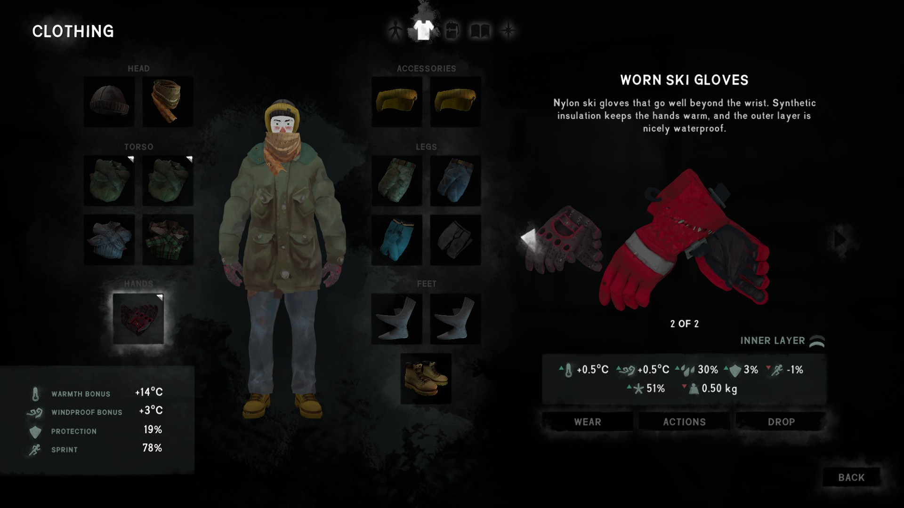
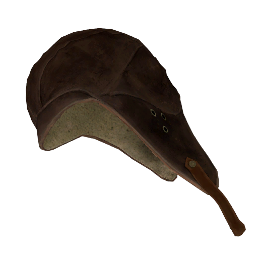
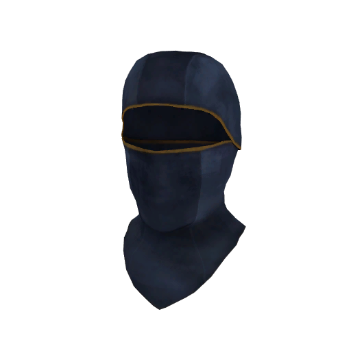
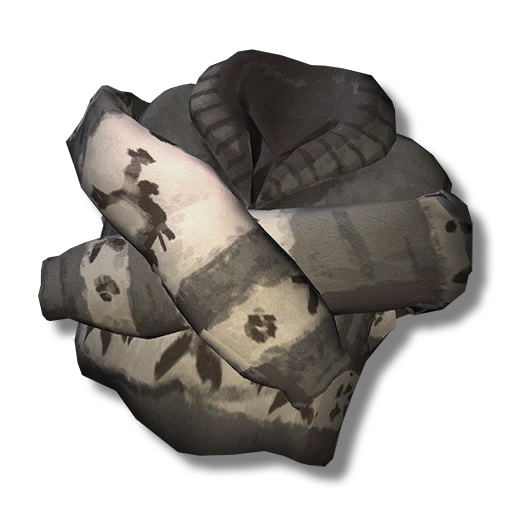
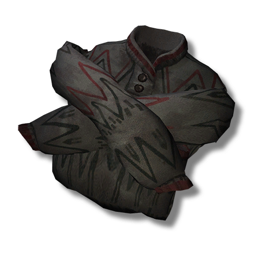
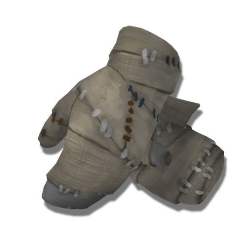

# Clothing

**Categories:** Clothing · **Source:** [Fandom](https://thelongdark.fandom.com/wiki/Clothing)

**Contents**

- [Obtaining clothing](#obtaining-clothing)
- [Clothing attributes](#clothing-attributes)
- [Warmth](#warmth)
- [Windproof](#windproof)
- [Waterproof](#waterproof)
- [Protection](#protection)
- [Mobility](#mobility)
- [Condition](#condition)
- [Weight](#weight)
- [Layering](#layering)
- [Clothing by slot](#clothing-by-slot)
- [Head](#head)
- [Torso](#torso)
- [Outer](#outer)
- [Inner](#inner)
- [Hands](#hands)
- [Legs](#legs)
- [Outer](#outer-1)
- [Inner](#inner-1)
- [Feet](#feet)
- [Inner](#inner-2)
- [Outer](#outer-2)
- [Accessories](#accessories)
- [Cut Clothing](#cut-clothing)

_The clothing hud old_

"_Out in the wilderness, clothing is like armour against the elements. Wear layers to stay warm. And remember, wind is your enemy! Clothing offers different protection from cold and windchill. Your clothes can get wet from blowing snow or if you fall into water, which makes them ineffective and increases your risk of hypothermia or even frostbite. Keep your clothes as dry as you can! Finally, clothing can protect you from physical injuries as from falling or tangling with wildlife. Balance all these factors against the weight and mobility cost of your combined clothing._"

— [What I Know](./What%20I%20Know.md) description

**Clothing** is the term for items that can be equipped to provide bonuses to the player throughout their playthrough. Clothing does not have any requirements to wear. A player's total clothing bonus can be seen on the status screen.

## Obtaining clothing

In all difficulty levels, the player will start out with a few items of low-grade clothing. In the early game, one of the highest priorities is finding good quality clothing. It's possible to find clothing nearly everywhere, but some of the most common locations where clothing may be found include houses (bedrooms in particular), cabins, lockers, car trunks, suitcases, and [Frozen Corpses](./Frozen%20Corpse.md). If the player is struggling to find clothing, specific locations to search include [Coastal Townsite](./Coastal%20Townsite.md) in [Coastal Highway](./Coastal%20Highway.md), the [plane crash](./Crash%20Site%20%28Pleasant%20Valley%29.md) in [Pleasant Valley](./Pleasant%20Valley.md), the town of [Milton](./Milton.md), or the [Cargo Containers](./Cargo%20Container.md) found at the [Summit](./Summit.md) (bring a [Hacksaw](./Hacksaw.md) for here).

## Clothing attributes

### Warmth

 The **Warmth** bonus provided by clothing protects against the chilling ambient temperatures experienced by the player character. Each equipped clothing item contributes a specified number of degrees to the warmth bonus. The bonus is a constant effect that increases the "Feels Like" temperature. However, as clothing deteriorates, so too does the level of warmth it provides.

The highest possible warmth bonus that can currently be achieved is 44°C (79.2°F) (or 37.5°C on Interloper).

| Column 1 | Column 2 | Column 3 | Column 4 | Column 5 | Column 6 |
| --- | --- | --- | --- | --- | --- |
| Head |  / _Clothing.png_ |  / _Temp\_icon.png_ | Accessory |  / _Clothing.png_ |  / _Temp\_icon.png_ |
|  / _Cougar\_Hide\_Wrap\_icon.png_ | [Cougar Hide Wrap](./Cougar%20Hide%20Wrap.md) | 4.0 °C / _(7.2 °F)_ |  / _Improvised\_Insulation\_icon.png_ | [Improvised Insulation](./Improvised%20Insulation.md) | 2.0 °C / _(3.6 °F)_ |
| // / | [Aviator Cap](./Aviator%20Cap.md)/[Balaclava](./Balaclava.md)/ [Technical Balaclava](./Technical%20Balaclava.md)/[Wool Toque](./Wool%20Toque.md) | 2.0 °C / _(3.6 °F)_ |  / _Improvised\_Insulation\_icon.png_ | [Improvised Insulation](./Improvised%20Insulation.md) | 2.0 °C / _(3.6 °F)_ |
| Torso (Outer) |  / _Clothing.png_ |  / _Temp\_icon.png_ | Legs (Outer) |  / _Clothing.png_ |  / _Temp\_icon.png_ |
|  / _Bearskin\_Coat\_icon.png_ | [Bearskin Coat](./Bearskin%20Coat.md) | 6.0 °C / _(10.8 °F)_ |  / _Wolfskin\_Pants\_icon.png_ | [Wolfskin Pants](./Wolfskin%20Pants.md) | 3.0 °C / _(5.4 °F)_ |
|  / _Bearskin\_Coat\_icon.png_ | [Bearskin Coat](./Bearskin%20Coat.md) | 6.0 °C / _(10.8 °F)_ |  / _Wolfskin\_Pants\_icon.png_ | [Wolfskin Pants](./Wolfskin%20Pants.md) | 3.0 °C / _(5.4 °F)_ |
| Torso (Inner) |  / _Clothing.png_ |  / _Temp\_icon.png_ | Legs (Inner) |  / _Clothing.png_ |  / _Temp\_icon.png_ |
|  / _Cowichan\_Sweater\_icon.png_ | [Cowichan Sweater](./Cowichan%20Sweater.md) | 2.5 °C / _(4.5 °F)_ |  / _Wool\_Longjohns\_icon.png_ | [Wool Longjohns](./Wool%20Longjohns.md) | 2.0 °C / _(3.6 °F)_ |
|  / _Cowichan\_Sweater\_icon.png_ | [Cowichan Sweater](./Cowichan%20Sweater.md) | 2.5 °C / _(4.5 °F)_ |  / _Wool\_Longjohns\_icon.png_ | [Wool Longjohns](./Wool%20Longjohns.md) | 2.0 °C / _(3.6 °F)_ |
| Gloves |  / _Clothing.png_ |  / _Temp\_icon.png_ | Socks |  / _Clothing.png_ |  / _Temp\_icon.png_ |
| / | [Gauntlets](./Gauntlets.md)/[Rabbitskin Mitts](./Rabbitskin%20Mitts.md) | 2.0 °C / _(3.6 °F)_ |  / _Climbing\_Socks\_icon.png_ | [Climbing Socks](./Climbing%20Socks.md) | 1.0 °C / _(1.8 °F)_ |
|  |  |  |  / _Climbing\_Socks\_icon.png_ | [Climbing Socks](./Climbing%20Socks.md) | 1.0 °C / _(1.8 °F)_ |
|  |  |  | Shoes |  / _Clothing.png_ |  / _Temp\_icon.png_ |
|  |  |  | / | [Insulated Boots](./Insulated%20Boots.md)/[Ski Boots](./Ski%20Boots.md) | 3.0 °C / _(5.4 °F)_ |

### Windproof

 The **Windproof** bonus provided by clothing protects against the additional heat loss experienced by the player due to windchill. Even when your gear's warmth rating is higher than the environmental temperature, when its windproof rating is lower than the windchill, you will lose heat. The windproof effect only increases the "Feels Like" temperature by the absolute number of degrees of windchill affecting the player.

Only the outermost layer of clothing contributes to the player's windproof bonus, which severely limits how much you can stack it. There are only 7 clothing slots that count towards the Windproof rating. These are: Head (1st slot), Outer Torso (1st slot), Outer Legs (2nd slot), Hands, Outer Feet (boots), and Accessories (both slots). This means inner hats, 2nd jacket, sweaters &amp; shirts, 2nd pants, inner pants, and socks do not add to the windproof rating when fully geared, even if they have a Windproof score. Their windproof score only applies when no outer layer is worn over them. The accessories are an exception to this rule, however. Both accessory slots contribute to the player's windproof bonus.

The highest possible Windproof rating is 21°C (37.8°F)

| Column 1 | Column 2 | Column 3 | Column 4 | Column 5 | Column 6 |
| --- | --- | --- | --- | --- | --- |
| Head |  / _Clothing.png_ |  / _Windproofness\_icon.png_ | Accessory |  / _Clothing.png_ |  / _Windproofness\_icon.png_ |
|  / _Cougar\_Hide\_Wrap\_icon.png_ | [Cougar Hide Wrap](./Cougar%20Hide%20Wrap.md) | 4.0 °C / _(7.2 °F)_ |  / _Improvised\_Insulation\_icon.png_ | [Improvised Insulation](./Improvised%20Insulation.md) | 1.0 °C / _(1.8 °F)_ |
| None |  |  |  / _Improvised\_Insulation\_icon.png_ | [Improvised Insulation](./Improvised%20Insulation.md) | 1.0 °C / _(1.8 °F)_ |
| Torso (Outer) |  / _Clothing.png_ |  / _Windproofness\_icon.png_ | Legs (Outer) |  / _Clothing.png_ |  / _Windproofness\_icon.png_ |
|  / _Expedition\_Parka\_icon.png_ | [Expedition Parka](./Expedition%20Parka.md) | 6.0 °C / _(10.8 °F)_ | / | [Deerskin Pants](./Deerskin%20Pants.md)/[Snow Pants](./Snow%20Pants.md) | 2.0 °C / _(3.6 °F)_ |
| None |  |  | None |  |  |
| Gloves |  / _Clothing.png_ |  / _Windproofness\_icon.png_ | Shoes |  / _Clothing.png_ |  / _Windproofness\_icon.png_ |
|  / _Tactical\_Gloves\_icon.png_ | [Tactical Gloves](./Tactical%20Gloves.md) | 3.0 °C / _(5.4 °F)_ |  / _Ski\_Boots\_icon.png_ | [Ski Boots](./Ski%20Boots.md) | 4.0 °C / _(7.2 °F)_ |

### Waterproof

 The **Waterproof** bonus provided by clothing measures how resistant clothing becomes wet during outdoor activities and how fast they dry off.

- Clothes become wet by simply being left outside or inside [Vehicles](./Vehicle.md), if it's snowing, if a Blizzard is present, or being near certain wet locations.
  - Clothing will become completely wet if the player falls through [Weak Ice](./Weak%20Ice.md), or when passing through a [waterfall](./Environmental%20Hazard.md#Waterfalls).
    - One can also remove all clothing when going through a waterfall to avoid them getting wet, then simply put them back on.
  - Walking through [shallow water puddles](./Environmental%20Hazard.md#Cold_Water_Puddles%2FStreams) will only soak your feet; remove boots and socks before walking through water to prevent them from becoming wet.
    - Certain waterfalls with splashing water, such as the ones in [Hushed River Valley](./Hushed%20River%20Valley.md), also make the player's clothing wet by standing near them for long periods of time.
- Clothing will gradually dry when worn or dropped in a dry interior location. They rapidly dry when beside a [Fire](./Fire.md).
  - Clothes cannot become wet if they are placed indoors or in the player's Backpack, even when passing through waterfalls/falling through Weak Ice.
- Wetness counters windproof protection. As clothes become wet, each% of wetness removes 1% of windproof. 100% wet equals 0% Windproof.
- Static warmth is reduced by 5% for each 33% wetness (Maximum -15% for 100% wet).
- Each 1% of Wetness makes clothing heavier than its initial weight (ex. a 1.00kg hat at 50% wetness will weigh 2.00kg).
- Clothing that becomes 100% Wet will weigh twice as much and begin gradually freezing over to 100% Frozen.
  - Fully Wet clothing and 0% Frozen equal -15%°C and 0% Windproof as well as weighing twice as much as normal.
- Each 1% of Frozen makes clothing warmth decrease by 0.1 Wearing 100% frozen clothing also increases the likelihood of [Hypothermia](./Hypothermia.md) and will ultimately lead to [Frostbite](./Frostbite.md) (even if the player's other clothing is warm enough to counter the frozen clothing).
  - Freezing counters the warmth protection. Each% of freezing diminishes warmth protection, and clothing becomes much heavier.
  - A clothing at 50% Frozen = -15% + (-37%) more warmth. A 100% Froze clothing = 0% warmth &amp; 0% Windproof.
- The time needed to reduce Frozen or Wet status depends on weight and Waterproof rating of the clothing as well as if a fire is active and nearby. When unfrozen, clothing becomes 100% wet again.

The highest possible waterproofness value that can currently be achieved is 700%

| Column 1 | Column 2 | Column 3 | Column 4 | Column 5 | Column 6 |
| --- | --- | --- | --- | --- | --- |
| Head |  / _Clothing.png_ |  / _Waterproofness\_icon.png_ | Accessory |  / _Clothing.png_ |  / _Waterproofness\_icon.png_ |
|  / _Cougar\_Hide\_Wrap\_icon.png_ | [Cougar Hide Wrap](./Cougar%20Hide%20Wrap.md) | 30% | / | [Crampons](./Crampons.md)/[Improvised Crampons](./Improvised%20Crampons.md) | 100% |
|  / _Technical\_Balaclava\_icon.png_ | [Technical Balaclava](./Technical%20Balaclava.md) | 50% |  / _Wool\_Ear\_Wrap\_icon.png_ | [Wool Ear Wrap](./Wool%20Ear%20Wrap.md) | 20% |
| Torso (Outer) |  / _Clothing.png_ |  / _Waterproofness\_icon.png_ | Legs (Outer) |  / _Clothing.png_ |  / _Waterproofness\_icon.png_ |
|  / _Moose-Hide\_Cloak\_icon.png_ | [Moose-Hide Cloak](./Moose-Hide%20Cloak.md) | 90% |  / _Deerskin\_Pants\_icon.png_ | [Deerskin Pants](./Deerskin%20Pants.md) | 60% |
|  / _Moose-Hide\_Cloak\_icon.png_ | [Moose-Hide Cloak](./Moose-Hide%20Cloak.md) | 90% |  / _Deerskin\_Pants\_icon.png_ | [Deerskin Pants](./Deerskin%20Pants.md) | 60% |
| Torso (Inner) |  / _Clothing.png_ |  / _Waterproofness\_icon.png_ | Legs (Inner) |  / _Clothing.png_ |  / _Waterproofness\_icon.png_ |
|  / _Cowichan\_Sweater\_icon.png_ | [Cowichan Sweater](./Cowichan%20Sweater.md) | 50% |  / _Wool\_Longjohns\_icon.png_ | [Wool Longjohns](./Wool%20Longjohns.md) | 35% |
|  / _Cowichan\_Sweater\_icon.png_ | [Cowichan Sweater](./Cowichan%20Sweater.md) | 50% |  / _Wool\_Longjohns\_icon.png_ | [Wool Longjohns](./Wool%20Longjohns.md) | 35% |
| Gloves |  / _Clothing.png_ |  / _Waterproofness\_icon.png_ | Socks |  / _Clothing.png_ |  / _Waterproofness\_icon.png_ |
|  / _Tactical\_Gloves\_icon.png_ | [Tactical Gloves](./Tactical%20Gloves.md) | 50% |  / _Climbing\_Socks\_icon.png_ | [Climbing Socks](./Climbing%20Socks.md) | 25% |
|  |  |  |  / _Climbing\_Socks\_icon.png_ | [Climbing Socks](./Climbing%20Socks.md) | 25% |
|  |  |  | Shoes |  / _Clothing.png_ |  / _Waterproofness\_icon.png_ |
|  |  |  |  / _Chemical\_Boots\_icon.png_ | [Chemical Boots](./Chemical%20Boots.md) | 60% |

### Protection

 The **Protection** bonus provided by clothing provides a reduction in physical damage that the player may experience through falls, burns, or attacks from wildlife.

Only the outermost layer of clothing contributes to the player's protection bonus (the only exception to this is if the Ballistic Vest is worn on the inner Accesory slot). Layered clothing does not help mitigate the effects of damage beyond the outermost layer. Inner clothes eg. underwear, socks, 2nd coat, 2nd pants, or shirts, do not contribute to protection bonus. The accessories are an exception to this rule, however. Both accessory slots contribute to the player's protection bonus.

Protections works as follows: For every 1 protection you have, you receive 1% less damage from wildlife attacks. If you have 100% or greater, you become **_invulnerable_** to wildlife attacks (at the cost of clothing being damaged). Protection also reduces the damage done by the afflictions [Minor Bruising](./Minor%20Bruising.md), [Major Bruising](./Major%20Bruising.md), and [Laceration](./Laceration.md). Protection does not however, reduce the risk of receiving negative afflictions from fights. No matter what protection you have, you can still always get [Blood Loss](./Blood%20Loss.md), [Infection Risk](./Infection%20Risk.md), [Sprained Wrist](./Sprained%20Wrist.md), ect.

The highest possible protection value that can currently be achieved is 106%

| Column 1 | Column 2 | Column 3 | Column 4 | Column 5 | Column 6 |
| --- | --- | --- | --- | --- | --- |
| Head |  / _Clothing.png_ |  / _Protection\_icon.png_ | Accessory |  / _Clothing.png_ |  / _Protection\_icon.png_ |
|  / _Cougar\_Hide\_Wrap\_icon.png_ | [Cougar Hide Wrap](./Cougar%20Hide%20Wrap.md) | 6% |  / _Ballistic\_Vest\_icon.png_ | [Ballistic Vest](./Ballistic%20Vest.md) | 50% |
|  |  |  | / | [Crampons](./Crampons.md)/[Improvised Crampons](./Improvised%20Crampons.md) | 3% |
| Torso (Outer) |  / _Clothing.png_ |  / _Protection\_icon.png_ | Legs (Outer) |  / _Clothing.png_ |  / _Protection\_icon.png_ |
|  / _Moose-Hide\_Cloak\_icon.png_ | [Moose-Hide Cloak](./Moose-Hide%20Cloak.md) | 20% | / | [Deerskin Pants](./Deerskin%20Pants.md)/[Wolfskin Pants](./Wolfskin%20Pants.md) | 10% |
| Gloves |  / _Clothing.png_ |  / _Protection\_icon.png_ | Shoes |  / _Clothing.png_ |  / _Protection\_icon.png_ |
|  / _Tactical\_Gloves\_icon.png_ | [Tactical Gloves](./Tactical%20Gloves.md) | 7% | / | [Ski Boots](./Ski%20Boots.md)/[Combat Boots](./Combat%20Boots.md) | 10% |

### Mobility

 The **Mobility** penalty provided by clothing constricts the survivor's ability to move, reducing the maximum length of time that a player can [Sprint](./Stamina.md) while worn. The penalty is cumulative when wearing multiple pieces of clothing that cause a mobility penalty (e.g., a coat that reduces mobility by -5% and a pair of gloves that reduce mobility by -4% would yield a total penalty of -9%).

The highest possible mobility penalty that can currently be achieved is -100% (technically -126%, but capped at -100%)

| Column 1 | Column 2 | Column 3 | Column 4 | Column 5 | Column 6 |
| --- | --- | --- | --- | --- | --- |
| Head |  / _Clothing.png_ |  / _Mobility\_icon.png_ | Accessory |  / _Clothing.png_ |  / _Mobility\_icon.png_ |
| None |  |  |  / _Ballistic\_Vest\_icon.png_ | [Ballistic Vest](./Ballistic%20Vest.md) | -40% |
| None |  |  | / | [Crampons](./Crampons.md)/[Improvised Crampons](./Improvised%20Crampons.md) | -5% |
| Torso (Outer) |  / _Clothing.png_ |  / _Mobility\_icon.png_ | Legs (Outer) |  / _Clothing.png_ |  / _Mobility\_icon.png_ |
|  / _Bearskin\_Coat\_icon.png_ | [Bearskin Coat](./Bearskin%20Coat.md) | -20% | // | [Deerskin Pants](./Deerskin%20Pants.md)/[Wolfskin Pants](./Wolfskin%20Pants.md) /[Snow Pants](./Snow%20Pants.md) | -5% |
|  / _Bearskin\_Coat\_icon.png_ | [Bearskin Coat](./Bearskin%20Coat.md) | -20% | // | [Deerskin Pants](./Deerskin%20Pants.md)/[Wolfskin Pants](./Wolfskin%20Pants.md) /[Snow Pants](./Snow%20Pants.md) | -5% |
| Gloves |  / _Clothing.png_ |  / _Mobility\_icon.png_ | Shoes |  / _Clothing.png_ |  / _Mobility\_icon.png_ |
|  / _Rabbitskin\_Mitts\_icon.png_ | [Rabbitskin Mitts](./Rabbitskin%20Mitts.md) | -5% |  / _Ski\_Boots\_icon.png_ | [Ski Boots](./Ski%20Boots.md) | -20% |

### Condition

 The **Condition** of clothing affects how well it does the job it's designed to do. As clothing deteriorates, it will contribute less to the players warmth and windchill protection. A piece of clothing at 50% condition rated for +2.0 degrees of warmth will only contribute +1.0 degrees. If clothing reaches 0% condition, it will become Ruined and can't be repaired, though it can still be harvested for raw materials.

### Weight

 The **Weight** of clothing is how much it weighs when carried, worn, or placed in a container. When worn, clothing only contributes 75% of its weight towards the player's carrying limit. Wet clothing also increases clothing weight by 0.01kg per 1%.

The heaviest clothing weight that can currently be worn is 29.65kg (this number jumps to 58.55kg when 100% Wet, though Improvised Crampons cannot get wet due to being 100% Waterproof)

| Column 1 | Column 2 | Column 3 | Column 4 | Column 5 | Column 6 |
| --- | --- | --- | --- | --- | --- |
| Head |  / _Clothing.png_ |  / _Weight\_icon.png_ | Accessory |  / _Clothing.png_ |  / _Weight\_icon.png_ |
|  / _Cougar\_Hide\_Wrap\_icon.png_ | [Cougar Hide Wrap](./Cougar%20Hide%20Wrap.md) | 1.00 kg / _(2.2 lb)_ |  / _Ballistic\_Vest\_icon.png_ | [Ballistic Vest](./Ballistic%20Vest.md) | 6.00 kg / _(13.2 lb)_ |
|  / _Hardhat\_icon.png_ | [Hardhat](./Hardhat.md) | 0.40 kg / _(0.88 lb)_ |  / _Improvised\_Crampons\_icon.png_ | [Improvised Crampons](./Improvised%20Crampons.md) | 0.75 kg / _(1.65 lb)_ |
| Torso (Outer) |  / _Clothing.png_ |  / _Weight\_icon.png_ | Legs (Outer) |  / _Clothing.png_ |  / _Weight\_icon.png_ |
|  / _Bearskin\_Coat\_icon.png_ | [Bearskin Coat](./Bearskin%20Coat.md) | 5.00 kg / _(11 lb)_ |  / _Wolfskin\_Pants\_icon.png_ | [Wolfskin Pants](./Wolfskin%20Pants.md) | 2.50 kg / _(5.5 lb)_ |
|  / _Bearskin\_Coat\_icon.png_ | [Bearskin Coat](./Bearskin%20Coat.md) | 5.00 kg / _(11 lb)_ |  / _Wolfskin\_Pants\_icon.png_ | [Wolfskin Pants](./Wolfskin%20Pants.md) | 2.50 kg / _(5.5 lb)_ |
| Torso (Inner) |  / _Clothing.png_ |  / _Weight\_icon.png_ | Legs (Inner) |  / _Clothing.png_ |  / _Weight\_icon.png_ |
|  / _Cowichan\_Sweater\_icon.png_ | [Cowichan Sweater](./Cowichan%20Sweater.md) | 1.00 kg / _(2.2 lb)_ |  / _Wool\_Longjohns\_icon.png_ | [Wool Longjohns](./Wool%20Longjohns.md) | 0.50 kg / _(1.1 lb)_ |
|  / _Cowichan\_Sweater\_icon.png_ | [Cowichan Sweater](./Cowichan%20Sweater.md) | 1.00 kg / _(2.2 lb)_ |  / _Wool\_Longjohns\_icon.png_ | [Wool Longjohns](./Wool%20Longjohns.md) | 0.50 kg / _(1.1 lb)_ |
| Gloves |  / _Clothing.png_ |  / _Weight\_icon.png_ | Socks |  / _Clothing.png_ |  / _Weight\_icon.png_ |
| / | [Gauntlets](./Gauntlets.md)/[Rabbitskin Mitts](./Rabbitskin%20Mitts.md) | 1.00 kg / _(2.2 lb)_ | /// / / | [Climbing Socks](./Climbing%20Socks.md)/ [Patterned Wool Socks (Dots)](./Patterned%20Wool%20Socks%20%28Dots%29.md)/ / [Patterned Wool Socks (Moose)](./Patterned%20Wool%20Socks%20%28Moose%29.md)/[Patterned Wool Socks (Plaid)](./Patterned%20Wool%20Socks%20%28Plaid%29.md) / /[Wool Socks](./Wool%20Socks.md) | 0.25 kg / _(0.55 lb)_ |
|  |  |  | /// / | [Climbing Socks](./Climbing%20Socks.md)/ [Patterned Wool Socks (Dots)](./Patterned%20Wool%20Socks%20%28Dots%29.md)/ / [Patterned Wool Socks (Moose)](./Patterned%20Wool%20Socks%20%28Moose%29.md)/[Patterned Wool Socks (Plaid)](./Patterned%20Wool%20Socks%20%28Plaid%29.md) / /[Wool Socks](./Wool%20Socks.md) | 0.25 kg / _(0.55 lb)_ |
|  |  |  | Shoes |  / _Clothing.png_ |  / _Weight\_icon.png_ |
|  |  |  | / | [Combat Boots](./Combat%20Boots.md)/[Deerskin Boots](./Deerskin%20Boots.md) | 2.00 kg / _(4.4 lb)_ |

## Layering

_Outer and inner layers_ Effects in which the game elements affect the clothing are represented by the order of numbers (the lowest numbers are affected first and the highest numbers are affected last).

## Clothing by slot

**Note**: Clothing items denoted with _italics_ are only available in [Wintermute](./Wintermute.md).

Harvest info can be found in [Harvesting](./Harvesting.md#Harvestable_Clothing).

### Head

|  / _Clothing.png_ | Item |  / _Temp\_icon.png_ |  / _Windproofness\_icon.png_ |  / _Waterproofness\_icon.png_ |  / _Protection\_icon.png_ |  / _Mobility\_icon.png_ |  / _Weight\_icon.png_ | Weight Ratio |
| --- | --- | --- | --- | --- | --- | --- | --- | --- |
|  / _Aviator\_Cap\_icon.png_ | [Aviator Cap](./Aviator%20Cap.md) | 2.0 °C / _(3.6 °F)_ | 2.0 °C / _(3.6 °F)_ | 30% | 4% | 0% | 0.30 kg / _(0.66 lb)_ | 6.67 °C/kg / _(5.44 °F/lb)_ |
|  / _Astrid's\_Toque\_icon.png_ | _[Astrid's Toque](./Astrid%27s%20Toque.md)_ | 1.5 °C / _(2.7 °F)_ | 0.75 °C / _(1.4 °F)_ | 30% | 2% | 0% | 0.15 kg / _(0.33 lb)_ | 10 °C/kg / _(8.16 °F/lb)_ |
|  / _Balaclava\_icon.png_ | [Balaclava](./Balaclava.md) [¹](#fn1) | 2.0 °C / _(3.6 °F)_ | 1.5 °C / _(2.7 °F)_ | 30% | 3% | 0% | 0.25 kg / _(0.55 lb)_ | 8 °C/kg / _(6.53 °F/lb)_ |
|  / _Baseball\_Cap\_icon.png_ | [Baseball Cap](./Baseball%20Cap.md) | 0.5 °C / _(0.9 °F)_ | 0.0 °C / _(0 °F)_ | 0% | 0% | 0% | 0.10 kg / _(0.22 lb)_ | 5 °C/kg / _(4.08 °F/lb)_ |
|  / _Cotton\_Scarf\_icon.png_ | [Cotton Scarf](./Cotton%20Scarf.md) | 0.5 °C / _(0.9 °F)_ | 0.0 °C / _(0 °F)_ | 5% | 0% | 0% | 0.10 kg / _(0.22 lb)_ | 5 °C/kg / _(4.08 °F/lb)_ |
|  / _Cotton\_Toque\_icon.png_ | [Cotton Toque](./Cotton%20Toque.md) | 1.0 °C / _(1.8 °F)_ | 0.5 °C / _(0.9 °F)_ | 10% | 1% | 0% | 0.10 kg / _(0.22 lb)_ | 10 °C/kg / _(8.16 °F/lb)_ |
|  / _Cougar\_Hide\_Wrap\_icon.png_ | [Cougar Hide Wrap](./Cougar%20Hide%20Wrap.md) [²](#fn2) | 4.0 °C / _(7.2 °F)_ | 4.0 °C / _(7.2 °F)_ | 40% | 6% | 0% | 1.00 kg / _(2.2 lb)_ | 4 °C/kg / _(3.27 °F/lb)_ |
|  / _Fleece\_Cowl\_icon.png_ | [Fleece Cowl](./Fleece%20Cowl.md) | 1.5 °C / _(2.7 °F)_ | 1.0 °C / _(1.8 °F)_ | 20% | 2% | 0% | 0.25 kg / _(0.55 lb)_ | 6 °C/kg / _(4.9 °F/lb)_ |
|  / _Hardhat\_icon.png_ | [Hardhat](./Hardhat.md) | 0 °C / _(0 °F)_ | 0 °C / _(0 °F)_ | 30% | 4% | 0% | 0.40 kg / _(0.88 lb)_ | 0 °C/kg / _(0 °F/lb)_ |
|  / _Improvised\_Head\_Wrap\_icon.png_ | [Improvised Head Wrap](./Improvised%20Head%20Wrap.md) | 1.0 °C / _(1.8 °F)_ | 0.5 °C / _(0.9 °F)_ | 0% | 0.5% | 0% | 0.10 kg / _(0.22 lb)_ | 10 °C/kg / _(8.16 °F/lb)_ |
|  / _Long\_Wool\_Scarf\_icon.png_ | [Long Wool Scarf](./Long%20Wool%20Scarf.md) | 1.5 °C / _(2.7 °F)_ | 1.0 °C / _(1.8 °F)_ | 30% | 1% | 0% | 0.25 kg / _(0.55 lb)_ | 6 °C/kg / _(4.9 °F/lb)_ |
|  / _Mackenzie's\_Toque\_icon.png_ | _[Mackenzie's Toque](./Mackenzie%27s%20Toque.md)_ | 1.5 °C / _(2.7 °F)_ | 0.75 °C / _(1.4 °F)_ | 30% | 2% | 0% | 0.15 kg / _(0.33 lb)_ | 10 °C/kg / _(8.16 °F/lb)_ |
|  / _Rabbitskin\_Hat\_icon.png_ | [Rabbitskin Hat](./Rabbitskin%20Hat.md) [³](#fn3) | 2.0 °C / _(3.6 °F)_ | 1.5 °C / _(2.7 °F)_ | 30% | 4% | 0% | 0.35 kg / _(0.77 lb)_ | 5.71 °C/kg / _(4.67 °F/lb)_ |
|  / _Technical\_Balaclava\_icon.png_ | [Technical Balaclava](./Technical%20Balaclava.md) [⁴](#fn4) | 2.0 °C / _(3.6 °F)_ | 2.0 °C / _(3.6 °F)_ | 50% | 5% | 0% | 0.20 kg / _(0.44 lb)_ | 10 °C/kg / _(8.16 °F/lb)_ |
|  / _Wool\_Scarf\_icon.png_ | [Wool Scarf](./Wool%20Scarf.md) | 1.0 °C / _(1.8 °F)_ | 0.5 °C / _(0.9 °F)_ | 20% | 1% | 0% | 0.10 kg / _(0.22 lb)_ | 10 °C/kg / _(8.16 °F/lb)_ |
|  / _Wolfskin\_Hat\_icon.png_ | [Wolfskin Hat](./Wolfskin%20Hat.md) [⁵](#fn5) | 3.0 °C / _(5.4 °F)_ | 2.0 °C / _(3.6 °F)_ | 30% | 4% | 0% | 1.00 kg / _(2.2 lb)_ | 3 °C/kg / _(2.45 °F/lb)_ |
|  / _Wool\_Toque\_icon.png_ | [Wool Toque](./Wool%20Toque.md) | 2.0 °C / _(3.6 °F)_ | 1.0 °C / _(1.8 °F)_ | 30% | 2% | 0% | 0.25 kg / _(0.55 lb)_ | 8 °C/kg / _(6.53 °F/lb)_ |

### Torso

#### Outer

|  / _Clothing.png_ | Item |  / _Temp\_icon.png_ |  / _Windproofness\_icon.png_ |  / _Waterproofness\_icon.png_ |  / _Protection\_icon.png_ |  / _Mobility\_icon.png_ |  / _Weight\_icon.png_ | Weight Ratio |
| --- | --- | --- | --- | --- | --- | --- | --- | --- |
|  / _Astrid's\_Jacket\_icon.png_ | _[Astrid's Jacket](./Astrid%27s%20Jacket.md)_ | 2.0 °C / _(3.6 °F)_ | 2.0 °C / _(3.6 °F)_ | 30% | 3% | -4% | 1.25 kg / _(2.75 lb)_ | 1.6 °C/kg / _(1.31 °F/lb)_ |
|  / _Bearskin\_Coat\_icon.png_ | [Bearskin Coat](./Bearskin%20Coat.md) | 6.0 °C / _(10.8 °F)_ | 5.0 °C / _(9 °F)_ | 80% | 15% | -20% | 5.00 kg / _(11 lb)_ | 1.2 °C/kg / _(0.98 °F/lb)_ |
|  / _Down\_Vest\_icon.png_ | [Down Vest](./Down%20Vest.md) [⁶](#fn6) | 1.0 °C / _(1.8 °F)_ | 1.0 °C / _(1.8 °F)_ | 10% | 1% | 0% | 0.50 kg / _(1.1 lb)_ | 2 °C/kg / _(1.63 °F/lb)_ |
|  / _Expedition\_Parka\_icon.png_ | [Expedition Parka](./Expedition%20Parka.md) | 4.0 °C / _(7.2 °F)_ | 6.0 °C / _(10.8 °F)_ | 50% | 6% | -5% | 1.50 kg / _(3.3 lb)_ | 2.67 °C/kg / _(2.18 °F/lb)_ |
|  / _Flight\_Jacket\_icon.png_ | [Flight Jacket](./Flight%20Jacket.md) | 3.0 °C / _(5.4 °F)_ | 5.0 °C / _(9 °F)_ | 50% | 10% | -5% | 2.50 kg / _(5.5 lb)_ | 1.2 °C/kg / _(0.98 °F/lb)_ |
|  / _Light\_Shell\_icon.png_ | [Light Shell](./Light%20Shell.md) | 1.0 °C / _(1.8 °F)_ | 3.0 °C / _(5.4 °F)_ | 30% | 3% | -2% | 1.00 kg / _(2.2 lb)_ | 1 °C/kg / _(0.82 °F/lb)_ |
|  / _Mackenzie's\_Parka\_icon.png_ | _[Mackenzie's Parka](./Mackenzie%27s%20Parka.md)_ | 2.0 °C / _(3.6 °F)_ | 2.0 °C / _(3.6 °F)_ | 30% | 3% | -4% | 1.25 kg / _(2.75 lb)_ | 1.6 °C/kg / _(1.31 °F/lb)_ |
|  / _Mackinaw\_Jacket\_icon.png_ | [Mackinaw Jacket](./Mackinaw%20Jacket.md) | 2.5 °C / _(4.5 °F)_ | 2.0 °C / _(3.6 °F)_ | 40% | 5% | -3% | 1.50 kg / _(3.3 lb)_ | 1.67 °C/kg / _(1.36 °F/lb)_ |
|  / _Mariner's\_Pea\_Coat\_icon.png_ | [Mariner's Pea Coat](./Mariner%27s%20Pea%20Coat.md) | 3.0 °C / _(5.4 °F)_ | 4.0 °C / _(7.2 °F)_ | 75% | 7% | -6% | 2.00 kg / _(4.4 lb)_ | 1.5 °C/kg / _(1.22 °F/lb)_ |
|  / _Military\_Coat\_icon.png_ | [Military Coat](./Military%20Coat.md) | 3.0 °C / _(5.4 °F)_ | 3.0 °C / _(5.4 °F)_ | 40% | 8% | -5% | 2.00 kg / _(4.4 lb)_ | 1.5 °C/kg / _(1.22 °F/lb)_ |
|  / _Miner's\_Jacket\_icon.png_ | [Miner's Jacket](./Miner%27s%20Jacket.md) | 2.0 °C / _(3.6 °F)_ | 3.0 °C / _(5.4 °F)_ | 50% | 4% | -5% | 2.00 kg / _(4.4 lb)_ | 1 °C/kg / _(0.82 °F/lb)_ |
|  / _Moose-Hide\_Cloak\_icon.png_ | [Moose-Hide Cloak](./Moose-Hide%20Cloak.md) | 3.5 °C / _(6.3 °F)_ | 4.0 °C / _(7.2 °F)_ | 90% | 20% | -10% | 4.00 kg / _(8.8 lb)_ | 0.88 °C/kg / _(0.71 °F/lb)_ |
|  / _Old\_Fashioned\_Parka\_icon.png_ | [Old Fashioned Parka](./Old%20Fashioned%20Parka.md) | 3.0 °C / _(5.4 °F)_ | 3.0 °C / _(5.4 °F)_ | 20% | 5% | -7% | 2.00 kg / _(4.4 lb)_ | 1.5 °C/kg / _(1.22 °F/lb)_ |
|  / _Simple\_Parka\_icon.png_ | [Simple Parka](./Simple%20Parka.md) | 2.0 °C / _(3.6 °F)_ | 2.0 °C / _(3.6 °F)_ | 30% | 3% | -4% | 1.25 kg / _(2.75 lb)_ | 1.6 °C/kg / _(1.31 °F/lb)_ |
|  / _Ski\_Jacket\_icon.png_ | [Ski Jacket](./Ski%20Jacket.md) | 2.0 °C / _(3.6 °F)_ | 2.0 °C / _(3.6 °F)_ | 30% | 3% | -2% | 1.00 kg / _(2.2 lb)_ | 2 °C/kg / _(1.63 °F/lb)_ |
|  / _Sport\_Vest\_icon.png_ | [Sport Vest](./Sport%20Vest.md) [⁷](#fn7) | 0.5 °C / _(0.9 °F)_ | 0.5 °C / _(0.9 °F)_ | 5% | 1% | 0% | 0.50 kg / _(1.1 lb)_ | 1 °C/kg / _(0.82 °F/lb)_ |
|  / _Tactical\_Jacket\_icon.png_ | [Tactical Jacket](./Tactical%20Jacket.md) | 2.0 °C / _(3.6 °F)_ | 4.0 °C / _(7.2 °F)_ | 50% | 15% | -4% | 2.00 kg / _(4.4 lb)_ | 1 °C/kg / _(0.82 °F/lb)_ |
|  / _Urban\_Parka\_icon.png_ | [Urban Parka](./Urban%20Parka.md) | 2.5 °C / _(4.5 °F)_ | 2.0 °C / _(3.6 °F)_ | 10% | 2% | -2% | 1.00 kg / _(2.2 lb)_ | 2.5 °C/kg / _(2.04 °F/lb)_ |
|  / _Windbreaker\_icon.png_ | [Windbreaker](./Windbreaker.md) | 0.5 °C / _(0.9 °F)_ | 3.0 °C / _(5.4 °F)_ | 50% | 1% | 0% | 0.50 kg / _(1.1 lb)_ | 1 °C/kg / _(0.82 °F/lb)_ |
|  / _Wolfskin\_Coat\_icon.png_ | [Wolfskin Coat](./Wolfskin%20Coat.md) | 4.0 °C / _(7.2 °F)_ | 4.0 °C / _(7.2 °F)_ | 60% | 12% | -15% | 3.00 kg / _(6.6 lb)_ | 1.33 °C/kg / _(1.09 °F/lb)_ |

#### Inner

|  / _Clothing.png_ | Item |  / _Temp\_icon.png_ |  / _Windproofness\_icon.png_ |  / _Waterproofness\_icon.png_ |  / _Protection\_icon.png_ |  / _Mobility\_icon.png_ |  / _Weight\_icon.png_ | Weight Ratio |
| --- | --- | --- | --- | --- | --- | --- | --- | --- |
|  / _Astrid's\_Sweater\_icon.png_ | _[Astrid's Sweater](./Astrid%27s%20Sweater.md)_ | 0.5 °C / _(0.9 °F)_ | 1.0 °C / _(1.8 °F)_ | 10% | 2% | 0% | 0.25 kg / _(0.55 lb)_ | 2 °C/kg / _(1.63 °F/lb)_ |
|  / _Cowichan\_Sweater\_icon.png_ | [Cowichan Sweater](./Cowichan%20Sweater.md) | 2.5 °C / _(4.5 °F)_ | 2.0 °C / _(3.6 °F)_ | 50% | 5% | -2% | 1.00 kg / _(2.2 lb)_ | 2.5 °C/kg / _(2.04 °F/lb)_ |
|  / _Dress\_Shirt\_icon.png_ | [Dress Shirt](./Dress%20Shirt.md) | 0.5 °C / _(0.9 °F)_ | 1.0 °C / _(1.8 °F)_ | 0% | 0% | 0% | 0.25 kg / _(0.55 lb)_ | 2 °C/kg / _(1.63 °F/lb)_ |
|  / _Festive\_Sweater\_icon.png_ | [Festive Sweater](./Festive%20Sweater.md) | 1.0 °C / _(1.8 °F)_ | 3.0 °C / _(5.4 °F)_ | 15% | 3% | 0% | 0.30 kg / _(0.66 lb)_ | 3.33 °C/kg / _(2.72 °F/lb)_ |
|  / _Fisherman's\_Sweater\_icon.png_ | [Fisherman's Sweater](./Fisherman%27s%20Sweater.md) | 2.0 °C / _(3.6 °F)_ | 1.5 °C / _(2.7 °F)_ | 40% | 5% | -1% | 0.50 kg / _(1.1 lb)_ | 4 °C/kg / _(3.27 °F/lb)_ |
|  / _Hockey\_Jersey\_icon.png_ | [Hockey Jersey](./Hockey%20Jersey.md) | 1.0 °C / _(1.8 °F)_ | 3.0 °C / _(5.4 °F)_ | 15% | 3% | 0% | 0.30 kg / _(0.66 lb)_ | 3.33 °C/kg / _(2.72 °F/lb)_ |
|  / _Hoodie\_icon.png_ | [Hoodie](./Hoodie.md) | 0.5 °C / _(0.9 °F)_ | 0.5 °C / _(0.9 °F)_ | 10% | 2% | 0% | 0.25 kg / _(0.55 lb)_ | 2 °C/kg / _(1.63 °F/lb)_ |
|  / _Mackenzie's\_Shirt\_icon.png_ | _[Mackenzie's Shirt](./Mackenzie%27s%20Shirt.md)_ | 0.5 °C / _(0.9 °F)_ | 0.5 °C / _(0.9 °F)_ | 20% | 1% | 0% | 0.25 kg / _(0.55 lb)_ | 2 °C/kg / _(1.63 °F/lb)_ |
|  / _Mackenzie's\_Sweater\_icon.png_ | _[Mackenzie's Sweater](./Mackenzie%27s%20Sweater.md)_ | 0.5 °C / _(0.9 °F)_ | 1.0 °C / _(1.8 °F)_ | 10% | 2% | 0% | 0.25 kg / _(0.55 lb)_ | 2 °C/kg / _(1.63 °F/lb)_ |
|  / _Plaid\_Shirt\_icon.png_ | [Plaid Shirt](./Plaid%20Shirt.md) | 0.5 °C / _(0.9 °F)_ | 0.5 °C / _(0.9 °F)_ | 20% | 1% | 0% | 0.25 kg / _(0.55 lb)_ | 2 °C/kg / _(1.63 °F/lb)_ |
|  / _Sweatshirt\_icon.png_ | [Sweatshirt](./Sweatshirt.md) | 0.5 °C / _(0.9 °F)_ | 1.0 °C / _(1.8 °F)_ | 10% | 2% | 0% | 0.25 kg / _(0.55 lb)_ | 2 °C/kg / _(1.63 °F/lb)_ |
|  / _Thick\_Wool\_Sweater\_icon.png_ | [Thick Wool Sweater](./Thick%20Wool%20Sweater.md) | 1.5 °C / _(2.7 °F)_ | 1.0 °C / _(1.8 °F)_ | 30% | 3% | -1% | 0.50 kg / _(1.1 lb)_ | 3 °C/kg / _(2.45 °F/lb)_ |
|  / _Thin\_Wool\_Sweater\_icon.png_ | [Thin Wool Sweater](./Thin%20Wool%20Sweater.md) | 1.0 °C / _(1.8 °F)_ | 0.5 °C / _(0.9 °F)_ | 20% | 2% | 0% | 0.25 kg / _(0.55 lb)_ | 4 °C/kg / _(3.27 °F/lb)_ |
|  / _T-Shirt\_icon.png_ | [T-Shirt](./T-Shirt.md) | 0.5 °C / _(0.9 °F)_ | 0.0 °C / _(0 °F)_ | 0% | 0% | 0% | 0.25 kg / _(0.55 lb)_ | 2 °C/kg / _(1.63 °F/lb)_ |
|  / _T-Shirt\_(CM)\_icon.png_ | [T-Shirt (CM)](./T-Shirt%20%28CM%29.md) | 0.5 °C / _(0.9 °F)_ | 0.0 °C / _(0 °F)_ | 0% | 0% | 0% | 0.25 kg / _(0.55 lb)_ | 2 °C/kg / _(1.63 °F/lb)_ |
|  / _T-Shirt\_(GBI)\_icon.png_ | [T-Shirt (GBI)](./T-Shirt%20%28GBI%29.md) | 0.5 °C / _(0.9 °F)_ | 0.0 °C / _(0 °F)_ | 0% | 0% | 0% | 0.25 kg / _(0.55 lb)_ | 2 °C/kg / _(1.63 °F/lb)_ |
|  / _T-Shirt\_(Snappy)\_icon.png_ | [T-Shirt (Snappy)](./T-Shirt%20%28Snappy%29.md) | 0.5 °C / _(0.9 °F)_ | 0.0 °C / _(0 °F)_ | 0% | 0% | 0% | 0.25 kg / _(0.55 lb)_ | 2 °C/kg / _(1.63 °F/lb)_ |
|  / _Wool\_Shirt\_icon.png_ | [Wool Shirt](./Wool%20Shirt.md) | 1.0 °C / _(1.8 °F)_ | 0.5 °C / _(0.9 °F)_ | 40% | 2% | 0% | 0.25 kg / _(0.55 lb)_ | 4 °C/kg / _(3.27 °F/lb)_ |

### Hands

|  / _Clothing.png_ | Item |  / _Temp\_icon.png_ |  / _Windproofness\_icon.png_ |  / _Waterproofness\_icon.png_ |  / _Protection\_icon.png_ |  / _Mobility\_icon.png_ |  / _Weight\_icon.png_ | Weight Ratio |
| --- | --- | --- | --- | --- | --- | --- | --- | --- |
|  / _Astrid's\_Gloves\_icon.png_ | _[Astrid's Gloves](./Astrid%27s%20Gloves.md)_ | 0.5 °C / _(0.9 °F)_ | 0.5 °C / _(0.9 °F)_ | 5% | 1% | 0% | 0.10 kg / _(0.22 lb)_ | 5 °C/kg / _(4.08 °F/lb)_ |
|  / _Driving\_Gloves\_icon.png_ | [Driving Gloves](./Driving%20Gloves.md) | 0.5 °C / _(0.9 °F)_ | 0.5 °C / _(0.9 °F)_ | 0% | 1% | 0% | 0.10 kg / _(0.22 lb)_ | 5 °C/kg / _(4.08 °F/lb)_ |
|  / _Fleece\_Mittens\_icon.png_ | [Fleece Mittens](./Fleece%20Mittens.md) | 0.5 °C / _(0.9 °F)_ | 0.5 °C / _(0.9 °F)_ | 5% | 1% | 0% | 0.10 kg / _(0.22 lb)_ | 5 °C/kg / _(4.08 °F/lb)_ |
|  / _Gauntlets\_icon.png_ | [Gauntlets](./Gauntlets.md) | 2.0 °C / _(3.6 °F)_ | 2.0 °C / _(3.6 °F)_ | 40% | 5% | -3% | 1.00 kg / _(2.2 lb)_ | 2 °C/kg / _(1.63 °F/lb)_ |
|  / _Improvised\_Hand\_Wraps\_icon.png_ | [Improvised Hand Wraps](./Improvised%20Hand%20Wraps.md) | 0.5 °C / _(0.9 °F)_ | 0.25 °C / _(0.5 °F)_ | 0% | 0.5% | 0% | 0.10 kg / _(0.22 lb)_ | 5 °C/kg / _(4.08 °F/lb)_ |
|  / _Patterned\_Wool\_Mittens\_(Blue)\_icon.png_ | [Patterned Wool Mittens (Blue)](./Patterned%20Wool%20Mittens%20%28Blue%29.md) | 1.0 °C / _(1.8 °F)_ | 0.5 °C / _(0.9 °F)_ | 20% | 1% | 0% | 0.10 kg / _(0.22 lb)_ | 10 °C/kg / _(8.16 °F/lb)_ |
|  / _Patterned\_Wool\_Mittens\_(Brown)\_icon.png_ | [Patterned Wool Mittens (Brown)](./Patterned%20Wool%20Mittens%20%28Brown%29.md) | 1.0 °C / _(1.8 °F)_ | 0.5 °C / _(0.9 °F)_ | 20% | 1% | 0% | 0.10 kg / _(0.22 lb)_ | 10 °C/kg / _(8.16 °F/lb)_ |
|  / _Patterned\_Wool\_Mittens\_(Burgundy)\_icon.png_ | [Patterned Wool Mittens (Burgundy)](./Patterned%20Wool%20Mittens%20%28Burgundy%29.md) | 1.0 °C / _(1.8 °F)_ | 0.5 °C / _(0.9 °F)_ | 20% | 1% | 0% | 0.10 kg / _(0.22 lb)_ | 10 °C/kg / _(8.16 °F/lb)_ |
|  / _Rabbitskin\_Mitts\_icon.png_ | [Rabbitskin Mitts](./Rabbitskin%20Mitts.md) | 2.0 °C / _(3.6 °F)_ | 2.0 °C / _(3.6 °F)_ | 50% | 3% | -5% | 1.00 kg / _(2.2 lb)_ | 2 °C/kg / _(1.63 °F/lb)_ |
|  / _Ski\_Gloves\_icon.png_ | [Ski Gloves](./Ski%20Gloves.md) | 1.0 °C / _(1.8 °F)_ | 1.0 °C / _(1.8 °F)_ | 30% | 3% | -1% | 0.50 kg / _(1.1 lb)_ | 2 °C/kg / _(1.63 °F/lb)_ |
|  / _Tactical\_Gloves\_icon.png_ | [Tactical Gloves](./Tactical%20Gloves.md) | 1.5 °C / _(2.7 °F)_ | 3.0 °C / _(5.4 °F)_ | 50% | 7% | -1% | 0.75 kg / _(1.65 lb)_ | 2 °C/kg / _(1.63 °F/lb)_ |
|  / _Wool\_Mittens\_icon.png_ | [Wool Mittens](./Wool%20Mittens.md) | 1.0 °C / _(1.8 °F)_ | 0.5 °C / _(0.9 °F)_ | 20% | 1% | 0% | 0.10 kg / _(0.22 lb)_ | 10 °C/kg / _(8.16 °F/lb)_ |
|  / _Work\_Gloves\_icon.png_ | [Work Gloves](./Work%20Gloves.md) | 1.0 °C / _(1.8 °F)_ | 0.5 °C / _(0.9 °F)_ | 0% | 4% | -2% | 0.25 kg / _(0.55 lb)_ | 4 °C/kg / _(3.27 °F/lb)_ |

### Legs

#### Outer

|  / _Clothing.png_ | Item |  / _Temp\_icon.png_ |  / _Windproofness\_icon.png_ |  / _Waterproofness\_icon.png_ |  / _Protection\_icon.png_ |  / _Mobility\_icon.png_ |  / _Weight\_icon.png_ | Weight Ratio |
| --- | --- | --- | --- | --- | --- | --- | --- | --- |
|  / _Astrid's\_Jeans\_icon.png_ | _[Astrid's Jeans](./Astrid%27s%20Jeans.md)_ | 1.0 °C / _(1.8 °F)_ | 0.0 °C / _(0 °F)_ | 0% | 2% | -1% | 0.50 kg / _(1.1 lb)_ | 2 °C/kg / _(1.63 °F/lb)_ |
|  / _Cargo\_Pants\_icon.png_ | [Cargo Pants](./Cargo%20Pants.md) | 1.5 °C / _(2.7 °F)_ | 0.5 °C / _(0.9 °F)_ | 0% | 3% | -1% | 0.75 kg / _(1.65 lb)_ | 2 °C/kg / _(1.63 °F/lb)_ |
|  / _Combat\_Pants\_icon.png_ | [Combat Pants](./Combat%20Pants.md) | 2.0 °C / _(3.6 °F)_ | 0.5 °C / _(0.9 °F)_ | 20% | 7% | 0% | 0.75 kg / _(1.65 lb)_ | 2.67 °C/kg / _(2.18 °F/lb)_ |
|  / _Deerskin\_Pants\_icon.png_ | [Deerskin Pants](./Deerskin%20Pants.md) | 2.0 °C / _(3.6 °F)_ | 2.0 °C / _(3.6 °F)_ | 60% | 10% | -5% | 2.00 kg / _(4.4 lb)_ | 1 °C/kg / _(0.82 °F/lb)_ |
|  / _Jeans\_icon.png_ | [Jeans](./Jeans.md) | 1.0 °C / _(1.8 °F)_ | 0.0 °C / _(0 °F)_ | 0% | 2% | -1% | 0.50 kg / _(1.1 lb)_ | 2 °C/kg / _(1.63 °F/lb)_ |
|  / _Mackenzie's\_Pants\_icon.png_ | _[Mackenzie's Pants](./Mackenzie%27s%20Pants.md)_ | 1.0 °C / _(1.8 °F)_ | 0.0 °C / _(0 °F)_ | 0% | 2% | -1% | 0.50 kg / _(1.1 lb)_ | 2 °C/kg / _(1.63 °F/lb)_ |
|  / _Miner's\_Pants\_icon.png_ | [Miner's Pants](./Miner%27s%20Pants.md) | 1.5 °C / _(2.7 °F)_ | 1.0 °C / _(1.8 °F)_ | 20% | 6% | -3% | 1.00 kg / _(2.2 lb)_ | 1.5 °C/kg / _(1.22 °F/lb)_ |
|  / _Snow\_Pants\_icon.png_ | [Snow Pants](./Snow%20Pants.md) | 2.5 °C / _(4.5 °F)_ | 2.0 °C / _(3.6 °F)_ | 50% | 5% | -5% | 1.00 kg / _(2.2 lb)_ | 2.5 °C/kg / _(2.04 °F/lb)_ |
|  / _Wolfskin\_Pants\_icon.png_ | [Wolfskin Pants](./Wolfskin%20Pants.md) | 3.0 °C / _(5.4 °F)_ | 1.5 °C / _(2.7 °F)_ | 50% | 10% | -5% | 2.50 kg / _(5.5 lb)_ | 1.2 °C/kg / _(0.98 °F/lb)_ |
|  / _Work\_Pants\_icon.png_ | [Work Pants](./Work%20Pants.md) | 1.5 °C / _(2.7 °F)_ | 1.0 °C / _(1.8 °F)_ | 10% | 8% | -3% | 1.50 kg / _(3.3 lb)_ | 1 °C/kg / _(0.82 °F/lb)_ |

#### Inner

|  / _Clothing.png_ | Item |  / _Temp\_icon.png_ |  / _Windproofness\_icon.png_ |  / _Waterproofness\_icon.png_ |  / _Protection\_icon.png_ |  / _Mobility\_icon.png_ |  / _Weight\_icon.png_ | Weight Ratio |
| --- | --- | --- | --- | --- | --- | --- | --- | --- |
|  / _Thermal\_Underwear\_icon.png_ | [Thermal Underwear](./Thermal%20Underwear.md) | 1.0 °C / _(1.8 °F)_ | 0.0 °C / _(0 °F)_ | 20% | 0% | 0% | 0.25 kg / _(0.55 lb)_ | 4 °C/kg / _(3.27 °F/lb)_ |
|  / _Wool\_Longjohns\_icon.png_ | [Wool Longjohns](./Wool%20Longjohns.md) | 2.0 °C / _(3.6 °F)_ | 0.0 °C / _(0 °F)_ | 35% | 1% | 0% | 0.50 kg / _(1.1 lb)_ | 4 °C/kg / _(3.27 °F/lb)_ |

### Feet

#### Inner

|  / _Clothing.png_ | Item |  / _Temp\_icon.png_ |  / _Windproofness\_icon.png_ |  / _Waterproofness\_icon.png_ |  / _Protection\_icon.png_ |  / _Mobility\_icon.png_ |  / _Weight\_icon.png_ | Weight Ratio |
| --- | --- | --- | --- | --- | --- | --- | --- | --- |
|  / _Climbing\_Socks\_icon.png_ | [Climbing Socks](./Climbing%20Socks.md) | 1.0 °C / _(1.8 °F)_ | 0.5 °C / _(0.9 °F)_ | 25% | 0% | 0% | 0.25 kg / _(0.55 lb)_ | 4 °C/kg / _(3.27 °F/lb)_ |
|  / _Patterned\_Wool\_Socks\_(Dots)\_icon.png_ | [Patterned Wool Socks (Dots)](./Patterned%20Wool%20Socks%20%28Dots%29.md) | 0.5 °C / _(0.9 °F)_ | 0 °C / _(0 °F)_ | 20% | 0% | 0% | 0.25 kg / _(0.55 lb)_ | 2 °C/kg / _(1.63 °F/lb)_ |
|  / _Patterned\_Wool\_Socks\_(Moose)\_icon.png_ | [Patterned Wool Socks (Moose)](./Patterned%20Wool%20Socks%20%28Moose%29.md) | 0.5 °C / _(0.9 °F)_ | 0 °C / _(0 °F)_ | 20% | 0% | 0% | 0.25 kg / _(0.55 lb)_ | 2 °C/kg / _(1.63 °F/lb)_ |
|  / _Patterned\_Wool\_Socks\_(Plaid)\_icon.png_ | [Patterned Wool Socks (Plaid)](./Patterned%20Wool%20Socks%20%28Plaid%29.md) | 0.5 °C / _(0.9 °F)_ | 0 °C / _(0 °F)_ | 20% | 0% | 0% | 0.25 kg / _(0.55 lb)_ | 2 °C/kg / _(1.63 °F/lb)_ |
|  / _Sports\_Socks\_icon.png_ | [Sports Socks](./Sports%20Socks.md) | 0.25 °C / _(0.5 °F)_ | 0 °C / _(0 °F)_ | 0% | 0% | 0% | 0.10 kg / _(0.22 lb)_ | 2.5 °C/kg / _(2.04 °F/lb)_ |
|  / _Wool\_Socks\_icon.png_ | [Wool Socks](./Wool%20Socks.md) | 0.5 °C / _(0.9 °F)_ | 0 °C / _(0 °F)_ | 20% | 0% | 0% | 0.25 kg / _(0.55 lb)_ | 2 °C/kg / _(1.63 °F/lb)_ |

#### Outer

|  / _Clothing.png_ | Item |  / _Temp\_icon.png_ |  / _Windproofness\_icon.png_ |  / _Waterproofness\_icon.png_ |  / _Protection\_icon.png_ |  / _Mobility\_icon.png_ |  / _Weight\_icon.png_ | Weight Ratio |
| --- | --- | --- | --- | --- | --- | --- | --- | --- |
|  / _Astrid's\_Boots\_icon.png_ | _[Astrid's Boots](./Astrid%27s%20Boots.md)_ | 1.0 °C / _(1.8 °F)_ | 1.0 °C / _(1.8 °F)_ | 30% | 5% | -3% | 1.00 kg / _(2.2 lb)_ | 1 °C/kg / _(0.82 °F/lb)_ |
|  / _Chemical\_Boots\_icon.png_ | [Chemical Boots](./Chemical%20Boots.md) | 2.0 °C / _(3.6 °F)_ | 3.0 °C / _(5.4 °F)_ | 60% | 5% | -8% | 2.00 kg / _(4.4 lb)_ | 1 °C/kg / _(0.82 °F/lb)_ |
|  / _Combat\_Boots\_icon.png_ | [Combat Boots](./Combat%20Boots.md) | 1.5 °C / _(2.7 °F)_ | 1.0 °C / _(1.8 °F)_ | 20% | 10% | -7% | 2.00 kg / _(4.4 lb)_ | 0.75 °C/kg / _(0.61 °F/lb)_ |
|  / _Deerskin\_Boots\_icon.png_ | [Deerskin Boots](./Deerskin%20Boots.md) | 2.5 °C / _(4.5 °F)_ | 2.0 °C / _(3.6 °F)_ | 50% | 7% | -5% | 2.00 kg / _(4.4 lb)_ | 1.25 °C/kg / _(1.02 °F/lb)_ |
|  / _Insulated\_Boots\_icon.png_ | [Insulated Boots](./Insulated%20Boots.md) | 3.0 °C / _(5.4 °F)_ | 2.0 °C / _(3.6 °F)_ | 50% | 4% | -12% | 1.50 kg / _(3.3 lb)_ | 2 °C/kg / _(1.63 °F/lb)_ |
|  / _Leather\_Shoes\_icon.png_ | [Leather Shoes](./Leather%20Shoes.md) | 1.0 °C / _(1.8 °F)_ | 0.5 °C / _(0.9 °F)_ | 10% | 2% | -3% | 0.50 kg / _(1.1 lb)_ | 2 °C/kg / _(1.63 °F/lb)_ |
|  / _Mackenzie's\_Boots\_icon.png_ | _[Mackenzie's Boots](./Mackenzie%27s%20Boots.md)_ | 1.0 °C / _(1.8 °F)_ | 1.0 °C / _(1.8 °F)_ | 30% | 5% | -3% | 1.00 kg / _(2.2 lb)_ | 1 °C/kg / _(0.82 °F/lb)_ |
|  / _Mountaineering\_Boots\_icon.png_ | _[Mountaineering Boots](./Mountaineering%20Boots.md)_ | 2.5 °C / _(4.5 °F)_ | 2.0 °C / _(3.6 °F)_ | 40% | 5% | -3% | 1.00 kg / _(2.2 lb)_ | 2.5 °C/kg / _(2.04 °F/lb)_ |
|  / _Mukluks\_icon.png_ | [Mukluks](./Mukluks.md) | 2.5 °C / _(4.5 °F)_ | 2.0 °C / _(3.6 °F)_ | 40% | 5% | -3% | 1.50 kg / _(3.3 lb)_ | 1.67 °C/kg / _(1.36 °F/lb)_ |
|  / _Running\_Shoes\_icon.png_ | [Running Shoes](./Running%20Shoes.md) | 1.0 °C / _(1.8 °F)_ | 0.5 °C / _(0.9 °F)_ | 0% | 1% | 0% | 0.50 kg / _(1.1 lb)_ | 2 °C/kg / _(1.63 °F/lb)_ |
|  / _Ski\_Boots\_icon.png_ | [Ski Boots](./Ski%20Boots.md) | 3.0 °C / _(5.4 °F)_ | 4.0 °C / _(7.2 °F)_ | 30% | 10% | -20% | 4.0 kg / _(8.8 lb)_ | 0.75 °C/kg / _(0.61 °F/lb)_ |
|  / _Trail\_Boots\_icon.png_ | [Trail Boots](./Trail%20Boots.md) | 1.0 °C / _(1.8 °F)_ | 1.0 °C / _(1.8 °F)_ | 30% | 5% | -3% | 1.00 kg / _(2.2 lb)_ | 1 °C/kg / _(0.82 °F/lb)_ |
|  / _Work\_Boots\_icon.png_ | [Work Boots](./Work%20Boots.md) | 2.0 °C / _(3.6 °F)_ | 1.0 °C / _(1.8 °F)_ | 5% | 7% | -10% | 1.50 kg / _(3.3 lb)_ | 1.33 °C/kg / _(1.09 °F/lb)_ |

### Accessories

|  / _Clothing.png_ | Item |  / _Temp\_icon.png_ |  / _Windproofness\_icon.png_ |  / _Waterproofness\_icon.png_ |  / _Protection\_icon.png_ |  / _Mobility\_icon.png_ |  / _Weight\_icon.png_ | Weight Ratio |
| --- | --- | --- | --- | --- | --- | --- | --- | --- |
|  / _Ballistic\_Vest\_icon.png_ | [Ballistic Vest](./Ballistic%20Vest.md) | 0.0 °C / _(0 °F)_ | 0.0 °C / _(0 °F)_ | 0% | 50% | -40% | 6.00 kg / _(13.2 lb)_ | 0 °C/kg / _(0 °F/lb)_ |
|  / _Crampons\_icon.png_ | [Crampons](./Crampons.md) | 0 °C / _(0 °F)_ | 0 °C / _(0 °F)_ | 100% | 3% | -5% | 0.50 kg / _(1.1 lb)_ | 0 °C/kg / _(0 °F/lb)_ |
|  / _Foreman's\_Tool\_Belt\_icon.png_ | [Foreman's Tool Belt](./Foreman%27s%20Tool%20Belt.md) | 0 °C / _(0 °F)_ | 0 °C / _(0 °F)_ | 0% | 0% | 0% | 0.20 kg / _(0.44 lb)_ | 0 °C/kg / _(0 °F/lb)_ |
|  / _Improvised\_Crampons\_icon.png_ | [Improvised Crampons](./Improvised%20Crampons.md) | 0 °C / _(0 °F)_ | 0 °C / _(0 °F)_ | 100% | 3% | -5% | 0.75 kg / _(1.65 lb)_ | 0 °C/kg / _(0 °F/lb)_ |
|  / _Improvised\_Insulation\_icon.png_ | [Improvised Insulation](./Improvised%20Insulation.md) | 2.0 °C / _(3.6 °F)_ | 1.0 °C / _(1.8 °F)_ | 0% | 1% | 0% | 0.25 kg / _(0.55 lb)_ | 8 °C/kg / _(6.53 °F/lb)_ |
|  / _Moose-Hide\_Satchel\_icon.png_ | [Moose-Hide Satchel](./Moose-Hide%20Satchel.md) | 0 °C / _(0 °F)_ | 0 °C / _(0 °F)_ | 0% | 0% | 0% | 0.25 kg / _(0.55 lb)_ | 0 °C/kg / _(0 °F/lb)_ |
|  / _Security\_Chief's\_Rifle\_Holster\_icon.png_ | [Security Chief's Rifle Holster](./Security%20Chief%27s%20Rifle%20Holster.md) | 0 °C / _(0 °F)_ | 0 °C / _(0 °F)_ | 0% | 0% | 0% | 0.25 kg / _(0.55 lb)_ | 0 °C/kg / _(0 °F/lb)_ |
|  / _Wool\_Ear\_Wrap\_icon.png_ | [Wool Ear Wrap](./Wool%20Ear%20Wrap.md) | 1.0 °C / _(1.8 °F)_ | 0.5 °C / _(0.9 °F)_ | 20% | 1% | 0% | 0.25 kg / _(0.55 lb)_ | 4 °C/kg / _(3.27 °F/lb)_ |

### Cut Clothing

|  / _Clothing.png_ | Item |  / _Weight\_icon.png_ |
| --- | --- | --- |
|  / _Jeremiah's\_Bearskin\_Coat\_icon.png_ | [Jeremiah's Bearskin Coat](./Jeremiah%27s%20Bearskin%20Coat.md) | 5.00 kg / _(11 lb)_ |

## Notes

---

1. Can only be worn in the inner of the two slots. It is therefore impossible to wear two at once.[↩︎](#fnref1)
2. 
3. Can only be worn in the outer of the two slots. It is therefore impossible to wear two at once.[↩︎](#fnref3)
4. 
5. 
6. 
7.
