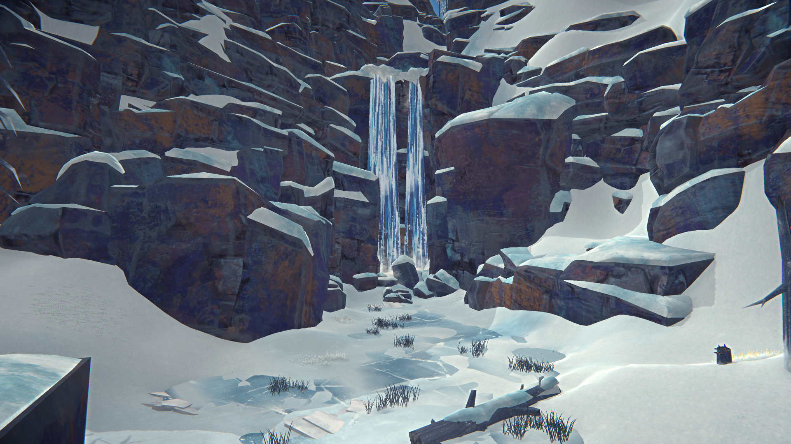

# Cloudtop Falls

**Categories:** Locations, Locations in Hushed River Valley, Outdoor locations, Waterfalls · **Source:** [Fandom](https://thelongdark.fandom.com/wiki/Cloudtop_Falls)

**Cloudtop Falls**

_Hushed\_river\_valley\_cloudtop\_falls\_20201031.png_

**Location**

_Cloudtop\_Falls\_Location.png_

**Region:** [Hushed River Valley](./Hushed%20River%20Valley.md)

**Type:** Outdoors

## Overview

The pond at the base of the falls can spawn [rabbits](./Rabbit.md), is full of [Cat Tails](./Cat%20Tail.md), and holds [Burdocks](./Burdock.md).

A small camp can be located down river towards [Stairsteps Lake](./Stairsteps%20Lake.md). This camp has a [Snow Shelter](./Snow%20Shelter.md) and a burnt out campfire. A backpack and a [Survival Bow](./Survival%20Bow.md) with [Simple Arrows](./Simple%20Arrow.md) may be found here.

A [Deer Carcass](./Deer%20Carcass.md) can potentially be found near the camp, the deer carcass may have a broken arrow laying next to it.

## Gallery

_The camp located down river from the falls._
