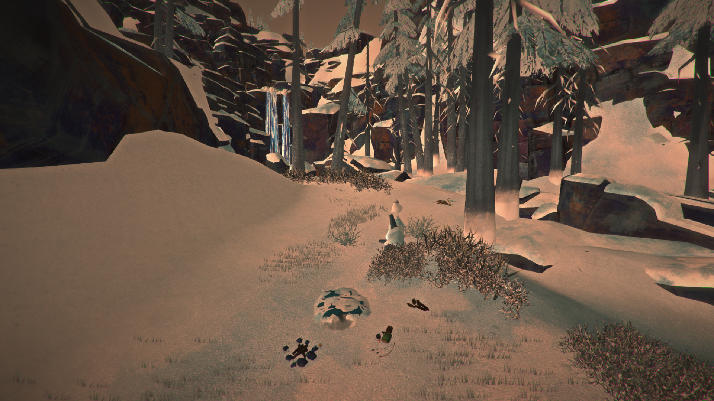

# Cloudtop Falls

**Categories:** Locations, Locations in Hushed River Valley, Outdoor locations, Waterfalls · **Source:** [Fandom](https://thelongdark.fandom.com/wiki/Cloudtop_Falls)

**Cloudtop Falls**

| Property | Details |
| --- | --- |
|  | [Hushed river valley cloudtop falls 20201031](../assets/Hushed_river_valley_cloudtop_falls_20201031.png) |
| **Location** |  |
|  | [Cloudtop Falls Location](../assets/Cloudtop_Falls_Location.png) |
| Region | [Hushed River Valley](./Hushed%20River%20Valley.md) |
| **General** |  |
| Type | Outdoors |
|  | Has no shelter |

**Cloudtop Falls** is a waterfall located in [Hushed River Valley](./Hushed%20River%20Valley.md), it is due west from the [Mountain Town](./Mountain%20Town.md) cave entrance.

## Overview

The pond at the base of the falls can spawn [rabbits](./Rabbit.md), is full of [Cat Tails](./Cat%20Tail.md), and holds [Burdocks](./Burdock.md).

A small camp can be located down river towards [Stairsteps Lake](./Stairsteps%20Lake.md). This camp has a [Snow Shelter](./Snow%20Shelter.md) and a burnt out campfire. A backpack and a [Survival Bow](./Survival%20Bow.md) with [Simple Arrows](./Simple%20Arrow.md) may be found here.

[ru:Заоблачный водопад](https://ru.wikipedia.org/wiki/%D0%97%D0%B0%D0%BE%D0%B1%D0%BB%D0%B0%D1%87%D0%BD%D1%8B%D0%B9_%D0%B2%D0%BE%D0%B4%D0%BE%D0%BF%D0%B0%D0%B4) A [Deer Carcass](./Deer%20Carcass.md) can potentially be found near the camp, the deer carcass may have a broken arrow laying next to it.

## Gallery

