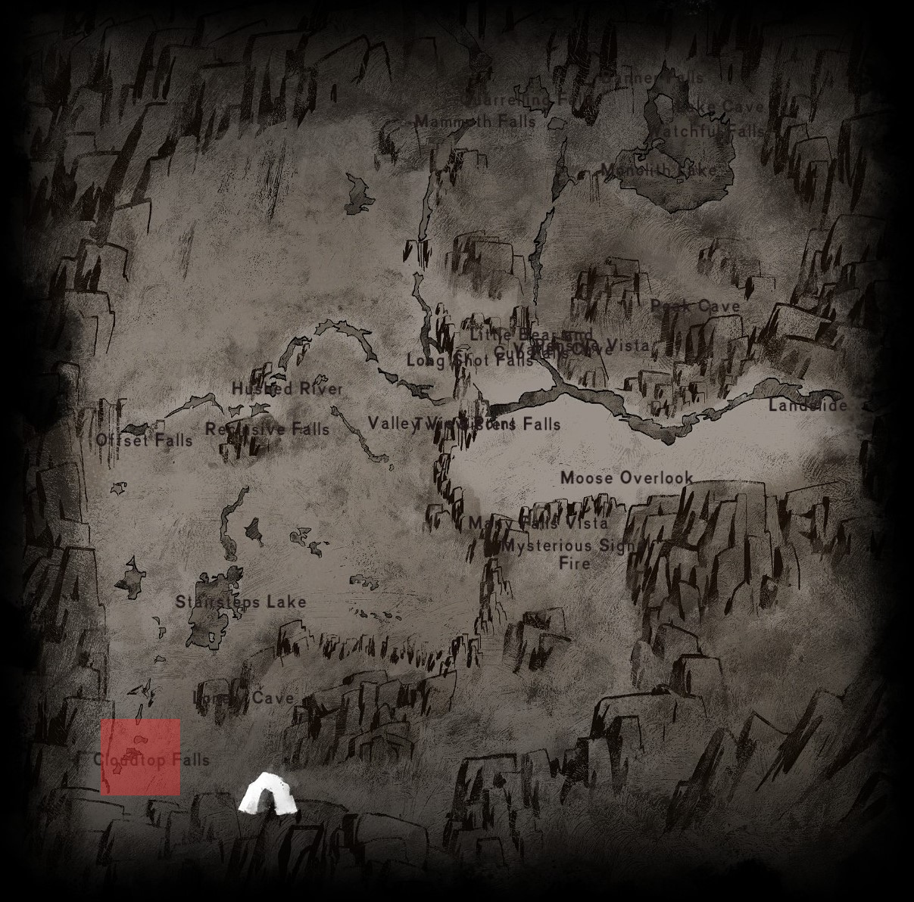

# Cloudtop Falls

**Cloudtop Falls**

| Property | Details |
| --- | --- |
|  |  / *Hushed\_river\_valley\_cloudtop\_falls\_20201031.png* |
| **Location** |  |
|  |  / *Cloudtop\_Falls\_Location.png* |
| Region | [Hushed River Valley](./Hushed%20River%20Valley.md)\|- |
| Type | Outdoors\|- |
