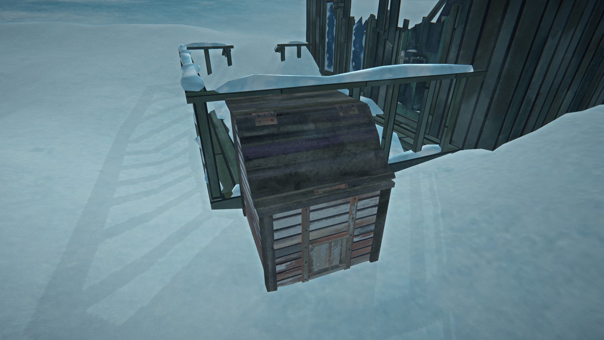

# Coal Bin

**Coal Bin**

| Property | Details |
| --- | --- |
|  |  / *Coal\_Bin.jpg* |
| Story item | Yes |
| **Container** |  |
| Capacity | 60.00 kg(132 lbs) |

A **Coal Bin** is a storage container item found occasionally across the Island next to Cabins and houses. They are half the size of [Firewood Bins](./Firewood%20Bin.md) and obtain contain [Tinder Plugs](./Tinder%20Plug.md) and [Coal](./Coal.md).

**Lua execution error in Module:Navbox function navbox**
