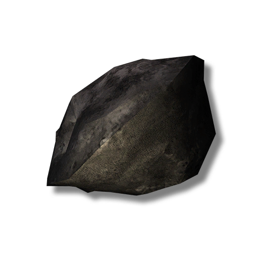

# Coal

**Contents**

- [Overview](#Overview)
- [Fire Starting info](#Fire_Starting_info)
- [Obtaining](#Obtaining)
- [Respawn statistics](#Respawn_statistics)
- [Update history](#Update_history)

<table class="infobox">
<caption>Coal</caption>
<colgroup>
<col style="width: 50%" />
<col style="width: 50%" />
</colgroup>
<tbody>
<tr>
<td colspan="2"><figure>

<figcaption>Coal_icon.png</figcaption>
</figure></td>
</tr>
<tr>
<td>
Release
</td>
<td>
<a href="./The%20Long%20Dark%20%E2%80%94%20Changelog.md#0.264" class="wikilink" title="18 September 2015">18 September 2015</a>
</td>
</tr>
<tr>
<td>
Wintermute
</td>
<td>
No
</td>
</tr>
<tr>
<td>
Renewable
</td>
<td>
Yes
</td>
</tr>
<tr>
<td colspan="2" class="section">
<strong>Properties</strong>
</td>
</tr>
<tr>
<td>
Item type
</td>
<td>
<a href="./Fire%20Starting.md" class="wikilink" title="Fire Starting">Fire Starting</a>|-
</td>
</tr>
<tr>
<td>
Stackable
</td>
<td>
Yes
</td>
</tr>
<tr>
<td>
Examine
</td>
<td>
Lump of Coal.
</td>
</tr>
<tr>
<td colspan="2" class="section">
<strong>Values</strong>
</td>
</tr>
<tr>
<td>
Weight
</td>
<td>
0.3 kg (0.66 lbs)
</td>
</tr>
</tbody>
</table>

**Coal** is a fuel item in *The Long Dark*.

## Overview

Coal is a fuel source for fires, and the only fuel which can heat Forges hot enough for Forging (150°C) to craft items. Each piece of coal added to a fire grants 1 hour of fuel and 20°C to its temperature. This makes it the most efficient fuel both for temperature and weight efficiency. Coal cannot be used to start a fire. It may be added once a fire has been started with another fuel (e.g. a <a href="./Stick.md" class="wikilink" title="Stick">Stick</a>).

## Fire Starting info

<table class="infobox">
<caption>Coal</caption>
<thead>
<tr>
<th>
Type
</th>
<th>
Fuel
</th>
</tr>
</thead>
<tbody>
<tr>
<th colspan="2" class="section">
<strong>Statistics</strong>
</th>
</tr>
&#10;<tr>
<th>
Duration
</th>
<td>
 60 minutes
</td>
</tr>
<tr>
<th>
Heat
</th>
<td>
 +20°C (+36°F)
</td>
</tr>
<tr>
<th>
Burn Density
</th>
<td>
3.33 hr/kg (1.51 hr/lb)
</td>
</tr>
</tbody>
</table>

## Obtaining

Coal is found on the floor abundantly inside mines, some caves, and rarely along streambeds. Finite amounts of Coal are present at <a href="./Forge.md" class="wikilink" title="Forges">Forges</a> on <a href="./Great%20Bear%20Island.md" class="wikilink" title="Great Bear Island">Great Bear Island</a>. The most abundant sources of coal are <a href="./Langston%20Mine.md" class="wikilink" title="Langston Mine">Langston Mine</a> and <a href="./Cinder%20Hills%20Coal%20Mine.md" class="wikilink" title="Cinder Hills Coal Mine">Cinder Hills Coal Mine</a>.

- Coal is necessary for forging.
- Coal respawns after 10 days (in-game) in caves, mines and streambeds.
- Coal is crucial for staying warm in Stalker and Interloper modes, where fires do not overcome ambient temperature, or prevent <a href="./Needs.md" class="wikilink" title="freezing">freezing</a>.
- Due of the proximity of <a href="./No.%203%20Coal%20Mine.md" class="wikilink" title="Abandoned Mine No. 3">Abandoned Mine No. 3</a> to <a href="./The%20Riken.md" class="wikilink" title="The Riken">The Riken</a> (and its forge), <a href="./Desolation%20Point.md" class="wikilink" title="Desolation Point">Desolation Point</a> is usually easier to forge at and sustainable for re-stocking than forges located in the <a href="./Maintenance%20Yard.md" class="wikilink" title="Maintenance Yard">Maintenance Yard</a>, <a href="./Old%20Spence%20Family%20Homestead.md" class="wikilink" title="Old Spence Family Homestead">Old Spence Family Homestead</a>, or <a href="./Hangar%20Basement.md" class="wikilink" title="Hangar Basement">Hangar Basement</a>.

## Respawn statistics

Some caves and mines have more coal the first time that one visits the location. The following numbers are based on *return* visits, on <a href="./Interloper.md" class="wikilink" title="Interloper">Interloper</a>, after day 250.

| Region | Location | Number of coal which respawn long-term (Interloper) | Note |
|----|----|----|----|
| <a href="./Blackrock.md" class="wikilink" title="Blackrock">Blackrock</a> | <a href="./Last%20Prospect.md" class="wikilink" title="Last Prospect">Last Prospect</a> mine | 23 | 6 outside mine, 7 on first floor, 5 on second floor, 5 on third floor |
| <a href="./Blackrock.md" class="wikilink" title="Blackrock">Blackrock</a> | Cave below <a href="./Last%20Prospect.md" class="wikilink" title="Last Prospect">Last Prospect</a> | 2 |  |
| <a href="./Bleak%20Inlet.md" class="wikilink" title="Bleak Inlet">Bleak Inlet</a> | Behind the <a href="./Cannery%20Worker%20Residences.md" class="wikilink" title="Cannery Worker Residences">Cannery Worker Residences</a> | 6 |  |
| <a href="./Bleak%20Inlet.md" class="wikilink" title="Bleak Inlet">Bleak Inlet</a> | Connector cave to <a href="./Forlorn%20Muskeg.md" class="wikilink" title="Forlorn Muskeg">Forlorn Muskeg</a> | 7 |  |
| <a href="./Coastal%20Highway.md" class="wikilink" title="Coastal Highway">Coastal Highway</a> | <a href="./Cinder%20Hills%20Coal%20Mine.md" class="wikilink" title="Cinder Hills Coal Mine">Cinder Hills Coal Mine</a> upper level | 46 |  |
| <a href="./Coastal%20Highway.md" class="wikilink" title="Coastal Highway">Coastal Highway</a> | <a href="./Cinder%20Hills%20Coal%20Mine.md" class="wikilink" title="Cinder Hills Coal Mine">Cinder Hills Coal Mine</a> aurora level | 8 |  |
| <a href="./Coastal%20Highway.md" class="wikilink" title="Coastal Highway">Coastal Highway</a> | <a href="./Cinder%20Hills%20Coal%20Mine.md" class="wikilink" title="Cinder Hills Coal Mine">Cinder Hills Coal Mine</a> lower level | 5 |  |
| <a href="./Desolation%20Point.md" class="wikilink" title="Desolation Point">Desolation Point</a> | <a href="./No.%203%20Coal%20Mine.md" class="wikilink" title="No. 3 Coal Mine">No. 3 Coal Mine</a> | 26 |  |
| <a href="./Desolation%20Point.md" class="wikilink" title="Desolation Point">Desolation Point</a> | <a href="./Abandoned%20Mine%20No.%205.md" class="wikilink" title="Abandoned Mine No. 5">Abandoned Mine No. 5</a> | 15 |  |
| <a href="./Desolation%20Point.md" class="wikilink" title="Desolation Point">Desolation Point</a> | <a href="./Cave%20%28Desolation%20Point%20location%29.md" class="wikilink" title="Scruffy&#39;s Cave">Scruffy's Cave</a> | 8 |  |
| <a href="./Far%20Range%20Branch%20Line.md" class="wikilink" title="Far Range Branch Line">Far Range Branch Line</a> | <a href="./Platelayer%27s%20Shortcut.md" class="wikilink" title="Platelayer&#39;s Shortcut">Platelayer's Shortcut</a> | 8 |  |
| <a href="./Mountain%20Town.md" class="wikilink" title="Mountain Town">Mountain Town</a> | Connector cave to <a href="./Mystery%20Lake%20%28disambiguation%29.md" class="wikilink" title="Mystery Lake">Mystery Lake</a> | 9 |  |
| <a href="./Mountain%20Town.md" class="wikilink" title="Mountain Town">Mountain Town</a> | Connector cave to <a href="./Hushed%20River%20Valley.md" class="wikilink" title="Hushed River Valley">Hushed River Valley</a> | 7 |  |
| <a href="./Pleasant%20Valley.md" class="wikilink" title="Pleasant Valley">Pleasant Valley</a> | Connector cave to <a href="./Winding%20River.md" class="wikilink" title="Winding River">Winding River</a> | 15 |  |
| <a href="./Pleasant%20Valley.md" class="wikilink" title="Pleasant Valley">Pleasant Valley</a> | <a href="./Misty%20Falls%20Cave.md" class="wikilink" title="Misty Falls Cave">Misty Falls Cave</a> | 10 |  |
| <a href="./Sundered%20Pass.md" class="wikilink" title="Sundered Pass">Sundered Pass</a> | <a href="./Bolt%20Chopper%27s%20Haven.md" class="wikilink" title="Bolt Chopper&#39;s Haven">Bolt Chopper's Haven</a> | 2 |  |
| <a href="./Sundered%20Pass.md" class="wikilink" title="Sundered Pass">Sundered Pass</a> | Cave system connecting <a href="./Idle%20Hideout.md" class="wikilink" title="Idle Hideout">Idle Hideout</a>, <a href="./Prayerful%20Window.md" class="wikilink" title="Prayerful Window">Prayerful Window</a>, <a href="./Cascading%20Gap.md" class="wikilink" title="Cascading Gap">Cascading Gap</a> and <a href="./Route%20One%20Waterfall.md" class="wikilink" title="Route One Waterfall">Route One Waterfall</a> | 7 | All spawn on the level connecting the three entrances (i.e. no rope climb is needed to access them all unless entering from Prayerful Window) |
| <a href="./Sundered%20Pass.md" class="wikilink" title="Sundered Pass">Sundered Pass</a> | <a href="./Miserable%20Haunt.md" class="wikilink" title="Miserable Haunt">Miserable Haunt</a> | 1 |  |
| <a href="./Timberwolf%20Mountain.md" class="wikilink" title="Timberwolf Mountain">Timberwolf Mountain</a> | Cave system from <a href="./Andre%27s%20Peak.md" class="wikilink" title="Andre&#39;s Peak">Andre's Peak</a> to <a href="./Chasm%20Cave.md" class="wikilink" title="Chasm Cave">Chasm Cave</a> | 8 |  |
| <a href="./Timberwolf%20Mountain.md" class="wikilink" title="Timberwolf Mountain">Timberwolf Mountain</a> | Cave system from <a href="./Secluded%20Shelf.md" class="wikilink" title="Secluded Shelf">Secluded Shelf</a> toward <a href="./Summit.md" class="wikilink" title="Summit">Summit</a> | 0 | Coal appears first time and does not respawn |
| <a href="./Zone%20of%20Contamination.md" class="wikilink" title="Zone of Contamination">Zone of Contamination</a> | <a href="./Langston%20Mine.md" class="wikilink" title="Langston Mine">Langston Mine</a> from Miner's Footpath entrance to blocked path area on Level 3 | 14 | 2 spawn in the Miner's Footpath entrance room. 4 spawn between the 400 ft sign and the swinging bridge. 8 spawn between the swinging bridge and the blocked entrance to the rest of Level 3. |
| <a href="./Zone%20of%20Contamination.md" class="wikilink" title="Zone of Contamination">Zone of Contamination</a> | <a href="./Langston%20Mine.md" class="wikilink" title="Langston Mine">Langston Mine</a> Floor 3 not including area past blocked path to Miner's Footpath | 40 |  |
| <a href="./Zone%20of%20Contamination.md" class="wikilink" title="Zone of Contamination">Zone of Contamination</a> | <a href="./Langston%20Mine.md" class="wikilink" title="Langston Mine">Langston Mine</a> Floor 2 | 8 | All the coal respawns are in the area without rail tracks (i.e. first left after entering from the elevator shaft). The coal in the crushing machine does not respawn. |
| <a href="./Zone%20of%20Contamination.md" class="wikilink" title="Zone of Contamination">Zone of Contamination</a> | <a href="./Langston%20Mine.md" class="wikilink" title="Langston Mine">Langston Mine</a> Floor 1 not including area unlocked by Tales | 17 | All the coal spawns are in the area with toxic gas and no rail tracks. A respirator is needed to access them all. |
| <a href="./Zone%20of%20Contamination.md" class="wikilink" title="Zone of Contamination">Zone of Contamination</a> | <a href="./Langston%20Mine.md" class="wikilink" title="Langston Mine">Langston Mine</a> Mountainside Passage to Floor 1 | 29 | 6 coal in the large room with the flooded path to the rest of Level 1. 11 coal on the next "level" above that, 12 coal in the top level. |
| <a href="./Zone%20of%20Contamination.md" class="wikilink" title="Zone of Contamination">Zone of Contamination</a> | <a href="./Welkin%27s%20Window.md" class="wikilink" title="Welkin&#39;s Window">Welkin's Window</a> | 7 |  |
| <a href="./Zone%20of%20Contamination.md" class="wikilink" title="Zone of Contamination">Zone of Contamination</a> | Far Territory Cave System | 25 | 4 spawn on the top level that has the entrance to <a href="./Sundered%20Pass.md" class="wikilink" title="Sundered Pass">Sundered Pass</a>. 7 spawn in between the rope climb and the bridge into the room where the junction is. 1 in the room with the junction. 6 coal between the junction and the entrance to <a href="./Forsaken%20Airfield.md" class="wikilink" title="Forsaken Airfield">Forsaken Airfield</a>. 7 coal between the junction and the entrance to <a href="./Zone%20of%20Contamination.md" class="wikilink" title="Zone of Contamination">Zone of Contamination</a>. |
|  |  |  |  |

## Update history

- UPDATE **23 September 2016 (<a href="./The%20Long%20Dark%20%E2%80%94%20Changelog.md#.364" class="wikilink" title="Update">Update</a>):**
  - Fixed issue where players could add Coal to a fire at an invalid (too low) temperature
- UPDATE **16 December 2015 (<a href="./The%20Long%20Dark%20%E2%80%94%20Changelog.md#.298" class="wikilink" title="Update">Update</a>):**
  - Fixed issue with Coal sometimes spawning in air.
- UPDATE **18 September 2015 (<a href="./The%20Long%20Dark%20%E2%80%94%20Changelog.md#.264" class="wikilink" title="Update">Update</a>):**
  - Added to game.

**Lua execution error in Module:Navbox function navbox** <a href="ru:%D0%A3%D0%B3%D0%BE%D0%BB%D1%8C" class="wikilink" title="ru:Уголь">ru:Уголь</a>

