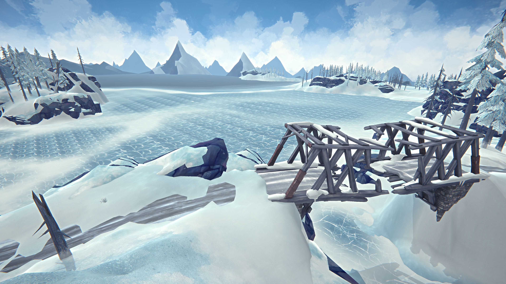
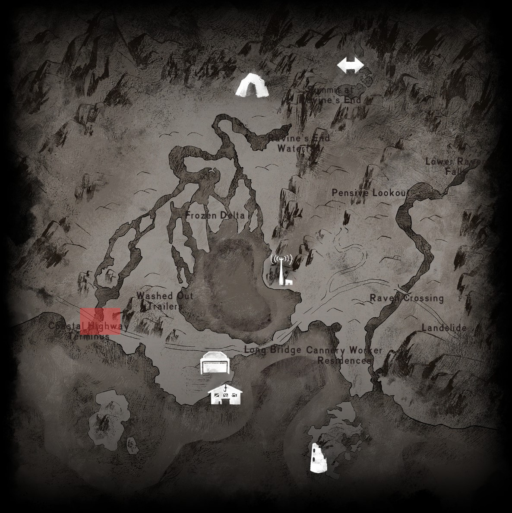

# Coastal Highway Terminus

**Coastal Highway Terminus**

| Property | Details |
| --- | --- |
|  |  / *SS-BI-Terminus01.jpg* |
| **Location** |  |
|  |  / *Coastal\_Highway\_Terminus\_Location.png* |
| Region | [Bleak Inlet](./Bleak%20Inlet.md)\|- |
| **General** |  |
| Type | Outdoors\|- |
