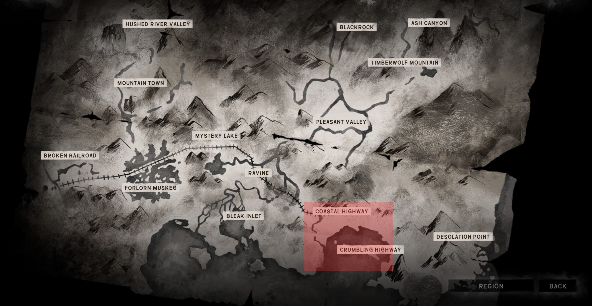
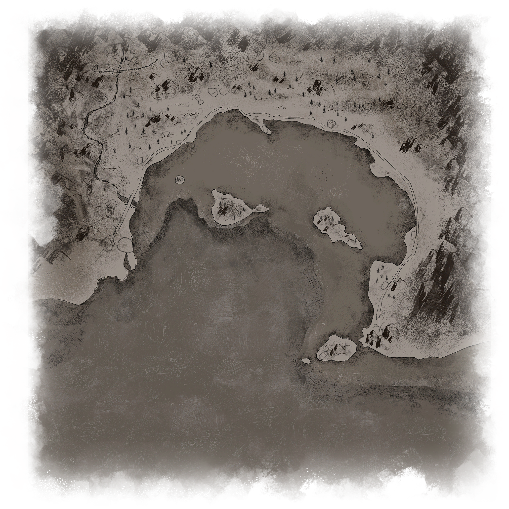
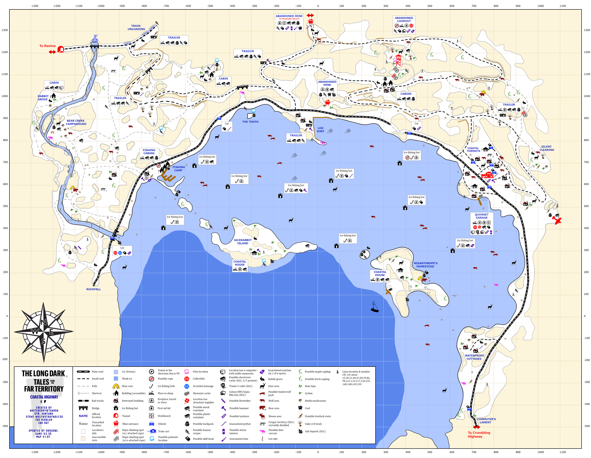
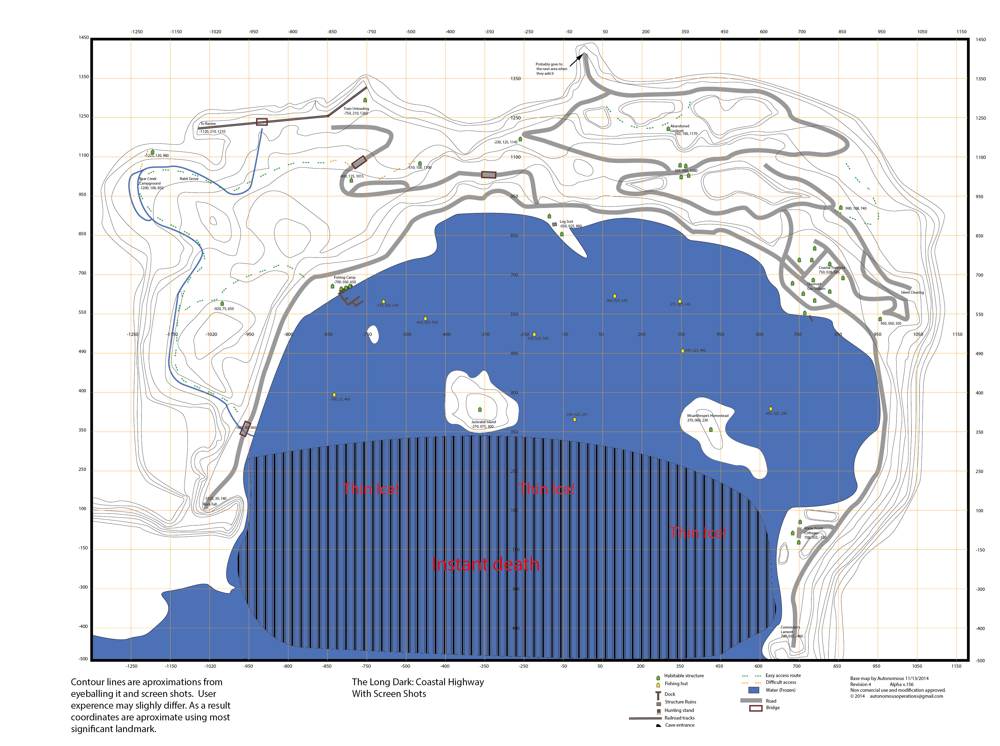
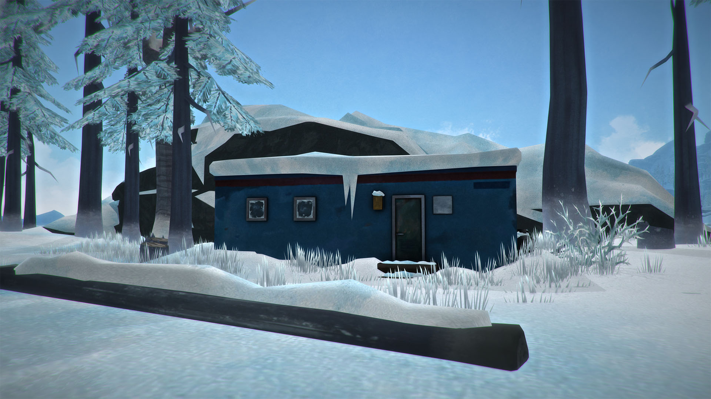
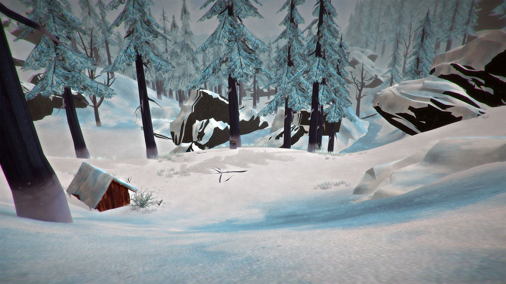
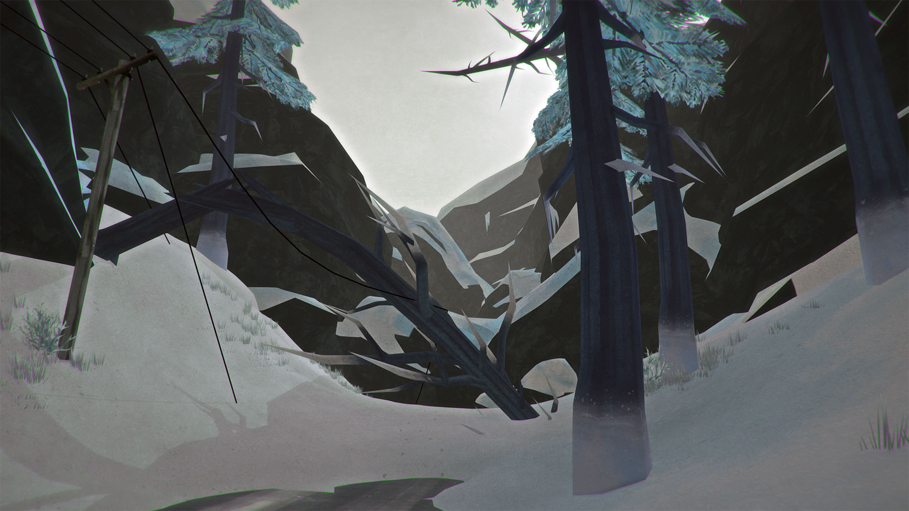
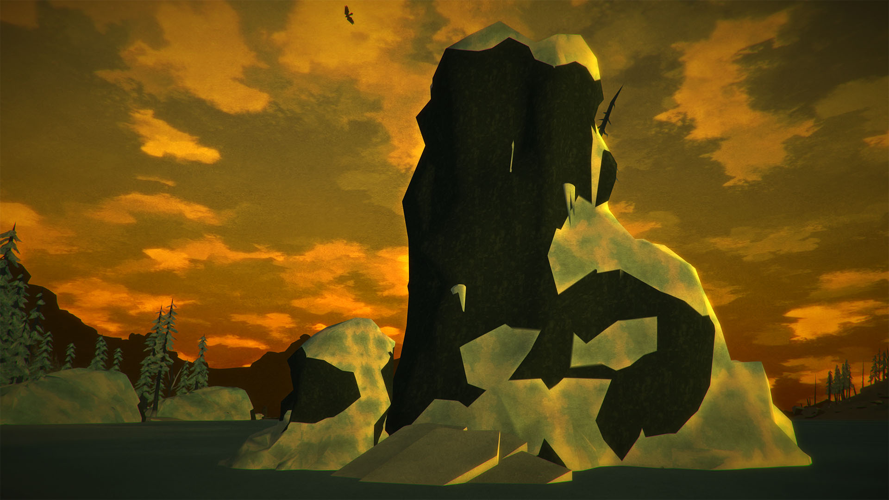
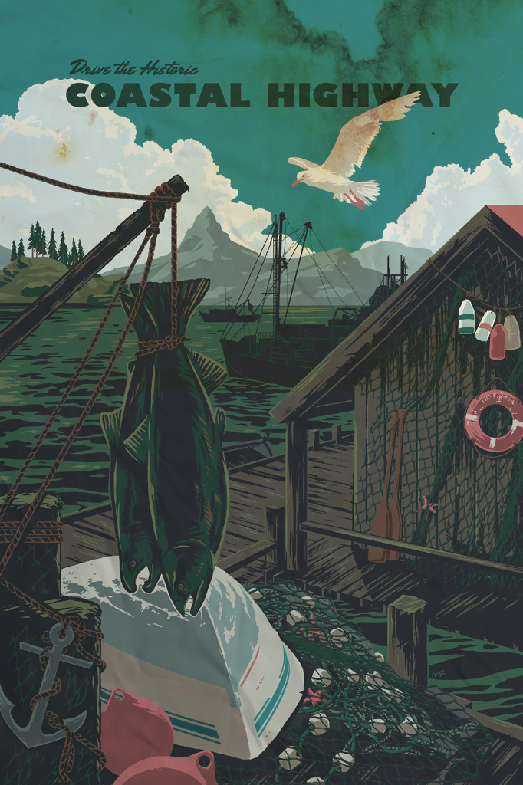

# Coastal Highway

**Categories:** Regions · **Source:** [Fandom](https://thelongdark.fandom.com/wiki/Coastal_Highway)

**Contents**

- [Overview](#overview)
- [Peculiarities](#peculiarities)
- [Exclusive gear](#exclusive-gear)
- [Locations](#locations)
- [Unmarked Locations](#unmarked-locations)
- [Miscellaneous Structures](#miscellaneous-structures)
- [Safehouses](#safehouses)
- [Quonset Garage](#quonset-garage)
- [Jackrabbit Island](#jackrabbit-island)
- [Fishing Camp](#fishing-camp)
- [Trivia](#trivia)
- [Gallery](#gallery)
- [Maps](#maps)
- [Locations (Old)](#locations-old)
- [Miscellaneous](#miscellaneous)

**Coastal Highway**

_Coastal\_Highway\_title\_card.png_

**Location on [Great Bear Island](./Great%20Bear%20Island.md)**

_Coastal\_Highway\_Location.png_

_Coastal\_Highway\_Region\_Map.png_

**Details**

**Description:** A large frozen bay and coastline with a ruined highway crossing around it.

**Connecting Regions:** [Mystery Lake](./Mystery%20Lake%20%28region%29.md) (via [The Ravine](./The%20Ravine.md)) / [Bleak Inlet](./Bleak%20Inlet.md) (via [The Ravine](./The%20Ravine.md)) / [Pleasant Valley](./Pleasant%20Valley.md) (via [Cinder Hills Coal Mine](./Cinder%20Hills%20Coal%20Mine.md)) / [Desolation Point](./Desolation%20Point.md) (via [Old Island Connector](./Crumbling%20Highway.md))

**Difficulty:** Intermediate

**Interloper Region Spawn:** No

**Locations:** 20

**Hazards and Survivability:** The region has plentiful resources, but there is also a high concentration of [Wolves](./Wolf.md) and three [Bear](./Bear.md)-patrolled locations.

**Date Added:** Oct 2014

> “**For intermediate players. A weather-battered coastline rich in shelters and resources. Watch out for wildlife.**”
>
> — - In game description

**Coastal Highway** is the 2nd [Region](./Region.md) released in _[The Long Dark](./The%20Long%20Dark.md)_. The region is named after a section of the [Great Bear Highway](./Great%20Bear%20Highway.md) that wraps itself around a local lagoon, giving the region a C shape.

## Overview

The region is a relatively warm crescent of steep hills and switchbacks surrounding an icy bay; a highway follows the coast with settlements along it. The bay's ice shelf features many [Fishing huts](./Fishing%20Hut.md), and further out two islands: [Jackrabbit Island](./Jackrabbit%20Island.md) and [Misanthrope's Homestead](./Misanthrope%27s%20Homestead.md). Several [Wolf](./Wolf.md) packs live in the area, and further out the bay's ice becomes thin and dangerous to walk upon.

Coastal Highway connects to [Mystery Lake](./Mystery%20Lake%20%28region%29.md) through the [Ravine](./The%20Ravine.md) to the north-west, [Pleasant Valley](./Pleasant%20Valley.md) through the [Cinder Hills Coal Mine](./Cinder%20Hills%20Coal%20Mine.md) to the north, and [Desolation Point](./Desolation%20Point.md) through the [Crumbling Highway](./Crumbling%20Highway.md) and [No. 3 Coal Mine](./No.%203%20Coal%20Mine.md) to the south-east.

Compared to the nearby [Mystery Lake](./Mystery%20Lake%20%28region%29.md), it has more resources and overall warmer temperatures; however there are more abundant [wolves](./Wolf.md) and [bears](./Bear.md), particularly near the [Coastal Townsite](./Coastal%20Townsite.md), [Log Sort](./Log%20Sort.md), and [Misanthrope's Homestead](./Misanthrope%27s%20Homestead.md).

Coastal Highway also has two notable benefits compared to regions further inland. First, like in other coastal regions, [beachcombing](./Beachcombing.md) is possible, giving the player easy and renewable sources of clothing, tools, medications, and fish, among other items. Second, Coastal Highway is the only region in the game with a [Trade Drop Box](./Trade%20Drop%20Box.md), meaning that it is the only region where goods can be directly exchanged with the [Trader](./Trader.md). This makes Coastal Highway a prime candidate for long-term habitation, and makes it one of the most important regions in the late-game.

## Peculiarities

Coastal Highway differs from most other regions in some regards, which may require adaptations to playing style.

- There are no proper [Warm Caves](./Warm%20Cave.md). The bear dens are just sheltered nooks.
- Two-slot cooking opportunities are only available indoors in a heavily wildlife-infested area, or using [campfires](./Campfire.md).
- The entrance to the Cinder Hills Coal Mine near the [Log Sort](./Log%20Sort.md) has a portion which is only accessible via an elevator which is only powered during an aurora. In past versions of the game, this Aurora Mine was considered highly dangerous, as players could become trapped underground for extended periods of time if they failed to leave before the aurora ended. However, in current versions of the game, if a player becomes trapped after the end of an aurora, there will always be a scripted aurora at 8:30 PM the following night allowing them to escape, making the Aurora Mine much safer to traverse.
- The two entrances to Cinder Hills Coal Mine are not connected inside.

One notable feature of this region is that, depending on the Experience chosen, many houses and cabins throughout the region spawn destroyed. On [Interloper](./Interloper.md), [Misery](./Misery.md), and the [As the Dead Sleep](./As%20the%20Dead%20Sleep.md) Challenge, half of the available structures are destroyed. This can make certain locations contain very few structures to loot/shelter in. All trailers in the region will remain intact, regardless of difficulty however.

This is the only region that features this type of change on higher difficulties.

## Exclusive gear

One piece of exclusive gear will be found in the region: [Barb's Rifle](./Barb%27s%20Rifle.md). This rifle is considerably more durable than the normal rifle, but is 0.50 kg heavier. Its exact location will vary in each playthrough.

## Locations

There are many named locations within Coastal Highway, including:

- [Abandoned Lookout](./Abandoned%20Lookout.md)
- [Bear Creek Campground](./Bear%20Creek%20Campground.md)
- [Cinder Hills Coal Mine](./Cinder%20Hills%20Coal%20Mine.md)
- [Coastal Townsite](./Coastal%20Townsite.md)
- [Commuter's Lament](./Commuter%27s%20Lament.md)
- [Fishing Camp](./Fishing%20Camp.md)
- [Jackrabbit Island](./Jackrabbit%20Island.md)
- [Log Sort](./Log%20Sort.md)
- [Misanthrope's Homestead](./Misanthrope%27s%20Homestead.md)
- [Quonset Garage](./Quonset%20Garage.md)
- [Rabbit Grove](./Rabbit%20Grove.md)
- [Rockfall](./Rockfall.md)
- [Silent Clearing](./Silent%20Clearing.md)
- [The Tooth](./The%20Tooth.md)
- [Train Unloading](./Train%20Unloading.md)
- [Waterfront Cottages](./Waterfront%20Cottages.md)
- To Abandoned Mine (Transition to [Cinder Hills Coal Mine](./Cinder%20Hills%20Coal%20Mine.md) Upper Level to [Pleasant Valley](./Pleasant%20Valley.md))
- To Abandoned Mine (Transition to [Cinder Hills Coal Mine](./Cinder%20Hills%20Coal%20Mine.md) Middle Level that leads to Lower Level)
- To Crumbling Highway (Transition to [Crumbling Highway](./Crumbling%20Highway.md))
- To Ravine (Transition to [The Ravine](./The%20Ravine.md))

### Unmarked Locations

Additionally, there are several indoor locations spread across the region that are recorded in the [Journal](./Journal.md). These locations are labeled [Coastal House](./Coastal%20House.md), Cabin, Fishing Cabin, and Trailer.

Many of these buildings will spawn destroyed if playing on [Interloper](./Interloper.md)/[Misery](./Misery.md) (labeled as I/M).

- [Coastal Townsite](./Coastal%20Townsite.md) contains 7 (3 on I/M) [Coastal Houses](./Coastal%20House.md), with one on the outskirt of the town.
- [Jackrabbit Island](./Jackrabbit%20Island.md) has 1 Coastal House.
- [Misanthrope's Homestead](./Misanthrope%27s%20Homestead.md) has 1 Coastal House.
- [Fishing Camp](./Fishing%20Camp.md) contains 3 Fishing Cabins and 1 Cabin.
- [Log Sort](./Log%20Sort.md) has 1 Trailer and 1 Coastal House (the House can spawn boarded up, even on lower difficulties).
- [Rabbit Grove](./Rabbit%20Grove.md) has 1 Cabin.
- [Waterfront Cottages](./Waterfront%20Cottages.md) can contain 1-2 [Coastal Houses](./Coastal%20House.md) (0 on I/M).

### Miscellaneous Structures

Several Trailers and Cabins can be found farther away from named locations.

- There are 3 cabins south of [Abandoned Lookout](./Abandoned%20Lookout.md), below the cliff (2 on I/M).
- A trailer north of [Coastal Townsite](./Coastal%20Townsite.md).
- A trailer north of [Log Sort](./Log%20Sort.md).
- A trailer at [Train Unloading](./Train%20Unloading.md)
  - A Trailer south of [Train Unloading](./Train%20Unloading.md).
  - A Cabin is found east of the previous Trailer/west of Abandoned Lookout Cabins/north of The Tooth.
- A Cabin northwest of [Fishing Camp](./Fishing%20Camp.md), south of [Bear Creek Campground](./Bear%20Creek%20Campground.md) (spawns destroyed on I/M).

Additionally, a [crashed plane](./Plane%20Crashes.md) can be found to the east of Coastal Townsite, up in the hills past the Cabin on the outskirt of town.

## Safehouses

There are several locations for [Safehouses](./Safehouse.md) in the Coastal Highway, including Jackrabbit Island and Quonset Garage.

### Quonset Garage

- Pros: A central location with plentiful resources, abundant storage, an indoor workbench, bed, and fire barrel. Numerous vehicles nearby for storage or escape from predators.
- Cons: Multiple predators around the Quonset, including wolves, a bear and moose spawn. Very dangerous, especially if on Stalker and Interloper. No nearby cave (but fishing huts) for Cabin Fever; vehicles are quite cold.

### Jackrabbit Island

- Pros: Centrally located, direct access to multiple key regions and to the [Trader](./Trader.md) while being secluded from predators. Has 2 rabbit groves on the island, and 1 nearby (towards Misanthrope) as well as fishing, abundant sticks, and close access for [Beachcombing](./Beachcombing.md). Several possible bear spawns in the vicinity but none come close to the island.
- Cons: Somewhat unreliable [Fir Limb](./Fir%20Limb.md) / [Cedar Limb](./Cedar%20Limb.md) spawns, a [Travois](./Travois.md) is recommended to haul in bigger loads from elsewhere. No place for indoor fires ([Fireplace](./Fireplace.md), [barrel](./Fire%20Barrel.md) or [Pot Belly Stove](./Pot%20Belly%20Stove.md)). No nearby cave for Cabin Fever, only Fishing Huts. Wolves and Timberwolves can spawn near Fishing huts.

### Fishing Camp

- Pros: multiple rabbit groves (2 over hill, 1 near the bridge, 2 at Jackrabbit Island) and fishing shacks, and close to the coast for beachcombing. Centrally located in the region, and has a workbench (outdoors).
- Cons: Multiple wolves may spawn nearby, as well as a bear up the road or atop the hill. Workbench is outdoors. No place for indoor fires (fireplace, barrel or pot belly stove). No nearby cave for Cabin Fever.

## Trivia

- Many photographs on walls or nightstands inside the houses of Coastal Highway are [Hinterland's](./Hinterland%20Studio%20Inc..md) developers, or their friends and family; this includes "Stacyplays" (aka Stacy Hinojosa) a YouTuber who ran a "let's play" series during The Long Dark's alpha/beta (2014-2016). The item [Stacy's Grape Soda](./Stacy%27s%20Grape%20Soda.md) is also named after her.

## Gallery

### Maps

_A detailed map of Coastal Highway v2.35 (spoilers)_

_Map of Coastal Highway v2.35 (Interloper/Misery edition, contains spoilers)_

_Coastal\_highway\_map.png_

_MAP-ingame-CH-v162-Eng.jpg_

_Coastal\_Highway\_map\_by\_Sniper\_Bob.jpg_

### Locations (Old)

_Abandoned Lookout_

_Bear Creek Campground_

_Coastal Townsite_

_Commuter's Lament_

_Jackrabbit Island_

_Fishing Camp_

_Log Sort_

_Misanthrope's Homestead_

\[Missing image: Quonset\_Gas\_Station\_exterior.jpg\]

_Quonset Gas Station_

_Rabbit Grove_

_Rockfall_

_Silent Clearing_

_The Tooth_

_Train Unloading_

_Waterfront Cottages_

### Miscellaneous

_A poster of Coastal Highway_
