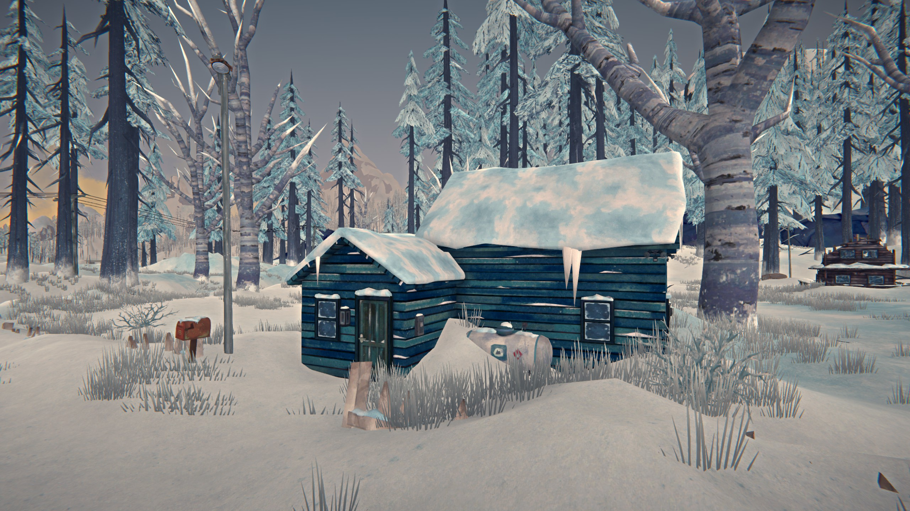
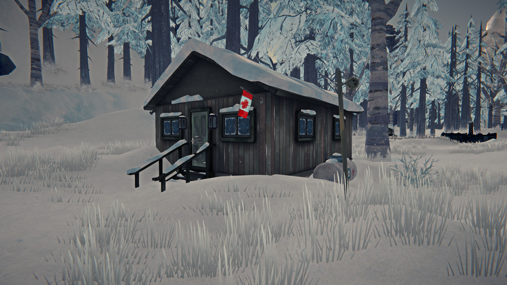
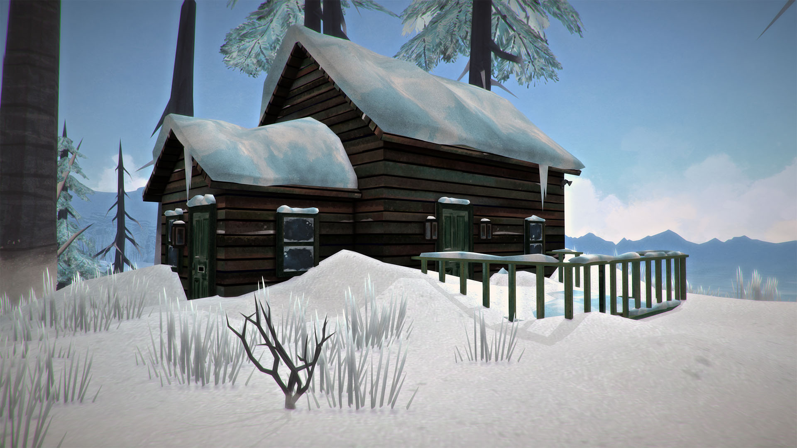

# Coastal House

**Categories:** Indoor locations, Locations, Locations in Coastal Highway, Residential locations · **Source:** [Fandom](https://thelongdark.fandom.com/wiki/Coastal_House)

**Contents**

- [Overview](#overview)
- [Loot](#loot)
- [Building Types](#building-types)
- [1 Story House Type 1](#1-story-house-type-1)
- [1 Story House Type 2](#1-story-house-type-2)
- [1 Story House Type 3](#1-story-house-type-3)
- [1 Story House Type 4](#1-story-house-type-4)
- [2 Story House](#2-story-house)

**Coastal House**

| \[\[File: /  / _Type 1_ /  / _Type 2_ /  / _Type 3_ /  / _Type 4_ /  / _Type 5_ | 250px\]\] |  |
| --- | --- | --- |
| **Location** |  |  |
| Region | [Coastal Highway](./Coastal%20Highway.md)\|- | Location |
| **General** |  |  |
| Type | Residential\|- | Firebox |
|  / _bed\_icon.png_ | Has a bed |  |
