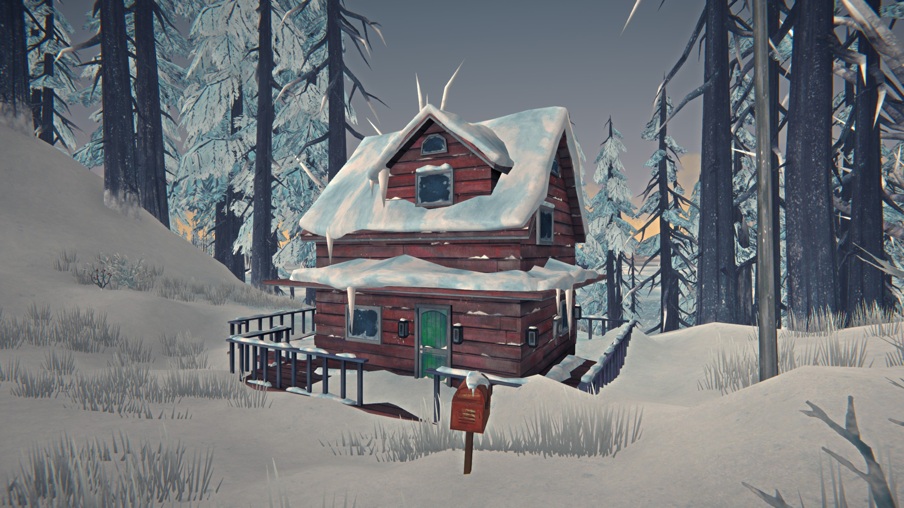
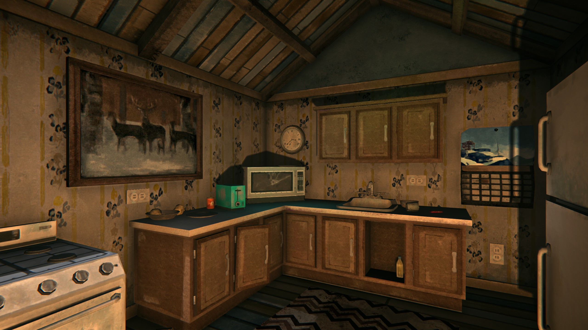
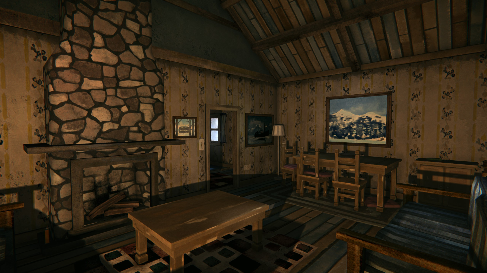
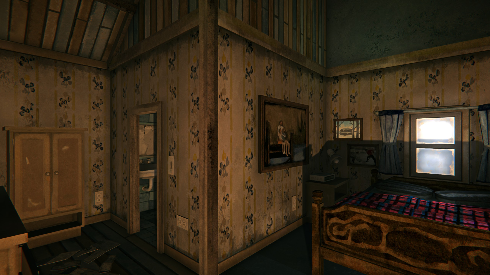
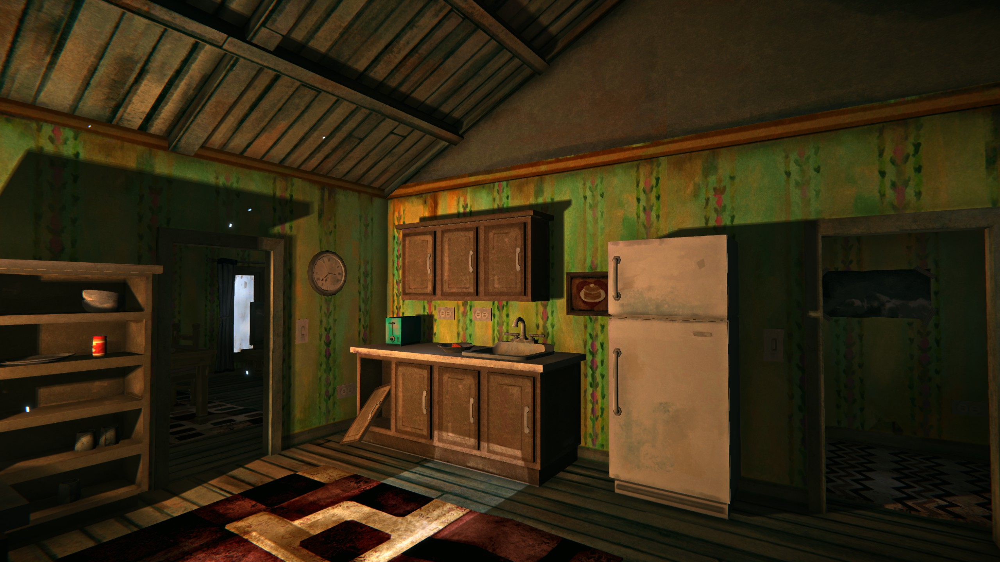
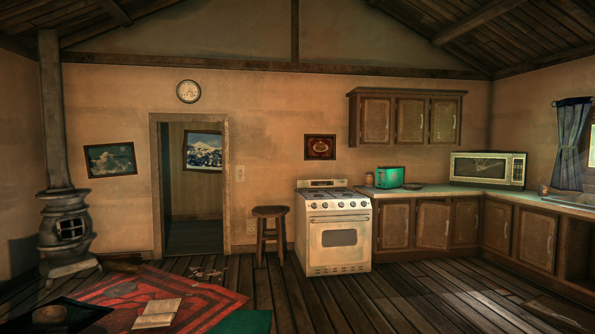
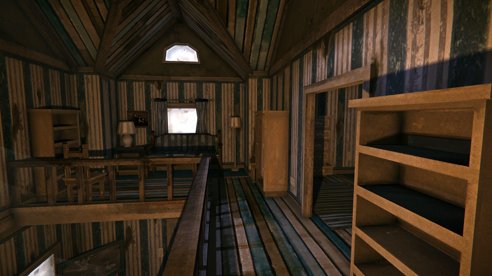

# Coastal House

**Contents**

- [Overview](#overview)
- [Loot](#loot)
- [Building Types](#building-types)
- [1 Story House Type 1](#1-story-house-type-1)
- [1 Story House Type 2](#1-story-house-type-2)
- [1 Story House Type 3](#1-story-house-type-3)
- [1 Story House Type 4](#1-story-house-type-4)
- [2 Story House](#2-story-house)

**Coastal House**

| Property | Details |
| --- | --- |
| \[\[File: / \| Column 1 \| Column 2 \| Column 3 \| Column 4 \| / \| --- \| --- \| --- \| --- \| / \|  / *Type 1* \|  / *Type 2* \|  / *Type 3* \|  / *Type 4* \| / \|  / *Type 5* \|  \|  \|  \| | 250px\]\] |
|  / *Type 1* |  / *Type 2* /  / *Type 3* /  / *Type 4* |
|  / *Type 5* |  |
| **Location** |  |
| Region | [Coastal Highway](./Coastal%20Highway.md)\|- / Location |
| **General** |  |
| Type | Residential\|- / Firebox |
|  / *bed\_icon.png* | Has a bed |
|  | Has an interior\|} A **Coastal House**is a type of house found throughout the [Coastal Highway](./Coastal%20Highway.md) region. Many of these buildings have the same layout as the [Crossroads House](./Crossroads%20House.md) and [Milton House](./Milton%20House.md). A few Cabins can be found throughout the region, but none are considered Coastal Houses. / ## Overview / Most of the dwellings throughout the region count as Coastal Houses. They are found in the following locations: / - [Coastal Townsite](./Coastal%20Townsite.md) (10 buildings, up to 5 standing at a time) / - [Waterfront Cottages](./Waterfront%20Cottages.md) (3 buildings, up to 2 standing at a time) / - [Jackrabbit Island](./Jackrabbit%20Island.md) / - [Misanthrope's Homestead](./Misanthrope%27s%20Homestead.md) / Most houses at Costal Townsite are in ruins after decades of neglect, with many being fully collapsed. The few that remain accessible are great condition, with many having nearby [Cars](./Car.md) and [Mailboxes](./Mailbox.md). One building is located up the back road near the town, isolated from the town. / Waterfront Cottages has a chance to have no standing buildings when playing on [Interloper](./Interloper.md) or [Misery](./Misery.md) and most of the houses in Coastal Townsite can be in ruins as well. Higher game difficulty will almost always lead to more ruined buildings spawning. / ### Loot / Coastal Houses are filled with [Clothing](./Clothing.md), [Food And Drink](./Food%20And%20Drink.md), [Beds](./Bed.md), [Toilets](./Toilet.md) for [Water (Potable)](./Water%20%28Potable%29.md), and furniture for harvesting wood. / ## Building Types / Coastal Houses appear as 5 types of buildings: / ### 1 Story House Type 1 / \| Column 1 \| Column 2 \| Column 3 \| Column 4 \| / \| --- \| --- \| --- \| --- \| / \|  / *Coastal\_House\_1.jpg* \|  / *Coastal\_House\_2\_Kitchen.jpg* \|  / *Coastal\_House\_2\_Den.jpg* \|  / *Coastal\_House\_2\_Bedroom.jpg* \| / This type of building has only 1 floor, with 2 doors leading outside of the building to either the kitchen or living room. They are composed of: / - A kitchen / - A den with a [Fireplace](./Fireplace.md) / - A bedroom with a [Bed](./Bed.md) and Clothing Drawers / - A bathroom next to the bedroom / ### 1 Story House Type 2 / \| Column 1 \| Column 2 \| Column 3 \| / \| --- \| --- \| --- \| / \|  / *Coastal\_House\_3.jpg* \|  / *Den* \|  / *Kitchen leading to bedroom/bathroom* \| / This type of building has only 1 floor, with 2 doors leading outside of the building to either the kitchen or living room, but with a slightly different layout from the first house type. They are composed of: / - A kitchen / - A den with a [Fireplace](./Fireplace.md) / - A bedroom with a [Bed](./Bed.md) and Clothing Drawers / - A bathroom next to the bedroom / ### 1 Story House Type 3 / \| Column 1 \| Column 2 \| Column 3 \| / \| --- \| --- \| --- \| / \|  / *Coastal\_House\_2.jpg* \|  / *Kitchen* \|  / *Bedroom and Bathroom* \| / A very small walk in house with a single door entrance. This building has only 3 major rooms: / - The kitchen and dining room at the front door, with a [Pot Belly Stove](./Pot%20Belly%20Stove.md) sometimes being found near the doorway to the bedroom / - Bedroom with a Bed and Clothing drawers / - Bathroom adjacent to the Bedroom / ### 1 Story House Type 4 / \| Column 1 \| / \| --- \| / \|  / *Jackrabbit\_Island\_-\_house.jpg* \| / This building type only appears at [Jackrabbit Island](./Jackrabbit%20Island.md). It has 2 entrances that lead to 4 different rooms: / - A living room area / - A kitchen between the living room and bedroom / - A bedroom / - A bathroom next to the bedroom / ### 2 Story House / \| Column 1 \| Column 2 \| Column 3 \| Column 4 \| / \| --- \| --- \| --- \| --- \| / \|  / *Coastal\_House\_4.jpg* \|  / *Den* \|  / *Kitchen* \|  / *Upper Floor* \| / These homes are the only 2 story buildings in the region. They contain a single door leading to the front hallway. They have a stairwell that leads the bedroom and nearby bathroom, with the ground floor containing a kitchen and den. [Misanthrope's Homestead](./Misanthrope%27s%20Homestead.md) counts as this building type. **Lua execution error in Module:Navbox function navbox** |
|  / *Coastal\_House\_1.jpg* |  / *Coastal\_House\_2\_Kitchen.jpg* /  / *Coastal\_House\_2\_Den.jpg* /  / *Coastal\_House\_2\_Bedroom.jpg* |
|  / *Coastal\_House\_3.jpg* |  / *Den* /  / *Kitchen leading to bedroom/bathroom* |
|  / *Coastal\_House\_2.jpg* |  / *Kitchen* /  / *Bedroom and Bathroom* |
|  |  / *Jackrabbit\_Island\_-\_house.jpg* |
|  / *Coastal\_House\_4.jpg* |  / *Den* /  / *Kitchen* /  / *Upper Floor* |
