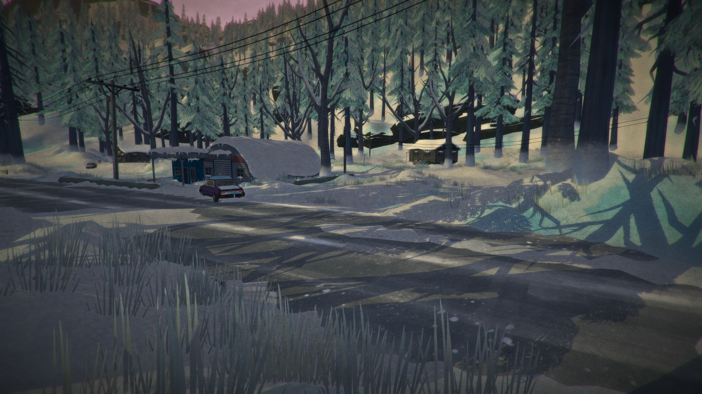
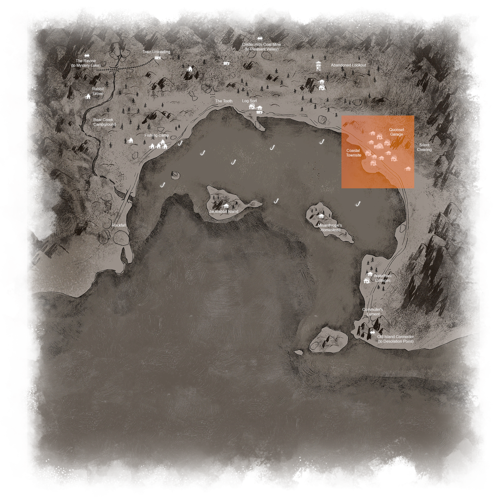
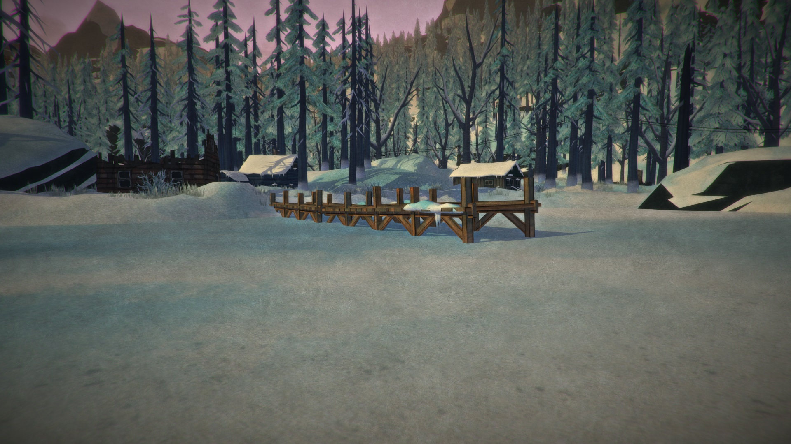
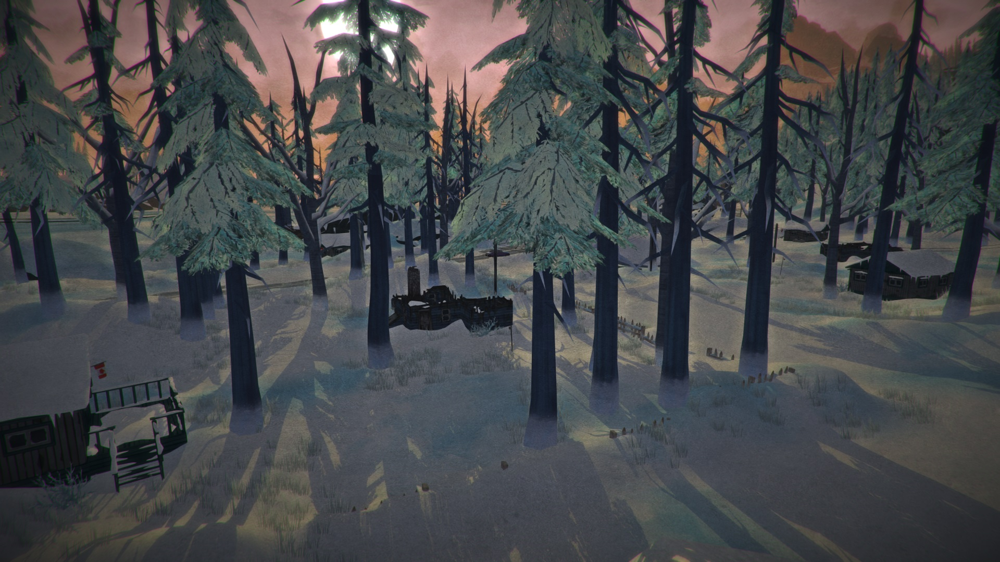
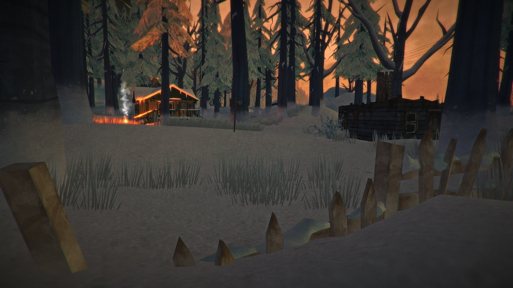

# Coastal Townsite

**Categories:** Indoor locations, Locations, Locations in Coastal Highway, Locations with a workbench, Residential locations, Settlements · **Source:** [Fandom](https://thelongdark.fandom.com/wiki/Coastal_Townsite)

**Coastal Townsite**

\[\[File: /  / _Coastal\_townsite\_2.jpg_

250px\]\]

**Location**

_Coastal\_Townsite.png_

Region

**Sublocations:** [Quonset Gas Station](./Quonset%20Garage.md)

**Description:** A small neighborhood

**General**

Type

Residential

_bed\_icon.png_

_workbench\_icon\_green.png_

Has a workbench

## Overview

Coastal Townsite has several buildings, including the [Quonset Gas Station](./Quonset%20Garage.md) in the middle of the town. This is a good place to stock up on supplies, including (possibly) some important tools such as the [hacksaw](./Hacksaw.md).

However, the townsite can be treacherous when [wolves](./Wolf.md) are near. The uneven landscape, vehicles, and junk scattered around the area limit visibility throughout most of the town.

Cars are usually parked near the houses, and loot can be found in the trunks (many require a [prybar](./Prybar.md) to open). Most of the structures are typical homes with standard layouts. Most structures except for [Quonset Gas Station](./Quonset%20Garage.md) have a random chance of being burnt down and inaccessible.

In addition to a relatively large number of wolves often patrolling the area, a [bear](./Bear.md) and a [moose](./Moose.md) may also wander by, so caution outdoors is almost always advisable.

## Gallery

_Coastal\_townsite\_1.jpg_

_Coastal\_townsite\_3.jpg_

_Coastal\_townsite\_4.jpg_
