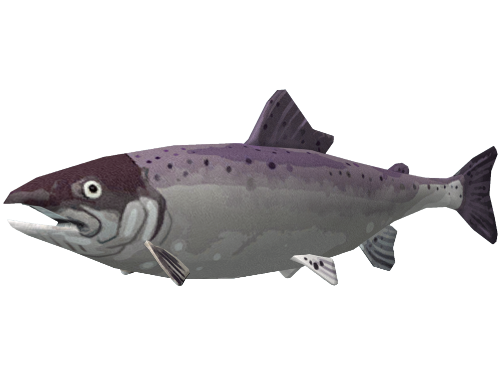
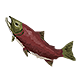

# Coho Salmon \(Raw\)

**Categories:** Fish, Food And Drink, Pages with update history · **Source:** [Fandom](https://thelongdark.fandom.com/wiki/Coho_Salmon_%28Raw%29)

**Contents**

- [Overview](#overview)
- [Recipe](#recipe)
- [Products](#products)
- [Gallery](#gallery)
- [Update history](#update-history)

**Coho Salmon (Raw)**

\[\[File:

250px\]\]

Release

[27 November 2014](./The%20Long%20Dark%20%E2%80%94%20Early%20Access%20Changelog.md#0.163)

Wintermute

No

Renewable

Yes

**Properties**

Item type

[Food And Drink](./Food%20And%20Drink.md)|-

Equipable

Stackable

No

Examine

A formidable West Coast fish. Grows to a good size.

**Values**

Calories

1650 kcal

Hydration

0%

[Vitamin C](./Scurvy.md)

Minor (12%)

Weight

5.5 kg (12.1 lbs)

Oil/Weight

0,032

**Advanced data**

Item key

GAMEPLAY\_RawCohoSalmon

_For the cooked version, see [Coho Salmon (Cooked)](./Coho%20Salmon%20%28Cooked%29.md)._

**Coho Salmon (Raw)** is a raw [food](./Food%20And%20Drink.md) item in _The Long Dark_.

## Overview

**Coho salmon** are hefty saltwater fish found sparsely under the ice off the coast. They can be caught by [Ice Fishing](./Ice%20Fishing.md) using [fishing tackle](./Fishing%20Tackle.md) or found by [Beachcombing](./Beachcombing.md). Fresh salmon can be between 2.8 and 5.5 kg raw.

At 0% condition food disappears if inside of a container, but not outside of containers or in the player's inventory.

## Recipe

Using salmon on a lit [fire](./Fire.md) yields Cooked Salmon. Cooked fish increases its condition by 50%, decays 4 times slower than raw meat, and has a reduced chance of [Food Poisoning](./Food%20Poisoning.md) over raw meat, while decreasing its weight by 35%. Cooked salmon's energy density is 455 calories-per-kilogram. Cooking fish also yields a small amount of [Lantern Fuel](./Lantern%20Fuel.md).

Cooking Salmon improves the [cooking skill](./Skills.md#Cooking) and requires a lit fire and 10 minutes. Using a [Cooking Pot](./Cooking%20Pot.md) reduces cooking time by 25%. Cooked food on an active fire for too long will burn (twice its 'Ready' cooking time), destroying the item and damaging a Cooking Pot if used.

## Products

| Item | Skills | Materials |
| --- | --- | --- |
| [Coho Salmon (Cooked)](./Coho%20Salmon%20%28Cooked%29.md) | None | - 1.00 kg × [Coho Salmon (Raw)](./Coho%20Salmon%20%28Raw%29.md) |
| [Dockworker's Pie](./Dockworker%27s%20Pie.md) | None | - 2 × [Potato](./Potato.md) - 0.50 kg × [Coho Salmon (Raw)](./Coho%20Salmon%20%28Raw%29.md) - 0.50 kg × [Rockfish (Raw)](./Rockfish%20%28Raw%29.md) - 0.10 L × [Water (Potable)](./Water%20%28Potable%29.md) - 0.05 L × [Cooking Oil](./Cooking%20Oil.md) - 0.01 kg × [Salt](./Salt.md) |
| [Mounted Coho Salmon](./Mounted%20Coho%20Salmon.md) | None | - 1 × [Fir Firewood](./Fir%20Firewood.md) - 1 × [Coho Salmon (Raw)](./Coho%20Salmon%20%28Raw%29.md) |

## Gallery

## Update history

- UPDATE **27 November 2014 ([Update](./The%20Long%20Dark%20%E2%80%94%20Early%20Access%20Changelog.md#0.163)):**
  - Added to game.
