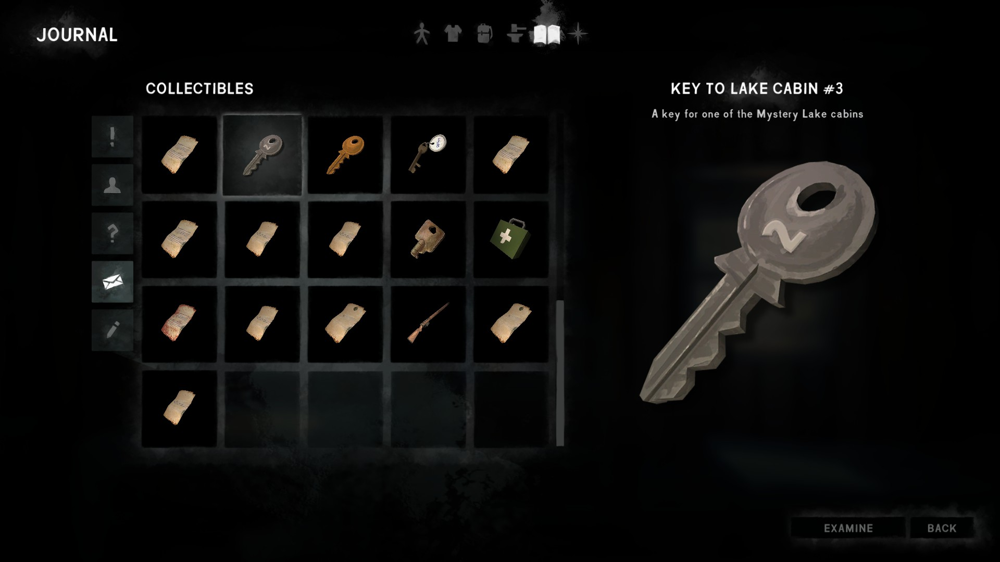

# Collectibles

**Categories:** Collectibles, Gameplay, Story · **Source:** [Fandom](https://thelongdark.fandom.com/wiki/Collectibles)

_The Collectibles screen in story mode._ **Collectibles** are special items that can be collected but do not have any extra carry-weight. Once found, collectibles can be 'examined' at any time through the [Journal](./Journal.md) menu in the [Survival Menu](./Survival%20Menu.md).

In [Wintermute](./Wintermute.md), collectibles come in various forms; the most common are single page notes, which can be read, as well as keys and other items, many of whom are related to various Missions or Side Missions.

In [Survival Mode](./Survival%20Mode.md), collectibles come in Eight types:

- [Notes](./Notes.md) - Short writings left on pieces of paper around the world.
- [Buffer Memories](./Buffer%20Memories.md) - cached emails or similar electronic messages that can be found on some intact computers in the world during [Aurora](./Aurora.md) events.
- [Cairns](./Cairns.md) - Cairns are small stacks of stones with red cloths; when clicked on at close range, they will display text in tribute to some of the original supporters of _The Long Dark_.
- [Polaroids](./Polaroids.md) - Allows the player to survey a large portion of the regional map.
- [Surveyed Locations](./Map.md#Surveying) - Keeps track of locations required to unlock the [Faithful Cartographer](./Faithful%20Cartographer.md) achievement.
- [Transmitters](./Transmitters.md) - Transmitters can be repaired to help the player find [Supply Caches](./Supply%20Cache.md).
- [Mementos](./Mementos.md) - Mementos are useful hints for survivors which might lead to loot or new locations in regions.
- [Recipe Cards](./Recipe%20Cards.md) - Unlock powerful Unique Recipes for the player to craft with a [Cooking Skillet](./Cooking%20Skillet.md) or [Cooking Pot](./Cooking%20Pot.md).

## Wintermute Collectibles
