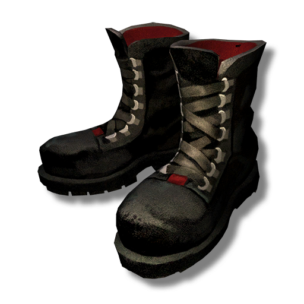
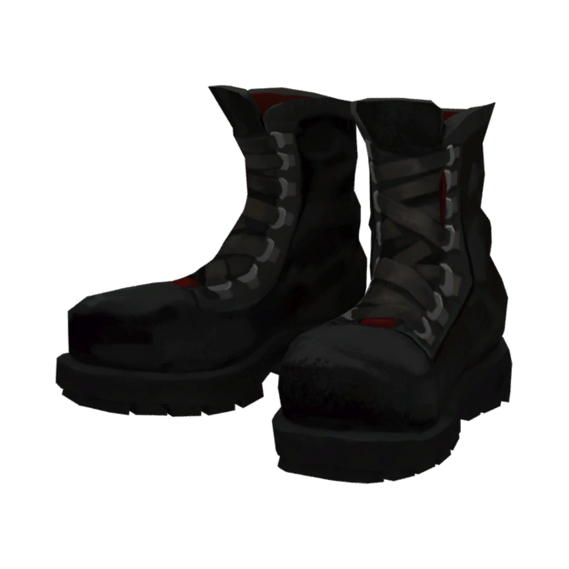

# Combat Boots

<table class="infobox">
<caption>Combat Boots</caption>
<colgroup>
<col style="width: 50%" />
<col style="width: 50%" />
</colgroup>
<tbody>
<tr>
<td colspan="2"><figure>

<figcaption>Combat_Boots_icon.png</figcaption>
</figure></td>
</tr>
<tr>
<td colspan="2" class="section">
<strong>General</strong>
</td>
</tr>
<tr>
<td>
Item Type
</td>
<td>
Clothing|-
</td>
</tr>
<tr>
<td>
Clothing Slot
</td>
<td>
Outer feet
</td>
</tr>
<tr>
<td colspan="2" class="section">
<strong>Statistics</strong>
</td>
</tr>
<tr>
<td>
Weight
</td>
<td>
2.00 kg(4.4 lbs)
</td>
</tr>
<tr>
<td>
Warmth bonus
</td>
<td>
1.5 °C(2.7 °F)
</td>
</tr>
<tr>
<td>
Windproof bonus
</td>
<td>
1.0 °C(1.8 °F)
</td>
</tr>
<tr>
<td>
Waterproof bonus
</td>
<td>
20%
</td>
</tr>
<tr>
<td>
Protection
</td>
<td>
10%
</td>
</tr>
<tr>
<td>
Mobility
</td>
<td>
-7%
</td>
</tr>
<tr>
<td>
Harvest
</td>
<td>
1 × <a href="./Cured%20Leather.md" class="wikilink" title="Cured leather">Cured leather</a> 
90 minutes
</td>
</tr>
<tr>
<td>
Repair
</td>
<td>
1 × <a href="./Cured%20Leather.md" class="wikilink" title="Cured leather">Cured leather</a> 
30 minutes 
25% condition
</td>
</tr>
</tbody>
</table>

<table>
<colgroup>
<col style="width: 33%" />
<col style="width: 33%" />
<col style="width: 33%" />
</colgroup>
<tbody>
<tr>
<td style="vertical-align: top; font-size: 3em; color: #5d5980; padding-right: 10px">
“
</td>
<td>
Boots designed for war zones. Too bad they weren't made for Winter. Heavy-duty leather with good ankle support. Would offer fair resistance to animal bites.

&#10;

In-game description

</td>
<td style="vertical-align: bottom; font-size: 3em; color: #5d5980; padding-left: 10px">
”
</td>
</tr>
</tbody>
</table>

**Combat Boots** are a type of <a href="./Clothing.md" class="wikilink" title="Clothing">Clothing</a> in *The Long Dark*.

## Usefulness

Mid-tier boots. They are heavier than the <a href="./Work%20Boots.md" class="wikilink" title="Work Boots">Work Boots</a> and offer less <a href="./Warmth.md" class="wikilink" title="warmth">warmth</a> and mobility, but are more waterproof and offer more protection. Expensive to repair but their protection is useful during wildlife <a href="./Struggle.md" class="wikilink" title="struggles">struggles</a>, and they are only a half the weight of <a href="./Ski%20Boots.md" class="wikilink" title="Ski Boots">Ski Boots</a>.

<table class="gallery">
<colgroup>
<col style="width: 50%" />
<col style="width: 50%" />
</colgroup>
<tbody>
<tr>
<td><figure>

<figcaption>Clothing model</figcaption>
</figure></td>
<td><figure>

<figcaption>Clothing model damaged</figcaption>
</figure></td>
</tr>
</tbody>
</table>

## Update history

- UPDATE **19 December 2016 (<a href="./The%20Long%20Dark%20%E2%80%94%20Early%20Access%20Changelog.md#0.386" class="wikilink" title="Update">Update</a>):**
  - Added to game

**Lua execution error in Module:Navbox function navbox** <a href="ru:%D0%91%D0%B5%D1%80%D1%86%D1%8B" class="wikilink" title="ru:Берцы">ru:Берцы</a>

