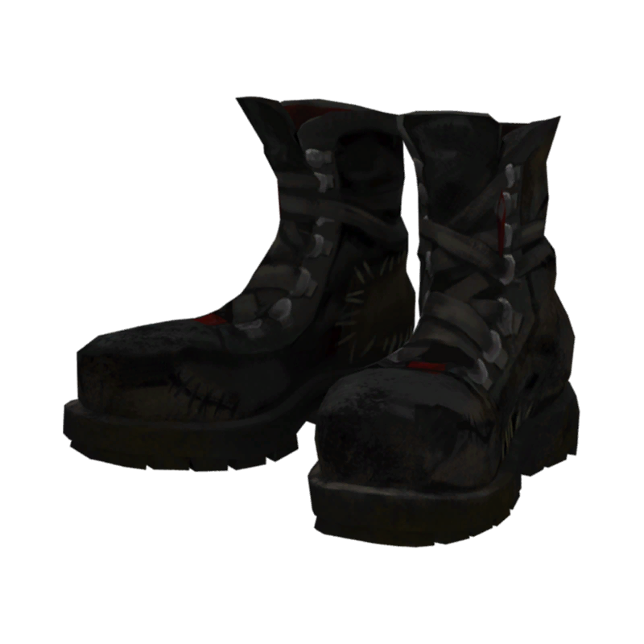

# Combat Boots

**Categories:** Clothing, Pages with update history, Story items · **Source:** [Fandom](https://thelongdark.fandom.com/wiki/Combat_Boots)

**Combat Boots**

_Combat\_Boots\_icon.png_

**General**

**Item Type:** Clothing\|-

**Clothing Slot:** Outer feet

**Statistics**

**Weight:** 2.00 kg(4.4 lbs)

**Warmth bonus:** 1.5 °C(2.7 °F)

**Windproof bonus:** 1.0 °C(1.8 °F)

**Waterproof bonus:** 20%

**Protection:** 10%

**Mobility:** -7%

**Harvest:** 1 × [Cured leather](./Cured%20Leather.md) / 90 minutes

**Repair:** 1 × [Cured leather](./Cured%20Leather.md) / 30 minutes / 25% condition

> “**Boots designed for war zones. Too bad they weren't made for Winter. Heavy-duty leather with good ankle support. Would offer fair resistance to animal bites.**”
>
> — In-game description

**Combat Boots** are a type of [Clothing](./Clothing.md) in _The Long Dark_.

## Usefulness

Mid-tier boots. They are heavier than the [Work Boots](./Work%20Boots.md) and offer less [warmth](./Warmth.md) and mobility, but are more waterproof and offer more protection. Expensive to repair but their protection is useful during wildlife [struggles](./Struggle.md), and they are only a half the weight of [Ski Boots](./Ski%20Boots.md).

_Clothing model_

_Clothing model damaged_

## Update history

- UPDATE **19 December 2016 ([Update](./The%20Long%20Dark%20%E2%80%94%20Early%20Access%20Changelog.md#0.386)):**
  - Added to game
