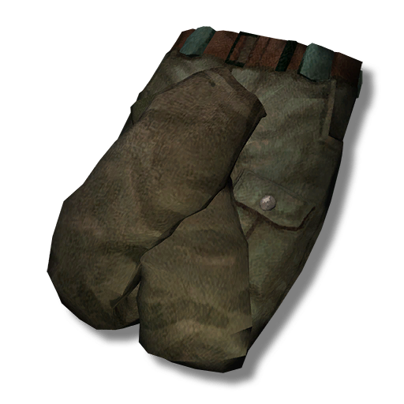
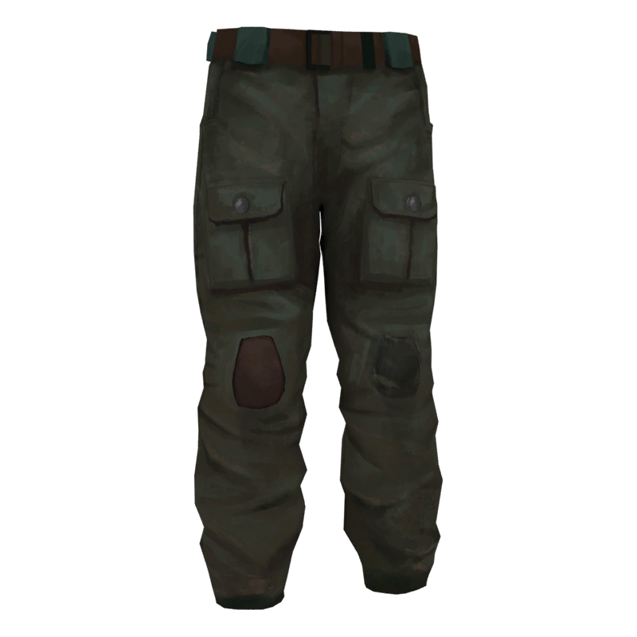

# Combat Pants

<table class="infobox">
<caption>Combat Pants</caption>
<colgroup>
<col style="width: 50%" />
<col style="width: 50%" />
</colgroup>
<tbody>
<tr>
<td colspan="2"><figure>

<figcaption>Combat_Pants_icon.png</figcaption>
</figure></td>
</tr>
<tr>
<td colspan="2" class="section">
<strong>General</strong>
</td>
</tr>
<tr>
<td>
Item Type
</td>
<td>
Clothing|-
</td>
</tr>
<tr>
<td>
Clothing Slot
</td>
<td>
Outer legs
</td>
</tr>
<tr>
<td colspan="2" class="section">
<strong>Statistics</strong>
</td>
</tr>
<tr>
<td>
Weight
</td>
<td>
0.75 kg(1.65 lbs)
</td>
</tr>
<tr>
<td>
Warmth bonus
</td>
<td>
2.0 °C(3.6 °F)
</td>
</tr>
<tr>
<td>
Windproof bonus
</td>
<td>
0.5 °C(0.9 °F)
</td>
</tr>
<tr>
<td>
Waterproof bonus
</td>
<td>
20%
</td>
</tr>
<tr>
<td>
Protection
</td>
<td>
7%
</td>
</tr>
<tr>
<td>
Mobility
</td>
<td>
0%
</td>
</tr>
<tr>
<td>
Harvest
</td>
<td>
1 × <a href="./Cloth.md" class="wikilink" title="Cloth">Cloth</a> 
30 minutes
</td>
</tr>
<tr>
<td>
Repair
</td>
<td>
1 × <a href="./Cloth.md" class="wikilink" title="Cloth">Cloth</a> 
30 minutes 
30% condition
</td>
</tr>
</tbody>
</table>

<table>
<colgroup>
<col style="width: 33%" />
<col style="width: 33%" />
<col style="width: 33%" />
</colgroup>
<tbody>
<tr>
<td style="vertical-align: top; font-size: 3em; color: #5d5980; padding-right: 10px">
“
</td>
<td>
Heavy duty military pants, with reinforced knees and articulated for good mobility. Designed to take a beating.

&#10;

In-game description

</td>
<td style="vertical-align: bottom; font-size: 3em; color: #5d5980; padding-left: 10px">
”
</td>
</tr>
</tbody>
</table>

**Combat Pants** are a type of <a href="./Clothing.md" class="wikilink" title="clothing">clothing</a> in *<a href="./The%20Long%20Dark.md" class="wikilink" title="The Long Dark">The Long Dark</a>*.

While somewhat rare, they provide minimal weight and much better stats than the <a href="./Cargo%20Pants.md" class="wikilink" title="Cargo Pants">Cargo Pants</a> and <a href="./Jeans.md" class="wikilink" title="Jeans">Jeans</a>, though they only provide minimal Windproofing. All pants that have better stats are heavier.

Combat pants are one of the few high-quality clothing items in all survival <a href="./Survival%20Mode.md" class="wikilink" title="modes">modes</a>. They are particularly useful on <a href="./Interloper.md" class="wikilink" title="Interloper">Interloper</a> mode when worn on the inner layer, with <a href="./Deerskin%20Pants.md" class="wikilink" title="Deerskin Pants">Deerskin Pants</a> on the outer layer.

Can be found in <a href="./Episode%202%20-%20Luminance%20Fugue.md" class="wikilink" title="Wintermute: Episode 2">Wintermute: Episode 2</a> in \#2 cabin at <a href="./Mystery%20Lake%20%28region%29.md" class="wikilink" title="Mystery Lake">Mystery Lake</a>.

Possible spawns: <a href="./Signal%20Hill.md" class="wikilink" title="Signal Hill">Signal Hill</a>, <a href="./Crash%20Site%20%28Pleasant%20Valley%29.md" class="wikilink" title="Crash Site">Crash Site</a>, <a href="./Milton%20House%20%28Grey%20Mother%27s%29.md" class="wikilink" title="Milton House (Grey Mother&#39;s)">Milton House (Grey Mother's)</a>, <a href="./Miner%27s%20Folly.md" class="wikilink" title="Miner&#39;s Folly">Miner's Folly</a> cabin (under the bed), <a href="./Gold%20Mine.md" class="wikilink" title="Gold Mine">Gold Mine</a> (on the bed, low chance), <a href="./Hidden%20Cache.md" class="wikilink" title="Hidden Cache">Hidden Cache</a> inside <a href="./Reclusive%20Falls.md" class="wikilink" title="Reclusive Falls">Reclusive Falls</a>, <a href="./Homesteader%27s%20Respite.md" class="wikilink" title="Homesteader&#39;s Respite">Homesteader's Respite</a>. <a href="./Forsaken%20Airfield.md" class="wikilink" title="Forsaken Airfield">Forsaken Airfield</a> (<a href="./Cargomaster%27s%20Trailer.md" class="wikilink" title="Cargomaster&#39;s Trailer">Cargomaster's Trailer</a>, <a href="./Main%20Hangar.md" class="wikilink" title="Main Hangar">Main Hangar</a>, suitcases and lockers)

<table class="gallery">
<colgroup>
<col style="width: 50%" />
<col style="width: 50%" />
</colgroup>
<tbody>
<tr>
<td><figure>

<figcaption>Clothing model icon</figcaption>
</figure></td>
<td><figure>

<figcaption>Clothing model icon damaged</figcaption>
</figure></td>
</tr>
</tbody>
</table>

## Update history

- UPDATE **19 December 2016 (<a href="./The%20Long%20Dark%20%E2%80%94%20Early%20Access%20Changelog.md#0.386" class="wikilink" title="Update">Update</a>):**
  - Added to game

**Lua execution error in Module:Navbox function navbox** <a href="ru:%D0%90%D1%80%D0%BC%D0%B5%D0%B9%D1%81%D0%BA%D0%B8%D0%B5_%D1%88%D1%82%D0%B0%D0%BD%D1%8B" class="wikilink" title="ru:Армейские штаны">ru:Армейские штаны</a>

