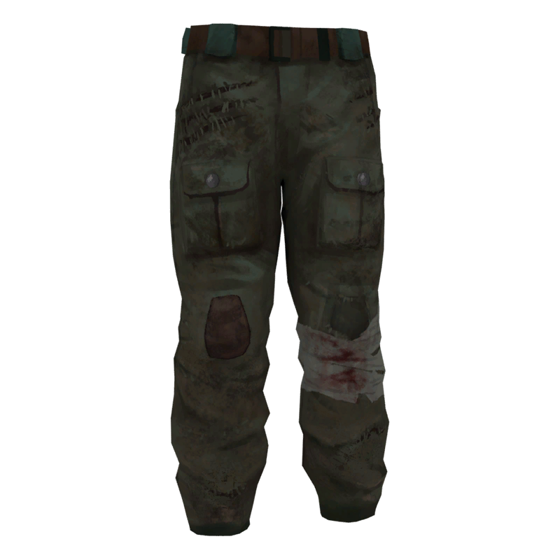

# Combat Pants

**Categories:** Clothing, Pages with update history · **Source:** [Fandom](https://thelongdark.fandom.com/wiki/Combat_Pants)

**Combat Pants**

_Combat\_Pants\_icon.png_

**General**

**Item Type:** Clothing\|-

**Clothing Slot:** Outer legs

**Statistics**

**Weight:** 0.75 kg(1.65 lbs)

**Warmth bonus:** 2.0 °C(3.6 °F)

**Windproof bonus:** 0.5 °C(0.9 °F)

**Waterproof bonus:** 20%

**Protection:** 7%

**Mobility:** 0%

**Harvest:** 1 × [Cloth](./Cloth.md) / 30 minutes

**Repair:** 1 × [Cloth](./Cloth.md) / 30 minutes / 30% condition

> “**Heavy duty military pants, with reinforced knees and articulated for good mobility. Designed to take a beating.**”
>
> — In-game description

**Combat Pants** are a type of [clothing](./Clothing.md) in _[The Long Dark](./The%20Long%20Dark.md)_.

While somewhat rare, they provide minimal weight and much better stats than the [Cargo Pants](./Cargo%20Pants.md) and [Jeans](./Jeans.md), though they only provide minimal Windproofing. All pants that have better stats are heavier.

Combat pants are one of the few high-quality clothing items in all survival [modes](./Survival%20Mode.md). They are particularly useful on [Interloper](./Interloper.md) mode when worn on the inner layer, with [Deerskin Pants](./Deerskin%20Pants.md) on the outer layer.

Can be found in [Wintermute: Episode 2](./Episode%202%20-%20Luminance%20Fugue.md) in #2 cabin at [Mystery Lake](./Mystery%20Lake%20%28region%29.md).

Possible spawns: [Signal Hill](./Signal%20Hill.md), [Crash Site](./Crash%20Site%20%28Pleasant%20Valley%29.md), [Milton House (Grey Mother's)](./Milton%20House%20%28Grey%20Mother%27s%29.md), [Miner's Folly](./Miner%27s%20Folly.md) cabin (under the bed), [Gold Mine](./Gold%20Mine.md) (on the bed, low chance), [Hidden Cache](./Hidden%20Cache.md) inside [Reclusive Falls](./Reclusive%20Falls.md), [Homesteader's Respite](./Homesteader%27s%20Respite.md). [Forsaken Airfield](./Forsaken%20Airfield.md) ([Cargomaster's Trailer](./Cargomaster%27s%20Trailer.md), [Main Hangar](./Main%20Hangar.md), suitcases and lockers)

_Clothing model icon_

_Clothing model icon damaged_

## Update history

- UPDATE **19 December 2016 ([Update](./The%20Long%20Dark%20%E2%80%94%20Early%20Access%20Changelog.md#0.386)):**
  - Added to game
