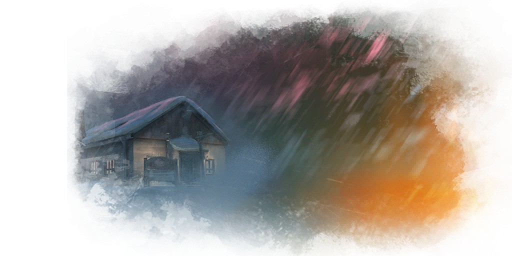

# Coming Storm/Transcript

**Categories:** Episode 3 · **Source:** [Fandom](https://thelongdark.fandom.com/wiki/Coming_Storm%2FTranscript)

**Coming Storm/Transcript**

| Property | Details |
| --- | --- |
|  |  / _Missions\_story\_ep3\_Coming\_Storm.png_ |
| Episode | [Episode 3](./Episode%203%20-%20Crossroads%20Elegy.md)\|- |
| Previous | [Fallen Star/Transcript](./Fallen%20Star%20%E2%80%94%20Transcript.md) |
| Current | Coming Storm/Transcript |
| Next | [Aftermath/Transcript](./Aftermath%20%E2%80%94%20Transcript.md) |
| Region | [Pleasant Valley](./Pleasant%20Valley.md) |
| Characters | [Astrid](./Astrid%20Greenwood.md) / [Father Thomas](./Father%20Thomas.md) / [Crash Survivor](./Crash%20Survivor.md) |

This is the mission transcript for mission 3 [Coming Storm](./Coming%20Storm.md) of [Episode 3: Crossroads Elegy](./Episode%203%20-%20Crossroads%20Elegy.md).

## Locate and return the missing survivors.

CHAPTER THREE

COMING STORM

[Astrid Greenwood](./Astrid%20Greenwood.md): "Still some names missing from the passenger manifest. Became delirious and wandered off, maybe."

_A new addition to the entrance to the hall is present, an [Emergency Kit](./Emergency%20Kit.md), perhaps left by Molly? Either way, Astrid takes the [Distress Pistol](./Distress%20Pistol.md) and [Flare Shells](./Flare%20Shell.md) and begins searching for supplies and the 3 missing [Crash Survivors](./Crash%20Survivor.md)_

_After rescuing the 3 missing survivors, and stocking the [Storage Cupboard](./Storage%20Cupboard.md) with all the needed supplies, Astrid finds Father Thomas standing on the stage in front of a podium, overlooking his flock._

[Father Thomas](./Father%20Thomas.md): "Thank you for your efforts. You have likely saved the lives of all these people. They now have a fighting chance to last through this storm. You have done God's work here and He will forever look favourably upon you."

Astrid: "Thank you, Father. Do you think while looking favourably on me, He could also help me find a way out of here?"

Father Thomas: "As I said, the usual paths are blocked. But, the blizzard...it may have displaced enough snow to..."

Astrid: "To what?"

Father Thomas: "There is another route. It's a dangerous one. Through the mountains."

Astrid: "I'll take my chances. I really need to get to Perseverance Mills. If things are this bad here, they'll be worse... Look, I just need to get there. Can you help me?"

_Father Thomas takes his glasses off_

Father Thomas: "An entrance to the old coal mine. If the blizzard moved enough snow, you might be able to get in there. It passes through the mountain."

_Father Thomas puts his glasses back on_

Father Thomas: "After that, you'll find the highway - it follows the coastline. Follow the highway and, god-willing, you'll get to Perseverance Mills. Here...I'll draw it on your map for you..."

_Astrid hands him a map_

Astrid: "Thank you, Father."

_He draws on the map and hands it back to her_

Father Thomas: "My thanks to you, my child. And if you'll permit an old priest an indulgence. I'd like to share some wisdom with you."

Astrid: "Go ahead, Father."

Father Thomas: "Your burden. I see it weighs heavily on you."

Astrid: "I...I don't know what you mean."

Father Thomas: "Yes, you do. You do not have to carry it alone."

Astrid: "Look...thank you Father, but religion isn't really..."

Father Thomas: "I don't say this as an attempt to sway your thinking or help you find faith. But find something...someone...to help with your burden. Otherwise, it will consume you."

Astrid: "Look around you, Father. I think the Lord may have his hands full right now. Whatever burdens I may have, they're mine to bear. And mine alone."

Father Thomas: "However crowded his table, there is always a seat for you, my child."

Astrid: "I'll keep it in mind, Father." _produces the [Rosary](./Rosary.md)_ "Here. You should take this back."

Father Thomas: "Keep it, my child. I fear you will have need of it before this long winter is done."

_Astrid dangles the prayer beads and cross before her, and puts it away_
