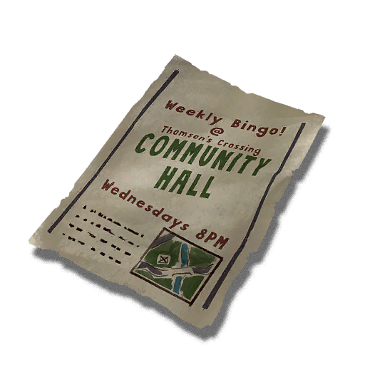

# Community Hall Flyer

<table class="infobox">
<caption>Community Hall Flyer</caption>
<colgroup>
<col style="width: 50%" />
<col style="width: 50%" />
</colgroup>
<tbody>
<tr>
<td colspan="2"><figure>

<figcaption>Community_Hall_Flyer_icon.png</figcaption>
</figure></td>
</tr>
<tr>
<td>
Release
</td>
<td>
<a href="./The%20Long%20Dark%20%E2%80%94%20Changelog.md#1.60" class="wikilink" title="22 October 2019">22 October 2019</a>
</td>
</tr>
<tr>
<td>
Wintermute
</td>
<td>
<a href="./Episode%203%20-%20Crossroads%20Elegy.md" class="wikilink" title="Episode 3">Episode 3</a> - <a href="./Trauma.md" class="wikilink" title="Trauma">Trauma</a>
</td>
</tr>
<tr>
<td colspan="2" class="section">
<strong>Properties</strong>
</td>
</tr>
<tr>
<td>
Item type
</td>
<td>
<a href="./Collectibles.md" class="wikilink" title="Collectibles">Collectibles</a>|-
</td>
</tr>
<tr>
<td>
Stackable
</td>
<td>
No
</td>
</tr>
<tr>
<td>
Examine
</td>
<td>
Flyer for a local event at the Thomson's Crossing Community Hall.
</td>
</tr>
<tr>
<td colspan="2" class="section">
<strong>Values</strong>
</td>
</tr>
<tr>
<td>
Weight
</td>
<td>
0.00 kg (0 lbs)
</td>
</tr>
<tr>
<td colspan="2" class="section">
<strong>Actions</strong>
</td>
</tr>
<tr>
<td>
Backpack
</td>
<td>
Examine
</td>
</tr>
<tr>
<td>
On ground
</td>
<td>
Take It, Leave It
</td>
</tr>
<tr>
<td colspan="2" class="section">
<strong>Advanced data</strong>
</td>
</tr>
<tr>
<td>
Item key
</td>
<td>
STORY_CommunityHallFlyer
</td>
</tr>
</tbody>
</table>

**Community Hall Flyer** is a <a href="./Collectibles.md" class="wikilink" title="Collectible">Collectible</a> item found in <a href="./Episode%203%20-%20Crossroads%20Elegy.md" class="wikilink" title="Episode 3">Episode 3</a> of the <a href="./Wintermute.md" class="wikilink" title="Wintermute">Wintermute</a> story mode as a part of the <a href="./Trauma.md" class="wikilink" title="Trauma">Trauma</a> mission.

During the course of the mission, the Astrid finds the flyer within the Barn outside the <a href="./Pleasant%20Valley%20Farmstead.md" class="wikilink" title="Pleasant Valley Farmstead">Pleasant Valley Farmstead</a>. The flyer directs the Astrid to head towards <a href="./Thomson%27s%20Crossing.md" class="wikilink" title="Thomson&#39;s Crossing">Thomson's Crossing</a>.

## Update history

- UPDATE **22 October 2019 (<a href="./The%20Long%20Dark%20%E2%80%94%20Changelog.md#1.60" class="wikilink" title="Update">Update</a>):**
  - Added to game.

**Lua execution error in Module:Navbox function navbox**

