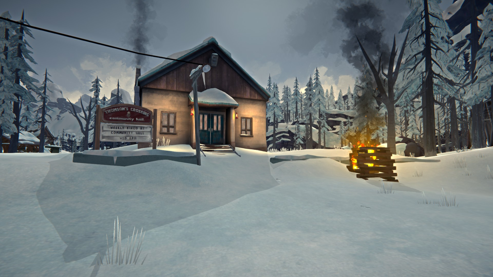

# Community Hall

**Community Hall**

| Property | Details |
| --- | --- |
| \[\[File: / \|  / *Exterior* \|  / *Interior* \| / \| --- \| --- \| | 250px\]\] |
|  / *Exterior* |  / *Interior* |
| **Location** |  |
|  / *Community\_Hall\_Location.png* |  |
| Region | [Pleasant Valley](./Pleasant%20Valley.md)\|- / **General** |
| Type | Residential\|- / Firebox |
|  | Has an interior\|} / **Community Hall** is a building at [Thomson's Crossing](./Thomson%27s%20Crossing.md) within [Pleasant Valley](./Pleasant%20Valley.md). It is a major location within [Episode 3: Crossroads Elegy](./Episode%203%20-%20Crossroads%20Elegy.md) of [Wintermute](./Wintermute.md). / ## Overview / Community Hall is the largest building in [Thomson's Crossing](./Thomson%27s%20Crossing.md). The building contains a kitchen with a [Stove](./Stove.md), mess hall with a [Fireplace](./Fireplace.md), bathroom with a [Toilet](./Toilet.md), and a small office. Next to the back entrance is one of the [Radios](./Trader.md#Radio_Locations) necessary to contact the Trader (if enabled). The nearest work bench is at the [Pleasant Valley Outbuildings](./Pleasant%20Valley%20Outbuildings.md), but it can be disassembled and rebuilt in the Community Hall using [Safehouse Customization](./Safehouse%20Customization.md). / It is a perfect location for a [Safe House](./Safehouse.md), as it contains a 6-slot Stove, [Beds](./Bed.md), several [Crossroads House](./Crossroads%20House.md) to loot nearby, and the 200.00kg [Storage Cupboard](./Storage%20Cupboard.md), the largest container in the game. / ## Episode 3 / **Spoiler Warning:****This page may contain spoilers from the [story](./Wintermute.md) of The Long Dark.** / In Episode 3, the Community Hall is inhabited by the plane crash survivors and overseen by [Father Thomas](./Father%20Thomas.md). / Although there are many items in the building that can normally be broken down or interacted with to harvest resources (e.g., ripping curtains for [cloth](./Cloth.md)), these actions are not available as options inside the Community Hall. / The fireplace, however, is an "infinity fire," meaning that it never burns out. This makes it a useful place to boil [water](./Water%20%28Potable%29.md), cook, and refill the warmth need. / ## Gallery / \| Column 1 \| Column 2 \| Column 3 \| Column 4 \| / \| --- \| --- \| --- \| --- \| / \|  / *community\_hall\_exterior.jpg* \|  / *community\_hall\_exterior\_2.jpg* \|  / *community\_hall\_interior.jpg* \|  / *community\_hall\_interior\_2.jpg* \| / **Lua execution error in Module:Navbox function navbox** [ru:Общественный клуб](ru:%D0%9E%D0%B1%D1%89%D0%B5%D1%81%D1%82%D0%B2%D0%B5%D0%BD%D0%BD%D1%8B%D0%B9_%D0%BA%D0%BB%D1%83%D0%B1) |
|  / *community\_hall\_exterior.jpg* |  / *community\_hall\_exterior\_2.jpg* /  / *community\_hall\_interior.jpg* /  / *community\_hall\_interior\_2.jpg* |
