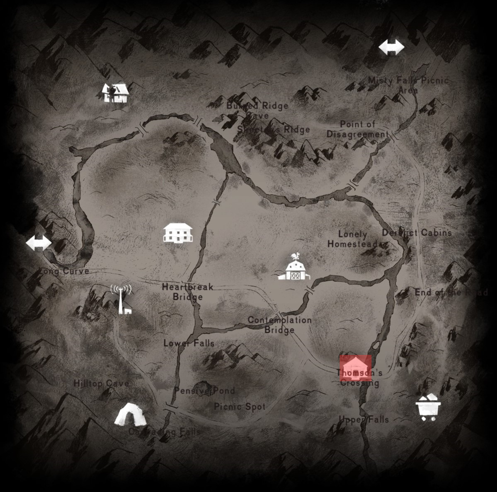

# Community Hall

**Categories:** Indoor locations, Locations, Locations in Pleasant Valley, Residential locations · **Source:** [Fandom](https://thelongdark.fandom.com/wiki/Community_Hall)

**Community Hall**

**Location**

Region

[Pleasant Valley](./Pleasant%20Valley.md)

**General**

Type

Residential

Firebox

[Stove](./Stove.md) [Fireplace](./Fireplace.md)

Has an interior

**Community Hall** is a building at [Thomson's Crossing](./Thomson%27s%20Crossing.md) within [Pleasant Valley](./Pleasant%20Valley.md). It is a major location within [Episode 3: Crossroads Elegy](./Episode%203%20-%20Crossroads%20Elegy.md) of [Wintermute](./Wintermute.md).

## Overview

Community Hall is the largest building in [Thomson's Crossing](./Thomson%27s%20Crossing.md). The building contains a kitchen with a [Stove](./Stove.md), mess hall with a [Fireplace](./Fireplace.md), bathroom with a [Toilet](./Toilet.md), and a small office. Next to the back entrance is one of the [Radios](./Trader.md#radio-locations) necessary to contact the Trader (if enabled). The nearest work bench is at the [Pleasant Valley Outbuildings](./Pleasant%20Valley%20Outbuildings.md), but it can be disassembled and [rebuilt](./Work%20Bench.md) in the Community Hall using [Safehouse Customization](./Safehouse%20Customization.md).

It is a perfect location for a [Safe House](./Safehouse.md), as it contains a 6-slot Stove, [Beds](./Bed.md), several [Crossroads House](./Crossroads%20House.md) to loot nearby, and the 200.00kg [Storage Cupboard](./Storage%20Cupboard.md), the largest container in the game.

## Episode 3

**Spoiler Warning:****This page may contain spoilers from the [story](./Wintermute.md) of The Long Dark.**

In Episode 3, the Community Hall is inhabited by the plane crash survivors and overseen by [Father Thomas](./Father%20Thomas.md).

Although there are many items in the building that can normally be broken down or interacted with to harvest resources (e.g., ripping curtains for [cloth](./Cloth.md)), these actions are not available as options inside the Community Hall.

The fireplace, however, is an "infinity fire," meaning that it never burns out. This makes it a useful place to boil [water](./Water%20%28Potable%29.md), cook, and refill the warmth need.

## Gallery

