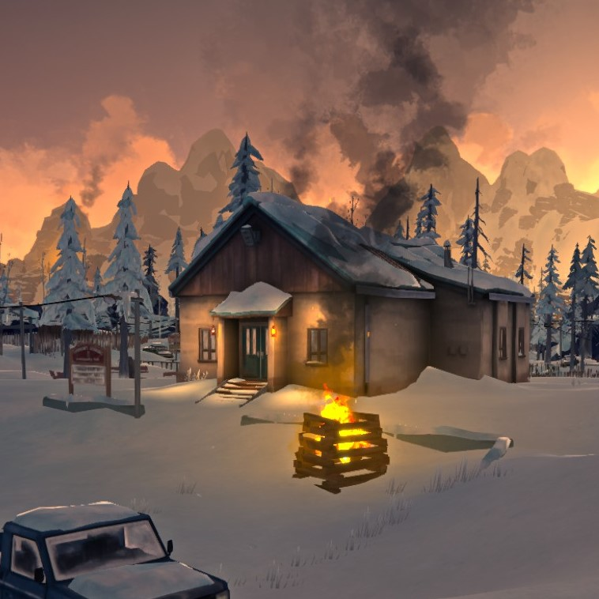
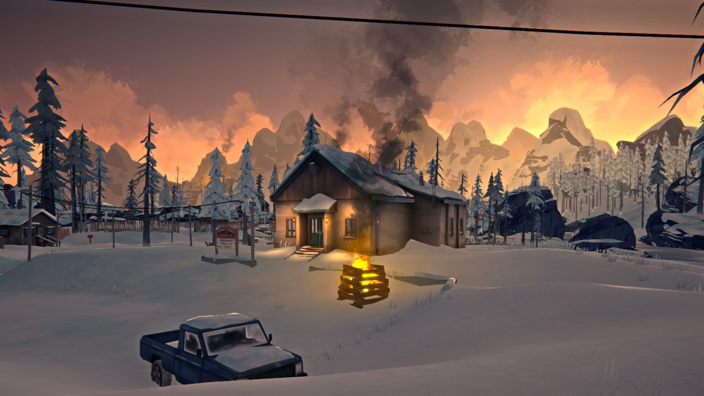

# Community Hall

**Categories:** Indoor locations, Locations, Locations in Pleasant Valley, Residential locations · **Source:** [Fandom](https://thelongdark.fandom.com/wiki/Community_Hall)

**Community Hall**

\[\[File: /  / _Exterior_ /  / _Interior_

250px\]\]

_Exterior_

_Interior_

**Location**

_Community\_Hall\_Location.png_

Region

[Pleasant Valley](./Pleasant%20Valley.md)

**General**

Type

Residential

Firebox

_community\_hall\_exterior.jpg_

_community\_hall\_exterior\_2.jpg_

_community\_hall\_interior.jpg_

_community\_hall\_interior\_2.jpg_
