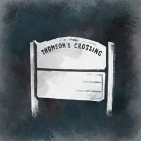

# Community Service

**Community Service**

| Property | Details |
| --- | --- |
|  |  / *Community\_Service\_icon.png* |
| Description | Get to Thomson's Crossing. |

**Community Service** is a [Wintermute](./Wintermute.md) [achievement](./The%20Long%20Dark%20%E2%80%94%20Achievements.md) in [Episode 3: Crossroads Elegy](./Episode%203%20-%20Crossroads%20Elegy.md) of *[The Long Dark](./The%20Long%20Dark.md)*.

## Guide

This is an unmissable story achievement, and is earned leaving [Molly's Barn](./Barn%20%28Molly%27s%29.md) and making your way to the [Community Hall](./Community%20Hall.md) in [Thomson's Crossing](./Thomson%27s%20Crossing.md) during the mission [Trauma](./Trauma.md).

## Game History

- UPDATE **22 October 2019 ([Update](./The%20Long%20Dark%20%E2%80%94%20Changelog.md#1.60)):**
  - Added to game.

**Lua execution error in Module:Navbox function navbox**
