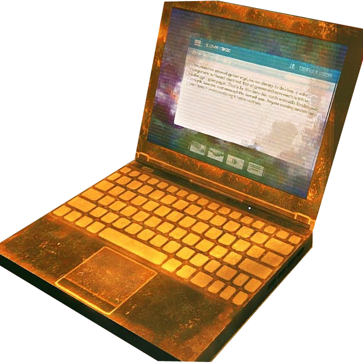
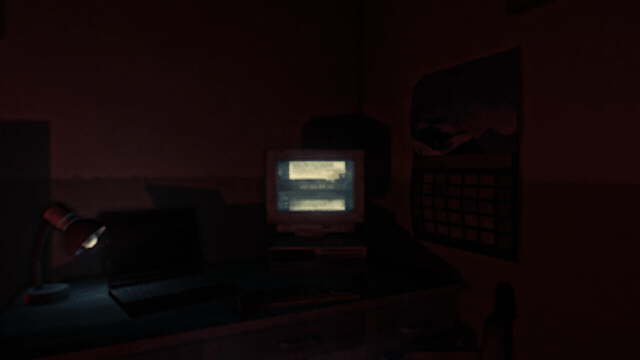

# Computer

A computer during the aurora **Computers** are stationary objects in The Long Dark. Un-interactable under normal circumstances, but during an <a href="./Aurora.md" class="wikilink" title="Aurora">Aurora</a> their display will sometimes illuminate to show the contents of a recently closed log/diary, as a nod to the civilization on Great Bear before the lights.

## Overview

While traveling in your game, you might stumble upon a laptop or desktop computer. Although sometimes the position that they've been placed in is rather annoying, and they cannot be moved, picked up, or used in any way unless an aurora is active,

Laptops and computers are still a valid piece of backstory to the Long Dark, and can be used to collect <a href="./Buffer%20Memories.md" class="wikilink" title="Buffer Memories">Buffer Memories</a> during an aurora. They also play a large role in the <a href="./Archivist.md" class="wikilink" title="Archivist">Archivist</a> challenge.

## Aurora

During an Aurora, some of these computers will flash on to display a message, called a Buffer Memories. Each computer that *will*turn on in the game has at least three buffer memories, and computers that are active during an aurora will slowly cycle through the list, so if you wait long enough you might be able to catch more than one buffer memory on the same computer. Don't be fooled though - not all computers turn on. Generally if you've found a computer that didn't turn on during the Aurora, chances are there's another one in the building that did.

<table class="gallery">
<colgroup>
<col style="width: 33%" />
<col style="width: 33%" />
<col style="width: 33%" />
</colgroup>
<tbody>
<tr>
<td><figure>
[Missing image: 20190113203759_1.jpg]
<figcaption>20190113203759_1.jpg</figcaption>
</figure></td>
<td><figure>
[Missing image: Cave_laptop.jpg]
<figcaption>Cave_laptop.jpg</figcaption>
</figure></td>
<td><figure>

<figcaption>Buffer-memories.gif</figcaption>
</figure></td>
</tr>
</tbody>
</table>

## Locations

There are currently 16 locations that will display Buffer Memories during an Aurora:

| Location | Number of memories |
|----|:--:|
| [Camp Office](https://thelongdark.fandom.com/wiki/Camp_Office) | 5 |
| [Carter Hydro Dam - Upper](https://thelongdark.fandom.com/wiki/Carter_Hydro_Dam#Upper_Levels) | 5 |
| [Carter Hydro Dam - Lower](https://thelongdark.fandom.com/wiki/Carter_Hydro_Dam#Lower_Levels) | 5 |
| [Chasm Cave](https://thelongdark.fandom.com/wiki/Chasm_Cave) | 4 |
| [Fishing Cabin](https://thelongdark.fandom.com/wiki/Fishing_Camp) | 5 |
| [Hibernia Processing](https://thelongdark.fandom.com/wiki/Hibernia_Processing) | 5 |
| [Lonely Lighthouse](https://thelongdark.fandom.com/wiki/Lonely_Lighthouse) | 4 |
| [Maintenance Yard](https://thelongdark.fandom.com/wiki/Maintenance_Yard) | 4 |
| [Maintenance Yard Exterior](https://thelongdark.fandom.com/wiki/Maintenance_Yard) | 5 |
| [Milton Credit Union](https://thelongdark.fandom.com/wiki/Milton_Credit_Union) | 5 |
| [Milton Post Office](https://thelongdark.fandom.com/wiki/Milton_Post_Office) | 4 |
| [Orca Gas Station](https://thelongdark.fandom.com/wiki/Orca_Gas_Station) | 4 |
| [Quonset Garage](https://thelongdark.fandom.com/wiki/Quonset_Garage) | 3 |
| [Rural Store](https://thelongdark.fandom.com/wiki/Rural_Crossroads) | 5 |
| [Shortwave Tower](https://thelongdark.fandom.com/wiki/Shortwave_Tower) | 3 |
| [Signal Hill](https://thelongdark.fandom.com/wiki/Signal_Hill) | 5 |

**Lua execution error in Module:Navbox function navbox**

