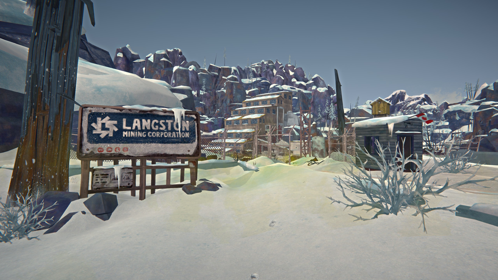
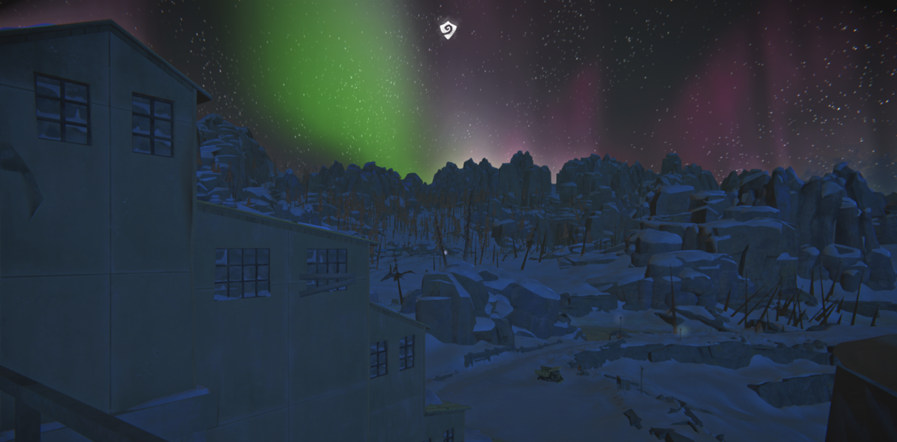
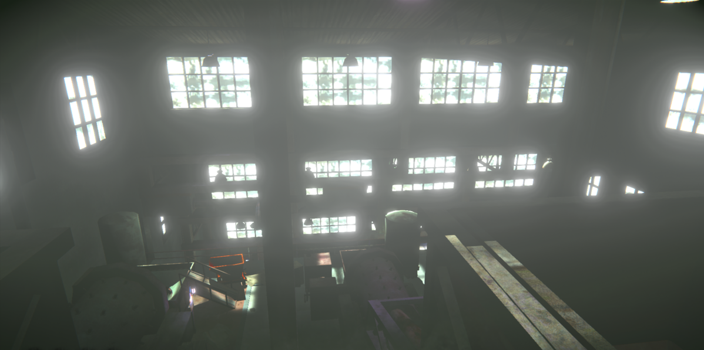

# Concentrator

**Categories:** Indoor locations, Locations, Locations in Zone of Contamination, Locations with a workbench · **Source:** [Fandom](https://thelongdark.fandom.com/wiki/Concentrator)

**Concentrator**

_Concentrator.png_

**Location**

_Concentrator\_Location.png_

**Region:** [Zone of Contamination](./Zone%20of%20Contamination.md)

**General**

Type

_bed\_icon.png_

_workbench\_icon\_green.png_

Has a workbench

## Overview

This 7 story tall building is enormous from both the inside and outside. From the top, the player can observe the entire surrounding area.

Each floor is quite tall with steel beams spanning across the ceiling. On the ground are countless different pieces of machinery and objects.

The floors contain:

- Ground floor: Delivery area with toolboxes and metal containers to loot. There are also coal pieces next to the minecart. On this floor are the two exits leading to the mine pit area. [Can of Gunpowder](./Can%20of%20Gunpowder.md) may spawn behind a large sheet of corrugated metal in a back corner of the room.
- Second floor: Here are the concentrator machines located. Lockers a few containers and a control room to loot.
- Third floor: The walkways of the concentrators. Basically no loot except a few rounds of rifle ammo.
- Fourth floor: Some concrete platforms. Basically no loot.
- Fifth floor: Conveyor chutes. A hopper machine at the opposite end of the floor leads onto a series of pipes below (where a backpack can be spotted laying from above), when these are followed they lead onto a walkway from which an otherwise inaccessible control room can be entered, this secret room may contain high-tier loot including a [Can of Gunpowder](./Can%20of%20Gunpowder.md), Ammo, Clothing, Emergency Stim and the [Miner's Flashlight](./Miner%27s%20Flashlight.md).
- Sixth floor: Minecart entrance from the mountain (exit to the mountainside mine entrance). Little amount of loot. [Woodworking Tools](./Woodworking%20Tools.md) spawn on a work table on this floor.
- Seventh floor: Office area with a kitchen and a storage room where the [Respirator](./Respirator.md) is located. Has [Food And Drinks](./Food%20And%20Drink.md), [Bag of Salt](./Salt%20%28Bag%29.md), stored water container, a [Safe](./Safe.md), a [Medical Locker](./Medical%20Locker.md), [Clothing](./Clothing.md), etc.

It is important to note that all the floors are abundant in items that can be broken down ([Crates](./Crate.md), [Cardboard boxes](./Cardboard%20Box.md)) and have debris scattered on the floor ([Reclaimed Wood](./Reclaimed%20Wood.md), [Scrap Metal](./Scrap%20Metal.md)). [Coal](./Coal.md) can also be found scattered around.

There are no beds in the building, but it is possible to sleep in the car on the ground floor.

There are also no indoor fireplaces. The best option is to cook outside at the delivery area entrances or at the exit to the mountain on the sixth floor.

## Trivia

The Concentrator is based off of the [Britannia Mine Museum](https://en.m.wikipedia.org/wiki/Britannia_Mine_Museum) in Vancouver, British Columbia, Canada.

## Gallery

_The Concentrator in the distance, with the company sign._

_Concentrator during aurora_

_Concentrator inside during aurora_
