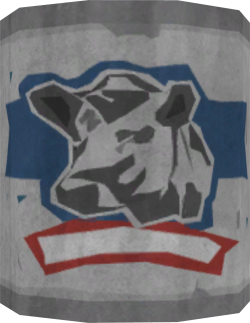

# Condensed Milk

**Contents**

- [Overview](#overview)
- [Trivia](#trivia)
- [Gallery](#gallery)
- [Update history](#update-history)

**Condensed Milk**

| Property | Details |
| --- | --- |
| \[\[File: / \|  / *Sealed* \|  / *Opened* \| / \| --- \| --- \| | 250px\]\] |
|  / *Sealed* |  / *Opened* |
| Release | [22 September 2014](./The%20Long%20Dark%20%E2%80%94%20Changelog.md#0.117) |
| Wintermute | No |
| **Properties** |  |
| Item type | [Food And Drink](./Food%20And%20Drink.md)\|- / Equipable |
| Stackable | No |
| Examine | Sweetened, thickened milk in a can. Keeps forever. |
| **Values** |  |
| Calories | 750 kcal |
| Hydration | 25% |
| [Vitamin C](./Scurvy.md) | Minor (12%) |
| Weight | 0.25 kg (0.55 lbs) |
| **Decay Rate** |  |
| Inside | 0.500% per day |
| Outside | 2.500% per day |
| **Advanced data** |  |
| Item key | GAMEPLAY\_CondensedMilk |

**Condensed Milk** is a packaged [food](./Food%20And%20Drink.md) item in *The Long Dark*.

## Overview

Consuming Condensed Milk replenishes a moderate amount of thirst and large amount of calories. It may also be warmed by a [fire](./Fire.md) to grant the benefit [Warming Up](./Warming%20Up.md).

Like other [canned](./Food%20And%20Drink.md) foods, Condensed Milk may be opened with a [Can Opener](./Can%20Opener.md) or [bladed tool](./Tools.md), or smashed open (with no tool) but spilling some of its contents. If opened with a tool, a [Recycled Can](./Recycled%20Can.md) is received after consuming the contents.

Condensed Milk is relatively rare, but may be found inside homes, usually in cupboards or on shelfs. It is essentially an upgraded [Pinnacle Peaches](./Pinnacle%20Peaches.md), offering a similar hydration and more calories per weight.

Contrary to its in-game description, Condensed Milk [spoils](./Decay.md) quickly compared to other processed food.

## Trivia

- Condensed milk is packaged as a product called *Little Cow: Condensed Milk* with a picture of a cow, fittingly.
- The side of the can lists "Ingredients: Evaporated Cows Milk, Vitamin D."
- Condensed Milk will not spawn on Interloper mode.

## Gallery

| Column 1 |
| --- |
|  / *Old model* |

## Update history

- UPDATE **22 September 2014 ([Update](./The%20Long%20Dark%20%E2%80%94%20Early%20Access%20Changelog.md#0.117)):**
  - Added to game.

**Lua execution error in Module:Navbox function navbox** [ru:Банка сгущёнки](ru:%D0%91%D0%B0%D0%BD%D0%BA%D0%B0_%D1%81%D0%B3%D1%83%D1%89%D1%91%D0%BD%D0%BA%D0%B8)
