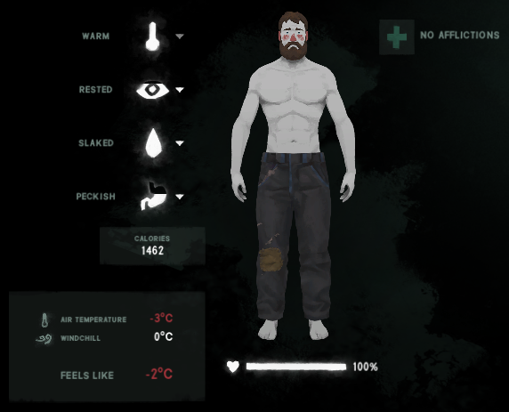
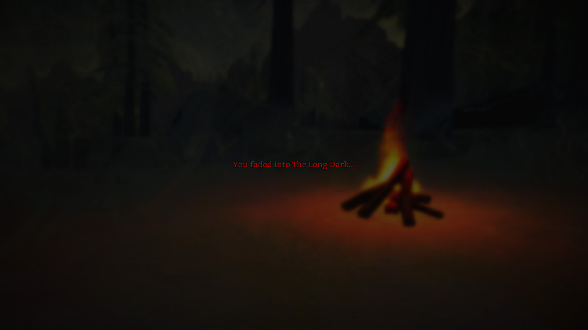

# Condition

**Categories:** Gameplay · **Source:** [Fandom](https://thelongdark.fandom.com/wiki/Condition)

**Contents**

- [Mechanics](#mechanics)
- [Afflictions that damage Condition](#afflictions-that-damage-condition)
- [Instant Damage](#instant-damage)
- [Damage over time](#damage-over-time)
- [Afflictions that change Condition Bar](#afflictions-that-change-condition-bar)
- [Positive](#positive)
- [Negative](#negative)
- [Recovering Condition](#recovering-condition)
- [Positive Recovery](#positive-recovery)
- [Negative Recovery](#negative-recovery)
- [Death](#death)
- [Wintermute](#wintermute)
- [See also](#see-also)

 **Condition** is a player statistic that represents health as the total amount of damage that can be taken before dying. Condition can be lost immediately through Injuries, indirectly through [Afflictions](./Afflictions.md), or through deficiencies in [Needs](./Needs.md).

When the player falls below 10% condition, the display becomes blurred and begins to sway, with visibility decreased and sound muffled except for the sound of a heartbeat. As condition drops lower and lower, these effects are made more and more pronounced. Movement is still possible at a normal rate, but can be more challenging as the survivor will stagger around uncontrollably even when crouched.

## Mechanics

 Injuries instantly subtract a percentage of the player's condition. Incidents such as a short fall or a [Laceration](./Laceration.md) from a struggle with a [Wolf](./Wolf.md) can cause minor to moderate injuries. The associated condition loss is immediate and usually does not have any long-lasting effects beyond the condition loss itself.

On the other hand, certain [Afflictions](./Afflictions.md) such as [Blood Loss](./Blood%20Loss.md) or [Infections](./Infection.md) drain the player's condition until either the affliction is treated or the player slips into the Long Dark. However, a few afflictions limit the maximum condition that the player can reach. Most afflictions last until treated fully, including rest if required. After the affliction has been removed condition may be restored normally.

When a [Need](./Needs.md) reaches 0, the player begins to lose condition. Failing to satisfy needs will consistently drain condition until the need meter is brought above zero. When the player has not had sufficient rest, nutrition, or hydration, condition loss is relatively slow. If the player does not have sufficient warmth, condition loss is very rapid and requires the player to quickly react to prevent death. See below for the condition drain rates when a need reaches 0.

| Need | Daily drain rate | Hourly drain rate |
| --- | --- | --- |
| Warmth | -450.0% | -18.75% |
| Fatigue | -25.0% | -1.04% |
| Thirst | -50.0% | -2.08% |
| Hunger | -25.0% | -1.04% |

## Afflictions that damage Condition

### Instant Damage

Some Afflictions cause Condition damage. Falling through [Weak Ice](./Weak%20Ice.md), [Bruises](./Minor%20Bruising.md) (from [Falling](./Rope%20Climbing.md)) and Lacerations (from [Struggles](./Struggle.md)) cause instant Condition damage based on [Survival Mode](./Survival%20Mode.md) (or length of fall). Falls above 50m are instantly lethal on contact with the ground, as are Falls/entering a killbox (e.g. attempting to climb beneath the [Raven Falls Trestle](./Raven%20Falls%20Trestle.md) ([The Ravine](./The%20Ravine.md)) or the gorge below [Mackenzie's Crashed Plane](./Mackenzie%27s%20Crashed%20Plane.md) ([Mountain Town](./Mountain%20Town.md)) see [Environmental Hazard](./Environmental%20Hazard.md)). [Torn Clothing](./Torn%20Clothing.md) affects the Condition of worn [Clothing](./Clothing.md), rather than the player's Condition.

| Image | Affliction | Condition Instantly Lost |
| --- | --- | --- |
| [Torn Clothing icon](../assets/Torn_Clothing_icon.png) | [Torn Clothing](./Torn%20Clothing.md) | N/A (To Clothing Condition) |
| [Major Bruising icon](../assets/Major_Bruising_icon.png) | [Major Bruising](./Major%20Bruising.md) | -10% |
| [Minor Bruising icon](../assets/Minor_Bruising_icon.png) | [Minor Bruising](./Minor%20Bruising.md) | -5% |
| [Laceration icon](../assets/Laceration_icon.png) | [Laceration](./Laceration.md) | -10% to -15% |

[Misery](./Misery.md) Afflictions are unique to this game mode only, but many can cause Condition loss

| Image | Affliction | Condition Instantly Lost |
| --- | --- | --- |
| [Rheumatic Joints icon](../assets/Rheumatic_Joints_icon.png) | [Rheumatic Joints](./Rheumatic%20Joints.md) | -2% from Sprains |
| [Broken Body icon](../assets/Broken_Body_icon.png) | [Broken Body](./Broken%20Body.md) | +100% more Condition loss from any damage source |

### Damage over time

Other Afflictions cause damage over a period of time, and often take longer periods to heal both lost Condition and the Affliction itself.

| Image | Affliction | Daily drain rate | Hourly drain rate | Minute drain rate |
| --- | --- | --- | --- | --- |
| [Food Poisoning icon](../assets/Food_Poisoning_icon.png) | [Food Poisoning](./Food%20Poisoning.md) | -85.0% | -3.5% | -0.058% |
| [Blood Loss icon](../assets/Blood_Loss_icon.png) | [Blood Loss](./Blood%20Loss.md) | -720.0% | -30.0% | -0.5% |
| [Dysentery icon](../assets/Dysentery_icon.png) | [Dysentery](./Dysentery.md) | -96% | -4% | -0.067% |
| [Infection icon](../assets/Infection_icon.png) | [Infection](./Infection.md) | -120% | -5% | -0.083% |
| [Hypothermia icon](../assets/Hypothermia_icon.png) | Freezing while [Hypothermic](./Hypothermia.md) | -960.0% | -40.0% | -0.66% |
| [Fear icon](../assets/Fear_icon.png) | [Fear](./Afflictions.md) | -72,000.0% | -3,000.0% | -50.0% |
| [Burns icon](../assets/Burns_icon.png) | [Burns](./Burns.md) | -2,851,200.0% | -118,800.0% | -1980.0% |

- **Note 1**: Intestinal Parasites affects _maximum_ Condition.
- **Note 2:** Food Poisoning is non-lethal, and cannot lower Condition below 15%.
- **Note 3:** Food Poisoning and Dysentery do not allow Condition to be recovered while the Affliction persists, even during [Sleep](./Sleep.md).
- **Note 4**: Burns (from Electrified Wires or Water during an [Aurora](./Aurora.md) or from contact with a lit [Campfire](./Campfire.md)/large open fires found in Wintermute) causes 33% Condition damage per second.

## Afflictions that change Condition Bar

While most Afflictions damage Condition, which can be recovered with enough rest, some Afflictions reduce or increase the overall size of the Condition bar, increasing or simply preventing Condition recovery up to a certain point.

### Positive

[Well Fed](./Well%20Fed.md) is acquired after [Calorie Store](./Hunger.md) is kept above 0 calories for 3 days, and increases max carrying capacity by 5kg (11 lbs) and increases Condition by 5%, but is lost if Calorie Store reaches 0 calories. [Unburdened](./Unburdened.md) temporarily increases max Condition by 10% for 3 hours. If both Afflictions are acquired, this can make the maximum length of the Condition bar stretch to 115%, the highest it can possible be.

A "+" Plus symbol and the color blue is used to denote any condition gained when the player's Condition passes 100%. If either previously mentioned Positive Affliction is lost, extra Condition over 100% is instantly lost as well, sending the player's condition back to 100% if they were already over it.

| Image | Affliction | Condition increase |
| --- | --- | --- |
| [Well Fed icon](../assets/Well_Fed_icon.png) | [Well Fed](./Well%20Fed.md) | Temporarily increases Condition bar by 5% |
| [Nourished icon](../assets/Nourished_icon.png) | [Nourished](./Nourished.md) | Temporarily increases Condition bar by 10% |

### Negative

[Frostbite](./Frostbite.md) afflictions lower the maximum Condition bar by 10% per instance, and is the only [Affliction](./Afflictions.md) with no treatment (making its effects permanent). Up to 5 instances of Frostbite can be present at once on one body part (reducing maximum Condition by 50%), with up to 10 (11 temporarily with the extra 15% acquired from [Well Fed](./Well%20Fed.md) and [Unburdened](./Unburdened.md), until Unburdened wears off) instances resulting in death.

[Burns](./Burns.md) reduce maximum Condition by 25%, [Chemical Poisoning](./Chemical%20Poisoning.md) by 20% per stack of poisoning, both will not allow condition to heal above the lowered maximum threshold until at least one instance of said Afflictions is healed. [Intestinal Parasites](./Intestinal%20Parasites.md) permanently reduces the Condition bar by 2% per day until cured (minimum of 20% per 10 days on Stalker, minimum of 40% per 20 days on Interloper.

Theoretically, the largest Condition Bar debuff would be -325% acquired from all 5 body parts having 5 instances of Frostbite, plus one instance of either Burns or Chemical Poisoning.

A "-" Minus symbol and the color red is used to denote any Condition on the bar that cannot be recovered if currently suffering from these 4 Afflictions:

| Image | Affliction | Condition decrease |
| --- | --- | --- |
| [Frostbite icon](../assets/Frostbite_icon.png) | [Frostbite](./Frostbite.md) | Permanently decreases Condition bar by 10% per instance |
| [Cheated Death Penalty icon](../assets/Cheated_Death_Penalty_icon.png) | [Cheated Death Penalty](./Cheated%20Death%20Penalty.md) | Temporary or Permanent Condition loss |
| [Burns icon](../assets/Burns_icon.png) | [Burns](./Burns.md) | Immediately reduces max Condition bar to 75% of its Condition |
| [Chemical Poisoning icon](../assets/Chemical_Poisoning_icon.png) | [Chemical Poisoning](./Chemical%20Poisoning.md) | Reduces max Condition bar by 20% (per Affliction) |
| [Intestinal Parasites icon](../assets/Intestinal_Parasites_icon.png) | [Intestinal Parasites](./Intestinal%20Parasites.md) | Permanently reduces max Condition bar by 2% daily until cured |

## Recovering Condition

Condition normally restores to 100% but can be limited to less by certain [Afflictions](./Afflictions.md). Players can restore lost condition using four different methods.

[Sleep](./Sleep.md) is the most common method of restoring condition. All four needs must be met for the player to restore condition during sleep. The rate of return is dependent on the bed used and the number of hours slept, with longer periods granting higher returns. [Cup of Herbal Tea](./Cup%20of%20Herbal%20Tea.md) can also help the player achieve a more restful sleep. For more detailed info on this vital mechanic, have a look at the [sleep](https://thelongdark.fandom.com/wiki/Sleep?so=search#Restoring_condition) page.

Condition is restored at a rate of 25% each day, or just over 1% every hour as long as all four [Needs](./Needs.md) are above 0 and the player has no Afflictions which negatively affects condition (such as [Food Poisoning](./Food%20Poisoning.md)). This passive regeneration improves the player's condition while awake, but is slower than the condition recovery from sleeping.

### Positive Recovery

The following items positively affect Condition recovery:

| Image | Name | Condition Restored |
| --- | --- | --- |
| [Breyerhouse Pie icon](../assets/Breyerhouse_Pie_icon.png) | [Breyerhouse Pie](./Breyerhouse%20Pie.md) | Instantly restores 10% of Condition Provides the [Nourished icon](../assets/Nourished_icon.png) [Nourished](./Nourished.md) Affliction for 3 hours |
| [Camber Flight Porridge icon](../assets/Camber_Flight_Porridge_icon.png) | [Camber Flight Porridge](./Camber%20Flight%20Porridge.md) | Instantly restores 10% of Condition Provides the [Nourished icon](../assets/Nourished_icon.png) [Nourished](./Nourished.md) Affliction for 3 hours |
| [Dockworker's Pie icon](../assets/Dockworker%27s_Pie_icon.png) | [Dockworker's Pie](./Dockworker%27s%20Pie.md) | Instantly restores 35% of Condition Provides the [Nourished icon](../assets/Nourished_icon.png) [Nourished](./Nourished.md) Affliction for 3 hours |
| [Ranger Stew icon](../assets/Ranger_Stew_icon.png) | [Ranger Stew](./Ranger%20Stew.md) | Instantly restores 10% of Condition Provides the [Nourished icon](../assets/Nourished_icon.png) [Nourished](./Nourished.md) Affliction for 3 hours |
| [Lily's Pancakes icon](../assets/Lily%27s_Pancakes_icon.png) | [Lily's Pancakes](./Lily%27s%20Pancakes.md) | Instantly restores 10% of Condition |
| [Emergency Stim icon](../assets/Emergency_Stim_icon.png) | [Emergency Stim](./Emergency%20Stim.md) | Instantly restores 15% of Condition |
| [Prepper's Pie icon](../assets/Prepper%27s_Pie_icon.png) | [Prepper's Pie](./Prepper%27s%20Pie.md) | Instantly restores 25% of Condition |
| [Birch Bark Tea icon](../assets/Birch_Bark_Tea_icon.png) | [Birch Bark Tea](./Birch%20Bark%20Tea.md) | Grants the [Restore Condition icon](../assets/Restore_Condition_icon.png) [Restore Condition](./Restore%20Condition.md) Affliction, Restoring 5% Condition for 2 hours |

The following foods grant the  [Improved Rest](./Improved%20Rest.md) Affliction, restoring Condition gained while [sleeping](./Sleep.md) by an extra 2% (1% for Interloper) an hour while the benefit is still active. This benefit is used whenever sleeping, whether this be all at once or across multiple sleep sessions.

|  | Food and Drink | Duration |
| --- | --- | --- |
| [Cup of Herbal Tea icon](../assets/Cup_of_Herbal_Tea_icon.png) | [Cup of Herbal Tea](./Cup%20of%20Herbal%20Tea.md) | 6 hours |
| [Stalker's Pie icon](../assets/Stalker%27s_Pie_icon.png) | [Stalker's Pie](./Stalker%27s%20Pie.md) | 6 hours |
| [Ptarmigan Stew icon](../assets/Ptarmigan_Stew_icon.png) | [Ptarmigan Stew](./Ptarmigan%20Stew.md) | 3 hours |
| [Ranger Stew icon](../assets/Ranger_Stew_icon.png) | [Ranger Stew](./Ranger%20Stew.md) | 3 hours |
| [Rabbit Stew icon](../assets/Rabbit_Stew_icon.png) | [Rabbit Stew](./Rabbit%20Stew.md) | 3 hours |
| [Thomson Family Stew icon](../assets/Thomson_Family_Stew_icon.png) | [Thomson Family Stew](./Thomson%20Family%20Stew.md) | 3 hours |
| [Trout Stew icon](../assets/Trout_Stew_icon.png) | [Trout Stew](./Trout%20Stew.md) | 3 hours |
| [Venison Stew icon](../assets/Venison_Stew_icon.png) | [Venison Stew](./Venison%20Stew.md) | 3 hours |

During the [Challenge](./Challenge.md) "[As the Dead Sleep](./As%20the%20Dead%20Sleep.md)" (or Custom), passive healing and sleep healing are disabled, additionally [Birch Bark Tea](./Birch%20Bark%20Tea.md) is disabled. This makes [Herbal Tea](./Herbal%20Tea.md) and [Cup of Herbal Tea](./Cup%20of%20Herbal%20Tea.md) strictly a food item and [Birch Bark](./Birch%20Bark.md) strictly tinder. The only way to heal during the challenge are with using rare and finite [Emergency Stims](./Emergency%20Stim.md).

- Frostbite permanently reduces maximum Condition by 10% per application (up to 5, to a maximum of 50%).
- Burns temporarily reduce maximum Condition by 15%.
- Food Poisoning and Dysentery temporarily lowers maximum Condition recovery **to 0%**.

### Negative Recovery

The following Afflictions negatively affect Condition recovery.

| Image | Affliction | Condition Recovery Penalty |
| --- | --- | --- |
| [Insomnia icon](../assets/Insomnia_icon.png) | [Insomnia](./Insomnia.md) | Has a chance to interupt Rest |
| [Weakened State icon](../assets/Weakened_State_icon.png) | [Weakened State](./Weakened%20State.md) | Halves Condition Recovery |
| [Haunted Mind icon](../assets/Haunted_Mind_icon.png) | [Haunted Mind](./Haunted%20Mind.md) | -50% Condition healing from Rest |
| [Broken Body icon](../assets/Broken_Body_icon.png) | [Broken Body](./Broken%20Body.md) | Disables all forms of Condition Recovery |

## Death

> “**You faded into The Long Dark...**”
>
> — In-game description

Death occurs when the survivor's Condition reaches zero, providing a brief explanation for the cause of death:

- "YOU FADED INTO THE LONG DARK..." - typically occurs when the player dies from 1 or more Needs being empty/environmental damage (freezing to death while sleeping, or from [Chemical Poisoning](./Chemical%20Poisoning.md), [Frostbite](./Frostbite.md), or [Hypothermia](./Hypothermia.md)). Small falls that finish the player off via [Major Bruising](./Major%20Bruising.md) or [Minor Bruising](./Minor%20Bruising.md) will also trigger this. Most other deaths generate this message by default.
- "YOU BURNED TO DEATH" - standing in a lit [Campfire](./Campfire.md) or open flames found in Wintermute Episodes will generate this message when the player dies.
- "YOU DIED FROM LOSS OF BLOOD AND SHOCK FROM A (WOLF/BEAR/COUGAR) ATTACK" - displays when the last point of damage occurs from a [Wolf](./Wolf.md), [Timberwolf](./Timberwolf.md), [Poisoned Wolf](./Poisoned%20Wolf.md), [Bear](./Bear.md), or [Cougar](./Cougar.md) struggles. A killing bite from a passing Timberwolf or slash from Cougars will also trigger this (via [Laceration](./Laceration.md), Minor Bruising, or Major Bruising).
- "YOU DIED FROM INJURIES SUSTAINED FROM A MOOSE ATTACK" - appears after death by [Moose](./Moose.md) Struggle.
- "YOU DIED FROM (AFFLICTION)" - displays when the player dies from [Blood Loss](./Blood%20Loss.md), [Dysentery](./Dysentery.md), [Infection](./Infection.md), [Scurvy](./Scurvy.md), [Suffocation](./Suffocation.md), or [Food Poisoning](./Food%20Poisoning.md) while awake.
- "YOU DIED FROM (AFFLICTION) WHILE SLEEPING" - Die from Blood Loss, Dysentery, Infection, Scurvy, Suffocation, or Food Poisoning while sleeping.
- "YOU DROWNED AFTER FALLING THROUGH CRACKED ICE" - occurs if the player dies while falling through [Weak Ice](./Weak%20Ice.md).
- "YOU DIED FROM DROWNING" - occurs after falling into the large moving rivers in [Blackrock](./Blackrock.md) or [Keeper's Pass North](./Keeper%27s%20Pass%20North.md).
- "YOU DIED FROM MASSIVE INTERNAL INJURIES AFTER FALLING" - falling from an extreme height or passing through an [instant kill barrier](./Environmental%20Hazard.md#Instant_Kill_Barriers) will trigger this. Can also occur when stamina is too low and falling from a [Rope Climbing](./Rope%20Climbing.md) section.
- "THE DARKWALKER HAS DEVOURED YOU" - if the Darkwalker in [Escape the Darkwalker](./Escape%20the%20Darkwalker.md) catches you, a cutscene will play before the player is killed and generate this message.

### Wintermute

In addition to normal death screens, Wintermute has unique game over screens.

- "(Crash Survivor) HAS DIED FROM (Affliction)" - occurs in [Episode 3: Crossroads Elegy](./Episode%203%20-%20Crossroads%20Elegy.md) when transporting the [Crash Survivors](./Crash%20Survivor.md) (Gwen, Ada, Logan, and Wade) if they die from an Affliction (Blood Loss, [Exposure](./Hypothermia.md), or [Dehydration](./Dehydrated.md)).
- "(Crash Survivor) HAS DIED FROM A WOLF ATTACK" - occurs if a Crash Survivor is killed by a [Timberwolf](./Timberwolf.md) in Episode 3.
- "YOU DIED FROM GUNSHOT WOUNDS" - occurs when shot by [Convicts](./Convicts.md) in the [Blackrock Prison](./Blackrock%20Prison.md) Yard in the mission [Donner (mission)](./Donner%20%28mission%29.md) [Episode 4: Fury, Then Silence](./Episode%204%20-%20Fury%2C%20Then%20Silence.md).
- "MISSON FAILED - THE CONVICTS RE-CAPTURED MACKENZIE" - occurs when Convicts break down one of the two doors down at the end of Episode 4 in the mission Donner (mission) and the player does not escape fast enough.

Death is different per game mode:

- If the player dies in Survival Mode, they have an option to [Cheat Death](./Cheat%20Death.md) (for 3 more extra lives) and continue their save, or chose to end their run and Die. If the later option is chosen, an option to "Save the journal" is available, which will add that save's journal statistics to the global statistics. In [Challenges](./Challenge.md) the Challenge ends in failure and must be restarted.
- In [Wintermute](./Wintermute.md) (Story Mode) the player has the option to restart from a prior save/autosave checkpoint upon death.

Progress towards [Feats](./Feats.md), [Achievements](./The%20Long%20Dark%20%E2%80%94%20Achievements.md), and certain [Badges](./Badges.md) persists even after death.

## See also

- [Hibernation](./Hibernation.md)
