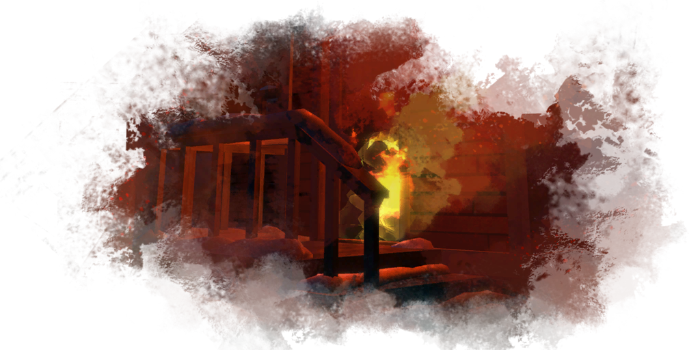

# Conflagration

<table class="infobox">
<caption>Conflagration</caption>
<colgroup>
<col style="width: 50%" />
<col style="width: 50%" />
</colgroup>
<tbody>
<tr>
<td colspan="2"><figure>

<figcaption>Missions_story_ep5_Conflagration.png</figcaption>
</figure></td>
</tr>
<tr>
<td>
Episode
</td>
<td></td>
</tr>
<tr>
<td colspan="2" class="section">
<strong>Missions</strong>
</td>
</tr>
<tr>
<td>
Previous
</td>
<td>
<a href="./To%20SAR%20And%20Back.md" class="wikilink" title="To SAR And Back">To SAR And Back</a>
</td>
</tr>
<tr>
<td>
Current
</td>
<td>
Conflagration
</td>
</tr>
<tr>
<td>
Region
</td>
<td>
<a href="./Perseverance%20Mills.md" class="wikilink" title="Perseverance Mills">Perseverance Mills</a>
</td>
</tr>
<tr>
<td>
Characters
</td>
<td>
<a href="./Astrid%20Greenwood.md" class="wikilink" title="Astrid Greenwood">Astrid Greenwood</a> 
<a href="./Mathis.md" class="wikilink" title="Mathis">Mathis</a> 
<a href="./Jane%20Yang.md" class="wikilink" title="Jane Yang">Jane Yang</a> 
<a href="./Donner.md" class="wikilink" title="Donner">Donner</a> 
<a href="./Heller.md" class="wikilink" title="Heller">Heller</a> 
<a href="./Vachon.md" class="wikilink" title="Vachon">Vachon</a> 
<a href="./Jeremiah.md" class="wikilink" title="Jeremiah">Jeremiah</a> 
<a href="./Molly.md" class="wikilink" title="Molly">Molly</a> 
<a href="./Methuselah.md" class="wikilink" title="Methuselah">Methuselah</a> 
<a href="./Convicts.md" class="wikilink" title="Convicts">Convicts</a>
</td>
</tr>
</tbody>
</table>

|  |  |  |
|----|----|----|
| “ | Prepare for the Quiet Apocalypse. | ” |

**Conflagration** is the only mission of Part Four: Terminus in <a href="./Episode%205%20-%20The%20Light%20At%20The%20End%20Of%20All%20Things.md" class="wikilink" title="Episode 5: The Light At The End Of All Things">Episode 5: The Light At The End Of All Things</a> of the <a href="./Wintermute.md" class="wikilink" title="Wintermute">Wintermute</a> story of <a href="./The%20Long%20Dark.md" class="wikilink" title="The Long Dark"><em>The Long Dark</em></a>. It is the last mission in the Episode, and the last mission of the Wintermute story.

## Objectives

- Infiltrate the town. Sneak by or take down the marauding Convicts.
  - Reach Jane's house.
- Record a radio message for the apocalypse survivors.
  - Reach the radio hut.

## Walkthrough

## Trivia

**Lua execution error in Module:Navbox function navbox**

