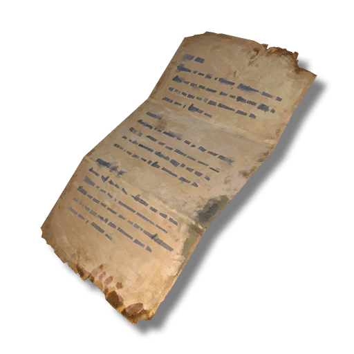

# Conspiracy Theories

<table class="infobox">
<caption>Conspiracy Theories</caption>
<colgroup>
<col style="width: 50%" />
<col style="width: 50%" />
</colgroup>
<tbody>
<tr>
<td colspan="2"><figure>

<figcaption>Conspiracy_Theories_icon.png</figcaption>
</figure></td>
</tr>
<tr>
<td>
Release
</td>
<td>
<a href="./The%20Long%20Dark%20%E2%80%94%20Changelog.md#1.95" class="wikilink" title="6 October 2021">6 October 2021</a>
</td>
</tr>
<tr>
<td>
Wintermute
</td>
<td>
<a href="./Episode%204%20-%20Fury%2C%20Then%20Silence.md" class="wikilink" title="Episode 4">Episode 4</a> - <a href="./Blackrock%20Rumours.md" class="wikilink" title="Blackrock Rumours">Blackrock Rumours</a>
</td>
</tr>
<tr>
<td colspan="2" class="section">
<strong>Properties</strong>
</td>
</tr>
<tr>
<td>
Item type
</td>
<td>
<a href="./Collectibles.md" class="wikilink" title="Collectibles">Collectibles</a>|-
</td>
</tr>
<tr>
<td>
Stackable
</td>
<td>
No
</td>
</tr>
<tr>
<td>
Examine
</td>
<td>
Hand written notes mentioning various local conspiracy theories.
</td>
</tr>
<tr>
<td colspan="2" class="section">
<strong>Values</strong>
</td>
</tr>
<tr>
<td>
Weight
</td>
<td>
0.00 kg (0 lbs)
</td>
</tr>
<tr>
<td colspan="2" class="section">
<strong>Actions</strong>
</td>
</tr>
<tr>
<td>
Backpack
</td>
<td>
Examine
</td>
</tr>
<tr>
<td>
On ground
</td>
<td>
Take It, Read Text, Leave It
</td>
</tr>
</tbody>
</table>

**Conspiracy Theories** is a <a href="./Collectibles.md" class="wikilink" title="Collectible">Collectible</a> found in <a href="./Episode%204%20-%20Fury%2C%20Then%20Silence.md" class="wikilink" title="Episode 4">Episode 4</a> of the <a href="./Wintermute.md" class="wikilink" title="Wintermute">Wintermute</a> story as part of the <a href="./Blackrock%20Rumours.md" class="wikilink" title="Blackrock Rumours">Blackrock Rumours</a> side mission. It is found in the bunker as part of the Suspicious man quest.

## Transcrip

The following text is transcribed from **Conspiracy Theories**

Those lights keep coming back, over and over. Never stops. Ever since that first night. And the wolves are strange critters now. It's gotta be down to somethin at Blackrock, but I just don't know...

It's all gettin fuzzy around the edges. I keep dreaming of the sea, being back on the water again...see myself tumblin down the mountain, can't stop myself. River swallows me up.

Never shoulda stayed round here after I got out. Was like a big hole and now I'm sitting on the edge of it looking back down. Down where I already was.

Like the doc said back then, keep writin...if you're writin you're breathin.

## Trivia

- An unconfirmed theory is that this letter was written by <a href="./The%20Foreman.md" class="wikilink" title="The Foreman">The Foreman</a> after he escaped <a href="./Forsaken%20Airfield.md" class="wikilink" title="Forsaken Airfield">Forsaken Airfield</a>.
  - The symptoms the writer documents are consistent with those experienced by <a href="./Project%20Medical%20Officer.md" class="wikilink" title="Patient 7">Patient 7</a>, likely due to exposure to Rudiger's Machine.
- Another theory is that this individual may have been a former convict released from Blackrock Prison, as the note <a href="./Blackrock%20Prisoner%20Release%20Record.md" class="wikilink" title="Blackrock Prisoner Release Record">Blackrock Prisoner Release Record</a> is found inside the same bunker. The <a href="./Prepper%20Hatch%20Location.md" class="wikilink" title="Prepper Hatch Location">Prepper Hatch Location</a> note is also found during the quest, with the writing being of far sounder mind.

## Update history

- UPDATE **6 October 2021 (<a href="./The%20Long%20Dark%20%E2%80%94%20Changelog.md#1.95" class="wikilink" title="Update">Update</a>):**
  - Added to game.

**Lua execution error in Module:Navbox function navbox**

