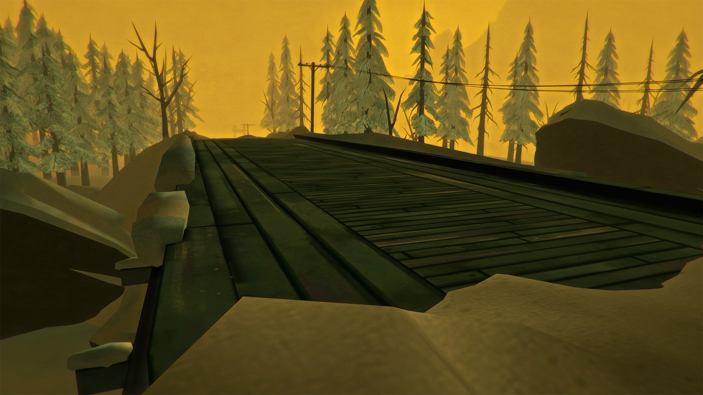

# Contemplation Bridge

**Categories:** Landmarks, Locations, Locations in Pleasant Valley, Outdoor locations · **Source:** [Fandom](https://thelongdark.fandom.com/wiki/Contemplation_Bridge)

**Contemplation Bridge**

_Contemplation\_Bridge.jpg_

**Location**

_Contemplation\_Bridge\_Location.png_

**Region:** [Pleasant Valley](./Pleasant%20Valley.md)

**General**

**Type:** Landmark

## Overview

Contemplation Bridge is one of many bridges in the region. It serves to connect the main road that runs from [Long Curve](./Long%20Curve.md) to [End of the Road](./End%20of%20the%20Road.md).

Contemplation Bridge is east of [Pleasant Valley Outbuildings](./Pleasant%20Valley%20Outbuildings.md). Some [cat tail](./Cat%20Tail.md) plants can be found growing by the river bank near the bridge.

The name might refer to someone "contemplating" jumping off in an act of suicide, since there is a considerable drop from the bridge to the ground below. A less dark interpretation might be the name simply emphasizes the tranquility and a natural beauty of a pleasant spot in a once Pleasant Valley.
