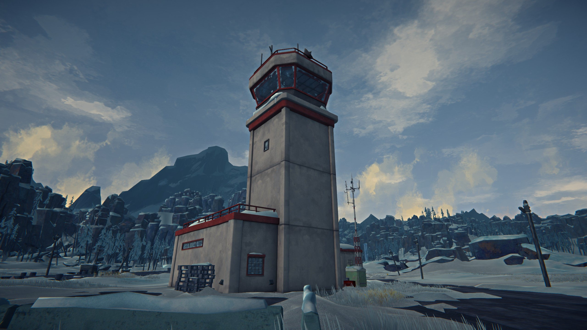

# Control Tower

**Categories:** Indoor locations, Locations, Locations in Forsaken Airfield · **Source:** [Fandom](https://thelongdark.fandom.com/wiki/Control_Tower)

**Control Tower**

_Control\_Tower.jpg_

**Location**

_Control\_Tower\_Location.png_

**Region:** [Forsaken Airfield](./Forsaken%20Airfield.md)

**Description:** The control tower of the airfield

**General**

Type

Firebox

_bed\_icon.png_

Has an interior / The **Control Tower** is building in [Field 31](./Field%2031.md) in the [Forsaken Airfield](./Forsaken%20Airfield.md) Region.

## Overview

The access is possible through a double door, there is no loading screen upon entering. There is no bed or other facilities. A [Distress Pistol](./Distress%20Pistol.md) may spawn at the top of the tower on the console.

At the top floor of the building can be found the [Field 31 Operation Memo](./Field%2031%20Operation%20Memo.md) that allow the survivor to start the [Signal Void](./Signal%20Void.md) [Tale](./Tales.md). A [Transmitter](./Transmitters.md) can be repaired and provides radio coverage for the region and the [Zone of Contamination](./Zone%20of%20Contamination.md).

As with other buildings around the airfield, there is a fair amount of furniture, boxes, etc. that can be broken down for crafting materials. Likewise, the small storage room across from the entrance double doors may contain a little bit of loot and some objects that can be broken down.

## Gallery

_The control tower enlighted by aurora_

_The panel enlighted by aurora_
