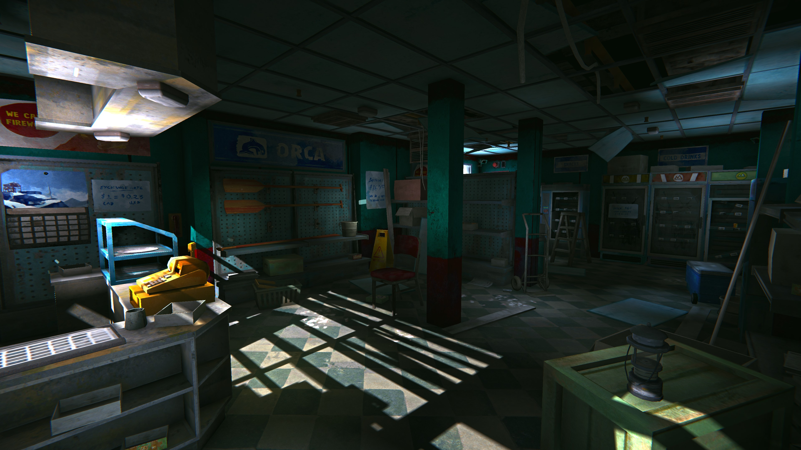
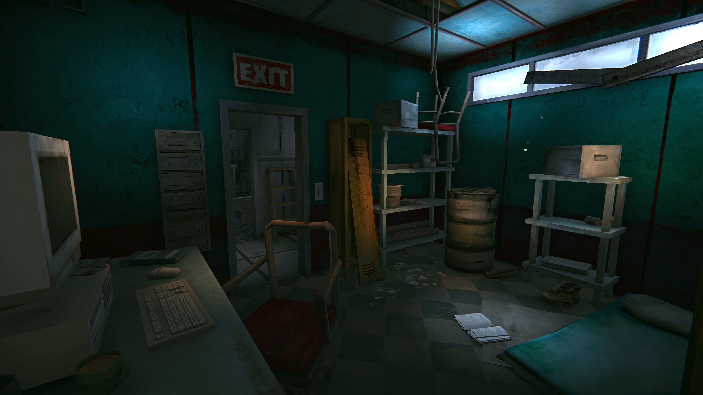
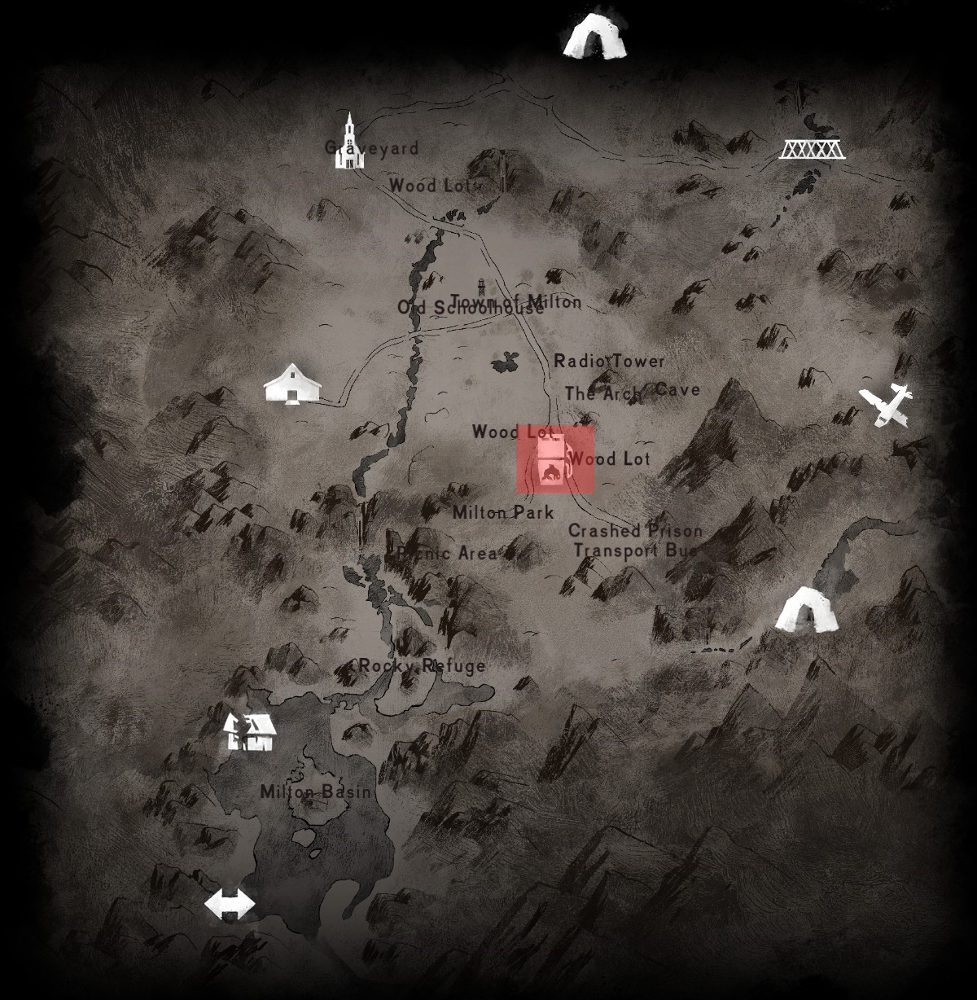

# Convenience Store

**Categories:** Indoor locations, Locations, Locations in Mountain Town, Store locations · **Source:** [Fandom](https://thelongdark.fandom.com/wiki/Convenience_Store)

**Contents**

- [Survival Mode](#survival-mode)
- [Wintermute](#wintermute)
- [Previous Versions](#previous-versions)
- [Trivia](#trivia)

**Convenience Store**

\[\[File: /  / _Floor_ /  / _Back_

250px\]\]

_Floor_

_Back_

**Location**

_Orca\_Gas\_Station\_Location.png_

Region

[Mountain Town](./Mountain%20Town.md)\|-

Location

**Description:** An abandoned gas station

**General**

Type

Store\|-

Firebox

_bed\_icon.png_

Has a bed

**Has an interior\|-:** **Wintermute**

**Missions:** [Episode 1](./Episode%201%20-%20Do%20Not%20Go%20Gentle.md)

**Characters:** [Methuselah](./Methuselah.md)

The **Convenience** **Store** is the inside store found at the [Orca Gas Station](./Orca%20Gas%20Station.md). The front and back doors to the station are both initially locked in [Survival Mode](./Survival%20Mode.md), and require a [Prybar](./Prybar.md) to open.

## Survival Mode

Inside the gas station, the player can find the main store floor, an office, and a bathroom. a [Bed](./Bed.md) and [Fire Barrel](./Fire%20Barrel.md) can be found in the back office. [Water (Potable)](./Water%20%28Potable%29.md), several containers, processed food items, and lots of breakable wood/metal are found all over the shop floor.

## Wintermute

Upon meeting [Grey Mother](./Grey%20Mother.md) she will suggest to [Will Mackenzie](./Will%20Mackenzie.md) to visit the local gas station for supplies. 2 notes, [Orca Gas Store Notice](./Orca%20Gas%20Store%20Notice.md) and [Highway Robbery](./Highway%20Robbery.md) are found inside the station. The front door to the store will be open and will have the lights on when first found, as [Methuselah](./Methuselah.md) will be found inside.

The gas station also serves as a prime example of the already dire situation of the people of Great Bear prior to the [First Flare](./First%20Flare.md). Gas prices appear to have been extremely high, and, ultimately, gasoline seems to have run out entirely based on the red X's on the gas station sign. Comments from characters and notes/signs throughout the store and other buildings in town (mostly in Story mode) also suggest cash had been depleted and that even staples such as milk were hard to come by. The island seem to have suffered some of the worst effects of the wider economic crisis in _The Long Dark_ universe.

#### _Previous Versions_

Prior to the Redux Update to Wintermute, Grey Mother and Will Mackenzie had additional dialogue over a moral dilemma around raiding the gas station in order to provide food for her. This included Grey Mother saying she misjudged Will if he does not steal from the store and instead procures food for her via other means, remarking that he "might just have what it takes to survive this winter."

If the player instead chose to steal from the store, she would express her joy over how "that Mainlander store owner finally had what was coming to him", much to Mackenzie's dismay.

## Trivia

Several signs around the store show just how desperate the Canadian economy was during [The Collapse](./The%20Collapse.md):

- The front door has a note saying "_No Cash_" and the ATM logo being crossed out and also saying in red "No Cash"
- The large sign outside near the pumps showing gasoline prices says $8.88 per gallon for regular and diesel, but is crossed out in red with a note saying "No Gas." The electric vehicle charging sign is not crossed out however
- A sign above the counter near the ceiling says "Ask us about barter/trade"
- The Fridges in the back have a sign saying "Milk $6.00. Next shipment 3-4 weeks"
- The ATM has a sign taped to the screen saying "_No Cash_"
- A shelf has a sign saying "Batteries $160.00. Can be adapted to home use"
- A sign near the register counter displays currency exchange rates "$1 CAD = $0.23 USD." In Wintermute, the note [Orca Gas Store Notice](./Orca%20Gas%20Store%20Notice.md) can be found telling the store owner that store deliveries have been reduced to every quarter of the year.
- The Register has a note on it saying "No more cash"
