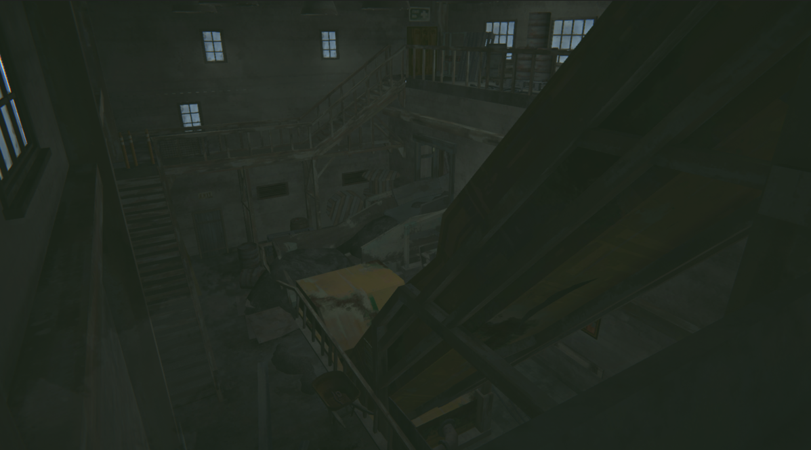

# Conveyor Room

**Categories:** Indoor locations, Locations, Locations in Zone of Contamination · **Source:** [Fandom](https://thelongdark.fandom.com/wiki/Conveyor_Room)

**Conveyor Room**

| Property | Details |
| --- | --- |
| | [Conveyor Room](../assets/Conveyor_Room.png) |
| **Location** | |
| | [Conveyor Room Location](../assets/Conveyor_Room_Location.png) |
| Region | [Zone of Contamination](./Zone%20of%20Contamination.md) |
| Location | Langston mine |
| **General** | |
| Type | |
| | Has an interior |

The **Conveyor Room** is a side building sandwiched between the [Concentrator](./Concentrator.md) and the [Headframe Building](./Headframe%20Building.md). Its role is to bring ore to the surface and deliver it to the Concentrator via 3 conveyor belts connected between all 3 structures.

## Overview

The Conveyor Room is a small building connecting to the second floor of the [Concentrator](./Concentrator.md), the second floor of the [Headframe Building](./Headframe%20Building.md) and the 1st Level of the [Langston Mine](./Langston%20Mine.md). It also has two entrances from the outside.

Loot is scarce and can be obtained from [Lockers](./Locker.md) or from the ground. [Hacksaws](./Hacksaw.md) can also be found.

## Gallery

