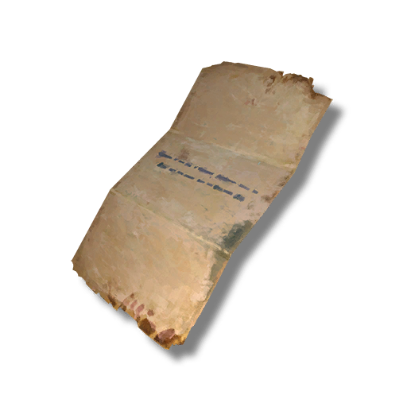

# Convict Cache Directions

**Convict Cache Directions**

| Property | Details |
| --- | --- |
|  |  / *Convict\_Cache\_Directions\_icon.png* |
| Release | [22 October 2019](./The%20Long%20Dark%20%E2%80%94%20Changelog.md#1.60) |
| Wintermute | [Episode 3](./Episode%203%20-%20Crossroads%20Elegy.md) - [Blackrock (mission)](./Blackrock%20%28mission%29.md) |
| **Properties** |  |
| Item type | [Collectibles](./Collectibles.md)\|- |
| Stackable | No |
| Examine | A handwritten note with the location of a hidden cache. |
| **Values** |  |
| Weight | 0.00 kg (0 lbs) |
| **Actions** |  |
| Backpack | Examine |
| On ground | Take It, Read Text, Leave It |
| **Advanced data** |  |
| Item key | STORY\_Collectible\_ConvictNote3 |

**Convict Cache Directions** is a [Collectible](./Collectibles.md) item found in [Episode 3](./Episode%203%20-%20Crossroads%20Elegy.md) of the [Wintermute](./Wintermute.md) story mode as a part of the [Blackrock (mission)](./Blackrock%20%28mission%29.md) side mission.

During the course of the mission, [Astrid Greenwood](./Astrid%20Greenwood.md) finds the note *Convict Cache Directions* in a backpack outside of [Hilltop Cave](./Hilltop%20Cave.md).

## Transcript

*The following text is transcribed from **Convict Cache Directions***

**Use this stuff to push on up and and out of this place. No end to these hills but we got no other way. That thing is still out there.**

## Update history

- UPDATE **22 October 2019 ([Update](./The%20Long%20Dark%20%E2%80%94%20Changelog.md#1.60)):**
  - Added to game.

**Lua execution error in Module:Navbox function navbox**
