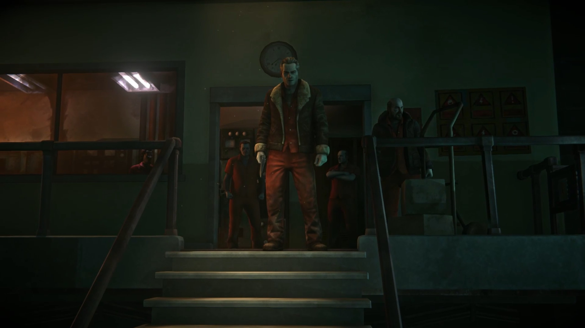
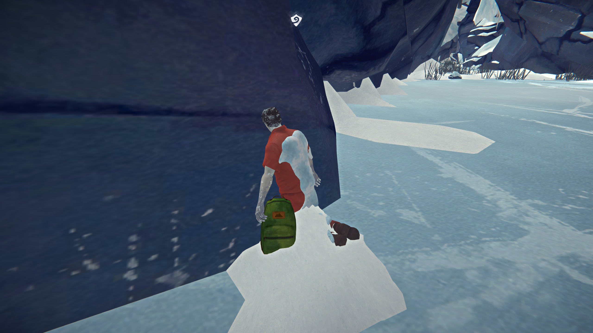
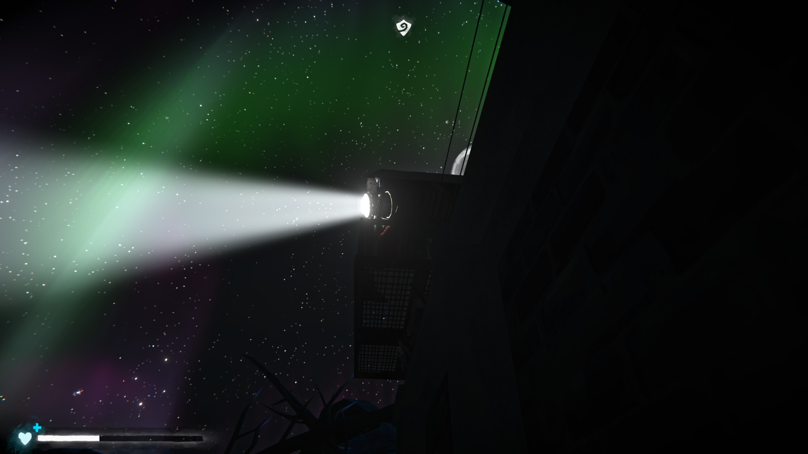
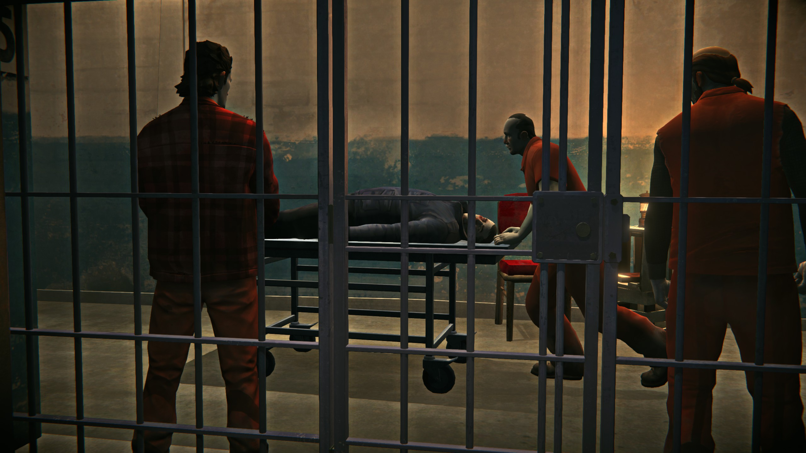
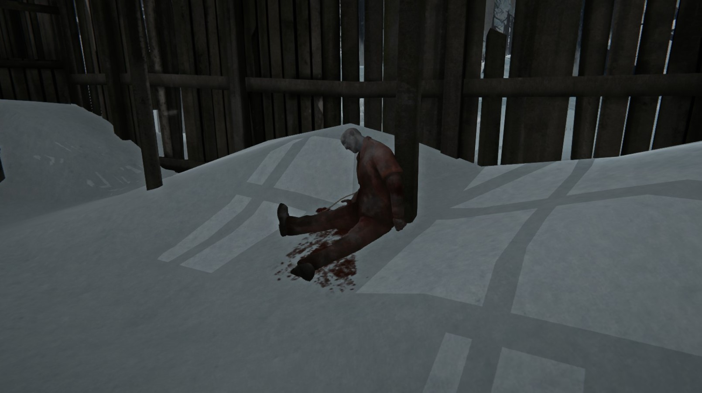
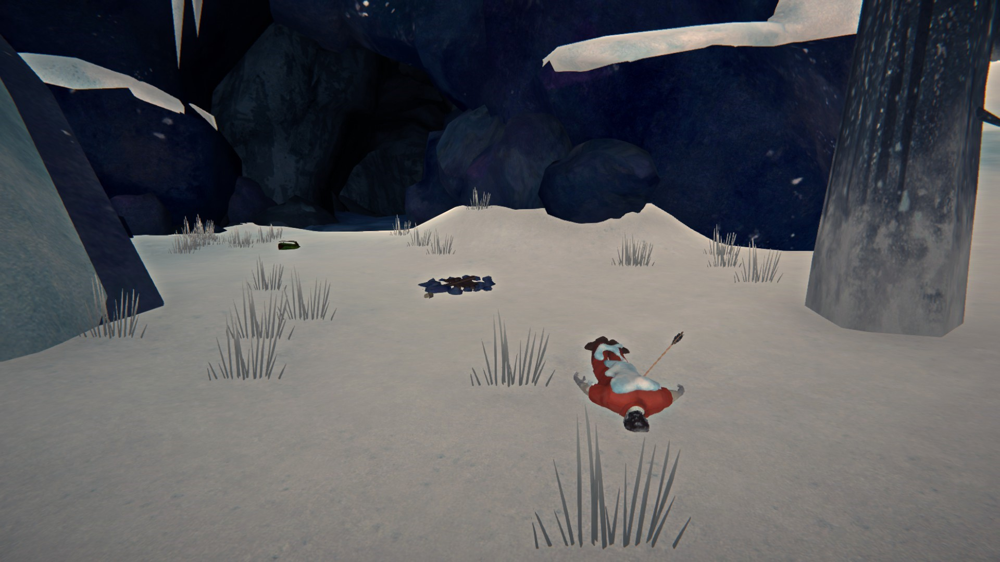
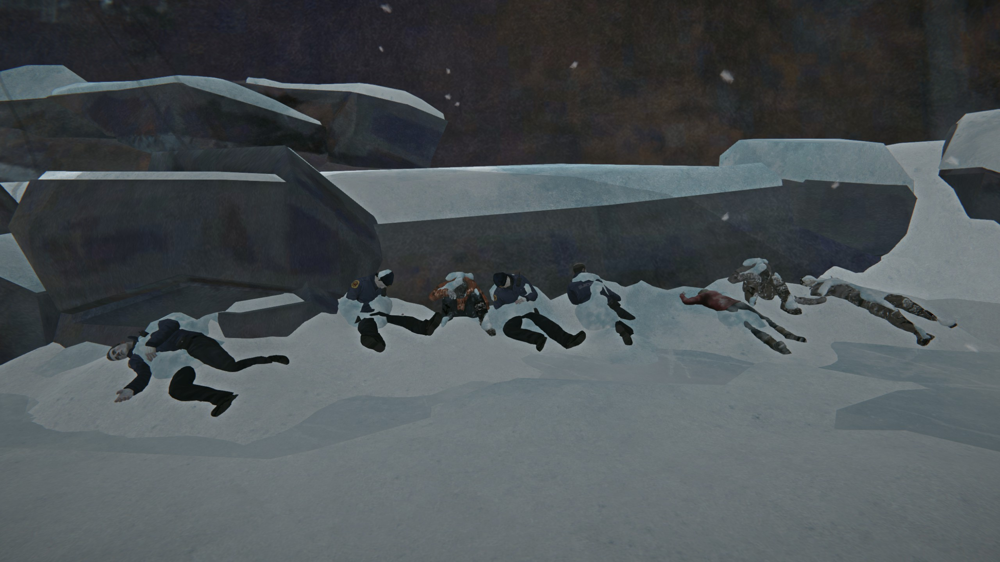

# Convicts

**Categories:** Story · **Source:** [Fandom](https://thelongdark.fandom.com/wiki/Convicts)

**Contents**

- [Group History](#group-history)
- [List of Convicts](#list-of-convicts)
- [Prison Bus Convicts](#prison-bus-convicts)
- [Blackrock Prison Convicts](#blackrock-prison-convicts)
- [Story](#story)
- [Episode 1](#episode-1)
- [Episode 2](#episode-2)
- [Episode 3](#episode-3)
- [Episode 4](#episode-4)
- [Trivia](#trivia)
- [Gallery](#gallery)

_Mathis\_and\_his\_Convicts.jpg_

> “__The bad men...the bad men CAME. Took my things. Tried to take my house. Thought they were safe because Grey Mother can't see. They were wrong.__”
>
> — Grey Mother describing her encounter with the Convicts

The **Convicts** are a group of hostile survivors on [Great Bear Island](./Great%20Bear%20Island.md) that appeared after the [First Flare](./First%20Flare.md). They act as human antagonists for the other survivors on the Island, and were originally members of a maximum security penal colony prison.

## Group History

The Convicts are former inmates that were detained at [Blackrock Federal Penitentiary](./Blackrock%20Prison.md) prior to the First Flare. During the event, most of the Convicts escaped their cells inside the Penitentiary, overpowering the prison personnel and brutally executing the staff outside the walls of the prison and taking the Warden [Franklin](./Franklin.md) hostage before taking over the local Blackrock region. A separate group of fifteen individuals was being carried in a [Crashed Prison Transport Bus](./Crashed%20Prison%20Transport%20Bus.md) to the prison, but were freed after the bus crashed during the First Flare, leaving the bus in the middle of a rubble pile on the road to [Pleasant Valley](./Pleasant%20Valley.md) just outside of [Milton](./Milton.md).

## List of Convicts

Two main groups of Convicts exist on Great Bear Island:

- The 15 Convicts on the [Crashed Prison Transport Bus](./Crashed%20Prison%20Transport%20Bus.md)
- Untold numbers of Convicts housed at [Blackrock Prison](./Blackrock%20Prison.md)

### Prison Bus Convicts

There were 15 Convicts traveling aboard the Crashed Bus. The [Prison Transport Manifest](./Prison%20Transport%20Manifest.md) includes the names:

- WHITE, S.
- IRVINE, K.
- [VACHON, B.](./Vachon.md)
- KANG, D.
- KELLEY, P.
- HARRIS, S.
- [HOBBS, T.](./Hobbs.md)
- [MATHIS, D.](./Mathis.md)
- GABAS, E.
- NG, R.
- LECLERC, Y.
- KOWALSKI, M.
- BAKER, J.
- DESCUBES, V.
- [HELLER, S.](./Heller.md)

Of these individuals, 4 escaped into the nearby town of Milton, including [Hobbs](./Hobbs.md), with many others dying in the bus crash and being buried under the avalanche.

The rest made their way to [Keeper's Pass South](./Keeper%27s%20Pass%20South.md) and later [Pleasant Valley](./Pleasant%20Valley.md). At least 8 convicts made their way to Pleasant Valley; [Vachon](./Vachon.md), [Heller](./Heller.md), [Mathis](./Mathis.md), Leclerc, and 4 other dead convicts found in the mission [Blackrock (mission)](./Blackrock%20%28mission%29.md). A [Dead Prison Guard](./Dead%20Prison%20Guard.md) is found giving chase to the convicts until he was killed by a convict, with an [Improvised Knife](./Improvised%20Knife.md) stabbed into his side, all the while carrying the [Blackrock Penitentiary Memo](./Blackrock%20Penitentiary%20Memo.md). Some time after their arrival in the region, [Molly](./Molly.md) began hunting and killing many of the convicts with her [Survival Bow](./Survival%20Bow.md), causing the remaining Convicts to scatter and leave the region.

### Blackrock Prison Convicts

An unknown quantity of unnamed convicts appear inside the Blackrock Prison. They are alive and many of them appear near the end of the episode operating spotlights and shooting at Will Mackenzie. They have no real interaction with Mackenzie, only appearing in cutscenes or as dead bodies after the Prison explosion. They currently rally behind Mathis as he attempts to free his son [Donner](./Donner.md) from the prison, and will likely follow him if he ever leaves the Prison behind to conquer Great Bear Island.

## Story

### Episode 1

Some inmates managed to escape, though the [Frozen Corpse](./Frozen%20Corpse.md) of a unnamed convict can be seen only a few meters from the bus. Several other surviving convicts travelled to the nearby town of [Milton](./Milton.md), taking most of its residents hostage. Some of the convicts, including [Hobbs](./Hobbs.md), locked the remaining Milton residents inside the schoolhouse; an [Aurora](./Aurora.md) event then ignited a fire within the schoolhouse. Dr. [Astrid Greenwood](./Astrid%20Greenwood.md) attempted to rescue the trapped townsfolk, but the inmates prevented her from doing so. Thus, the town's entire population, except for Grey Mother, died in the fire. Astrid was injured during the struggle, but managed to stab Hobbs and escape to Pleasant Valley through the Bus.

A bald convict was found dead near [Grey Mother's House](./Milton%20House%20%28Grey%20Mother%27s%29.md) by [Will Mackenzie](./Will%20Mackenzie.md) in [Episode 1](./Episode%201%20-%20Do%20Not%20Go%20Gentle.md) of [Wintermute](./Wintermute.md). Judging by the blood trail, he attempted to enter [Grey Mother](./Grey%20Mother.md)'s home and was shot, fatally wounding him. Hobbs, who had stolen a safety box belonging to Gray Mother, was later found by Will, mortally wounded in [Paradise Meadows Farm](./Paradise%20Meadows%20Farm.md). After explaining to him what they did to the local residents, Will chose to either leave or execute him.

### Episode 2

A single convict is found dead near the [River (Southern Access)](./River%20%28Southern%20Access%29.md) carrying the [Convict Journal Entry](./Convict%20Journal%20Entry.md) and may have come from the Crashed Prison Bus. A resident of Milton whom managed to escape the town into [Forlorn Muskeg](./Forlorn%20Muskeg.md) mentions evading a convict by falling off a cliff, as written in the [Blood Soaked Note](./Blood%20Soaked%20Note.md).

### Episode 3

In [Episode 3: Crossroads Elegy](./Episode%203%20-%20Crossroads%20Elegy.md), it is revealed that most of the convicts from the crashed bus managed to escape into Pleasant Valley through the other side of the tunnel in Milton, with Astrid having been the last to make it through before the tunnel fully collapsed. [Molly](./Molly.md) begins hunting several of them down after Astrid awakens, with the doctor later finding their corpses with arrows shot through them. [Vachon](./Vachon.md) would later mention in Episode 4 that Leclerc was found with an arrow through the chest. It is implied that Mathis, Vachon, and Heller escaped into [Winding River](./Winding%20River.md) by the time Astrid woke up, and encountered Mackenzie.

### Episode 4

At the end of [Episode 2: Luminance Fugue](./Episode%202%20-%20Luminance%20Fugue.md), Will is attacked and captured in [Carter Hydro Dam](./Carter%20Hydro%20Dam.md) by [Mathis](./Mathis.md), who had escaped the bus and made his way through the [Winding River](./Winding%20River.md) into the Dam. In [Episode 4: Fury, then Silence](./Episode%204%20-%20Fury%2C%20Then%20Silence.md), Will manages to escape from Mathis and two other convicts: [Heller](./Heller.md) and [Vachon](./Vachon.md). He is recaptured and imprisoned, however, and awakens inside Blackrock Prison. He is then forced to assist the Convicts under the threat of death: both to his own life and that of the prison warden [Franklin](./Franklin.md). At the end of the episode, an explosion destroys much of the prison, giving Will a chance to escape. During the ending cutscene, Will is cornered inside the power plant by Mathis, Heller, Vachon, and two other unnamed convicts. The episode ends with Will jumping into the river that runs through the plant to escape the convict gang.

## Trivia

- The names of prisoners on the Prisoner Manifest are names of the Hinterland Dev Team.
- As of Episode 4, the Convicts are the only human antagonists in the game.
- The only other minor character convict who's acknowledged is Leclerc. Heller mentions having gone out looking for him and Vachon says he was found dead with an arrow in his chest, likely Molly's work.
- Of the 4 main convicts, Mathis and Hobbs are the only prisoners to have their name printed on their orange Jumpsuit, with Vachon and Heller missing theirs.

## Gallery

_The convict in Episode 2_

_A convict operating a spotlight while searching for Will._

_A convict moving Franklin's body through the halls._

_A dead prisoner in episode 3_

_ditto_

_The executed remains of the Blackrock Personnel by the hands of the Convicts_
