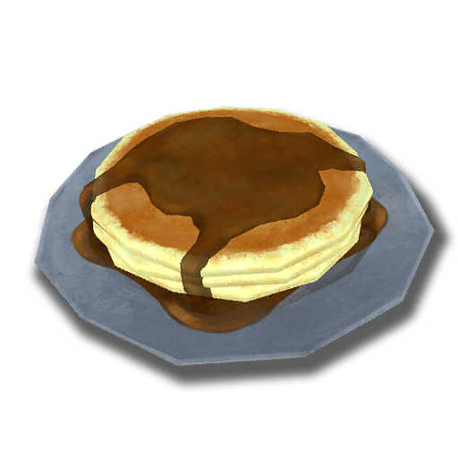

# Cooking Oil

**Categories:** DLC Content, Food And Drink, Pages with update history · **Source:** [Fandom](https://thelongdark.fandom.com/wiki/Cooking_Oil)

**Contents**

- [Usage](#usage)
- [Trivia](#trivia)
- [Crafting](#crafting)
- [Products](#products)
- [Update history](#update-history)

_Ptarmigan\_icon.png_

**DLC-Exclusive content.** / This content requires the [Tales from the Far Territory](./Tales%20from%20the%20Far%20Territory.md) addon to be installed before it can be seen or used in regular gameplay.

_Cooking\_Oil\_icon.png_

**Release:** [21 June 2023](./The%20Long%20Dark%20%E2%80%94%20Changelog.md#2.17)

**Wintermute:** No

**Renewable:** Yes

**Properties**

**Item type:** [Food And Drink](./Food%20And%20Drink.md)

**Stackable:** No

**Examine:** A basic cooking oil. Nothing fancy.

**Values**

**Weight:** 0.75 kg (1.65 lbs)

**Decay Rate**

**Inside:** 0.000% per day

**Outside:** 0.000% per day

**Advanced data**

**Item key:** GAMEPLAY\_CookingOil

**Template:pic link plain**[Cooking](./Cooking.md)**

-

24 minutes

**Requirements**

**Facility:** **Template:iconlink**

**Tool:** **Template:iconlink**

**Materials**

**Template:iconlink plain**

**Item:** [Animal Fat](./Animal%20Fat.md)

**Quantity:** 1.00 kg

**Template:pic link plain**[Cooking](./Cooking.md)**

-

24 minutes

**Requirements**

**Facility:** **Template:iconlink**

**Tool:** **Template:iconlink**

**Materials**

**Template:iconlink plain**

**Item:** [Animal Fat](./Animal%20Fat.md)

**Quantity:** 1.00 kg

Item

Skills

Materials

 [Acorn Bannock](./Acorn%20Bannock.md)

None

- 1 × [Acorn Grounds](./Acorn%20Grounds.md) / - 0.15 L × [Water (Potable)](./Water%20%28Potable%29.md) / - 0.05 L × [Cooking Oil](./Cooking%20Oil.md)

 [Acorn Pancakes](./Acorn%20Pancakes.md)

None

- 1 × [Acorn Grounds](./Acorn%20Grounds.md) / - 0.05 Kg × [Maple Syrup](./Maple%20Syrup.md) / - 0.10 L × [Water (Potable)](./Water%20%28Potable%29.md) / - 0.05 L × [Cooking Oil](./Cooking%20Oil.md)

 [Bannock](./Bannock.md)

None

- 0.15 L × [Water (Potable)](./Water%20%28Potable%29.md) / - 0.05 L × [Cooking Oil](./Cooking%20Oil.md) / - 0.20 kg × [Old Mill Flour](./Old%20Mill%20Flour.md)

 [Breyerhouse Pie](./Breyerhouse%20Pie.md)

None

- 0.50 kg × [Ptarmigan (Raw)](./Ptarmigan%20%28Raw%29.md) / - 0.50 kg × [Rabbit (Raw)](./Rabbit%20%28Raw%29.md) / - 0.50 kg × [Venison (Raw)](./Venison%20%28Raw%29.md) / - 0.15 L × [Water (Potable)](./Water%20%28Potable%29.md) / - 0.05 L × [Cooking Oil](./Cooking%20Oil.md) / - 0.20 kg × [Old Mill Flour](./Old%20Mill%20Flour.md)

 [Coastal Fishcakes](./Coastal%20Fishcakes.md)

None

- 0.50 Kg × [Rainbow Trout (Raw)](./Rainbow%20Trout%20%28Raw%29.md) / - 2 × [Potato](./Potato.md) / - 0.15 L × [Water (Potable)](./Water%20%28Potable%29.md) / - 0.05 L × [Cooking Oil](./Cooking%20Oil.md) / - 0.01 kg × [Salt](./Salt.md)

 [Dockworker's Pie](./Dockworker%27s%20Pie.md)

None

- 2 × [Potato](./Potato.md) / - 0.50 kg × [Coho Salmon (Raw)](./Coho%20Salmon%20%28Raw%29.md) / - 0.50 kg × [Rockfish (Raw)](./Rockfish%20%28Raw%29.md) / - 0.10 L × [Water (Potable)](./Water%20%28Potable%29.md) / - 0.05 L × [Cooking Oil](./Cooking%20Oil.md) / - 0.01 kg × [Salt](./Salt.md)

 [Lily's Pancakes](./Lily%27s%20Pancakes.md)

None

- 1 × [Acorn Grounds](./Acorn%20Grounds.md) / - 0.05 kg × [Maple Syrup](./Maple%20Syrup.md) / - 0.50 kg × [Pinnacle Peaches](./Pinnacle%20Peaches.md) / - 0.10 L × [Water (Potable)](./Water%20%28Potable%29.md) / - 0.05 L × [Cooking Oil](./Cooking%20Oil.md)

 [Pancakes](./Pancakes.md)

None

- 0.05 kg × [Maple Syrup](./Maple%20Syrup.md) / - 0.15 L × [Water (Potable)](./Water%20%28Potable%29.md) / - 0.05 L × [Cooking Oil](./Cooking%20Oil.md) / - 0.12 kg × [Old Mill Flour](./Old%20Mill%20Flour.md)

 [Peach Pie](./Peach%20Pie.md)

None

- 0.50 kg × [Pinnacle Peaches](./Pinnacle%20Peaches.md) / - 0.10 L × [Water (Potable)](./Water%20%28Potable%29.md) / - 0.05 L × [Cooking Oil](./Cooking%20Oil.md) / - 0.20 kg × [Old Mill Flour](./Old%20Mill%20Flour.md)

 [Prepper's Pie](./Prepper%27s%20Pie.md)

None

- 1 × [Acorn Grounds](./Acorn%20Grounds.md) / - 4 × [Reishi Mushroom](./Reishi%20Mushroom.md) / - 2 × [Burdock Root](./Burdock%20Root.md) / - 0.10 L × [Water (Potable)](./Water%20%28Potable%29.md) / - 0.05 L × [Cooking Oil](./Cooking%20Oil.md) / - 0.01 kg × [Salt](./Salt.md)

 [Ptarmigan Pie](./Ptarmigan%20Pie.md)

None

- 0.50 kg × [Ptarmigan (Raw)](./Ptarmigan%20%28Raw%29.md) / - 0.15 L × [Water (Potable)](./Water%20%28Potable%29.md) / - 0.05 L × [Cooking Oil](./Cooking%20Oil.md) / - 0.20 kg × [Old Mill Flour](./Old%20Mill%20Flour.md)

 [Rabbit Pie](./Rabbit%20Pie.md)

None

- 0.50 kg × [Rabbit (Raw)](./Rabbit%20%28Raw%29.md) / - 0.15 L × [Water (Potable)](./Water%20%28Potable%29.md) / - 0.05 L × [Cooking Oil](./Cooking%20Oil.md) / - 0.20 kg × [Old Mill Flour](./Old%20Mill%20Flour.md)

 [Rose Hip Pie](./Rose%20Hip%20Pie.md)

None

- 8 × [Rose Hip](./Rose%20Hip.md) / - 0.10 L × [Water (Potable)](./Water%20%28Potable%29.md) / - 0.05 L × [Cooking Oil](./Cooking%20Oil.md) / - 0.20 kg × [Old Mill Flour](./Old%20Mill%20Flour.md)

 [Stalker's Pie](./Stalker%27s%20Pie.md)

None

- 0.50 kg × [Bear Meat (Raw)](./Bear%20Meat%20%28Raw%29.md) / - 0.50 kg × [Wolf Meat (Raw)](./Wolf%20Meat%20%28Raw%29.md) / - 1 × [Acorn Grounds](./Acorn%20Grounds.md) / - 0.15 L × [Water (Potable)](./Water%20%28Potable%29.md) / - 0.05 L × [Cooking Oil](./Cooking%20Oil.md) / - 0.01 kg × [Salt](./Salt.md)

 [Venison Pie](./Venison%20Pie.md)

None

- 0.50 kg × [Venison (Raw)](./Venison%20%28Raw%29.md) / - 0.15 L × [Water (Potable)](./Water%20%28Potable%29.md) / - 0.05 L × [Cooking Oil](./Cooking%20Oil.md) / - 0.20 kg × [Old Mill Flour](./Old%20Mill%20Flour.md)
