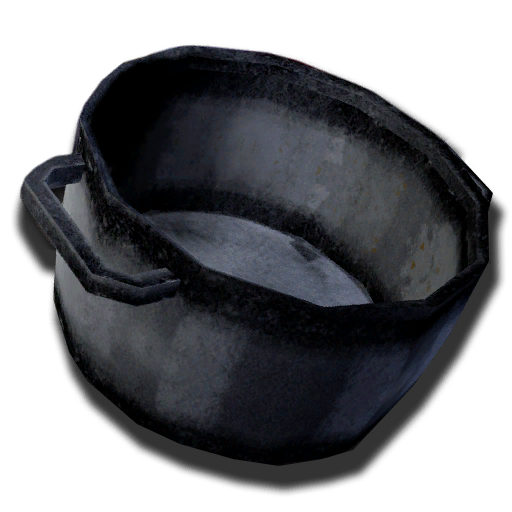

# Cooking Pot

**Contents**

- [Overview](#Overview)
- [Locations](#Locations)
- [Recipes](#Recipes)
- [Trivia](#Trivia)
- [Update history](#Update_history)

<table class="infobox">
<caption>Cooking Pot</caption>
<colgroup>
<col style="width: 50%" />
<col style="width: 50%" />
</colgroup>
<tbody>
<tr>
<td colspan="2"><figure>

<figcaption>Cooking_Pot_icon.png</figcaption>
</figure></td>
</tr>
<tr>
<td>
Release
</td>
<td>
<a href="./The%20Long%20Dark%20%E2%80%94%20Changelog.md#1.33" class="wikilink" title="14 June 2018">14 June 2018</a>
</td>
</tr>
<tr>
<td>
Wintermute
</td>
<td>
No
</td>
</tr>
<tr>
<td>
Renewable
</td>
<td>
No
</td>
</tr>
<tr>
<td colspan="2" class="section">
<strong>Properties</strong>
</td>
</tr>
<tr>
<td>
Item type
</td>
<td>
<a href="./Tools.md" class="wikilink" title="Tools">Tools</a>|-
</td>
</tr>
<tr>
<td>
Stackable
</td>
<td>
No
</td>
</tr>
<tr>
<td>
Examine
</td>
<td>
A sturdy pot for melting snow, boiling water, and cooking food.
</td>
</tr>
<tr>
<td colspan="2" class="section">
<strong>Values</strong>
</td>
</tr>
<tr>
<td>
Weight
</td>
<td>
1.00 kg (2.2 lbs)
</td>
</tr>
<tr>
<td colspan="2" class="section">
<strong>Actions</strong>
</td>
</tr>
<tr>
<td>
Backpack
</td>
<td>
Use, Actions, Drop
</td>
</tr>
<tr>
<td>
On ground
</td>
<td>
Take It, Leave It
</td>
</tr>
</tbody>
</table>

A **Cooking Pot** is a tool primarily used for melting snow, boiling water, and <a href="./Cooking.md" class="wikilink" title="Cooking">Cooking</a> food. A cooking pot will reduce the amount of time required for food inside it to cook by **20%** and will allow for the creation of broths, stews, and porridges that cannot be cooked directly by the fire.

## Overview

A cooking pot can melt or boil up to 2.00 liters of snow or water at a time. The amount of time required to melt snow per liter does decrease a bit when using a Cooking Pot, compared to a <a href="./Recycled%20Can.md" class="wikilink" title="Recycled Can">Recycled Can</a>.

A Cooking Pot will degrade by **5%** if its contents are burned or boiled dry. The Cooking Pot will not degrade in any other circumstances.

A Cooking Pot can be harvested for 1 unit of <a href="./Scrap%20Metal.md" class="wikilink" title="Scrap Metal">Scrap Metal</a>.

It can also be repaired with <a href="./Simple%20Tools.md" class="wikilink" title="Simple Tools">Simple Tools</a> or <a href="./Quality%20Tools.md" class="wikilink" title="Quality Tools">Quality Tools</a> for 1 unit of Scrap Metal.

## Locations

Cooking Pots typically spawn in houses and buildings with kitchens, especially kitchens with wood-burning cooking stoves.

Examples of places that Cooking Pots are known to spawn on Interloper:

- <a href="./Ash%20Canyon.md" class="wikilink" title="Ash Canyon">Ash Canyon</a>
  - <a href="./Angler%27s%20Den.md" class="wikilink" title="Angler&#39;s Den">Angler's Den</a>
  - cave from Ash Canyon to Timberwolf Mountain
- <a href="./Bleak%20Inlet.md" class="wikilink" title="Bleak Inlet">Bleak Inlet</a>
  - <a href="./Fallen%20Lighthouse.md" class="wikilink" title="Fallen Lighthouse">Fallen Lighthouse</a>
  - <a href="./Pensive%20Lookout.md" class="wikilink" title="Pensive Lookout">Pensive Lookout</a>
- <a href="./Forsaken%20Airfield.md" class="wikilink" title="Forsaken Airfield">Forsaken Airfield</a>
  - <a href="./Mindful%20Cabin.md" class="wikilink" title="Mindful Cabin">Mindful Cabin</a>
  - <a href="./Bunker%20Omega.md" class="wikilink" title="Bunker Omega">Bunker Omega</a>
- <a href="./Hushed%20River%20Valley.md" class="wikilink" title="Hushed River Valley">Hushed River Valley</a>
  - Large chamber of northern ice cave system, near the entrance closest to <a href="./Mammoth%20Falls.md" class="wikilink" title="Mammoth Falls">Mammoth Falls</a>
  - Potential <a href="./Snow%20Shelter.md" class="wikilink" title="snow shelter">snow shelter</a> campsite in between <a href="./Lonely%20Cave.md" class="wikilink" title="Lonely Cave">Lonely Cave</a>, <a href="./Cloudtop%20Falls.md" class="wikilink" title="Cloudtop Falls">Cloudtop Falls</a>, and <a href="./Stairsteps%20Lake.md" class="wikilink" title="Stairsteps Lake">Stairsteps Lake</a>
- <a href="./Mountain%20Town.md" class="wikilink" title="Mountain Town">Mountain Town</a>
  - <a href="./Milton%20House%20%28Grey%20Mother%27s%29.md" class="wikilink" title="Milton House (Grey Mother&#39;s)">Milton House (Grey Mother's)</a> and the other houses in Milton
  - <a href="./Paradise%20Meadows%20Farm.md" class="wikilink" title="Paradise Meadows Farm">Paradise Meadows Farm</a>
- <a href="./Mystery%20Lake%20%28disambiguation%29.md" class="wikilink" title="Mystery Lake">Mystery Lake</a>
  - <a href="./Carter%20Hydro%20Dam.md" class="wikilink" title="Carter Hydro Dam">Carter Hydro Dam</a> in the room where the <a href="./Mementos.md" class="wikilink" title="Memento">Memento</a> is found
- <a href="./Pleasant%20Valley.md" class="wikilink" title="Pleasant Valley">Pleasant Valley</a>
  - <a href="./Pleasant%20Valley%20Farmstead.md" class="wikilink" title="Pleasant Valley Farmstead">Pleasant Valley Farmstead</a>
  - <a href="./Community%20Hall.md" class="wikilink" title="Community Hall">Community Hall</a> and the houses nearby
- <a href="./Sundered%20Pass.md" class="wikilink" title="Sundered Pass">Sundered Pass</a>
  - <a href="./Bolt%20Chopper%27s%20Haven.md" class="wikilink" title="Bolt Chopper&#39;s Haven">Bolt Chopper's Haven</a>
  - <a href="./Placid%20Notch.md" class="wikilink" title="Placid Notch">Placid Notch</a> on the patio
  - <a href="./Station%20Bunkhouse.md" class="wikilink" title="Station Bunkhouse">Station Bunkhouse</a> on the table near the potbelly stove
- <a href="./Zone%20of%20Contamination.md" class="wikilink" title="Zone of Contamination">Zone of Contamination</a>
  - <a href="./Idle%20Camp.md" class="wikilink" title="Idle Camp">Idle Camp</a>

It is not guaranteed that every region will spawn a Cooking Pot. Some regions, like <a href="./Coastal%20Highway.md" class="wikilink" title="Coastal Highway">Coastal Highway</a> and <a href="./Desolation%20Point.md" class="wikilink" title="Desolation Point">Desolation Point</a>, may have no Cooking Pots in a given game.

## Recipes

The following recipes can only be created within a Cooking Pot, and are available to cook from the start:

<table>
<colgroup>
<col style="width: 20%" />
<col style="width: 20%" />
<col style="width: 20%" />
<col style="width: 20%" />
<col style="width: 20%" />
</colgroup>
<thead>
<tr>
<th class="unsortable" style="border-style: solid none solid solid"><figure>

<figcaption>Cooking.png</figcaption>
</figure></th>
<th style="border-style: solid solid solid none">
Item
</th>
<th>
Weight
</th>
<th>
Cooking Times
</th>
<th style="border-style: solid solid solid none">
Cooking Level
</th>
</tr>
</thead>
<tbody>
<tr>
<td><figure>

<figcaption>Broth_icon.png</figcaption>
</figure></td>
<td>
<a href="./Broth.md" class="wikilink" title="Broth">Broth</a>
</td>
<td>
0.80 kg
</td>
<td>
60 min
</td>
<td>
1
</td>
</tr>
<tr>
<td><figure>

<figcaption>Cooking_Oil_icon.png</figcaption>
</figure></td>
<td>
<a href="./Cooking%20Oil.md" class="wikilink" title="Cooking Oil">Cooking Oil</a>
</td>
<td>
0.75 kg
</td>
<td>
24 min
</td>
<td>
1
</td>
</tr>
<tr>
<td><figure>

<figcaption>Ptarmigan_Stew_icon.png</figcaption>
</figure></td>
<td>
<a href="./Ptarmigan%20Stew.md" class="wikilink" title="Ptarmigan Stew">Ptarmigan Stew</a>
</td>
<td>
0.35 kg
</td>
<td>
2 hr
</td>
<td>
1
</td>
</tr>
<tr>
<td><figure>

<figcaption>Venison_Stew_icon.png</figcaption>
</figure></td>
<td>
<a href="./Venison%20Stew.md" class="wikilink" title="Venison Stew">Venison Stew</a>
</td>
<td>
0.35 kg
</td>
<td>
2 hr
</td>
<td>
1
</td>
</tr>
<tr>
<td><figure>

<figcaption>Trout_Stew_icon.png</figcaption>
</figure></td>
<td>
<a href="./Trout%20Stew.md" class="wikilink" title="Trout Stew">Trout Stew</a>
</td>
<td>
0.35 kg
</td>
<td>
2 hr
</td>
<td>
1
</td>
</tr>
<tr>
<td><figure>

<figcaption>Rabbit_Stew_icon.png</figcaption>
</figure></td>
<td>
<a href="./Rabbit%20Stew.md" class="wikilink" title="Rabbit Stew">Rabbit Stew</a>
</td>
<td>
0.35 kg
</td>
<td>
2 hr
</td>
<td>
1
</td>
</tr>
<tr>
<td><figure>

<figcaption>Porridge_icon.png</figcaption>
</figure></td>
<td>
<a href="./Porridge.md" class="wikilink" title="Porridge">Porridge</a>
</td>
<td>
0.20 kg
</td>
<td>
20 min
</td>
<td>
1
</td>
</tr>
</tbody>
</table>

These Unique Recipes can only be cooked after their <a href="./Recipe%20Cards.md" class="wikilink" title="Recipe Cards">Recipe Cards</a> are found:

<table>
<colgroup>
<col style="width: 20%" />
<col style="width: 20%" />
<col style="width: 20%" />
<col style="width: 20%" />
<col style="width: 20%" />
</colgroup>
<thead>
<tr>
<th class="unsortable" style="border-style: solid none solid solid"><figure>

<figcaption>Cooking.png</figcaption>
</figure></th>
<th style="border-style: solid solid solid none">
Item
</th>
<th>
Weight
</th>
<th>
Cooking Times
</th>
<th style="border-style: solid solid solid none">
Cooking Level
</th>
</tr>
</thead>
<tbody>
<tr>
<td><figure>

<figcaption>Camber_Flight_Porridge_icon.png</figcaption>
</figure></td>
<td>
<a href="./Camber%20Flight%20Porridge.md" class="wikilink" title="Camber Flight Porridge">Camber Flight Porridge</a>
</td>
<td>
0.30 kg
</td>
<td>
20 min
</td>
<td>
4
</td>
</tr>
<tr>
<td><figure>

<figcaption>Last_Resort_Soup_icon.png</figcaption>
</figure></td>
<td>
<a href="./Last%20Resort%20Soup.md" class="wikilink" title="Last Resort Soup">Last Resort Soup</a>
</td>
<td>
0.10 kg
</td>
<td>
40 min
</td>
<td>
1
</td>
</tr>
<tr>
<td><figure>

<figcaption>Pemmican_Bar_icon.png</figcaption>
</figure></td>
<td>
<a href="./Pemmican%20Bar.md" class="wikilink" title="Pemmican Bar">Pemmican Bar</a> (4)
</td>
<td>
0.25 kg
</td>
<td>
40 min
</td>
<td>
5
</td>
</tr>
<tr>
<td><figure>

<figcaption>Porter's_Soup_icon.png</figcaption>
</figure></td>
<td>
<a href="./Porter%27s%20Soup.md" class="wikilink" title="Porter&#39;s Soup">Porter's Soup</a>
</td>
<td>
0.10 kg
</td>
<td>
40 min
</td>
<td>
4
</td>
</tr>
<tr>
<td><figure>

<figcaption>Ranger_Stew_icon.png</figcaption>
</figure></td>
<td>
<a href="./Ranger%20Stew.md" class="wikilink" title="Ranger Stew">Ranger Stew</a>
</td>
<td>
0.40 kg
</td>
<td>
2 hr
</td>
<td>
4
</td>
</tr>
<tr>
<td><figure>

<figcaption>Thomson_Family_Stew_icon.png</figcaption>
</figure></td>
<td>
<a href="./Thomson%20Family%20Stew.md" class="wikilink" title="Thomson Family Stew">Thomson Family Stew</a>
</td>
<td>
0.35 kg
</td>
<td>
2 hr
</td>
<td>
4
</td>
</tr>
<tr>
<td><figure>

<figcaption>Vagabond_Soup_icon.png</figcaption>
</figure></td>
<td>
<a href="./Vagabond%20Soup.md" class="wikilink" title="Vagabond Soup">Vagabond Soup</a>
</td>
<td>
0.10 kg
</td>
<td>
40 min
</td>
<td>
1
</td>
</tr>
</tbody>
</table>

## Trivia

The Cooking Pot was originally a harvestable environmental object called the <a href="./Metal%20Pot.md" class="wikilink" title="Metal Pot">Metal Pot</a>, which was cut in the Vigilant Flame update and added as an item using the same model as the Metal Pot.

## Update history

- HOTFIX **28 Apr 2021 (<a href="./The%20Long%20Dark%20%E2%80%94%20Changelog.md#1.94" class="wikilink" title="Update">Update</a>):**
  - \[Audio\] Cans and Pots now play sound effects when placed onto a cooking slot, as intended.
- UPDATE **19 May 2020 (<a href="./The%20Long%20Dark%20%E2%80%94%20Changelog.md#1.76" class="wikilink" title="Update">Update</a>):**
  - \[Gameplay\] The Cooking Pot now provides the correct bonus when cooking meat.
- UPDATE **17 December 2018 (<a href="./The%20Long%20Dark%20%E2%80%94%20Changelog.md#1.41" class="wikilink" title="Update">Update</a>):**
  - \[All\] Fixed Cooking Pots sinking into cooking surfaces
- HOTFIX **27 August 2018 (<a href="./The%20Long%20Dark%20%E2%80%94%20Changelog.md#1.36" class="wikilink" title="Update">Update</a>):**
  - \[ALL\] Player’s last Cooking Pot will no longer drop during a Struggle.
- HOTFIX **20 June 2018 (<a href="./The%20Long%20Dark%20%E2%80%94%20Changelog.md#1.34" class="wikilink" title="Update">Update</a>):**
  - \[All\] Fixed players being able to use a Recycled Can/Cooking Pot to cook when the item was at 0% Condition.
- UPDATE **14 June 2018 (<a href="./The%20Long%20Dark%20%E2%80%94%20Changelog.md#1.33" class="wikilink" title="Update">Update</a>):**
  - Added to game.

**Lua execution error in Module:Navbox function navbox**

<a href="ru:%D0%9A%D0%BE%D1%82%D0%B5%D0%BB%D0%BE%D0%BA" class="wikilink" title="ru:Котелок">ru:Котелок</a>

