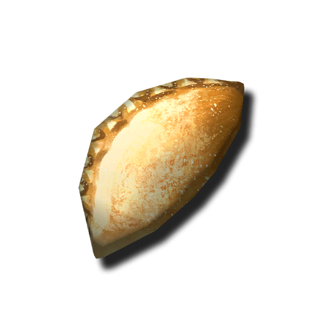
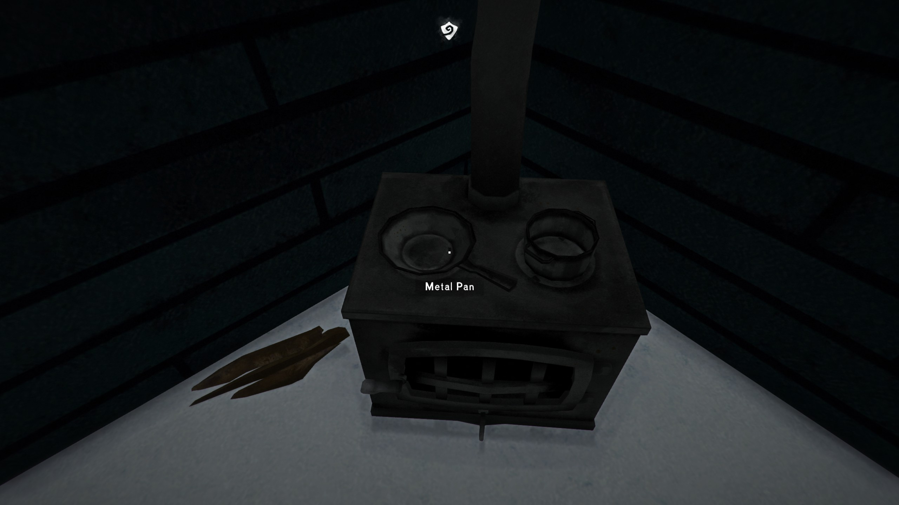

# Cooking Skillet

**Contents**

- [Overview](#overview)
- [Locations](#locations)
- [Recipes](#recipes)
- [Update history](#update-history)

| Column 1 | Column 2 | Column 3 | Column 4 | Column 5 |
| --- | --- | --- | --- | --- |
|  / *Ptarmigan\_icon.png* | **DLC-Exclusive content.** / This content requires the [Tales from the Far Territory](./Tales%20from%20the%20Far%20Territory.md) addon to be installed before it can be seen or used in regular gameplay. | \|} / **Cooking Skillet** / \| Property \| Details \| / \| --- \| --- \| / \|  \|  / *Cooking\_Skillet\_icon.png* \| / \| Release \| [21 June 2023](./The%20Long%20Dark%20%E2%80%94%20Changelog.md#2.17) \| / \| Wintermute \| No \| / \| Renewable \| No \| / \| **Properties** \|  \| / \| Item type \| [Tools](./Tools.md)\\|- \| / \| Stackable \| No \| / \| Examine \| A pan for cooking and frying. \| / \| **Values** \|  \| / \| Weight \| 1.00 kg (2.2 lbs) \| / \| **Actions** \|  \| / \| Backpack \| Use, Actions, Drop \| / \| On ground \| Take It, Leave It \| / \| **Advanced data** \|  \| / \| Item key \| GAMEPLAY\_Skillet \| / A **Cooking Skillet** is a tool primarily used for melting snow, boiling water, and cooking food. They were introduced in the Part 3: Frontier Comforts update for players who purchase the [Tales from the Far Territory](./Tales%20from%20the%20Far%20Territory.md) expansion, and are used for cooking advanced food Recipes. / ## Overview / A cooking skillet can hold up to 1.00 liters of liquid for melting snow or boiling water. This makes it inferior in this respect to the [Cooking Pot](./Cooking%20Pot.md) given it weighs the same. However, it does allow more recipes to be cooked compared to the pot. / A cooking skillet will degrade by 5% if its contents are burned or boiled dry. The cooking skillet will not degrade in any other circumstances. If damaged, it can be repaired in 60 minutes with 1 unit of [Scrap Metal](./Scrap%20Metal.md) with [Simple Tools](./Simple%20Tools.md), increasing the item's condition by 30%. Alternatively, a cooking skillet can be harvested in 90 minutes for 1 unit of Scrap Metal with a [Hacksaw](./Hacksaw.md). / ## Locations / Skillets typically spawn in houses or buildings with kitchens, especially kitchens with wood-burning cooking stoves (e.g., in [Milton House (Grey Mother's)](./Milton%20House%20%28Grey%20Mother%27s%29.md) and the [Pleasant Valley Farmstead](./Pleasant%20Valley%20Farmstead.md)). / Examples of places that skillets are known to spawn on Interloper: / - [Ash Canyon](./Ash%20Canyon.md) / - [Foreman's Retreat](./Foreman%27s%20Retreat.md) / - [Blackrock](./Blackrock.md) / - Staff Quarters of [Blackrock Prison](./Blackrock%20Prison.md) / - [Bleak Inlet](./Bleak%20Inlet.md) / - [Pensive Lookout](./Pensive%20Lookout.md) / - Underneath the [Cannery Pier](./Cannery%20Pier.md) / - [Broken Railroad](./Broken%20Railroad.md) / - [Hunting Lodge](./Hunting%20Lodge.md) in the kitchen area / - [Forsaken Airfield](./Forsaken%20Airfield.md) / - [Mindful Cabin](./Mindful%20Cabin.md) / - [Mountain Town](./Mountain%20Town.md) / - [Milton House (Grey Mother's)](./Milton%20House%20%28Grey%20Mother%27s%29.md) and the other houses in Milton / - [Paradise Meadows Farm](./Paradise%20Meadows%20Farm.md) / - [Mystery Lake](./Mystery%20Lake%20%28disambiguation%29.md) / - [Camp Office](./Camp%20Office.md) / - [Pleasant Valley](./Pleasant%20Valley.md) / - [Pleasant Valley Farmstead](./Pleasant%20Valley%20Farmstead.md) / - [Community Hall](./Community%20Hall.md) and the houses nearby / - [Sundered Pass](./Sundered%20Pass.md) / - [Cabin (Sundered Pass)](./Cabin%20%28Sundered%20Pass%29.md), lower level in the kitchen area / - campsite outside [Idle Hideout](./Idle%20Hideout.md) / - [Lotte's Rest](./Lotte%27s%20Rest.md) / - [Zone of Contamination](./Zone%20of%20Contamination.md) / - [Idle Camp](./Idle%20Camp.md) / It is not guaranteed that every region will contain a skillet. Some regions, like [Coastal Highway](./Coastal%20Highway.md) and [Desolation Point](./Desolation%20Point.md), may have no skillets in a given game. / ## Recipes / These recipes can only be created with a Cooking Skillet, and are available to cook from the start: / \| Image \| Recipe Name \| Weight \| Cooking Times \| Cooking Level \| / \| --- \| --- \| --- \| --- \| --- \| / \|  / *Acorn\_Pancakes\_icon.png* \| [Acorn Pancakes](./Acorn%20Pancakes.md) \| 0.10 kg \| 12 min \| 2 \| / \|  / *Pancakes\_icon.png* \| [Pancakes](./Pancakes.md) \| 0.10 kg \| 12 min \| 2 \| / \|  / *Peach\_Pie\_icon.png* \| [Peach Pie](./Peach%20Pie.md) (3) \| 0.15 kg \| 1 hr 20 min \| 3 \| / \|  / *Ptarmigan\_Pie\_icon.png* \| [Ptarmigan Pie](./Ptarmigan%20Pie.md) (3) \| 0.15 kg \| 1 hr 20 min \| 3 \| / \|  / *Rabbit\_Pie\_icon.png* \| [Rabbit Pie](./Rabbit%20Pie.md) (3) \| 0.15 kg \| 1 hr 20 min \| 3 \| / \|  / *Rose\_Hip\_Pie\_icon.png* \| [Rose Hip Pie](./Rose%20Hip%20Pie.md) (3) \| 0.15 kg \| 1 hr 20 min \| 3 \| / \|  / *Venison\_Pie\_icon.png* \| [Venison Pie](./Venison%20Pie.md) (3) \| 0.15 kg \| 1 hr 20 min \| 3 \| / These recipes can be cooked with either a Cooking Skillet or [Cooking Pot](./Cooking%20Pot.md): / \| Image \| Recipe Name \| Weight \| Cooking Times \| Cooking Level \| / \| --- \| --- \| --- \| --- \| --- \| / \|  / *Cooking\_Oil\_icon.png* \| [Cooking Oil](./Cooking%20Oil.md) \| 0.75 kg \| 24 min \| 1 \| / \|  \|  \|  \|  \|  \| / These recipes can be cooked with a Cooking Skillet, but do not require one: / \| Image \| Recipe Name \| Weight \| Cooking Times \| Cooking Level \| / \| --- \| --- \| --- \| --- \| --- \| / \|  / *Acorn\_Bannock\_icon.png* \| [Acorn Bannock](./Acorn%20Bannock.md) (2) \| 0.10 kg \| 40 min \| 2 \| / \|  / *Bannock\_icon.png* \| [Bannock](./Bannock.md) (2) \| 0.10 kg \| 40 min \| 2 \| / \|  \|  \|  \|  \|  \| / These Unique Recipes can only be cooked after their [Recipe Cards](./Recipe%20Cards.md) are found: / \| Image \| Recipe Name \| Weight \| Cooking Times \| Cooking Level \| / \| --- \| --- \| --- \| --- \| --- \| / \|  / *Breyerhouse\_Pie\_icon.png* \| [Breyerhouse Pie](./Breyerhouse%20Pie.md) \| 0.20 kg \| 56 min \| 5 \| / \|  / *Coastal\_Fishcakes\_icon.png* \| [Coastal Fishcakes](./Coastal%20Fishcakes.md) (4) \| 0.053 kg \| 25 min \| 5 \| / \|  / *Dockworker's\_Pie\_icon.png* \| [Dockworker's Pie](./Dockworker%27s%20Pie.md) \| 0.30 kg \| 80 min \| 5 \| / \|  / *Lily's\_Pancakes\_icon.png* \| [Lily's Pancakes](./Lily%27s%20Pancakes.md) \| 0.20 kg \| 10 min \| 4 \| / \|  / *Pemmican\_Bar\_icon.png* \| [Pemmican Bar](./Pemmican%20Bar.md) (4) \| 0.25 kg \| 40 min \| 5 \| / \|  / *Prepper's\_Pie\_icon.png* \| [Prepper's Pie](./Prepper%27s%20Pie.md) \| 0.20 kg \| 80 min \| 5 \| / \|  / *Stalker's\_Pie\_icon.png* \| [Stalker's Pie](./Stalker%27s%20Pie.md) \| 0.20 kg \| 80 min \| 5 \| / ## Update history / - UPDATE **21 June 2023 ([Update](./The%20Long%20Dark%20%E2%80%94%20Changelog.md#2.17)):** / - Added to game. / == Gallery == / \| Column 1 \| / \| --- \| / \|  / *The early design for the skillet, a harvestable object called the [Metal Pan](./Metal%20Pan.md)* \| / **Lua execution error in Module:Navbox function navbox** / [ru:Сковорода](ru:%D0%A1%D0%BA%D0%BE%D0%B2%D0%BE%D1%80%D0%BE%D0%B4%D0%B0) |  |  |
|  / *Cooking\_Skillet\_icon.png* |  |  |  |  |
| Release | [21 June 2023](./The%20Long%20Dark%20%E2%80%94%20Changelog.md#2.17) |  |  |  |
| Wintermute | No |  |  |  |
| Renewable | No |  |  |  |
| **Properties** |  |  |  |  |
| Item type | [Tools](./Tools.md)\|- |  |  |  |
| Stackable | No |  |  |  |
| Examine | A pan for cooking and frying. |  |  |  |
| **Values** |  |  |  |  |
| Weight | 1.00 kg (2.2 lbs) |  |  |  |
| **Actions** |  |  |  |  |
| Backpack | Use, Actions, Drop |  |  |  |
| On ground | Take It, Leave It |  |  |  |
| **Advanced data** |  |  |  |  |
| Item key | GAMEPLAY\_Skillet |  |  |  |
| Image | Recipe Name | Weight | Cooking Times | Cooking Level |
|  / *Acorn\_Pancakes\_icon.png* | [Acorn Pancakes](./Acorn%20Pancakes.md) | 0.10 kg | 12 min | 2 |
|  / *Pancakes\_icon.png* | [Pancakes](./Pancakes.md) | 0.10 kg | 12 min | 2 |
|  / *Peach\_Pie\_icon.png* | [Peach Pie](./Peach%20Pie.md) (3) | 0.15 kg | 1 hr 20 min | 3 |
|  / *Ptarmigan\_Pie\_icon.png* | [Ptarmigan Pie](./Ptarmigan%20Pie.md) (3) | 0.15 kg | 1 hr 20 min | 3 |
|  / *Rabbit\_Pie\_icon.png* | [Rabbit Pie](./Rabbit%20Pie.md) (3) | 0.15 kg | 1 hr 20 min | 3 |
|  / *Rose\_Hip\_Pie\_icon.png* | [Rose Hip Pie](./Rose%20Hip%20Pie.md) (3) | 0.15 kg | 1 hr 20 min | 3 |
|  / *Venison\_Pie\_icon.png* | [Venison Pie](./Venison%20Pie.md) (3) | 0.15 kg | 1 hr 20 min | 3 |
| Image | Recipe Name | Weight | Cooking Times | Cooking Level |
|  / *Cooking\_Oil\_icon.png* | [Cooking Oil](./Cooking%20Oil.md) | 0.75 kg | 24 min | 1 |
|  |  |  |  |  |
| Image | Recipe Name | Weight | Cooking Times | Cooking Level |
|  / *Acorn\_Bannock\_icon.png* | [Acorn Bannock](./Acorn%20Bannock.md) (2) | 0.10 kg | 40 min | 2 |
|  / *Bannock\_icon.png* | [Bannock](./Bannock.md) (2) | 0.10 kg | 40 min | 2 |
|  |  |  |  |  |
| Image | Recipe Name | Weight | Cooking Times | Cooking Level |
|  / *Breyerhouse\_Pie\_icon.png* | [Breyerhouse Pie](./Breyerhouse%20Pie.md) | 0.20 kg | 56 min | 5 |
|  / *Coastal\_Fishcakes\_icon.png* | [Coastal Fishcakes](./Coastal%20Fishcakes.md) (4) | 0.053 kg | 25 min | 5 |
|  / *Dockworker's\_Pie\_icon.png* | [Dockworker's Pie](./Dockworker%27s%20Pie.md) | 0.30 kg | 80 min | 5 |
|  / *Lily's\_Pancakes\_icon.png* | [Lily's Pancakes](./Lily%27s%20Pancakes.md) | 0.20 kg | 10 min | 4 |
|  / *Pemmican\_Bar\_icon.png* | [Pemmican Bar](./Pemmican%20Bar.md) (4) | 0.25 kg | 40 min | 5 |
|  / *Prepper's\_Pie\_icon.png* | [Prepper's Pie](./Prepper%27s%20Pie.md) | 0.20 kg | 80 min | 5 |
|  / *Stalker's\_Pie\_icon.png* | [Stalker's Pie](./Stalker%27s%20Pie.md) | 0.20 kg | 80 min | 5 |
|  / *The early design for the skillet, a harvestable object called the [Metal Pan](./Metal%20Pan.md)* |  |  |  |  |
