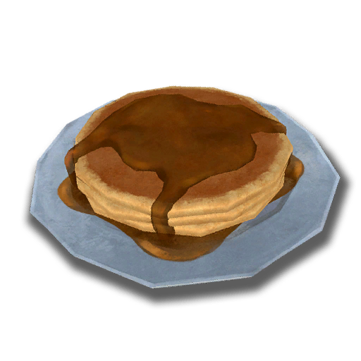

# Cooking Skillet

**Categories:** DLC Content, Pages with update history, Tools · **Source:** [Fandom](https://thelongdark.fandom.com/wiki/Cooking_Skillet)

**Contents**

- [Overview](#overview)
- [Locations](#locations)
- [Recipes](#recipes)
- [Update history](#update-history)

_Ptarmigan\_icon.png_

**DLC-Exclusive content.** / This content requires the [Tales from the Far Territory](./Tales%20from%20the%20Far%20Territory.md) addon to be installed before it can be seen or used in regular gameplay.

_Cooking\_Skillet\_icon.png_

**Release:** [21 June 2023](./The%20Long%20Dark%20%E2%80%94%20Changelog.md#2.17)

**Wintermute:** No

**Renewable:** No

**Properties**

**Item type:** [Tools](./Tools.md)\|-

**Stackable:** No

**Examine:** A pan for cooking and frying.

**Values**

**Weight:** 1.00 kg (2.2 lbs)

**Actions**

**Backpack:** Use, Actions, Drop

**On ground:** Take It, Leave It

**Advanced data**

**Item key:** GAMEPLAY\_Skillet

Image

Recipe Name

Weight

Cooking Times

Cooking Level

_Acorn\_Pancakes\_icon.png_

[Acorn Pancakes](./Acorn%20Pancakes.md)

0.10 kg

12 min

2

_Pancakes\_icon.png_

[Pancakes](./Pancakes.md)

0.10 kg

12 min

2

_Peach\_Pie\_icon.png_

[Peach Pie](./Peach%20Pie.md) (3)

0.15 kg

1 hr 20 min

3

_Ptarmigan\_Pie\_icon.png_

[Ptarmigan Pie](./Ptarmigan%20Pie.md) (3)

0.15 kg

1 hr 20 min

3

_Rabbit\_Pie\_icon.png_

[Rabbit Pie](./Rabbit%20Pie.md) (3)

0.15 kg

1 hr 20 min

3

_Rose\_Hip\_Pie\_icon.png_

[Rose Hip Pie](./Rose%20Hip%20Pie.md) (3)

0.15 kg

1 hr 20 min

3

_Venison\_Pie\_icon.png_

[Venison Pie](./Venison%20Pie.md) (3)

0.15 kg

1 hr 20 min

3

Image

Recipe Name

Weight

Cooking Times

Cooking Level

_Cooking\_Oil\_icon.png_

[Cooking Oil](./Cooking%20Oil.md)

0.75 kg

24 min

1

Image

Recipe Name

Weight

Cooking Times

Cooking Level

_Acorn\_Bannock\_icon.png_

[Acorn Bannock](./Acorn%20Bannock.md) (2)

0.10 kg

40 min

2

_Bannock\_icon.png_

[Bannock](./Bannock.md) (2)

0.10 kg

40 min

2

Image

Recipe Name

Weight

Cooking Times

Cooking Level

_Breyerhouse\_Pie\_icon.png_

[Breyerhouse Pie](./Breyerhouse%20Pie.md)

0.20 kg

56 min

5

_Coastal\_Fishcakes\_icon.png_

[Coastal Fishcakes](./Coastal%20Fishcakes.md) (4)

0.053 kg

25 min

5

_Dockworker's\_Pie\_icon.png_

[Dockworker's Pie](./Dockworker%27s%20Pie.md)

0.30 kg

80 min

5

_Lily's\_Pancakes\_icon.png_

[Lily's Pancakes](./Lily%27s%20Pancakes.md)

0.20 kg

10 min

4

_Pemmican\_Bar\_icon.png_

[Pemmican Bar](./Pemmican%20Bar.md) (4)

0.25 kg

40 min

5

_Prepper's\_Pie\_icon.png_

[Prepper's Pie](./Prepper%27s%20Pie.md)

0.20 kg

80 min

5

_Stalker's\_Pie\_icon.png_

[Stalker's Pie](./Stalker%27s%20Pie.md)

0.20 kg

80 min

5

_The early design for the skillet, a harvestable object called the [Metal Pan](./Metal%20Pan.md)_
