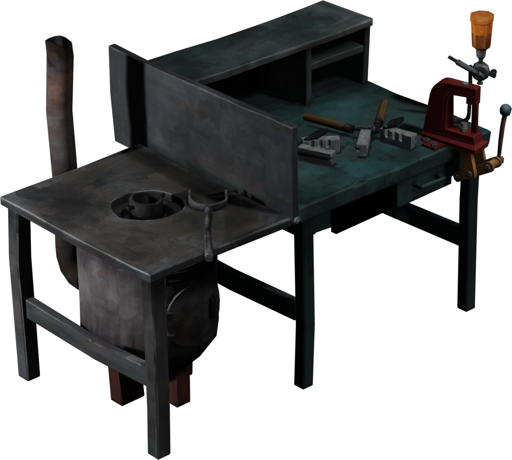
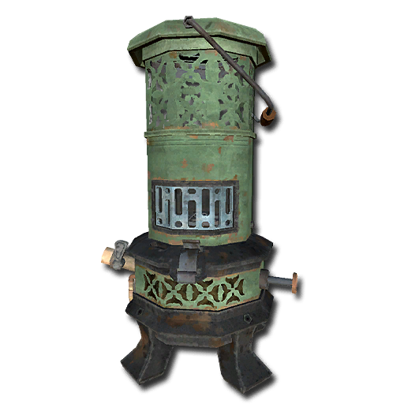

# Cooking

**Categories:** DLC Content, Skills · **Source:** [Fandom](https://thelongdark.fandom.com/wiki/Cooking)

**Contents**

- [How to cook](#how-to-cook)
- [Equipment](#equipment)
- [Firebox cooking slots](#firebox-cooking-slots)
- [Types of food](#types-of-food)
- [Meat](#meat)
- [Fish](#fish)
- [Canned](#canned)
- [Drinks](#drinks)
- [Edible Prepared Plants](#edible-prepared-plants)
- [Frontier Cooking Recipes](#frontier-cooking-recipes)
- [Preparing Recipes](#preparing-recipes)
- [Ingredients](#ingredients)
- [Cooking Pot Recipes](#cooking-pot-recipes)
- [Cooking Skillet Recipes](#cooking-skillet-recipes)
- [No Tool Recipes](#no-tool-recipes)
- [Removing from fire](#removing-from-fire)
- [Skill levels](#skill-levels)
- [Gallery](#gallery)

**Cooking**

_Cooking\_background.png_

**Release:** [Penitent Scholar (v0.346)](./The%20Long%20Dark%20%E2%80%94%20Early%20Access%20Changelog.md#0.346)

**Date:** 23 June 2016

_Cooking.png_

**Cooking** is a Survival [Skill](./Skills.md) that is used to prepare or craft [Food and Drink](./Food%20And%20Drink.md). Cooking offers several benefits, including increasing the condition of raw food and reducing the risk of [Food Poisoning](./Food%20Poisoning.md). There are many different types of food in _[The Long Dark](./The%20Long%20Dark.md)_, each providing different amounts of calories and special buffs and debuffs only available by using this Skill. Cooking also has a larger variety of training options than any other Skill, due to the number of food types and drinks that can be cooked.

## How to cook

_old menu_ Cooking is one of the easiest skills to train in _The Long Dark_, as players can increase their skill by cooking any food or drink item. There are dozens of options for fish, meat, harvestable plants, tradeable cooking ingredients and a vast number of dishes and drinks that the player can craft; each of these options grants cooking experience, making Cooking as a skill the easiest to level up in the game. For players who own the [Tales from the Far Territory](./Tales%20from%20the%20Far%20Territory.md) DLC especially, the update "Frontier Comforts" added an entire cooking system with new dishes, recipe cards that can be collected throughout Great Bear and new ingredients all around the island..

Players can cook food and drinks on any [Fire](./Fire.md) using the one-to-six possible cooking slots depending on the type of fire. There is no difference between cooking over a [Campfire](./Fire.md#Campfire) and [contained fire](./Fire.md#Contained_fires) (Campfire, Rim Grill, Pot Belly, Fire Barrel, etc.).

Players can then select the food item, drink or cooking container from the radial menu or inventory and place it next to the fire in a designated cooking slot. When using a cooking tool, the player can "use" the placed [can](./Can.md), [cooking pot](./Cooking%20Pot.md) or [skillet](./Cooking%20Skillet.md) to select which food or drink to cook.

## Equipment

Players need a Fire before they can start cooking, and certain pieces of equipment can be used to assist with cooking.

| Image | Equipment | Benefit |
| --- | --- | --- |
| \[Missing image: Fire\_icon.png\] / _Fire\_icon.png_ | [Fire](./Fire.md#Types_of_fires) | - Used to cook any [canned food](#canned) and meat. / - The Can, Cooking Pot and Cooking Skillet can be used on it to prepare dishes. / - Includes player-made campfires and contained fires made in existing fireboxes. |
|  / _Anywhere\_icon.png_ | No Tool | - Used exclusively to cook [Bannock](./Bannock.md) and [Acorn Bannock](./Acorn%20Bannock.md) without a [Cooking Skillet](./Cooking%20Skillet.md) / - Alternative method of heating food/drink in inventory on an active Cooking Slot |
|  / _Recycled\_Can\_icon.png_ | [Recycled Can](./Recycled%20Can.md) | - Used to cook canned foods. / - Can melt and boil up to 0.5 liters of [water](./Water%20%28Unsafe%29.md) at a time. / - Used to craft or heat up any drink in the game. / - Used to boil [Prepared Acorns](./Prepared%20Acorns.md). |
|  / _Cooking\_Pot\_icon.png_ | [Cooking Pot](./Cooking%20Pot.md) | - Used to cook Cooking Pot Recipes. / - Used to cook canned foods. / - Used to cook any meat or fish in the game. / - Can melt and boil up to 2.0 litres of water at a time. / - Cooking times reduced by 20%. / - Food takes 50% longer to burn. |
|  / _Cooking\_Skillet\_icon.png_ | [Cooking Skillet](./Cooking%20Skillet.md) | - Used to cook Skillet Recipes. / - Used to cook canned foods. / - Used to cook any meat or fish in the game. / - Can melt and boil up to 1.0 litres of water at a time. / - Cooking times reduced by 20%. / - Food takes 50% longer to burn. |

## Firebox cooking slots

_Placing teas and canned goods near an active fire will warm/cook them, without sacrificing a cooking slot._ Different fireplaces provide different amounts of cooking slots, allowing for more or less efficient usage of fuel/places to cook food and water. It's important to note that canned goods and drinks can be placed from the inventory or radial menu in the direct vicinity of a fire and can be heated/cooked without sacrificing a cooking slot.

Image

Name

Cooking Slots

_Ammunition\_Forge.png_

[Ammunition Forge](./Ammunition%20Forge.md)

0

_Pot\_belly\_stove.png_

[Pot Belly Stove](./Pot%20Belly%20Stove.md)

1

_Forge.png_

[Furnace](./Furnace.md)

1

_McLeod\_Ultra-Efficiency\_Whale\_Oil\_Heater\_icon.png_

[McLeod Ultra-Efficiency Whale Oil Heater](./McLeod%20Ultra-Efficiency%20Whale%20Oil%20Heater.md)

1

_Prototype\_Train\_Interior.jpg_

[Prototype Train](./Prototype%20Train.md) (Engine cooking slot)

1

_Fire\_radial\_icon.png_

[Campfire](./Campfire.md)

2

_Fire\_barrel.png_

[Fire Barrel](./Fire%20Barrel.md)

2

_Fire\_place.png_

[Fireplace](./Fireplace.md)

2

_Screen\_ab2c5b97-8817-4398-a5b1-fb4b96024b93\_hi.png_

[Rim Grill](./Rim%20Grill.md)

2

_Wood\_stove.png_

[Wood Stove](./Wood%20Stove.md)

2

_Stove.png_

[Stove](./Stove.md)

6

## Types of food

### Meat

Players can obtain raw meat from [Harvesting](./Harvesting.md) animal carcasses. See the Energy density column below to maximize use of your calorie meter.

Image

Name

Cooking time (min/kg)[¹](#fn1)

Energy density (kcal/kg)

Notes

_Rabbit\_(Cooked)\_icon.png_

[Rabbit (Cooked)](./Rabbit%20%28Cooked%29.md)

38

450 kcal / kg / _(205 kcal / lb)_

Obtained by cooking raw rabbit meat [harvested](./Harvesting.md) from a [Rabbit Carcass](./Rabbit%20Carcass.md)

_Venison\_(Cooked)\_icon.png_

[Venison (Cooked)](./Venison%20%28Cooked%29.md)

57

800 kcal / kg / _(364 kcal / lb)_

Obtained by cooking raw venison harvested from a [Deer](./Deer.md) carcass

_Wolf\_Meat\_(Cooked)\_icon.png_

[Wolf Meat (Cooked)](./Wolf%20Meat%20%28Cooked%29.md)

69

700 kcal / kg / _(318 kcal / lb)_

Obtained by cooking raw wolf meat harvested from a [Wolf](./Wolf.md) or [Timberwolf](./Timberwolf.md) carcass

_Bear\_Meat\_(Cooked)\_icon.png_

[Bear Meat (Cooked)](./Bear%20Meat%20%28Cooked%29.md)

82

900 kcal / kg / _(409 kcal / lb)_

Obtained by cooking raw black bear meat harvested from a black [Bear](./Bear.md) carcass

_Moose\_Meat\_(Cooked)\_icon.png_

[Moose Meat (Cooked)](./Moose%20Meat%20%28Cooked%29.md)

82

900 kcal / kg / _(409 kcal / lb)_

Obtained by cooking raw moose meat harvested from a [Moose](./Moose.md) carcass

_Ptarmigan\_(Cooked)\_icon.png_

[Ptarmigan (Cooked)](./Ptarmigan%20%28Cooked%29.md)

38

450 kcal / kg / _(205 kcal / lb)_

Obtained by cooking ptarmigan meat harvested from a [Ptarmigan Carcass](./Ptarmigan%20Carcass.md).

_Cougar\_Meat\_(Cooked)\_icon.png_

[Cougar Meat (Cooked)](./Cougar%20Meat%20%28Cooked%29.md)

75

800 kcal / kg / _(364 kcal / lb)_

Obtained by cooking raw cougar meat harvested from a [Cougar](./Cougar.md) carcass

### Fish

Players can obtain raw fish from sufficiently deep bodies of Salt or Fresh water by [Ice Fishing](./Ice%20Fishing.md). Cooking fish also produces a small amount of [Lantern Fuel](./Lantern%20Fuel.md). See the Energy density column below to maximize use of your calorie meter.

Image

Name

Cooking time (min/kg) [²](#fn2)

Energy density

Notes

_Lake\_Whitefish\_(Cooked)\_icon.png_

[Lake Whitefish (Cooked)](./Lake%20Whitefish%20%28Cooked%29.md)

21

383.33 kcal / kg / _(174 kcal / lb)_

Obtained by cooking raw [Lake Whitefish](./Lake%20Whitefish%20%28Raw%29.md) fished from a freshwater location.

_Rainbow\_Trout\_(Cooked)\_icon.png_

[Rainbow Trout (Cooked)](./Rainbow%20Trout%20%28Cooked%29.md)

19

383.33 kcal / kg / _(174 kcal / lb)_

Obtained by cooking raw [Rainbow Trout](./Rainbow%20Trout%20%28Raw%29.md) fished from a saltwater location.

_Coho\_Salmon\_(Cooked)\_icon.png_

[Coho Salmon (Cooked)](./Coho%20Salmon%20%28Cooked%29.md)

12

445.95 kcal / kg / _(203 kcal / lb)_

Obtained by cooking raw [Coho Salmon](./Coho%20Salmon%20%28Raw%29.md) fished from a saltwater location.

_Smallmouth\_Bass\_(Cooked)\_icon.png_

[Smallmouth Bass (Cooked)](./Smallmouth%20Bass%20%28Cooked%29.md)

15

454.55 kcal / kg / _(207 kcal / lb)_

Obtained by cooking raw [Smallmouth Bass](./Smallmouth%20Bass%20%28Raw%29.md) fished from a freshwater location.

_Burbot\_(Cooked)\_icon.png_

[Burbot (Cooked)](./Burbot%20%28Cooked%29.md)

12

487.71 kcal / kg / _(222 kcal / lb)_

Obtained by cooking raw [Burbot](./Burbot%20%28Raw%29.md) fished from a freshwater location.

_Rockfish\_(Cooked)\_icon.png_

[Rockfish (Cooked)](./Rockfish%20%28Cooked%29.md)

11

449.31 kcal / kg / _(204 kcal / lb)_

Obtained by cooking raw [Rockfish](./Rockfish%20%28Raw%29.md) fished from a saltwater location.

_Red\_Irish\_Lord\_(Cooked)\_icon.png_

[Red Irish Lord (Cooked)](./Red%20Irish%20Lord%20%28Cooked%29.md)

16

451.32 kcal / kg / _(205 kcal / lb)_

Obtained by cooking raw [Red Irish Lord](./Red%20Irish%20Lord%20%28Raw%29.md) fished from a saltwater location.

_Goldeye\_(Cooked)\_icon.png_

[Goldeye (Cooked)](./Goldeye%20%28Cooked%29.md)

17

452.24 kcal / kg / _(206 kcal / lb)_

Obtained by cooking raw [Goldeye](./Goldeye%20%28Raw%29.md) fished from a freshwater location.

### Canned

Players can obtain canned goods by scavenging throughout their playthrough. Canned goods requires a [Can Opener](./Can%20Opener.md), [Hunting Knife](./Hunting%20Knife.md), or [Hatchet](./Hatchet.md) to be opened to retain the full contents. If the player does not have any of these tools, they can also smash the can open, but this results in losing between 10% and 30% of the contents to spillage if the player's Cooking level is less than 3. Smashing cans will not yield a Recycled Can once the contents are eaten, regardless of skill level. The cooking time for canned goods is 15 minutes when cooked directly on a Fire, but is 24 when placed next to one. Any canned foods not listed here cannot be cooked.

Image

Name

Energy density

Notes

_Canned\_Pineapple\_icon.png_

[Canned Pineapple](./Canned%20Pineapple.md)

737.5 kcal / kg / _(335 kcal / lb)_

Consuming while Hot also provides the Warming Up buff to the player.

_Canned\_Corn\_icon.png_

[Canned Corn](./Canned%20Corn.md)

983.3 kcal / kg / _(447 kcal / lb)_

Consuming while Hot also provides the Warming Up buff to the player.

_Pinnacle\_Peaches\_icon.png_

[Pinnacle Peaches](./Pinnacle%20Peaches.md)

900 kcal / kg / _(409 kcal / lb)_

Consuming while Hot also provides the Warming Up buff to the player.

_Tomato\_Soup\_icon.png_

[Tomato Soup](./Tomato%20Soup.md)

1200 kcal / kg / _(545 kcal / lb)_

Consuming while Hot also provides the Warming Up buff to the player.

_Pork\_and\_Beans\_icon.png_

[Pork and Beans](./Pork%20and%20Beans.md)

2400 kcal / kg / _(1,091 kcal / lb)_

Consuming while Hot also provides the Warming Up buff to the player.

### Drinks

Players can obtain hot drinks from brewing a [Tin of Coffee](./Tin%20of%20Coffee.md), [Herbal Tea](./Herbal%20Tea.md), [Acorn Coffee](./Cup%20of%20Acorn%20Coffee.md) or by preparing plants found across the island with 0.25 litres of potable water ([Rose Hip Tea](./Rose%20Hip%20Tea.md), [Birch Bark Tea](./Birch%20Bark%20Tea.md), etc.). Drinks cooked in a Recycled Can directly on a Fire take 12 minutes to cook; reheating takes 33% less time (8 minutes in a recycled can); they may also be cooked in a Cooking Pot or Cooking Skillet. Each drink weighs 0.1 kg and has 100 kcal and, when consumed Hot, provides a [Warming Up](./Warming%20Up.md) bonus to the player.

Image

Name

Bonus/Affliction

Ingredient (+0.25L water)

Ingredient weight

Materials weight

_Birch\_Bark\_Tea\_icon.png_

[Birch Bark Tea](./Birch%20Bark%20Tea.md)

Bonus [Restore Condition](./Restore%20Condition.md)

[Prepared Birch Bark](./Prepared%20Birch%20Bark.md)

0.05 kg / _(0.11 lb)_

0.10 kg / _(0.22 lb)_

_Burdock\_Tea\_icon.png_

[Burdock Tea](./Burdock%20Tea.md)

Cures [Food Poisoning](./Food%20Poisoning.md), [Infection](./Infection.md), [Dysentery](./Dysentery.md) and [Internal Parasites](./Intestinal%20Parasites.md).

[Prepared Burdock](./Prepared%20Burdock.md)

0.15 kg / _(0.33 lb)_

N/A

_Cup\_of\_Acorn\_Coffee\_icon.png_

[Cup of Acorn Coffee](./Cup%20of%20Acorn%20Coffee.md)

Bonus [Fatigue Reduced](./Fatigue%20Reduced.md)

[Acorn Grounds](./Acorn%20Grounds.md)

0.20 kg / _(0.44 lb)_

N/A

_Cup\_of\_Coffee\_icon.png_

[Cup of Coffee](./Cup%20of%20Coffee.md)

Bonus [Fatigue Reduced](./Fatigue%20Reduced.md)

[Tin of Coffee](./Tin%20of%20Coffee.md)

0.01 kg / _(0.022 lb)_

N/A

_Cup\_of\_Herbal\_Tea\_icon.png_

[Cup of Herbal Tea](./Cup%20of%20Herbal%20Tea.md)

Bonus [Improved Rest](./Improved%20Rest.md)

[Herbal Tea](./Herbal%20Tea.md)

0.01 kg / _(0.022 lb)_

N/A

_Reishi\_Tea\_icon.png_

[Reishi Tea](./Reishi%20Tea.md)

Cures [Food Poisoning](./Food%20Poisoning.md), [Infection](./Infection.md), [Dysentery](./Dysentery.md) and [Internal Parasites](./Intestinal%20Parasites.md).

[Prepared Reishi Mushrooms](./Prepared%20Reishi%20Mushrooms.md)

0.05 kg / _(0.11 lb)_

0.10 kg / _(0.22 lb)_

_Rose\_Hip\_Tea\_icon.png_

[Rose Hip Tea](./Rose%20Hip%20Tea.md)

Cures the [Pain](./Pain.md) [Affliction](./Afflictions.md).

[Prepared Rose Hips](./Prepared%20Rose%20Hips.md)

0.05 kg / _(0.11 lb)_

0.24 kg / _(0.528 lb)_

### Edible Prepared Plants

Some plants can be cooked and eaten as is. Acorns are a unique food that can be found near [Oak Trees](./Oak%20Tree.md) and must be shelled before cooking. Potatoes can be used in recipes or cooked.

Image

Name

Energy density

Ingredient (+0.25L water)

Ingredient weight

Materials weight

_Acorns\_(Cooked)\_icon.png_

[Acorns (Cooked)](./Acorns%20%28Cooked%29.md)

80 kcal

[Prepared Acorns](./Prepared%20Acorns.md)

0.05 kg / _(0.11 lb)_

N/A

_Acorns\_(Cooked\_-\_Large\_Portion)\_icon.png_

[Acorns (Cooked - Large Portion)](./Acorns%20%28Cooked%20-%20Large%20Portion%29.md)

400 kcal

[Prepared Acorns (Large Portion)](./Prepared%20Acorns%20%28Large%20Portion%29.md)

0.20 kg / _(0.44 lb)_

N/A

_Cooked\_Potato\_icon.png_

[Cooked Potato](./Cooked%20Potato.md)

250 kcal

[Potato](./Potato.md) (does not need water to cook)

0.20 kg / _(0.44 lb)_

0.15 kg / _(0.33 lb)_

## Frontier Cooking Recipes

| Column 1 | Column 2 | Column 3 |
| --- | --- | --- |

## Notes

---

1. When cooked directly on a [fire](./Fire.md). Times scale to weight cooked _(i.e., 0.5 kilograms cooks in half the time that 1.0 kilograms does)._[↩︎](#fnref1)
2. When cooked directly on a [fire](./Fire.md). Times scale to weight cooked _(i.e., 0.5 kilograms cooks in half the time that 1.0 kilograms does)._[↩︎](#fnref2)
